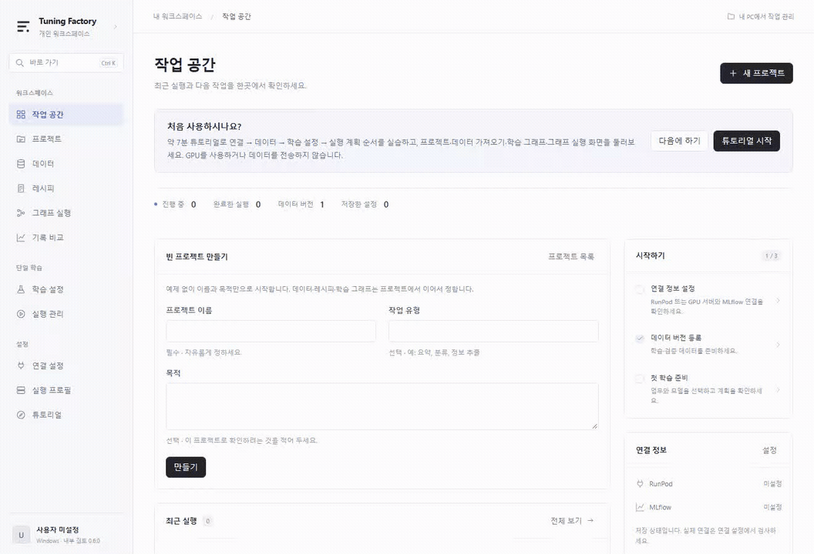

# LLM Tuning Factory

**업무 목적과 데이터에서 시작해, 추적 가능한 파인튜닝 흐름으로.**

Windows 작업 공간에서 데이터를 준비하고, 레시피를 재사용하며, 여러 실험을 그래프로
연결해 실행 계획을 검토합니다. 학습은 배정받은 RunPod Pod나 SSH로 접속하는 기관 GPU
서버에서 LLaMA-Factory로 실행하고, 산출물을 회수해 MLflow 기록으로 비교합니다.

[English](README.md) · **한국어**

[사용 흐름](#사용-흐름) · [빠른 시작](#빠른-시작) · [학습 지원](#학습-지원) · [검증](#검증과-한계) · [문서](#문서)

## 사용 흐름

논문에서 필요한 항목을 구조화해 추출하는 AI를 만든다고 가정해 보세요.
프로젝트를 만들고 질문·맥락·답변 열을 연결한 뒤, 학습 조건을 비교하고
GPU 시간을 쓰기 전에 실행 계획부터 확인합니다.

GIF는 **실제 데스크톱 프런트엔드를 로컬 테스트 브리지와 합성 예제로 촬영한 화면**입니다.
백엔드 응답·자원·가격은 모의 값입니다. 실제 GPU 학습이나 모델 품질을 보여주는 영상이
아닙니다. 이 문서는 한국어 UI 영상, [영어 문서](README.md)는 영어 UI 영상을 사용합니다.
[촬영 방식과 재현 방법](docs/images/README.md).

### 1. 해결할 업무부터 정하기

이름과 목적을 자유롭게 정한 빈 프로젝트를 만듭니다. 데이터 연결과 학습 그래프를
한 프로젝트에 보관해, 해결하려는 문제를 중심으로 실험을 관리합니다.


### 2. 가지고 있는 표를 학습 데이터로 바꾸기

CSV·JSON·JSONL을 가져와 열을 학습 항목에 연결하고, 등록 전에 샘플을 확인합니다.
바뀌지 않는 버전과 콘텐츠 해시로 실험에 쓴 데이터를 식별합니다.
학습·검증·시험 데이터를 나누어 평가 입력을 구분할 수 있습니다.



### 3. 레시피를 재사용하고 실험 연결하기

이름 붙인 학습 레시피를 저장해 여러 프로젝트에서 재사용합니다. 학습을 나란히 놓고
그 뒤에 평가를 연결하면 카드와 그래프 미리보기에 함께 반영됩니다.
호환성과 필요한 근거가 충족되면 자동 선택·병합·전체 모델 확정 단계도 연결할 수 있습니다.


### 4. 실행 전에 계획 확인하기

기본은 모의 실행입니다. 입력 데이터·실행 위치·시간 제한·예상 비용을 검토한 뒤
제출합니다. 실제 실행에는 실행 승인과 데이터 전송 승인이 각각 필요하며,
예상 비용은 제공자의 청구 상한이 아닙니다. GIF는 기본 경로인
**모의 계획과 모의 실행 등록**을 보여줍니다.


### 5. 실행 경과와 근거 남기기

백그라운드 컨트롤러는 창을 닫아도 승인한 그래프를 진행합니다. 관리 PC는 켜 두어야 합니다.
실제 학습 로그, 체크포인트·복구 정보, 회수한 산출물을 확인하고 MLflow로 설정과 지표를
비교합니다. 명세서와 체크섬으로 데이터·소스·산출물의 출처를 추적합니다.
실제 합성 데이터 GPU 시험은 [진행 기록](docs/PROGRESS.md)과
[H100 인수 시험](docs/GPU_ACCEPTANCE_2026-10-15.md)에 따로 기록했습니다.

## 빠른 시작

### Windows 앱

[Windows v0.6.1 프리릴리스](https://github.com/ParkYaeseong/llm-tuning-factory/releases/tag/v0.6.1)에서
영어/한국어 UI가 포함된 설치 파일과 SHA-256 체크섬을 내려받을 수 있습니다.
코드 서명하지 않은 Windows x64 설치 파일에 Python 관리 엔진이 포함되며,
학습 라이브러리는 원격 GPU 머신에서 실행합니다.

1. 제공되는 Windows 설치 파일로 앱을 설치하고 작업 공간을 엽니다.
2. 오른쪽 위에서 **ENG / KOR**를 선택합니다. 선택은 이 PC에 저장되며 초기 기본값은 KOR입니다.
3. **튜토리얼 시작**을 눌러 포함된 연습 데이터로 둘러봅니다.
4. 프로젝트 생성 → 데이터 가져오기 → 레시피 저장 → 학습 그래프 구성 순서로 진행합니다.
5. 먼저 **모의 실행 계획**을 확인합니다.
6. 실제 학습을 준비할 때 본인의 실행 프로필과 MLflow 연결을 설정합니다.

언어는 즉시 바뀌며 작성 중인 값과 검토한 계획은 유지됩니다. 프로젝트명·데이터·모델 ID와
원본 진단·로그는 원문을 유지합니다. 언어 변경으로 연결 정보를 저장하거나 작업을 제출하지 않습니다.

튜토리얼에는 인증 정보나 GPU가 필요 없으며 데이터를 전송하지 않습니다.
연습 데이터로는 실제 학습을 시작할 수 없습니다.
[Windows 안내](docs/WINDOWS_APP.md)와 [프로젝트·그래프 안내](docs/TRAINING_WORKFLOWS.md)에는
이전 0.4.0 기준 설명이 포함되어 있습니다.

### CLI: GPU 없이 파이프라인 체험

[uv](https://docs.astral.sh/uv/)를 설치하고 Python 3.12로 실행합니다.

```powershell
git clone https://github.com/ParkYaeseong/llm-tuning-factory.git
cd llm-tuning-factory
uv sync --python 3.12 --extra dev --extra tracking --locked
uv run factory dataset-register dummy 1 examples/dummy.json --synthetic
uv run factory validate configs/ai/paper_extraction.yaml
uv run factory plan configs/ai/paper_extraction.yaml
uv run factory run configs/ai/paper_extraction.yaml
uv run factory run configs/ai/paper_extraction.yaml --mock
uv run factory status
```

일반 `run`은 계획을 출력합니다. `--mock`은 실제 모델·어댑터나 꾸며낸 loss·품질 점수 없이
모의 실행을 진행합니다. 위 오프라인 체험에는 `.env`가 필요 없습니다.

실제 연결을 설정할 때 `.env.example`을 `.env`로 복사하고 본인의 값을 입력합니다.
PowerShell은 `Copy-Item .env.example .env`, Linux/macOS는 `cp .env.example .env`를 사용합니다.
CLI는 `.env`를 읽으며 셸 환경변수가 우선합니다. `factory doctor`로 설정한 연결을 점검합니다.
인증 정보·개인키·로컬 상태는 Git에 넣지 않습니다. 실제 실행 전에는
[운영 안내](docs/OPERATIONS.md)를 따라 준비하세요.

## 학습 지원

| 기능 | 사용 목적 |
|---|---|
| PT·SFT·RM·PPO·DPO·KTO | 단계에 맞는 설정과 데이터 요구 조건 적용 |
| Full·Freeze·LoRA·4비트 QLoRA·OFT | 방식별 옵션을 레시피로 저장해 재사용 |
| 모델 목록·Hugging Face 조회 | revision 고정과 구조·런타임 호환성 확인 |
| RunPod·SSH 직접 실행 | PC에서 관리하고 배정된 GPU에서 학습 |
| S3 가져오기 | 객체 조회와 버전·해시를 고정한 크기 제한 파일 가져오기 |
| MLflow | 파라미터·지표·업로드한 산출물 기록과 실행 비교 |

위 표는 설정 기능의 범위이며 모든 모델에서 모든 조합의 동작을 보장하지 않습니다.
모델·단계·런타임·GPU에 따른 검사로 지원하지 않는 조합을 차단합니다.
[학습 방식·스토리지 안내](docs/TRAINING_AND_STORAGE.md)를 참고하세요.

## 검증과 한계

| 근거 | 실제 확인한 범위 |
|---|---|
| 이전 H100·H200 실행 | 합성 SFT, LoRA/QLoRA, 생성, 취소·재개, 산출물 회수와 MLflow 왕복 해시; 실행마다 범위가 다름 |
| 0.6.0 A40 실행 | Qwen3.5-0.8B SFT LoRA/QLoRA/full/freeze·DPO/PT, Qwen3.5-9B SFT LoRA, Gemma 4 E2B SFT LoRA·DPO/PT, 엔진 수준 RM |
| 0.6.0 모델 연산 | Qwen3.5 전체 모델 확정의 수치 검산과 후속 예측, 별도의 CPU 수치 검사 |
| README GIF | 로컬 모의 응답과 합성 예제를 사용한 실제 프런트엔드 조작 |

작은 합성 데이터로 확인한 엔지니어링 시험이며 **업무용 모델 품질의 검증 결과가 아닙니다.**
Qwen3.5·Gemma 4 KTO는 upstream 런타임 실패 후 차단했습니다.
긴 입력의 메모리 측정, 반복 출력 원인 확인, 느리거나 큰 산출물의 회수,
실제 그래프·SSH 시험 확대 등이 남아 있습니다. 설치 앱의 GPU 자동 시험은 회수 도중
시간 제한에 걸렸고, 이후 앱에서 완료를 확인했습니다.
[정확한 결과와 남은 작업](docs/PROGRESS.md).

각 PC는 별도의 SQLite 상태·작업 큐·GPU 잠금·비용 제한을 사용합니다.
공용 MLflow는 기록 저장소이며 PC 사이의 스케줄러가 아닙니다.
사용자별 Pod를 배정하거나 관리 PC 한 대를 정하세요. 기존 사용자 Pod는 빌려 쓰는
자원이므로 자동으로 중지하거나 삭제하지 않습니다. 유료 자원 생성과 데이터 전송에는
명시적인 승인이 필요합니다.

모델 서빙·다중 PC 스케줄링·범용 멀티모달 학습·임의 플러그인은 현재 범위 밖입니다.
업데이트·제거 전에는 컨트롤러 정지를 요청하고 실제 정지까지 기다리세요.
창을 닫는 것만으로 컨트롤러가 정지하지는 않습니다.

## 구조

**데스크톱 / CLI → 명세서·로컬 큐 → 실행 어댑터 → LLaMA-Factory → 산출물 / MLflow**

| 위치 | 역할 |
|---|---|
| `desktop/` | Tauri Windows 앱과 TypeScript 워크플로 UI |
| `src/tuning_factory/` | 설정·데이터·그래프 컨트롤러·분리된 학습 및 인프라 어댑터 |
| `configs/`, `examples/` | AI 설정·정책·합성 예제 |
| `containers/` | GPU 런타임 정의와 의존성 잠금 파일 |
| `tests/`, `scripts/` | 자동 검사·인수 시험 도구·데모 촬영 |
| `docs/` | 사용 안내·아키텍처·검증 기록 |

데이터 스냅샷, 확정 명세서, 소스·의존성 해시, 산출물 체크섬으로 개별 실행의 근거를 확인합니다.

## 개발

```powershell
uv sync --python 3.12 --extra dev --extra tracking --locked
uv run pytest
uv run ruff check src tests scripts
```

프런트엔드를 수정했다면 `desktop/`에서 `npm ci`, `npm run build`, `npm test`를 실행합니다.
Playwright Chromium이 필요하며, 실제 GPU 시험에는 별도 승인이 필요합니다.

## 문서

- [Windows 앱과 튜토리얼](docs/WINDOWS_APP.md)
- [프로젝트·데이터·레시피·학습 그래프](docs/TRAINING_WORKFLOWS.md)
- [학습 방식·모델·S3](docs/TRAINING_AND_STORAGE.md)
- [설정·평가 규격](docs/CONFIGURATION.md)
- [원격 실행과 운영](docs/OPERATIONS.md)
- [아키텍처](docs/ARCHITECTURE.md)
- [검증 이력과 남은 작업](docs/PROGRESS.md)
- [보안](SECURITY.md)
