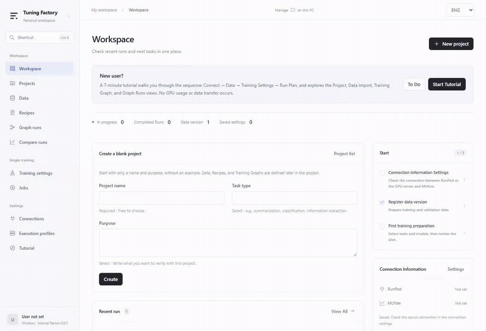
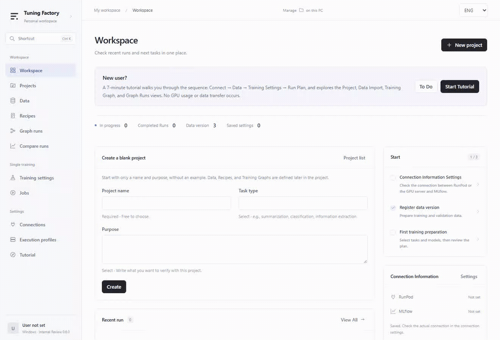

# LLM Tuning Factory

**Turn a task and a dataset into a traceable fine-tuning workflow.**

Prepare data, reuse recipes, connect experiments into a graph and review execution
plans from a Windows workspace. Run LLaMA-Factory on your assigned RunPod Pod or
institutional GPU server over SSH, then collect artifacts and compare records in MLflow.

**English** · [한국어](README.ko.md)

[Walkthrough](#walkthrough) · [Quickstart](#quickstart) · [Training support](#training-support) · [Verification](#verification-and-limits) · [Documentation](#documentation)

## Walkthrough

Suppose you want an assistant that extracts structured fields from papers. Start
with your task, map question/context/answer columns, compare training variants
and inspect a plan before committing GPU time.

The GIFs show the **actual desktop frontend with a local test bridge and synthetic
fixtures**. Backend responses, resources and prices are mocked. These clips show
UI behavior, not live GPU training or model quality. These recordings use the English UI.
[Recording details and reproduction](docs/images/README.md).

### 1. Start with your task

Create a blank project with a name and purpose. Keep its data bindings and training
graph together, so each experiment starts from the problem you want to solve.



### 2. Turn existing tables into training data

Import CSV, JSON or JSONL, map columns to training fields and inspect samples before
registration. Immutable versions and content hashes identify the data behind each
experiment. Register train/validation/test splits to keep evaluation inputs distinct.


### 3. Connect experiments and reuse recipes

Save named recipes and reuse them across projects. Add parallel training branches
and serial evaluation steps using cards and a shared graph preview. Selection,
merge and full-model materialization nodes support longer workflows where
compatibility and required evidence permit them.


### 4. Review the plan before execution

Dry-run is the default. Review inputs, destinations, time limits and estimated cost
before submission. Live execution requires separate execution and dataset-transfer
approvals. Estimates are not provider billing caps. This clip shows the default
**simulated** planning and submission path.



### 5. Follow the run and retain its evidence

The background controller advances approved graphs while the window is closed;
the controlling PC must stay on. Inspect native training logs, checkpoint/recovery
information and collected artifacts. Compare configurations and metrics in MLflow;
use manifests and checksums to trace data, source and artifact provenance.
Real synthetic-data GPU checks are recorded separately in
[Progress](docs/PROGRESS.md) and the [H100 report](docs/GPU_ACCEPTANCE_2026-10-15.md).

## Quickstart

### Windows app

Download the [Windows v0.6.1 prerelease](https://github.com/ParkYaeseong/llm-tuning-factory/releases/tag/v0.6.1),
including English/Korean UI and matching SHA-256 checksums.
The unsigned Windows x64 installer bundles the Python control engine. Training
libraries run on the remote GPU machine.

1. Install an available Windows build and open the workspace.
2. Select **ENG** or **KOR** at the top right. The choice is saved on this PC; the initial default is KOR.
3. Choose **Start tutorial** to explore bundled practice data.
4. Create a project, import data, save a recipe and build a training graph.
5. Inspect a **dry-run plan** first.
6. Configure your execution profile and MLflow connection for live training.

Language changes take effect immediately and preserve drafts and reviewed plans.
Project names, datasets, model identifiers and original diagnostics/logs retain their
original content. Changing the language does not save connections or submit jobs.

The tutorial needs no credentials or GPU and transfers no data. Practice data is
blocked from real training. The [Windows guide](docs/WINDOWS_APP.md) and
[project/graph guide](docs/TRAINING_WORKFLOWS.md) are in Korean and include
historical 0.4.0 instructions.

### CLI: try the pipeline without a GPU

Install [uv](https://docs.astral.sh/uv/) and use Python 3.12:

```powershell
git clone https://github.com/ParkYaeseong/llm-tuning-factory.git
cd llm-tuning-factory
uv sync --python 3.12 --extra dev --extra tracking --locked
uv run factory dataset-register dummy 1 examples/dummy.json --synthetic
uv run factory validate configs/ai/paper_extraction.yaml
uv run factory plan configs/ai/paper_extraction.yaml
uv run factory run configs/ai/paper_extraction.yaml
uv run factory run configs/ai/paper_extraction.yaml --mock
uv run factory status
```

Plain `run` prints a plan. `--mock` explicitly executes a simulation without a real
model/adapter or fabricated loss/quality scores. No `.env` is needed for this
initial offline walkthrough.

For live connections, copy `.env.example` to `.env` (`Copy-Item .env.example .env`
in PowerShell, `cp .env.example .env` on Linux/macOS) and enter your own values.
The CLI loads `.env`; shell variables take precedence. `factory doctor` checks
configured connections. Keep credentials, private keys and local state out of Git.
Follow the [operations guide](docs/OPERATIONS.md) before live execution.

## Training support

| Capability | How it fits the workflow |
|---|---|
| PT, SFT, RM, PPO, DPO, KTO | Stage-aware settings and dataset requirements |
| Full, Freeze, LoRA, 4-bit QLoRA, OFT | Reusable recipes with method-specific options |
| Model catalog and Hugging Face lookup | Pin revisions and check architecture/runtime compatibility |
| RunPod and direct SSH | Manage locally and train on an assigned GPU |
| S3 import | Browse objects and import bounded files with pinned versions/hashes |
| MLflow | Record parameters, metrics and uploaded artifacts; compare runs |

These are configuration surfaces, not a promise that every combination works on
every model. Model-, stage-, runtime- and GPU-specific checks refuse unsupported
combinations. See [training and storage](docs/TRAINING_AND_STORAGE.md).

## Verification and limits

| Evidence | Actual scope |
|---|---|
| Earlier H100/H200 runs | Synthetic SFT, LoRA/QLoRA, generation, cancellation/resume, artifact collection and MLflow round-trip hashes; scope varies by run |
| 0.6.0 A40 runs | Qwen3.5-0.8B SFT LoRA/QLoRA/full/freeze and DPO/PT; Qwen3.5-9B SFT LoRA; Gemma 4 E2B SFT LoRA/DPO/PT; engine-level RM |
| 0.6.0 model operations | Qwen3.5 materialization with numerical receipt and subsequent prediction; separate CPU numerical checks |
| README GIFs | Real frontend interactions against local mocks and synthetic fixtures |

These engineering checks use small synthetic datasets; they **do not establish
task-model quality**. Qwen3.5/Gemma 4 KTO is blocked after upstream runtime failures.
Outstanding work includes long-input memory checks, repeated-output diagnosis,
slow/large artifact downloads and broader live graph/SSH coverage. Installed-app
GPU automation timed out during retrieval; completion was observed later in the app.
[Exact results and outstanding work](docs/PROGRESS.md).

Each PC has its own SQLite state, queue, GPU leases and budget controls. Shared
MLflow stores records; it does not coordinate scheduling across PCs. Assign Pods
per user or designate one controlling PC. Existing user Pods are borrowed: never
automatically stop or delete them. Paid provisioning and dataset transfers require
explicit authorization.

Model serving, multi-PC scheduling, general multimodal training and arbitrary
plugins are outside the current scope. Before updating or uninstalling, request
controller shutdown and wait for it to stop; closing the window leaves it running.

## Architecture

**Desktop / CLI → manifests and local queue → execution adapter → LLaMA-Factory → artifacts / MLflow**

| Location | Responsibility |
|---|---|
| `desktop/` | Tauri Windows shell and TypeScript workflow UI |
| `src/tuning_factory/` | Configuration, data, graph controller, separate training and infrastructure adapters |
| `configs/`, `examples/` | AI settings, policy and synthetic samples |
| `containers/` | GPU runtime definitions and dependency locks |
| `tests/`, `scripts/` | Automated checks, acceptance tools and demo recording |
| `docs/` | User guides, architecture and recorded verification |

Dataset snapshots, resolved manifests, source/dependency hashes and artifact
checksums make individual runs inspectable.

## Development

```powershell
uv sync --python 3.12 --extra dev --extra tracking --locked
uv run pytest
uv run ruff check src tests scripts
```

For frontend changes, run `npm ci`, `npm run build` and `npm test` from `desktop/`
(Playwright Chromium required). Real GPU checks require separate authorization.

## Documentation

- [Windows app and tutorial](docs/WINDOWS_APP.md)
- [Projects, datasets, recipes and training graphs](docs/TRAINING_WORKFLOWS.md)
- [Training methods, models and S3](docs/TRAINING_AND_STORAGE.md)
- [Configuration and evaluation](docs/CONFIGURATION.md)
- [Remote execution and operations](docs/OPERATIONS.md)
- [Architecture](docs/ARCHITECTURE.md)
- [Verification history and remaining work](docs/PROGRESS.md)
- [Security](SECURITY.md)
