# Architecture

```mermaid
flowchart LR
  CLI --> Registry[Dataset and AI Registry]
  Registry --> Manifest[Resolved Manifest]
  Manifest --> Queue[SQLite Job Queue]
  Queue --> Policy[Resource and Approval Policy]
  Policy --> Executor[ExecutionBackend]
  Executor --> Mock[Local Simulation]
  Executor --> Pod[RunPod SSH Worker]
  Pod --> Engine[LlamaFactoryBackend]
  Engine --> Volume[Persistent Network Volume]
  Volume --> Collector[Hash-Verified Control Plane Copy]
  Collector --> Evaluation[Evaluator]
  Evaluation --> Tracking[MLflow Tracking and Artifacts]
  Tracking --> Candidate[Model Candidate - Approval Pending]
```

## Boundaries

`config.py` defines the common contract. `registry.py` owns content-addressed datasets and AI revisions.
`manifest.py` resolves and hashes configuration, dataset identity, exact model/tokenizer revisions, source tree,
Git commit, translated training settings and dependency lockfiles. Git commit identifies the last commit;
source SHA-256 also captures uncommitted Python edits. Manifests do not contain timestamps or job IDs,
so equivalent requests deduplicate; each submitted execution has a separate job ID and attempt history.

`TrainingBackend` exposes validate_config, prepare, train, resume, collect_artifacts and cleanup.
`LlamaFactoryBackend` delegates training to the official `llamafactory-cli train` command. MockTrainingBackend
exists only for pipeline tests. Adding another production engine requires a new adapter, not changes to AI workflows.

`ExecutionBackend` is independent of training. `LocalExecutor` is used for simulation. `SSHExecutor` transfers an
isolated per-attempt directory into an approved Pod's persistent volume and starts a detached worker.
The worker checks source, engine version, manifest, dataset and training YAML before training.
Worker timeout/cancellation kills the training process group. A completion marker is published after the artifact inventory.
The control plane retrieves all files and verifies hashes before releasing the GPU lease.

The control-plane DB and registry never live inside an ephemeral Pod. Retain and back up `state/`, the MLflow backend,
MLflow artifact store and network volume independently. File hashes detect corruption; they are not cryptographic signatures.

## Queue, recovery and ownership

Jobs progress PENDING → QUEUED → PROVISIONING → RUNNING → EVALUATING → COMPLETED.
FAILED, CANCELED and RETRYING are separate states. Quality qualification is independent of successful execution.
SQLite `BEGIN IMMEDIATE` transactions arbitrate submissions and claims. Idempotency keys reject a different manifest.
Priority is descending, followed by FIFO. Global active-job limits and GPU count limits are separate from exclusive Pod locks.
The initial allocator reserves the whole Pod, even if multiple GPUs are present; it does not co-schedule jobs on a Pod.

Capacity and rate-limit failures return to the queue only up to max_attempts. Training/data/configuration errors require
operator correction or an explicit resume. Restart recovery marks expired heartbeats failed and preserves GPU locks:
a disconnected controller does not prove that remote training stopped. Reconcile remote processes before release-lock.
Do not run `recover --stale-after-seconds 0` against live workers. All active workers should use the same SQLite state directory.

Each attempt retains logs, translated YAML, outcome, MLflow run ID and evaluation evidence under attempts/N/.
Resume uses the same immutable manifest and a checkpoint whose inventory matches the original job; adapter weights,
trainer state, optimizer, scheduler and RNG state are required. A newer code hash requires a new submission.

Borrowed Pods are never automatically stopped or deleted. Managed Pod ownership is persisted before use; stopping
requires verifying the original network volume. `guard --watch` enforces allocation deadline/live quoted price.
There is no automatic destructive deletion command. The REST adapter's delete method additionally requires explicit
ownership and a persistence receipt from its caller. Retention/deletion remains an operator responsibility.

## Tracking and evaluation

MLflow Tracking owns runs/parameters/metrics/status; its artifact store owns evidence, checkpoints and adapters;
Model Registry owns version metadata. Production results register approval-pending adapter candidates with base model,
tokenizer revision and engine compatibility tags. No serving deployment or automatic approval is performed.
Every attempt gets a distinct MLflow run, retained in attempt history. Tracking failures fail the orchestration job while
keeping training output locally; they do not silently claim durable external tracking succeeded.

Task metrics require actual predictions and supplied ground truth. Pipeline completion is a system metric, not model quality.
Initial training workers do SFT and collect native training/eval loss. Task-specific generation inference is an extension point:
absent `output/predictions.json`, task quality stays not_evaluated. Dummy runs never register model candidates.

## Operational limits

SQLite is supported on one host, not shared network filesystems or multiple control hosts. Back up while quiescent or
use SQLite's backup API. PostgreSQL, remote artifact-store uploads independent of SSH, multi-tenant RBAC and scheduled
workers are future extensions. SSH uses direct public TCP mapping and known_hosts; RunPod SSH proxy is not implemented.
A running external watchdog and provider-level billing controls are required for continuous cost protection:
controller/watchdog downtime can leave Pods billed beyond the software deadline. Storage/transfer/idle charges are not
included in the training estimate. Exact numeric reproducibility is not guaranteed across GPU hardware/kernels.
