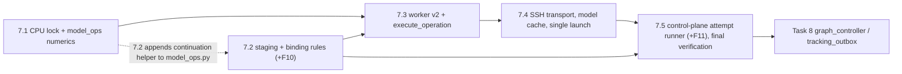

# Task 7 Model Operations — Reviewable Sub-task Plan

> **For agentic workers:** REQUIRED SUB-SKILL: superpowers:subagent-driven-development (recommended) or
> superpowers:executing-plans. Each sub-task below is one implementer + one independent review, test-first.
> Steps use checkbox (`- [ ]`) syntax.

**Parent plan:** [General-purpose training workflows, Task 7](2026-10-17-general-training-workflows.md#task-7-실제-부모-모델-전달평가병합전체-모델-확정-연산)
("실제 부모 모델 전달·평가·병합·전체 모델 확정 연산"). **Spec:** [design §5–§8](../specs/2026-10-17-general-training-workflows-design.md#5-모델-전달과-병합)
and the [SSH server extension](../specs/2026-10-19-ssh-gpu-servers-extension.md).

**Goal:** Give the pinned engine an exact, hash-verified way to train from a confirmed parent, evaluate, merge
compatible LoRA adapters (`cat`), and materialize full models. Every input is hash-checked, attempt and
launch identities are fenced, an attempt is never launched twice, and the CPU numerical acceptance is
hash-locked.

**Baseline:** HEAD `1c5d2d3` on `codex/general-training-workflows`. `uv run pytest -q` → 754 passed, 1 skipped
(opt-in GPU), Ruff clean (PROGRESS, 2026-10-19). Tasks 1–6, 6A, 6B are complete in software.

**Status:** planning only. This document authorizes no GPU, SSH, model download, institution data, or paid resource.

---

## 0. Facts verified for this plan (evidence)

All facts below were checked on 2026-10-20 against the repository, the pinned upstream sources, or throwaway
probes. The probes ran in the pre-existing, unlocked `.factory/model-ops-cpu-env` and in `%TEMP%`, and have
since been deleted.

| # | Fact | Evidence |
|---|---|---|
| F1 | LLaMA-Factory 0.9.5 has **no** `tokenizer_name_or_path`. The tokenizer is loaded from `model_name_or_path`, and a reference model's tokenizer from `ref_model`. | `v0.9.5/src/llamafactory/hparams/model_args.py`: the only tokenizer field is `use_fast_tokenizer`. `train/trainer_utils.py::create_ref_model` calls `ModelArguments.copyfrom(model_args, model_name_or_path=ref_model, adapter_name_or_path=ref_model_adapters, quantization_bit=ref_model_quantization_bit)` and then `load_tokenizer(ref_model_args)`. |
| F2 | LF 0.9.5 parameter names: `create_new_adapter` (default False), `ref_model`, `ref_model_adapters`, `ref_model_quantization_bit` (∈ {None, 4, 8}), `reward_model`, `reward_model_adapters`, `reward_model_quantization_bit`, `reward_model_type` ∈ {lora, full, api}. `lora_alpha = lora_alpha or lora_rank * 2`. `use_ref_model = stage == "dpo" and pref_loss not in ["orpo", "simpo"]`. PiSSA is refused for ppo/kto/ref-model DPO. | `v0.9.5/.../hparams/finetuning_args.py` (`RLHFArguments`, `LoraArguments`, `__post_init__`). The same names exist in the local 0.9.3 PPO runtime (`.factory/ppo-cpu-env/.../llamafactory/hparams/finetuning_args.py:177-205,473`). |
| F3 | When `adapter_name_or_path` is set, `is_trainable` is true and `create_new_adapter` is false, LF **resumes the last adapter with that adapter's own saved config** (`PeftModel.from_pretrained(model, adapter, is_trainable=True)`). It never compares that config with the child's `lora_rank`/`lora_alpha`. A quantized model forces the resume path. | `v0.9.5/.../model/adapter.py::_setup_lora_tuning`. This is why the plan's continuation-mismatch rule is required: LF would otherwise silently ignore the child settings. |
| F4 | With `ref_model=None` and a LoRA policy, DPO/KTO use the policy with adapters disabled as the reference. A continued SFT adapter would therefore fall back to the root weights. With `ref_model` set, a separate frozen model is loaded (`is_trainable=False`). | `create_ref_model` (`finetuning_type == "lora"` → `None`); `train/kto/workflow.py`. |
| F5 | PPO with a LoRA reward loads the reward adapter onto the **policy's** base: `model.pretrained_model.load_adapter(reward_model, "reward")`, and value-head params come from the `reward_model` path. A full reward loads `reward_model` (+ `reward_model_adapters`) separately. | 0.9.5 `create_reward_model` (WebFetch) and local 0.9.3 `train/trainer_utils.py:146-185`. |
| F6 | PEFT 0.18.1 `add_weighted_adapter(..., combination_type="cat")` sets `r = lora_alpha = Σ r_i`, so the new scaling is 1. It builds `A = cat(w_i·s_i·A_i, dim=0)` and `B = cat(B_i, dim=1)`. Other config fields come from `adapters[0]`. It rejects `target_parameters` and `modules_to_save` overlap. | `inspect.getsource(LoraModel.add_weighted_adapter / _check_add_weighted_adapter)` in the CPU env. |
| F7 | `PeftModel.save_pretrained(out, selected_adapters=["merged"])` writes a top-level `out/README.md` and puts the adapter files in `out/merged/`. Every saved `adapter_config.json` has `inference_mode: true`, `task_type: "CAUSAL_LM"` and `base_model_name_or_path` set to the **absolute local base path**. | Probe output (layout `merged/README.md`, `merged/merged/adapter_config.json`, …). |
| F8 | On the tiny Qwen2 (layers 2, hidden 16, intermediate 32, heads 2/2, vocab 32, context 64, fp32, `tie_word_embeddings=False`, 27 tensors, 14 non-`lm_head` Linear modules), the `cat` merge of r2/α4 + r3/α9 with weights 0.25/0.75 gives output rank 5. The FP32 delta max error is 1.5e-8 (≤ atol 1e-6). After `merge_and_unload(safe_merge=True)` and save/reload, the logits max error is 6.0e-8 (≤ 1e-5). The plan's tolerances are achievable. | Probe in the CPU env (torch 2.7.1+cpu, PEFT 0.18.1, Transformers 5.6.0, safetensors 0.8.0, tokenizers 0.22.2). |
| F9 | Meta-device inspection works: `with torch.device("meta"): AutoModelForCausalLM.from_config(cfg)` lists Linear modules with in/out dims and no weights. LF's `find_all_linear_modules` counts any class whose name contains `Linear` and not `Embedding`, excludes names containing `lm_head` (plus `output_layer` for chatglm and `output` for internlm2), and returns last name components. | Probe; `v0.9.5/.../model/model_utils/misc.py`. |
| F10 | **Latent bug (blocks every real continuation):** `graph_planner._expected_adapter` (lines 809-828) builds `AdapterMetadata` with the defaults `task_type=None` and `inference_mode=False`, and `_training_parent` (line 798) requires `descriptor.adapter == expected`. A real PEFT export can only be frozen with `task_type="CAUSAL_LM"` and `inference_mode=True`; `_validate_adapter` rejects other values. So `compile_node` refuses every real `continue_adapter`. | Probe: freezing a real PEFT export with default metadata → `adapter effective configuration mismatch: task_type`. With `task_type="CAUSAL_LM", inference_mode=True` it freezes. The existing test fixture omits those keys, so it passes. |
| F11 | **Latent bug (blocks evaluation receipts):** `GraphStore.record_outputs` (graph_store.py:309) requires `EvaluationRecord.benchmark_sha256 == digest(canonical(operation["benchmark"]))`. `compile_node`'s select path (graph_planner.py:955) and `BenchmarkRevision` require `BenchmarkSpec.fingerprint()`. The two values are never equal (checked: `False`), and no test covers evaluation `record_outputs`. | Probe in the main env. |
| F12 | `GraphStore.record_outputs` refuses any `inspected_targets`. Its comment says "Task 7 must use a separate inspected-receipt verifier". `compile_node` needs `ModelTargetEvidence` for continuation (`_expected_adapter`) and for merge/materialize (`_conversion_base_evidence`). | graph_store.py:313-316; graph_planner.py:796-801, 850-861. |
| F13 | `Factory.run_claimed` raises `NotImplementedError` for v2 manifests (runner.py:79-80). `SSHExecutor.run` falls back to `uuid.uuid4()` when no `launch_id` is given (execution.py:264) and truncates `worker.log` with `>` (line 289). `JobStore._claim` creates 32-hex `attempt_id`/`launch_id` (jobs.py:289), and `begin_launch` refuses a second launch (jobs.py:432-439). | Code. |
| F14 | The v2 manifest (`resolve_operation`, manifest.py:63-83) has no `training_config_sha256` and no `dependency_file_hashes`. The pinned lock hash is `operation.resources.runtime.dependency_sha256` (`graph_planner._runtime`). | Code. |
| F15 | The primary GPU lock pins `torch==2.7.1`, `peft==0.18.1`, `transformers==5.6.0`, `safetensors==0.8.0`, `tokenizers==0.22.2`, `accelerate==1.11.0`, `huggingface-hub==1.33.0`, `numpy==2.5.4`. The PPO lock pins PEFT 0.15.2 and Transformers 4.52.4. The main `.venv` has no torch/peft/transformers/safetensors, and `uv.lock` has no torch. | `grep` on the locks; `find_spec` in `.venv`. |
| F16 | The PROGRESS line "Separate CPU dependency/export preparation" is the ad hoc, **unlocked** venv `.factory/model-ops-cpu-env` (created 2026-10-18). torch was installed from `https://download.pytorch.org/whl/cpu/torch-2.7.1%2Bcpu-cp312-cp312-win_amd64.whl`, plus peft 0.18.1, transformers 5.6.0, safetensors 0.8.0, tokenizers 0.22.2 and **accelerate 1.15.0** (≠ the GPU lock's 1.11.0). No `.in`/`.lock` was committed. | `pyvenv.cfg`, `direct_url.json`, site-packages listing. |
| F17 | Lock convention: both GPU locks are made with `uv pip compile pyproject.toml containers/<name>.in … --generate-hashes --no-header` (docs/OPERATIONS.md:108), so they have no comment header. A dry resolution of the proposed CPU `.in` (§4) with `--python-platform x86_64-pc-windows-msvc --torch-backend cpu` **succeeded** (56 packages, `torch==2.7.1+cpu` with 19 hashes) into `%TEMP%`. Nothing was installed. `uv pip compile` and `uv pip sync` both accept `--torch-backend` in uv 0.11.23. | Command output. |
| F18 | Golden digest of legacy `translate()` at HEAD `1c5d2d3`: the 6 stages × 5 methods matrix (§3.2 test 1) = `f5d2c0e523c28909988eeebeb33de2db8df7722b5d76a0e61c58359243461499`. `configs/ai/paper_extraction.yaml` = `1630e49b5cda266ac5ced12ee3a92a10f85aad14ac62c33c60f56925b9b57144` and `integration_smoke.yaml` = `0aa75a3927a7336973574f43bd66a5b139de7f07fc781335330b436ff9c91498`. | Main env computation. |

---

## 1. Rules that apply to every sub-task

- Python 3.12, `uv sync --extra dev --extra tracking --locked`. Before each commit: the sub-task's tests, the
  listed regressions, `uv run pytest -q` and `uv run ruff check src tests`.
- Work test-first. Make missing modules fail tests, not collection. Use the `api()` pattern from
  `tests/test_model_artifacts.py:11-16`, which calls `pytest.fail` on `ModuleNotFoundError`.
- No GPU, SSH network, model download or institution data. Every main-env test uses fakes. **The main env must
  not import or depend on torch, peft, transformers, safetensors or huggingface_hub.** Heavy imports stay
  inside functions (lazy), as `model_artifacts.py` already requires.
- Legacy contracts are frozen. Keep the bytes of v1 `resolve()`, `LlamaFactoryBackend.translate(config)`, v1
  `worker.main` and `SSHExecutor.run(...)` behaviour unchanged. `containers/gpu-requirements.lock` and
  `gpu-ppo-requirements.lock` stay byte-identical (`git diff --exit-code containers/gpu-*.lock`).
- Default to dry-run. The real worker refuses simulation manifests. Model artifacts go only to the
  operation's pinned (approved) destination.
- Borrowed Pods and servers are never started, stopped or deleted. Remote cache entries are never deleted
  automatically.
- Each sub-task appends to `docs/PROGRESS.md` what was actually verified and what GPU work is still open.
- **File-list deviations from the parent plan, which root must approve:** `graph_planner.py` (7.2, fix F10),
  `graph_store.py` (7.5, fix F11), and `tests/test_desktop_runtime.py` (7.4, tests only). Each is test-first
  with no behaviour change beyond the fix.
- Naming: graph_planner already has a **`VerifiedBindings`** (controller compile input). The worker-side
  type of verified local model paths is named **`VerifiedModelPaths`** (new). The plan's
  `bind_training_plan(template, verified_bindings)` keeps its parameter name, but the parameter has this
  new type.

---

## 2. Sub-tasks and sequence

| Sub-task | One line |
|---|---|
| **7.1** | Hash-locked CPU model-ops runtime plus `model_ops.py` numerics (`merge_adapters`, `materialize_model`, finite scan, target inspection) and `scripts/verify_model_ops_cpu.py`. |
| **7.2** | Path-free model-input staging (`stage_model_inputs`), worker path verification, and `bind_training_plan`/`translate(config, model_input)`, with the continuation, frozen-reference, PPO reward and tokenizer rules. Also fixes F10. |
| **7.3** | `WorkerRequest` v2, the worker v2 entry (start marker, identity and hash checks), `execute_operation` dispatch for train/evaluate/merge/materialize, and bound runtime preflight. |
| **7.4** | SSH transport: persisted launch path, hash-verified remote model cache, "never launch twice", v2 result collection, and `desktop_runtime` runtime/cache selection. |
| **7.5** | Control-plane `OperationAttemptRunner` for Task 8: fenced claim→launch→collect, freezing outputs with exact lineage, `NodeOutputs`/evaluation receipts, crash-idempotent rebuild. Also fixes F11 and runs the final verification. |



Execute strictly in order 7.1 → 7.5. 7.1 and 7.2 may run in parallel worktrees only if 7.2 appends its two
functions to the end of `model_ops.py` after 7.1's skeleton is committed. Root integrates shared files in order.

Runtime sequence of one real attempt (after 7.5):

```mermaid
sequenceDiagram
  participant C as Task 8 controller
  participant R as OperationAttemptRunner (PC)
  participant S as JobStore / GraphStore
  participant X as SSHExecutor
  participant W as worker v2 (GPU host)
  C->>S: claim_ready(facts, controller_lease)
  C->>R: run_claimed(claimed, executor, approval=ApprovalGrant)
  R->>R: verify manifest, approval, destination; stage_model_inputs → model-inputs.json
  R->>S: begin_launch(lease) → launch_id (== claimed launch_id)
  R->>X: run_operation(job_dir, launch_dir, WorkerRequest, transfers)
  X->>X: refuse if remote start.json/result.json exists
  X->>W: verify-or-publish cache entries; upload small files; nohup worker --request <sha> >> worker.log
  W->>W: start.json (O_EXCL); verify request/manifest/lock/data/cache; bind; execute_operation
  W-->>X: result.json (identities) + artifacts.json
  X-->>R: identity-checked result; hash-verified download
  R->>R: freeze outputs with exact lineage; build NodeOutputs
  R->>S: transition COMPLETED; release_gpu(execution_stopped=True)
  R-->>C: OperationOutcome(outputs, inspected_targets)
  C->>S: record_outputs(lease, outputs) + outbox (Task 8)
```

---

## 3. Sub-tasks

### 7.1 Hash-locked CPU runtime and model-operation numerics

**Goal / scope:** Implement the numerical core and prove it on a locally generated tiny model in a separate,
hash-locked CPU environment. Validation that does not need torch (input refusals, weight normalization,
tolerance policy, target-evidence verification, the stdlib finite scan of adapter files) runs in the main
env. The numerics run only in the CPU env, and the acceptance script never skips.

**Not in scope:** staging/binding (7.2), the worker entry and dispatch (7.3), transport (7.4), freezing
outputs into the control-plane store with producer identity (7.5), a BF16 storage tolerance policy (§6 Q7),
and any GPU run.

**Files**
- Create `src/tuning_factory/model_ops.py`.
- Create `scripts/verify_model_ops_cpu.py`.
- Create `containers/model-ops-cpu-requirements.in` and `containers/model-ops-cpu-requirements.lock` (§4).
- Create `tests/test_model_ops_contract.py` (7.1 section).
- Modify `src/tuning_factory/runtime_profiles.py`: add constants after `engine_profile` (lines 4-11). Leave
  `engine_profile` unchanged.

**Interfaces (all new unless an existing name is given)**

```python
# runtime_profiles.py (additions; engine_profile unchanged)
MODEL_OPS_PINS = MappingProxyType({"torch": "2.7.1", "peft": "0.18.1", "transformers": "5.6.0",
                                   "safetensors": "0.8.0"})          # equal to gpu-requirements.lock
MODEL_OPS_CPU_LOCK = "containers/model-ops-cpu-requirements.lock"   # acceptance env only; never a GPU runtime

# model_ops.py — module import touches only stdlib, pydantic, .config, .model_artifacts
POLICY_F32_V1 = "model-ops-f32-v1"

class TolerancePolicy(StrictModel):                     # StrictModel from .config
    policy_id: Literal["model-ops-f32-v1"] = POLICY_F32_V1
    storage_dtype: Literal["F32"] = "F32"               # every merge/materialize output tensor is stored F32
    delta_atol: float = 1e-6;  delta_rtol: float = 1e-5
    logits_atol: float = 1e-5; logits_rtol: float = 1e-4
TOLERANCE_POLICIES: Mapping[str, TolerancePolicy]        # {POLICY_F32_V1: TolerancePolicy()} only

@dataclass(frozen=True)
class LocalModel:                                       # a verified local directory plus its identity
    path: Path
    identity: ModelArtifactRef | HFRootRef              # existing model_artifacts types
    descriptor: ModelDescriptor | None                  # None only for an HF root
    config_sha256: str
    tokenizer_fingerprint: str

@dataclass(frozen=True)
class StagedLoad:                                       # input of materialize_model
    base: LocalModel                                    # full, unquantized effective base
    adapter: LocalModel                                 # descriptor.storage_kind == "adapter"

class MergePlan(StrictModel):
    inputs: tuple[ModelArtifactRef, ...]
    normalized_weights: tuple[float, ...]               # Fraction(str(w)) / Σ; Σ must already be 1 (MergeNode rule)
    scales: tuple[float, ...]                           # alpha_i / rank_i (rsLoRA refused)
    ranks: tuple[int, ...]
    output_rank: int                                    # Σ ranks ≤ 256
    effective_base: BaseRef
    target_modules: tuple[str, ...]                     # sorted

class MergeReceipt(StrictModel):
    kind: Literal["merge"] = "merge"
    policy_id: str; inputs: tuple[ModelArtifactRef, ...]; normalized_weights: tuple[float, ...]
    output_rank: int; max_abs_delta_error: float; max_abs_logits_error: float
    finite_tensors_checked: int; output_files: tuple[str, ...]

class MaterializeReceipt(StrictModel):
    kind: Literal["materialize"] = "materialize"
    policy_id: str; base: BaseRef; adapter: ModelArtifactRef
    max_abs_delta_error: float; max_abs_logits_error: float
    non_target_tensors_identical: Literal[True]; tokenizer_fingerprint: str
    finite_tensors_checked: int; output_files: tuple[str, ...]

def validate_merge_inputs(refs, descriptors, weights, *, require_real: bool = True) -> MergePlan
def validate_materialize_input(load: StagedLoad) -> None
def scan_finite_safetensors(path: Path) -> int          # stdlib, streamed; F16/BF16/F32/F64; returns elements scanned
def merge_adapters(inputs: Sequence[LocalModel], weights: Sequence[float], output: Path, *,
                   base: LocalModel, policy: str = POLICY_F32_V1, device: str = "cpu",
                   require_real: bool = True, probe_ids: Sequence[int] | None = None) -> MergeReceipt
def materialize_model(input: StagedLoad, output: Path, *, policy: str = POLICY_F32_V1,
                      device: str = "cpu", probe_ids: Sequence[int] | None = None) -> MaterializeReceipt
def inspect_target_modules(model_dir: Path, base: BaseRef) -> "ModelTargetEvidence"   # graph_planner type, meta device
def verify_inspected_targets(evidence, descriptor: ModelDescriptor, ref: ModelArtifactRef) -> "ModelTargetEvidence"
def adapter_metadata_from_config(config: Mapping, *, method: Literal["lora", "qlora"],
                                 quantization_bit: Literal[4, 8] | None = None,
                                 loraplus_lr_ratio: float | None = None,
                                 loraplus_lr_embedding: float = 1e-6) -> AdapterMetadata   # sorted target_modules
```

Error messages: reuse the existing strings verbatim where an existing helper enforces the rule:
`merge requires distinct actual artifacts`, `merge input effective bases/tokenizers/targets differ`,
`merged rank exceeds 256`, `merge base tensor dimensions differ`, `unsupported adapter conversion variant`,
`materialize requires a causal LoRA/QLoRA adapter without value head` (graph_planner `_merge_descriptors`
897-921 and `_materializable` 864-872), and `one positive finite weight is required for each model` /
`weights must sum to one` (graph_schema `MergeNode.valid_weights` 64-74). New strings:
`non-finite tensor values in {file}: {tensor}`, `materialize base differs from adapter effective base`,
`materialization requires unquantized effective base weights` (same text as graph_planner line 860),
`unsupported tolerance policy`, `model-operation output failed delta verification`,
`reloaded logits differ beyond tolerance policy`.

**Failing tests (main env, `tests/test_model_ops_contract.py`)**

1. `test_model_ops_import_is_lightweight`: set `sys.modules[name] = None` for torch, peft, transformers,
   safetensors and huggingface_hub, then `importlib.reload(model_ops)` succeeds.
2. `test_merge_refuses_duplicate_inputs`: the same `(artifact_id, inventory_sha256)` twice → `merge requires distinct actual artifacts`.
3. `test_merge_refuses_different_effective_base`.
4. `test_merge_refuses_config_or_tokenizer_mismatch`.
5. `test_merge_refuses_target_module_or_fan_in_mismatch`.
6. `test_merge_refuses_base_dimension_mismatch`: different A in-dim or B out-dim.
7. `test_merge_refuses_rank_sum_over_256`: ranks 128 + 129.
8. `test_merge_refuses_unsupported_variants`, parametrized over use_dora, use_rslora, pissa_init,
   bias="all", modules_to_save, rank_pattern, alpha_pattern, target_parameters, layer_replication, OFT, and
   value head / reward_model semantics.
9. `test_merge_weights_positive_finite_sum_one`: wrong count, 0, −0.1, NaN, inf and Σ = 0.999 are refused;
   0.25/0.75 normalizes exactly.
10. `test_merge_require_real_refuses_synthetic_or_simulation`: refused with `require_real=True`, accepted
    with `require_real=False` (used only by the CPU script, whose fixtures are synthetic).
11. `test_finite_scan_detects_nan_and_inf_per_dtype`: hand-written F32/F16/BF16 safetensors containing
    NaN, +inf and −inf; clean files return the element count.
12. `test_merge_refuses_nonfinite_adapter_before_any_output`: a NaN in an F32 adapter →
    `non-finite tensor values …`. The output directory does not exist, and torch is blocked during the call
    (the input scan runs before the heavy import).
13. `test_materialize_refuses_root_when_effective_base_is_artifact`: an adapter whose `effective_base` is an
    SFT full artifact, given the HF root as base → `materialize base differs from adapter effective base`.
14. `test_materialize_refuses_quantized_or_adapter_base`: base descriptor `quantization_bit=4`, a
    `quantization_config` in config.json, or base `storage_kind="adapter"`.
15. `test_materialize_refuses_value_head_and_variants`.
16. `test_only_f32_tolerance_policy_is_accepted`: `"model-ops-bf16-v1"` → `unsupported tolerance policy`.
17. `test_verify_inspected_targets_requires_complete_matching_inventory`: refuses a missing module, wrong
    dims, a module with no `.weight` tensor in the verified full-model inventory, evidence for another base,
    and an inventory 2-D decoder `.weight` (non-embedding, non-`lm_head`, non-norm) that the evidence omits.
18. `test_adapter_metadata_from_real_peft_export_freezes`: the PEFT 0.18.1 export keys from F7, written as a
    fixture JSON, produce metadata with `task_type="CAUSAL_LM"` and `inference_mode=True` that
    `ModelArtifactStore.freeze` accepts.
19. `test_cpu_script_version_gate_refuses_drift`: load the script via `importlib.util.spec_from_file_location`
    (as tests/test_ppo_profile.py:7-12 does) and call `check_versions({...})` with peft 0.18.0 → `RuntimeError`.
20. `test_cpu_script_refuses_to_run_without_torch`:
    `subprocess.run([sys.executable, "-I", script, "--receipt", tmp])` in the main env → nonzero exit,
    stderr contains `model-operation CPU runtime is missing`, and no receipt is written. This test is also a
    guard that the main env stays free of torch.
21. `test_cpu_lock_pins_primary_runtime_versions_with_hashes`: parse both locks. The CPU lock has
    `torch==2.7.1+cpu`, and the same versions as `gpu-requirements.lock` for peft, transformers,
    safetensors, tokenizers, accelerate, huggingface-hub and numpy. Every entry has `--hash=sha256:`. It has
    no llamafactory, bitsandbytes, `nvidia-*` or triton.

**CPU acceptance (`scripts/verify_model_ops_cpu.py`, separate env only).** These are the RED/GREEN items of
the parent plan's step 4:
- Version gate: the exact pins (§4); `torch.version.cuda is None`; `HF_HUB_OFFLINE=1` and
  `TRANSFORMERS_OFFLINE=1`. A missing import exits with code 2 and no skip.
- Generate locally: a WordLevel tokenizer (28 `t<i>` tokens plus `<unk>`, `<pad>`, `<s>`, `</s>` = 32,
  WhitespaceSplit) and Qwen2 (layers 2, hidden 16, intermediate 32, heads 2, KV heads 2, vocab 32, context
  64, `tie_word_embeddings=False`, fp32, seed 0). Freeze base and adapters into a temporary
  `ModelArtifactStore` with `synthetic=True`.
- Adapters r2/α4 and r3/α9 on `q_proj, v_proj`, with nonzero A/B (seeded `randn·0.1`).
- `merge_adapters` with weights 0.25/0.75 → `r = lora_alpha = 5`. The per-module FP32 delta matches
  `Σ w_i·(α_i/r_i)·B_i A_i` (atol 1e-6, rtol 1e-5). Logits of the reloaded merged adapter match an
  independently built model whose target weights are `W + Σ…` (atol 1e-5, rtol 1e-4).
- `materialize_model` → delta check on target modules; every non-target tensor is `torch.equal` to the base;
  tokenizer files are byte-identical to the base; reload logits are within tolerance; all tensors are finite.
- Parent→child preservation: P (r2) on the base → F1; child C on F1 → F2. Check that
  `‖F2 − (F1 + ΔC)‖ ≤ tol` and `max|F2 − (base + ΔC)| > 1e-3`. `materialize_model(StagedLoad(base=HF/base, adapter=C))`
  is refused.
- Frozen reference: load F1 the way LF loads a reference (`is_trainable=False`, eval). Take one optimizer
  step on a DPO-style loss of the policy (F1 + new LoRA). The reference tensor SHA256s are unchanged and its
  `requires_grad` is false; the policy LoRA changed.
- NaN blocking: a NaN in an adapter copy → merge refused before any output; +inf in a base copy →
  materialize refused. The stdlib scan and the torch scan agree on all fixtures.
- Target inspection: `inspect_target_modules(base)` gives 14 modules with exact dims, which
  `verify_inspected_targets` accepts; tampered evidence is refused.
- Receipt: `--receipt PATH` writes canonical JSON containing `schema_version`, `versions`, `lock_sha256`,
  `source_sha256` (`manifest.source_hash()`), `tolerance_policy`, `checks{name: {passed, max_abs_error}}`,
  `model_downloaded:false`, `gpu_used:false`, `institution_data_used:false`, `synthetic_fixture:true` and
  `production_promotable:false`. The exit code is 0 only if every check passes.

**Implementation notes**
- Reuse, do not duplicate, the conversion rules: inside `validate_merge_inputs`/`validate_materialize_input`,
  lazily import `graph_planner._merge_descriptors`, `_materializable`, `_adapter_tensor_shapes` and
  `MergeNode` from graph_schema. The real-only rule moves behind `require_real`. Keep
  `_merge_descriptors`' behaviour for graph compilation unchanged: it stays real-only.
- Adapter tensor names are `base_model.model.<module>.lora_{A,B}.weight`, and the base tensor is
  `<module>.weight` (F7). Check `B.shape[0], A.shape[1] == base[<module>.weight].shape`.
- Compute in FP32 from an exact upcast of any float input dtype. Store the output only as F32 (policy v1).
  On CUDA set `torch.backends.cuda.matmul.allow_tf32 = False` and `torch.backends.cudnn.allow_tf32 = False`.
- Merge: load the base in FP32, `PeftModel.from_pretrained(base, in_0, adapter_name="a0")`, `load_adapter`
  the rest, `add_weighted_adapter(names, normalized_weights, "merged", combination_type="cat")`, then
  `save_pretrained(tmp, selected_adapters=["merged"])`. Move `tmp/merged/*` to `output` and **drop
  `README.md`**. Rewrite `base_model_name_or_path` in `adapter_config.json` to `root.repo_id` (a provenance
  string, never a host path; see F7). Copy `config.json` and the tokenizer files byte-for-byte from the
  shared base.
- Materialize: `PeftModel.from_pretrained(base_fp32, adapter)`, keep the logits before merging,
  `merge_and_unload(safe_merge=True)`, `save_pretrained(output)` (F32). Copy the tokenizer files from the
  base byte-for-byte (never `tokenizer.save_pretrained`) and drop `README.md`.
- Scan the inputs (adapters, small) with the stdlib scanner before importing torch. Scan the base and the
  outputs with torch (`safetensors.safe_open` + `torch.isfinite`). For speed, multi-GB bases are never
  scanned in pure Python.
- Probe ids: `probe_ids` if given, else the bound tokenizer's encoding of
  `"factory model operations numerical probe"`, padded with eos to at least 4 tokens and capped at 32.
- The script inserts `<repo>/src` at `sys.path[0]` and is run with `-I`. Its module import must not import
  torch; every heavy import goes in `main()`.

**Verification**
- RED: `uv run pytest tests/test_model_ops_contract.py -q` → failures from `api()` "missing". In the CPU env
  (§4), `scripts/verify_model_ops_cpu.py --receipt …` → nonzero (missing `merge_adapters`).
- GREEN: `uv run pytest tests/test_model_ops_contract.py tests/test_model_artifacts.py tests/test_graph_planner.py tests/test_ppo_profile.py -q`
  → pass. Full `uv run pytest -q` → 754 + new passed, 1 skipped. `uv run ruff check src tests` → clean.
- CPU env: `.factory\model-ops-cpu-venv\Scripts\python.exe -I scripts\verify_model_ops_cpu.py --receipt .factory\model-ops-cpu-receipt.json`
  → exit 0, every check `passed: true`, delta ≤ 1e-6 and logits ≤ 1e-5 (probe values were about 1e-8).
- `git diff --exit-code containers/gpu-requirements.lock containers/gpu-ppo-requirements.lock` → exit 0.
  `uv pip list --python .venv\Scripts\python.exe` contains no torch.

**Commit:** `feat: verify model-operation numerics in a hash-locked CPU runtime`

---

### 7.2 Model-input staging and training-plan binding

**Goal / scope:** Turn a resolved `TrainOperation`/`EvaluateOperation`/`MergeOperation`/`MaterializeOperation`
into (a) a path-free staged-input record on the control plane, which never copies weights into the attempt
directory, and (b) worker-side verified local paths and a bound LF YAML that substitutes only allowlisted
role slots. All parent, reference, reward and tokenizer rules are enforced twice, at staging and at binding.
This sub-task also fixes F10.

**Not in scope:** the worker entry, `command.json` and the result protocol (7.3); evaluate YAML (7.3);
transport and cache publishing (7.4); output freezing (7.5); a PPO KL-reference contract for continuation
(refused, §6 Q6).

**Files**
- Modify `src/tuning_factory/training.py`:
  - Move the body of `translate` (lines 66-100) into `_legacy_plan(config)`.
  - `translate(config, model_input=None)`.
  - `validate_config` (47-48) validates `GraphTrainingConfig` with its own class.
  - `prepare(config, directory, dataset, model_input=None)` (50-64).
- Create the staging/binding section of `src/tuning_factory/operation_runner.py`.
- Modify `src/tuning_factory/model_ops.py`: append the continuation helpers.
- Modify `src/tuning_factory/graph_planner.py` (deviation, F10): `_training_parent` 786-806 and
  `_expected_adapter` 809-828.
- Create `tests/test_model_inputs.py`.

**Interfaces**

```python
# training.py
ROLE_PREFIX = "factory-role:"                        # sentinel value, e.g. "factory-role:policy_base"
ROLE_SLOTS = MappingProxyType({                       # the only YAML keys that may hold a model location
    "policy_base": "model_name_or_path", "policy_adapter": "adapter_name_or_path",
    "reference_base": "ref_model", "reference_adapter": "ref_model_adapters",
    "reward_base": "reward_model", "reward_adapter": "reward_model"})
class LlamaFactoryBackend:
    @staticmethod
    def translate(config, model_input: ModelInput | None = None) -> dict
        # model_input is None → exactly _legacy_plan(config) (golden digests F18).
        # Otherwise a v2 logical template: drop model_name_or_path/model_revision/reward_model/reward_model_type;
        # model_name_or_path = sentinel(policy_base); if policy.adapter: adapter_name_or_path = sentinel(policy_adapter)
        # and create_new_adapter = False; if frozen_reference: ref_model (+ ref_model_adapters) sentinels and
        # ref_model_quantization_bit = config.quantization_bit iff training_method == "qlora" (§6 Q5);
        # if reward_model: reward_model = sentinel(reward_adapter if reward.adapter else reward_base),
        # reward_model_type = "lora" if reward.adapter else "full" (derived from the typed binding, never config).
    def prepare(self, config, directory, dataset, model_input: ModelInput | None = None) -> None

# model_ops.py (append)
EXPORT_ONLY_ADAPTER_FIELDS = frozenset({"inference_mode", "task_type"})   # PEFT save state (F7), not loader settings
def expected_continuation_adapter(config_or_recipe, actual_targets: tuple[str, ...]) -> AdapterMetadata
    # rank=lora_rank, alpha=lora_alpha or 2*lora_rank, dropout, use_rslora, use_dora, pissa_*, method,
    # quantization_bit (qlora only), loraplus fields; same as graph_planner._expected_adapter today
def continuation_mismatches(parent: AdapterMetadata, expected: AdapterMetadata) -> tuple[str, ...]
    # sorted field names that differ, excluding EXPORT_ONLY_ADAPTER_FIELDS; compares sorted target tuples

# operation_runner.py — staging (control plane)
ModelRole = Literal["policy_base", "policy_adapter", "reference_base", "reference_adapter",
                    "reward_base", "reward_adapter", "operation_base", "operation_adapter"]
class StagedModel(StrictModel):
    role: ModelRole
    index: int = Field(default=0, strict=True, ge=0, le=3)  # merge adapter position; 0 otherwise
    source: Literal["artifact", "hf_root"]
    artifact: ModelArtifactRef | None = None
    hf_root: HFRootRef | None = None
    storage_kind: Literal["adapter", "full_model"]
    config_sha256: Sha256
    tokenizer_fingerprint: Sha256                       # validator: exactly one identity; hf_root ⇒ full_model
class ResolvedModelInputs(StrictModel):
    schema_version: Literal[1] = 1
    operation_kind: Literal["train", "evaluate", "merge", "materialize"]
    operation_sha256: Sha256                            # digest(canonical(operation.model_dump(mode="json")))
    models: tuple[StagedModel, ...] = Field(min_length=1)
    transfers: tuple[ModelArtifactRef, ...]             # sorted unique artifacts the executor must cache remotely
    reference_quantization_bit: Literal[4, 8] | None = None
    reward_model_type: Literal["lora", "full"] | None = None
def stage_model_inputs(operation, approved_cache: ModelArtifactStore, staging_root: Path, *,
                       target_evidence: tuple["ModelTargetEvidence", ...] = ()) -> ResolvedModelInputs
    # verifies via approved_cache.verify/validate_input; writes staging_root/"model-inputs.json" (canonical);
    # never writes weights (asserts no *.safetensors under staging_root afterwards)

# operation_runner.py — worker-side verification and binding
def verify_cached_artifact(cache_root: Path, ref: ModelArtifactRef) -> ModelDescriptor
    # layout <cache_root>/<artifact_id>/<inventory_sha256>/{files/,descriptor.json,inventory.json};
    # descriptor hash + inventory + _validate_payload, no lineage
def resolve_hf_root(root: HFRootRef, hf_home: Path) -> Path
    # snapshot_download(repo_id, revision=<40-hex>, cache_dir=hf_home/"hub", allow_patterns=config/tokenizer/
    # safetensors/index); symlinks must resolve inside hf_home/"hub"; config sha and tokenizer fingerprint must
    # equal root; returns snapshot dir
@dataclass(frozen=True)
class VerifiedModelPath: role: ModelRole; index: int; path: Path; staged: StagedModel; descriptor: ModelDescriptor | None
@dataclass(frozen=True)
class VerifiedModelPaths:
    models: tuple[VerifiedModelPath, ...]; roots: tuple[Path, ...]   # approved cache roots
    def path(self, role: ModelRole, index: int = 0) -> Path
def verify_model_paths(resolved: ResolvedModelInputs, operation, *, model_cache: Path, hf_home: Path | None,
                       inspect_targets: Callable[[Path, BaseRef], "ModelTargetEvidence"] | None = None
                       ) -> VerifiedModelPaths     # re-derives roles from operation + cached descriptors; must equal resolved
class BoundTrainingPlan(StrictModel):
    plan: dict[str, Any]; binding: dict[str, Any]
    template_sha256: Sha256; bound_sha256: Sha256; binding_sha256: Sha256
def bind_training_plan(template: Mapping, verified_bindings: VerifiedModelPaths) -> BoundTrainingPlan
def write_bound_plan(directory: Path, bound: BoundTrainingPlan) -> None
    # train.bound.yaml, model-binding.json, binding-evidence.json {template,bound,binding sha}
```

Error messages. New ones: `<role> tokenizer differs from policy`, `PPO adapter continuation is unsupported: its
KL reference would revert to the base; materialize the parent first`,
`bound model path is outside the approved model caches`, `unbound or misplaced model role placeholder: <key>`,
`QLoRA requires an unquantized full effective base`, and
`graph training binds only typed model roles` (`stage_options.reward_model` present). Existing ones reused:
`complete local tokenizer snapshot is required`, `SFT to preference training requires explicit materialize`,
`frozen reference must bind the exact policy parent`, `reference-free recipe cannot bind a frozen reference`,
`LoRA reward requires the exact policy effective base`, and `PPO requires a typed reward_model binding; other
stages cannot bind reward`. The F10 fix keeps `parent adapter settings differ; explicit materialize is required`
and appends `: <fields>`.

**Failing tests (`tests/test_model_inputs.py`).** Fixtures reuse `test_model_artifacts.fixture_model` and
`test_graph_planner.adapter_fixture`/`fixture`.

1. `test_translate_legacy_output_is_byte_identical`: the 30-row matrix (`pt…kto` × `lora…oft`; PPO with
   `/workspace/rm`; OFT with `oft_rank=8, oft_block_size=0`; base `Qwen/Qwen2.5-0.5B-Instruct`, revisions
   `a*40`) has digest **f5d2c0e5…1499**. The example configs keep their F18 digests, and
   `translate(c) == translate(c, None)`.
2. `test_v1_manifest_training_config_hash_unchanged`: `resolve(paper_extraction)["training_config_sha256"] == "1630e49b…7144"`.
3. `test_logical_template_holds_only_role_placeholders`: no `base_model` repo id, no `model_revision`, no
   absolute paths; sentinels exactly at `ROLE_SLOTS` keys.
4. `test_child_of_materialized_sft_binds_effective_snapshot_not_root`: `model_name_or_path` is the SFT full
   artifact's cache path, and the string `config.base_model` is absent from the bound YAML.
5. `test_staging_never_copies_weights_into_attempt_directory`: after staging, `staging_root` holds only
   `model-inputs.json` and no `*.safetensors`.
6. `test_staging_refuses_tampered_or_missing_artifact`.
7. `test_missing_local_tokenizer_is_refused`: a cached base without `tokenizer_config.json`, and an HF
   snapshot (fake `snapshot_download`) without tokenizer files.
8. `test_reference_and_reward_tokenizers_must_match_policy`.
9. `test_continuation_alpha_none_resolves_to_twice_rank`: parent r8/α16 with child `lora_alpha=None`, r8 →
   accepted; parent α8 → refused, naming `alpha`.
10. `test_continuation_mismatch_is_refused[field]`, parametrized over rank, explicit alpha, dropout, targets
    (`all` vs `q_proj,v_proj` via injected inspected targets), use_rslora, use_dora, pissa_init, method
    lora↔qlora, quantization_bit 4↔8 and loraplus_lr_ratio. Each message names the field.
11. `test_continuation_accepts_real_peft_export_fields`: a parent with `inference_mode=True` and
    `task_type="CAUSAL_LM"` is accepted.
12. `test_compile_node_continuation_accepts_real_peft_export` (F10 regression, graph_planner): a variant of
    `test_graph_planner.py::test_ready_continuation_checks_actual_settings_targets_and_dimensions` using the
    real export fields compiles.
13. `test_continuation_resumes_parent_adapter_with_fresh_optimizer`: the bound YAML has
    `adapter_name_or_path` = parent cache path, `create_new_adapter: false`, no `resume_from_checkpoint`,
    `output_dir: ./output`; the cached adapter has no `optimizer.pt`.
14. `test_new_adapter_on_full_parent_has_no_adapter_slot`, and the same for `full_weights`.
15. `test_dpo_kto_frozen_reference_is_exact_confirmed_parent[dpo-sigmoid|kto|dpo→dpo continuation]`:
    `ref_model` equals the `model_name_or_path` path, `ref_model_adapters` equals the adapter path when
    continuing, and `ref_model_quantization_bit` follows Q5.
16. `test_reference_free_losses_bind_no_reference[orpo|simpo|sft]`, and a supplied `frozen_reference` is
    refused for them.
17. `test_sft_adapter_into_preference_training_is_refused`.
18. `test_ppo_lora_reward_binds_adapter_on_policy_base`: `reward_model` = reward adapter path,
    `reward_model_type: lora`, `value_head.safetensors` present in the reward artifact.
19. `test_ppo_full_reward_binds_reward_base_even_when_config_default_is_lora`.
20. `test_ppo_reward_mismatch_is_refused`: covers a LoRA reward on another base, a reward without
    `reward_model` semantics or value head, a reward on a non-PPO stage, PPO without a reward, and a
    `stage_options.reward_model` path.
21. `test_ppo_continuation_is_refused` (Q6 default).
22. `test_bind_refuses_paths_outside_approved_cache_and_misplaced_slots`: covers `..`, a symlink or reparse
    point, a sentinel under a non-slot key, and a leftover sentinel.
23. `test_bound_plan_evidence_is_deterministic`: re-binding identical inputs gives identical bytes and hashes.
24. `test_qlora_child_requires_unquantized_full_base`.
25. `test_worker_verification_rederives_roles_and_rejects_resolved_drift`: a `model-inputs.json` that names
    a different artifact or role than the operation → refused.

**Implementation notes**
- `stage_model_inputs`:
  - train: run `approved_cache.validate_input(model_input, require_real=not lineage.simulation)` first. It
    already enforces frozen reference == policy, the reward root and tokenizer, and the adapter base.
  - evaluate/merge/materialize: `operation_base = descriptor.effective_base` and `operation_adapter[i]` =
    the model(s); merge additionally calls `model_ops.validate_merge_inputs`.
  - `transfers` = every artifact role, sorted. HF roots are resolved by the worker (`resolve_hf_root`),
    which is the same GPU-host download behaviour as v1 LF loading.
- `verify_cached_artifact` reuses the private helpers in `model_artifacts` (`_check_ancestors`,
  `_read_json`, `_FileEntry`, `_inventory`, `_inventory_bytes`, `_validate_payload`), because
  `ModelArtifactStore._verify` would also demand every ancestor in the remote cache.
- Tokenizers: LF loads the tokenizer from each base path (F1). Every bound base, reference base and full
  reward base must hold a complete tokenizer snapshot whose fingerprint equals the policy's. Artifacts
  always satisfy this by the descriptor contract; HF snapshots are checked in `resolve_hf_root`.
- Continuation targets: on the control plane they come from `target_evidence` (compile already checked it);
  on the worker from `inspect_targets(bound policy base)`. Expand `lora_target: all` with LF's rule (F9).
- F10 fix: `_training_parent` calls
  `model_ops.continuation_mismatches(descriptor.adapter, _expected_adapter(...))` and refuses when the result
  is non-empty. `_expected_adapter` keeps its signature and messages. LoRA+ fields stay compared (cautious,
  §6 Q17).
- Placeholder replacement only touches `ROLE_SLOTS` keys. Afterwards, walk the whole plan and refuse any
  remaining `factory-role:` value. The only relative paths allowed in the YAML are `dataset_dir: ./data`
  and `output_dir: ./output`.

**Verification:** RED `uv run pytest tests/test_model_inputs.py -q`. GREEN: that file plus
`tests/test_training.py tests/test_graph_planner.py tests/test_operation_schema.py tests/test_model_artifacts.py tests/test_config_registry.py`,
the full suite and Ruff. `git diff` of `_legacy_plan` versus the old `translate` body is a pure move.

**Commit:** `feat: bind verified parent, reference and reward models into training plans`

---

### 7.3 Worker v2 protocol and operation dispatch

**Goal / scope:** A hash-verified `command.json` (`WorkerRequest` v2) starts at most one execution per launch
directory. The worker checks the attempt/launch/manifest/operation identities, the runtime lock, the data
and the model cache, then dispatches through an allowlist. Training runs on the bound YAML with preflight
against the **bound** model. Evaluate is greedy causal-LM generation. Merge and materialize use `model_ops`
with the pinned PEFT. v1 `worker.main` behaviour is unchanged.

**Not in scope:** SFTP upload, cache publishing, the launch command (7.4); control-plane preparation,
metric computation and freezing (7.5); RM/reward benchmarks, `generation_mode="sample"` and fp32 evaluation
precision (refused, §6 Q8).

**Files**
- Modify `src/tuning_factory/worker.py`:
  - argparse (lines 70-75): positional `timeout` becomes `nargs="?"`; it is mutually exclusive with
    `--request SHA256` (v2) and `--verify-model-cache DIR ARTIFACT_ID INVENTORY_SHA256` (used by 7.4).
  - Add `main_v2(directory, command_sha256)`.
  - Add `runtime_preflight_bound(config, paths)` next to `runtime_preflight` (36-64).
- Modify `src/tuning_factory/operation_runner.py`: add `WorkerRequest`, `OperationResult`, `execute_operation`.
- Modify `src/tuning_factory/training.py`: add `predict_bound(...)` after `predict` (143-176).
- Modify `src/tuning_factory/runtime_profiles.py`: add `operation_profile(kind, profile)`.
- Tests go in `tests/test_remote_worker.py` (worker) and `tests/test_model_ops_contract.py` (dispatch).

**Interfaces**

```python
Hex32 = Annotated[str, Field(pattern=r"^[0-9a-f]{32}$")]
class WorkerRequest(StrictModel):                       # command.json bytes = canonical(model_dump(mode="json"))
    schema_version: Literal[2] = 2
    attempt_id: Hex32
    launch_id: Hex32
    manifest_sha256: Sha256
    operation_sha256: Sha256                            # digest(canonical(manifest["operation"]))
    timeout_seconds: int = Field(strict=True, ge=1, le=604800)
class OperationResult(StrictModel):                     # result.json, written atomically (tmp → replace)
    schema_version: Literal[2] = 2
    status: Literal["COMPLETED", "FAILED", "CANCELED"]
    launch_id: Hex32                                    # always = launch directory name
    attempt_id: Hex32 | None; manifest_sha256: Sha256 | None; operation_sha256: Sha256 | None
    kind: Literal["train", "evaluate", "merge", "materialize"] | None
    engine_version: str | None = None
    error: str | None = None
    evidence: dict[str, Sha256] = {}                    # e.g. train.bound.yaml, model-binding.json, operation-receipt.json
def execute_operation(operation, directory: Path, timeout: float, canceled: Callable[[], bool], *,
                      backend: LlamaFactoryBackend | None = None, model_cache: Path | None = None,
                      hf_home: Path | None = None, ops=None) -> OperationResult
# runtime_profiles.py
def operation_profile(kind: str, profile: Literal["primary", "ppo"]) -> dict
    # engine_profile-shaped; merge/materialize require "primary" and MODEL_OPS_PINS
# worker.py
def runtime_preflight_bound(config, paths: VerifiedModelPaths) -> dict
    # AutoConfig/AutoTokenizer from bound local paths only
def main_v2(directory: Path, command_sha256: str) -> int
```

Order of `main_v2`:
1. `launch_id = directory.name` and `job dir = directory.parent.name`, both 32-hex.
2. `sha256(command.json) == argv`; parse; `request.launch_id == launch_id`.
3. **Create `start.json` with `O_CREAT|O_EXCL`** (attempt, launch, manifest and operation sha, pid,
   started_at). If it already exists, exit with code 3 and write nothing in the directory.
4. `verify_manifest`; schema 2; manifest sha == request; operation sha == request.
5. Refuse `lineage.simulation` and `kind == "select"`; `source_sha256 == source_hash()`.
6. `FACTORY_GPU_LOCK_FILE` sha == `runtime.dependency_sha256`; llamafactory version == `runtime.engine_version`.
7. Data files equal the manifest dataset sha.
8. Cache roots come from `FACTORY_MODEL_CACHE`/`HF_HOME`.
9. `execute_operation`.
10. `finally`: `artifacts.json`, then `result.json` (as in v1, lines 140-148).

Messages: `worker request hash mismatch`, `worker request launch identity differs from launch directory`,
`worker request manifest differs from manifest.json`, `worker request operation hash differs from manifest operation`,
`local selection never dispatches to a GPU worker`, `simulation manifest cannot authorize GPU execution`,
`worker dependency lock differs from operation runtime`,
`model operation requires the primary runtime with pinned PEFT 0.18.1`,
`v2 evaluation supports greedy causal-LM generation benchmarks only`,
`fp32 benchmark precision cannot be enforced by the pinned engine`.

**Failing tests**
1. `test_v1_worker_contract_unchanged`: the existing
   `test_worker_checks_integrity_and_publishes_real_completion_contract` stays green, unchanged.
2. `test_v2_worker_completes_train_on_bound_yaml`: a fake `run_config` records `"train.bound.yaml"`; the
   result carries every identity; `evidence` holds the bound/binding hashes.
3. `test_v2_worker_rejects_command_hash_mismatch`.
4. `test_v2_worker_rejects_attempt_launch_manifest_operation_mismatch[launch|manifest|operation]`: result
   FAILED, train calls 0.
5. `test_v2_worker_refuses_simulation_select_and_unknown_kind`.
6. `test_v2_second_start_is_refused_without_touching_result`: a pre-existing `start.json` → exit 3, train
   calls 0, `result.json` bytes unchanged.
7. `test_v2_worker_checks_operation_runtime_lock_and_engine`.
8. `test_v2_worker_verifies_data_against_manifest`.
9. `test_runtime_preflight_uses_bound_model_not_config_base`: a monkeypatched `AutoConfig.from_pretrained`
   receives the local bound path only, and the HF repo id is never passed.
10. `test_execute_operation_dispatches_merge_and_materialize_to_model_ops`: a fake `ops` records inputs,
    weights and policy; the receipt is written.
11. `test_model_ops_refused_in_ppo_runtime_or_on_pin_drift`.
12. `test_evaluate_runs_ordered_subset_and_writes_predictions`: the worker derives `data/validation.json`
    from the uploaded registered bytes in `ordered_sample_ids` order. A fake `predict_bound` gets
    `max_samples=len(ids)`, the benchmark template, cutoff, max_new_tokens and seed, `do_sample=False`, and
    the precision flags. `sample`, `fp32` and `reward_model` are refused.
13. `test_full_model_outputs_emit_target_inventory`: a fake inspector writes `target-inventory.json` for
    full/freeze training and for materialize.
14. `test_ppo_full_reward_tokenizer_check_uses_bound_paths`: reuses the vocab/special-id comparison from
    `worker.runtime_preflight` lines 52-63, on bound paths.

**Implementation notes**
- Training: `GraphTrainingConfig.model_validate(operation.config)`. The logical template is recomputed on
  the worker (`translate(config, operation.model_input)`) and must equal the uploaded `train.yaml` (the v1
  check `plan != backend.translate(config)` is mirrored). Then:
  `verify_model_paths` → `bind_training_plan` → `write_bound_plan` → `runtime_preflight_bound` →
  `backend.run_config(directory, timeout, canceled, "train.bound.yaml", "train.log")` → `validate_outputs` →
  `validate_training_result`.
- `runtime_preflight_bound` keeps `validate_runtime_facts` (worker.py:22-33): CUDA count, BF16 support and
  architecture versus `compatibility(config)["model"]["architecture"]`. Cutoff is checked against the
  bound config's `max_position_embeddings`.
- Merge/materialize: `device = "cuda" if available else "cpu"`, with TF32 disabled (7.1). Write
  `operation-receipt.json`.
- `--verify-model-cache` exits 0/1 by calling `verify_cached_artifact`. It is a fixed argv for 7.4, and the
  worker accepts no other free-form command.
- Keep heavy imports lazy. `operation_runner` must not import `graph_store`/`jobs` at module level, because
  the control-plane section comes in 7.5.

**Verification:** RED, then GREEN `uv run pytest tests/test_remote_worker.py tests/test_model_ops_contract.py tests/test_model_inputs.py tests/test_runtime_profiles.py -q`;
full suite; Ruff.

**Commit:** `feat: dispatch hash-verified v2 operations in the GPU worker`

---

### 7.4 SSH transport, remote model cache, single launch

**Goal / scope:** `SSHExecutor.run_operation` uploads only the small launch files. It publishes model
artifacts into a content-addressed remote cache and reuses an entry only after the remote side verifies its
hashes. It never launches twice for a launch path, and it accepts only results whose identities match.
`desktop_runtime` selects the runtime by operation profile and supplies the cache root. v1 `run`,
`collect_result` and the desktop/CLI call sites are unchanged.

**Not in scope:** choosing destinations, cross-destination artifact transfer approval and scheduling (Task 8);
cache eviction (never automatic); a RunPod API change.

**Files**
- Modify `src/tuning_factory/execution.py`:
  - `ExecutionBackend.run_operation` defaults to raising `NotImplementedError` (anchor 122-129).
  - `SSHExecutor.__init__` gains `model_cache_root: str | None = None` (144-178).
  - Add `run_operation`, `collect_operation_result`, `publish_cached_artifact`, `_remote_launch_state`,
    `_ensure_cached`.
  - Upload exclusions (215-218): add `start.json`; this is harmless for v1.
- Modify `src/tuning_factory/desktop_runtime.py`:
  - `executor_for(..., runtime_profile: Literal["primary","ppo"] | None = None)` (291-326); the cache root is
    `config.remote_root + "/model-cache"` for SSH and `REMOTE + "/model-cache"` for RunPod.
  - `check(..., model_ops=False)` (147-171): with `model_ops=True`, the probe also returns the
    `peft`/`transformers`/`safetensors` versions, which must equal `MODEL_OPS_PINS`. The default result dict
    stays byte-identical.
- Tests go in `tests/test_remote_worker.py` and `tests/test_desktop_runtime.py` (deviation, tests only).

**Interfaces**

```python
class SSHExecutor(ExecutionBackend):
    def run_operation(self, job_directory: Path, launch_directory: Path, request: WorkerRequest,
                      transfers: Sequence[CachedTransfer], canceled: Callable[[], bool]) -> dict
        # remote = f"{root}/{job_directory.name}/{request.launch_id}" — no uuid fallback (F13)
    def collect_operation_result(self, job_directory: Path, launch_directory: Path,
                                 request: WorkerRequest) -> dict | None     # never launches; recovery-safe
    def publish_cached_artifact(self, transfer: "CachedTransfer", *, source_remote_dir: str | None = None) -> None
@dataclass(frozen=True)
class CachedTransfer:                                   # built by 7.5 from approved_cache
    ref: ModelArtifactRef
    local_location: Path                               # <store>/<artifact_id>/<inventory_sha256> (files/, descriptor.json, inventory.json)
```

Steps of `run_operation`:
1. Refuse `recovery_only`. Validate the names: job 32-hex, `launch_id` 32-hex. Write `remote-attempt.json`.
2. If `remote/start.json` or `remote/result.json` exists, raise **`ExecutionUncertain("remote launch already
   started for this attempt; reconcile instead of relaunching")`** before any upload.
3. Refuse a launch directory that contains any `*.safetensors`/`*.bin`:
   `attempt directory must not contain model weights; stage them through the model cache`.
4. For each transfer, if `cache/<id>/<inv>` exists, run the fixed argv
   `[remote_python, -m, tuning_factory.worker, --verify-model-cache, dir, id, inv]`. Exit 0 → reuse. Nonzero →
   `remote model cache entry failed verification; remove it after inspection` (fail closed, no deletion).
   Missing → upload to `cache/.incoming/<launch_id>/<id>-<inv>`, verify remotely, then rename with a fixed
   argv `mv -T`. If the destination appeared concurrently, verify it and leave the incoming directory for
   manual cleanup.
5. Upload the launch directory (existing `upload`).
6. Launch `env CUDA_VISIBLE_DEVICES=… FACTORY_GPU_LOCK_FILE=… HF_HOME=… FACTORY_MODEL_CACHE=<cache_root> nohup <py> -m tuning_factory.worker <remote> --request <sha256(command.json)> >> worker.log 2>&1 < /dev/null &`.
   Use **append** (`>>`) so a duplicate cannot truncate the first worker's log. Set `submitted = True`
   before `exec_command`, exactly as in v1.
7. Wait and cancel as in v1 (deadline `timeout + 60`).
8. `save_remote_evidence`, then the hash-verified `download` into `launch_directory`.
9. Identity check: `result.launch_id == request.launch_id`. For COMPLETED, all four identities must match;
   otherwise `remote result belongs to a different attempt`.

**Failing tests (`tests/test_remote_worker.py`).** `FakeSSH`/`FakeSFTP` are extended so `exec_command`
emulates `--verify-model-cache` (calling the real function on the fake remote path) and the v2 worker launch.

1. `test_v2_requires_persisted_launch_identity`: no uuid fallback; a malformed `launch_id` is refused.
2. `test_v2_lost_start_response_never_relaunches`: the fake launch writes `start.json`, then raises
   `socket.timeout` → `ExecutionUncertain`. A second `run_operation` with the same request raises before
   upload. `client.commands` holds exactly **one** worker launch. `collect_operation_result` returns
   COMPLETED once the fake worker finishes.
3. `test_v2_existing_result_is_collected_not_relaunched`.
4. `test_v2_cache_reused_only_after_remote_hash_verification`: a correct entry → no weight `put`; a corrupt
   entry → refusal and no launch; a missing entry → incoming upload, verify, rename.
5. `test_v2_launch_directory_with_weights_is_refused`.
6. `test_v2_launch_command_is_fixed_argv_with_append_redirect`: shlex parse; env set; `--request <sha>`; `>>`.
7. `test_v2_result_identity_mismatch_is_rejected`.
8. `test_v2_collect_checks_original_command_and_manifest`.
9. `test_v2_upload_excludes_start_and_result_markers`.
10. `test_v1_run_paths_unchanged`: every existing test in the file passes unmodified.

In `tests/test_desktop_runtime.py`:
11. `test_executor_for_v2_selects_runtime_profile_and_cache_root` (SSH and RunPod fakes).
12. `test_check_model_ops_pins_only_when_requested`: the default dict is unchanged.

**Implementation notes**
- Use a local per-launch working directory: `state/jobs/<job_id>/launches/<launch_id>/`. This keeps stale
  `start.json`, `result.json` and old `output/` from being re-uploaded on a retry, and keeps the remote
  contract `<root>/<job_id>/<launch_id>` that `Factory.reconcile` (runner.py:297-300) already checks.
- `publish_cached_artifact(source_remote_dir=…)` seeds the cache from a finished launch's remote output
  after 7.5 has frozen it locally. It copies on the remote side with fixed argv, then verifies, so the same
  destination never re-uploads its own outputs (design §5, "같은 Pod의 검증된 캐시는 재사용").
- Never call `uuid.uuid4()` on the v2 path. The incoming directory name uses `launch_id`.

**Verification:** RED, then GREEN `uv run pytest tests/test_remote_worker.py tests/test_desktop_runtime.py tests/test_execution.py tests/test_gpu_servers.py -q`;
full suite; Ruff. No real SSH.

**Commit:** `feat: stage verified model caches and launch each attempt once over SSH`

---

### 7.5 Control-plane attempt runner and verified outputs

**Goal / scope:** `OperationAttemptRunner` is the v2 counterpart of `Factory.run_claimed` that Task 8 injects
as its operation dispatcher. It handles:
- lease fencing, refusals before launch and `begin_launch`;
- preparing the launch files;
- launching through 7.4, collecting, and freezing outputs with exact lineage into the control-plane
  `ModelArtifactStore`;
- returning typed `NodeOutputs` and evaluation receipts;
- crash-idempotent rebuild and reconciliation without relaunch.

It also fixes F11, runs the final Task 7 verification and updates PROGRESS.

**Not in scope:** scheduling, retries, budget, pause/cancel propagation, `GraphStore.record_outputs` calls,
the tracking outbox and MLflow (all Task 8); accepting `inspected_targets` inside `record_outputs` (Task 8
wires `model_ops.verify_inspected_targets`); a simulated dispatcher for dry-run graphs (Task 8, §6 Q21).

**Files**
- Modify `src/tuning_factory/operation_runner.py`: add the control-plane section, with lazy imports of
  `graph_store`, `jobs` and `graph_planner`.
- Modify `src/tuning_factory/graph_store.py` (deviation, F11): at line 309, compare with
  `BenchmarkSpec.model_validate(operation["benchmark"]).fingerprint()`.
- Runner tests go in `tests/test_model_ops_contract.py` (split into `tests/test_operation_runner.py` if root
  prefers).
- Modify `docs/PROGRESS.md`.

**Interfaces**

```python
@dataclass(frozen=True)
class OperationOutcome:
    job_id: str; attempt_id: str
    status: Literal["COMPLETED", "FAILED", "CANCELED"]
    uncertain: bool                                    # lock retained; reconcile the same launch
    outputs: "NodeOutputs | None"                       # graph_store.NodeOutputs(model|evaluation), inspected_targets=()
    inspected_targets: tuple["ModelTargetEvidence", ...] = ()   # verified; Task 8 persists via record_outputs fix
    error: str | None = None
class OperationAttemptRunner:
    def __init__(self, graph_store: "GraphStore", *, root: Path)   # uses graph_store.jobs/.registry/.artifacts
    def run_claimed(self, claimed: dict, executor, *, approval: "ApprovalGrant") -> OperationOutcome
    def reconcile(self, job_id: str, executor) -> OperationOutcome | None      # recovery executor; never launches
    def outputs_for(self, job_id: str) -> OperationOutcome                       # idempotent rebuild after a crash
def build_output_descriptor(operation, result: OperationResult, *, job_id: str, attempt_id: str,
                            manifest_sha256: str, launch_dir: Path, resolved: ResolvedModelInputs,
                            approved_cache: ModelArtifactStore) -> tuple[Path, ModelDescriptor]
```

`run_claimed` mirrors the fencing of runner.py:75-226:
1. Read the job; require schema 2. Run `verify_manifest`, check the source hash and `kind != "select"`
   (`local selection never dispatches to a GPU worker`). A real operation requires `executor.remote`, an
   `approval` with `approval.validate_plan(run plan)` and the operation's executor among
   `approval.destination_profile_revisions`, an executor equal to `operation.resources.executor`, and
   `observation_fits(actual, pinned)`. Every transferred dataset must have `export_allowed`.
2. Any refusal above calls `abandon_unlaunched(lease, error)` and writes `error.txt`.
3. `launch_id = begin_launch(lease)`; it must equal `claimed["launch_id"]`. Create the launch directory.
4. `prepare(config, launch_dir, data, model_input)` for train, or write the registered benchmark bytes for
   evaluate. Run `stage_model_inputs` and write `command.json`.
5. `transition(lease, "RUNNING")`, then `executor.run_operation`.
6. On `ExecutionUncertain`: status FAILED, `uncertain=True`, keep the lock (as v1 does).
7. On COMPLETED: `transition EVALUATING` → collect: verify `artifacts.json`, `build_output_descriptor`,
   `approved_cache.freeze` → `transition COMPLETED` → `release_gpu(lease, execution_stopped=True)`.
8. No MLflow calls.

**Output descriptor rules**
- train: `storage_kind` = adapter for lora/qlora, full_model for full/freeze. `semantic_kind` is
  `reward_model` for rm, `causal_lm` otherwise. `has_value_head` is true for rm/ppo. `root` = policy root;
  `effective_base` = `model_input.policy.base`; `parents` = policy base artifact (if any) + policy adapter
  (if any). Reward and reference are recorded in the producer manifest and `model-binding.json`, not in
  `parents`.
- merge: adapter; `effective_base` shared; `parents` = inputs + the base artifact.
- materialize: full_model; `effective_base` = the adapter's effective base; `parents` = adapter + base
  artifact; `quantization_bit=None`.
- Files are an allowlist: adapter config/weights or model shards (+ index), `value_head.safetensors`,
  `generation_config.json`. `config.json` is copied from the effective base for adapters and taken from the
  output for full models. **Tokenizer files are copied byte-for-byte from the effective base.**
  `README.md`, checkpoints, `training_args.bin` and optimizer states are excluded.
- If LF wrote tokenizer files, compare their vocabulary and special-token ids with the base and refuse a
  change: `engine tokenizer output changes the vocabulary; refusing artifact`.
- `adapter` = `model_ops.adapter_metadata_from_config(actual adapter_config.json, …)`.
- `synthetic` = training dataset synthetic or any input synthetic; `simulation = lineage.simulation`;
  producer job/attempt/manifest come from the ledger.
- evaluate: the worker returns predictions only. The control plane recomputes references from the
  registry rows in `ordered_sample_ids` order and computes metrics with `CommonEvaluator().evaluate(…,
  benchmark.evaluator_kind)`. It builds `EvaluationRecord(model, benchmark_sha256=benchmark.fingerprint(),
  metrics, status="completed", synthetic, simulation, producer_attempt_id=attempt_id)` and
  `NodeEvaluationBinding(node_id, evaluation, tracking_acknowledged=False, producer=None)`.
- full-model outputs: `target-inventory.json` → `model_ops.verify_inspected_targets` → `OperationOutcome.inspected_targets`.

**Failing tests**
1. `test_runner_refuses_select_simulation_unapproved_or_other_destination`: each case calls
   `abandon_unlaunched`, makes no executor call, and writes `error.txt`.
2. `test_runner_uses_persisted_launch_identity`: `command.json.launch_id == begin_launch() == claimed["launch_id"]`.
3. `test_lost_start_response_never_trains_twice` (end-to-end, plan Review Focus 4): fake SSH as in
   7.4 test 2. The first `run_claimed` → uncertain and the lock is held. After `GraphStore.takeover_attempt`,
   a second `run_claimed` raises on `begin_launch` (`launch already started or uncertain`). `reconcile`
   collects COMPLETED, and fake training calls == 1.
4. `test_result_from_other_attempt_is_rejected`: the outputs are not frozen.
5. `test_train_output_frozen_with_effective_base_lineage_and_base_tokenizer`.
6. `test_engine_tokenizer_vocab_change_refuses_output`.
7. `test_merge_output_descriptor_rank_and_parents`.
8. `test_materialize_output_is_full_unquantized_with_verified_targets`.
9. `test_evaluation_receipt_uses_benchmark_fingerprint_and_attempt`: `GraphStore.record_outputs` accepts it
   (fails before the F11 fix), and `compile_node`'s select path accepts the same record.
10. `test_outputs_rebuild_is_idempotent_after_crash`: two `outputs_for` calls give the same refs and bytes.
11. `test_runner_outputs_flow_into_record_outputs`: `GraphStore` submit → `prepare_ready` → `claim_ready` →
    `run_claimed` (fake executor) → `record_outputs` succeeds.
12. `test_run_claimed_v1_and_work_paths_unchanged`: existing runner tests pass, and `Factory.run_claimed`
    still raises for v2.

**Implementation notes:** Reuse `JobStore.begin_launch`/`abandon_unlaunched`/`transition`/`release_gpu`/
`reconcile_result` and `GraphStore.takeover_attempt` (jobs.py:432-529, graph_store.py:260-271). Reuse
`SSHExecutor.download`'s hash checks. Reuse `ModelArtifactStore.freeze`, which is idempotent for identical
bytes and descriptors (test_model_artifacts.py:117). Sort `target_modules` in every descriptor, because
`_merge_descriptors` compares tuples.

**Final verification for Task 7**
- `uv run pytest tests/test_model_inputs.py tests/test_model_ops_contract.py tests/test_remote_worker.py -q`
  (the parent plan's step 2 set), then the full `uv run pytest -q` and `uv run ruff check src tests`.
- The CPU acceptance (§4) re-run at the final HEAD; record the receipt SHA256 and its max errors in PROGRESS.
- `git diff --exit-code containers/gpu-requirements.lock containers/gpu-ppo-requirements.lock`.
- PROGRESS records what was verified and what remains unverified: real LF training on bound YAML, real DPO/KTO
  references, PPO, GPU merge/materialize tolerances at real sizes, real SSH/cache, and any GPU.

**Commit:** `feat: execute verified model handoff and compatible adapter operations` (the parent plan's
Task 7 message).

---

## 4. Hash-locked CPU environment on this Windows machine

**Location.** The tracked files are `containers/model-ops-cpu-requirements.in` and `.lock`. The venv goes in
the gitignored `.factory/model-ops-cpu-venv` (new and empty). Do **not** reuse `.factory/model-ops-cpu-env`
(F16: unlocked, accelerate 1.15.0). Leave it alone or remove it by hand. The main `.venv` is never touched.

**`.in` contents.** The pins equal the primary GPU lock for every shared library. pyproject dependencies
come in through the compile command, so `tuning_factory` imports exactly as on the GPU worker.

```text
# Separate CPU-only acceptance runtime for model operations (merge/materialize numerics).
# Shared library pins equal containers/gpu-requirements.lock. torch is the official CPU build selected by
# --torch-backend cpu (https://download.pytorch.org/whl/cpu). No LLaMA-Factory, bitsandbytes or CUDA.
torch==2.7.1+cpu
peft==0.18.1
transformers==5.6.0
safetensors==0.8.0
tokenizers==0.22.2
accelerate==1.11.0
huggingface-hub==1.33.0
numpy==2.5.4
```

**Commands.** Run from the repository root in PowerShell, so the lock's `# via -r containers/...`
annotations stay relative. Network access to PyPI and the PyTorch CPU index is required for resolution and
download only.

```powershell
# 1. Generate the lock. Same convention as docs/OPERATIONS.md:108: pyproject.toml + .in, hashes, no header.
uv pip compile pyproject.toml containers/model-ops-cpu-requirements.in --python-version 3.12 --python-platform x86_64-pc-windows-msvc --torch-backend cpu --generate-hashes --output-file containers/model-ops-cpu-requirements.lock --no-header
# 2. Create an isolated venv with uv-managed CPython 3.12.12, outside .venv.
uv venv --python 3.12 .factory/model-ops-cpu-venv
# 3. Install exactly the hash-locked set. --torch-backend cpu is also needed here, because torch==2.7.1+cpu is not on PyPI.
uv pip sync --python .factory/model-ops-cpu-venv/Scripts/python.exe --require-hashes --torch-backend cpu containers/model-ops-cpu-requirements.lock
# 4. Run the acceptance. -I ignores PYTHONPATH and user site; the script itself puts <repo>/src on sys.path.
.factory/model-ops-cpu-venv/Scripts/python.exe -I scripts/verify_model_ops_cpu.py --receipt .factory/model-ops-cpu-receipt.json
# 5. Prove the main env is untouched: no output expected.
uv pip list --python .venv/Scripts/python.exe | Select-String -Pattern '^(torch|peft|transformers|safetensors) '
```

**Notes**
- `--torch-backend cpu` routes only PyTorch-ecosystem packages to `https://download.pytorch.org/whl/cpu`.
  Plain `--index-url`, used for the old ad hoc env, also pulled filelock, jinja2, sympy and others from the
  PyTorch index. `--require-hashes` is what makes any index substitution fail.
- Never use `uv run` or `uv sync` for this env; they target the project `.venv`. Do not install the project
  wheel; the script runs from source.
- The lock is Windows-only (`colorama` etc.). A Linux CI run would need a second, separately named lock;
  that is not part of Task 7. Regenerating later can move unpinned transitive dependencies, as with the GPU
  locks. Regenerate deliberately and review the diff.
- A dry resolution of exactly this `.in` succeeded on 2026-10-20: 56 packages, including pydantic 2.14.1,
  paramiko 5.0.0, boto3 1.43.114, and `torch==2.7.1+cpu` with 19 hashes. Step 3 has **not** been run, so
  the sync itself is unverified.

---

## 5. How Task 8 (controller) consumes Task 7

| Task 8 need | Task 7 output |
|---|---|
| `operation_dispatcher` | `OperationAttemptRunner(graph_store, root=…)`: `.run_claimed(claimed, executor, approval=ApprovalGrant)` → `OperationOutcome`. The controller never calls `Factory.work()`/`run_claimed` for v2. |
| Lost or late responses, controller restart | `OperationOutcome.uncertain=True` keeps the GPU lock. The controller calls `.reconcile(job_id, recovery_executor)`, and never claims, launches or creates a new attempt on a timeout (Review Focus 4). `begin_launch`, the executor's remote start check and the worker's `O_EXCL` start marker are three guards against a second launch. |
| Crash between COMPLETED and `record_outputs` | `.outputs_for(job_id)` rebuilds identical `NodeOutputs` (freeze is idempotent). Task 8 then calls `GraphStore.record_outputs(lease, outputs)` and enqueues tracking. |
| `ModelTargetEvidence` for materialized or full outputs (`VerifiedBindings.base_targets`) | `OperationOutcome.inspected_targets`, already checked by `model_ops.verify_inspected_targets`. Task 8 changes `record_outputs` to accept them through that verifier (graph_store.py:313-316 today refuses them) and feeds them to its binding resolver. |
| `ProducerEvidence` for children | Unchanged: `GraphStore.producer_evidence(attempt_lease, model)` reads the descriptor producer fields written by 7.5. |
| Selection | `LocalSelectSpec` never reaches a worker. Task 8 resolves it with `operations.resolve_local_selection`. 7.5's evaluation receipts use `BenchmarkSpec.fingerprint()`, which fixes F11. |
| Executor per operation | `desktop_runtime.executor_for(settings, root, runtime_profile=op.resources.runtime.profile)` (7.4). Task 8's `ExecutorProvider.resolve` must still check the observed destination against `operation.resources.executor`/facts. The runner re-checks too. |
| Transfer and cost planning | `ResolvedModelInputs.transfers` (artifact refs) and the remote cache reuse rule. Full-model F32 outputs double storage and transfer (§6 Q7). |
| Dry-run graphs | The real worker refuses simulation manifests. Task 8 needs its own simulated dispatcher that freezes `simulation=True` descriptors (§6 Q21). |

---

## 6. Risks and open questions

**Must fix (found while planning).**
- **Q1 / F10.** `graph_planner._expected_adapter` ignores PEFT export fields, so no real continuation can
  compile. 7.2 fixes it through the shared `continuation_mismatches`, which edits `graph_planner.py` beyond
  the parent file list.
- **Q2 / F11.** `GraphStore.record_outputs` and `compile_node` disagree on the benchmark hash. 7.5 fixes
  `graph_store.py:309`, again beyond the parent file list; root may assign it to Task 8 instead.
- **Q3 / F12.** No verified producer of `ModelTargetEvidence` exists. Task 7 supplies the inspector and
  verifier. Persistence is Task 8. Planning-time evidence for **HF roots** (`ExecutionChoices.base_targets`)
  still has no producer, so Task 8/9 must run `inspect_target_modules` in an environment that has
  transformers.
- **Q4.** `HFRootRef.tokenizer_fingerprint` has no producer yet. The worker recomputes it with
  `model_artifacts`' algorithm over the snapshot's tokenizer files. The planning-time inspector (Task 8/9)
  must use exactly the same file set, or every HF-root run fails closed.

**Need a decision; the conservative default is in place.**
- **Q5. Reference quantization for QLoRA DPO/KTO.** The plan says "명시한 reference 양자화 설정", but no typed
  field exists. Default: `ref_model_quantization_bit` = the policy's quantization for QLoRA, and unquantized
  otherwise. This matches LF's own QLoRA behaviour and starts DPO at zero implicit reward. The alternative
  is an always-unquantized exact reference, which costs more VRAM. Neither VRAM figure is modelled by the
  planner (no memory model).
- **Q6. PPO continuation.** LF's PPO KL reference for a continued LoRA reverts to the base (F4/F5), and the
  typed `ModelInput` cannot carry a PPO reference. Default: refuse `continue_adapter` for PPO. A later change
  can either require materialize or bind `frozen_reference` for PPO.
- **Q7. Storage dtype.** Policy `model-ops-f32-v1` stores every merge and materialize output as F32. This is
  exact relative to the upcast inputs, but full models double in size and transfer time. A BF16 policy needs
  separate CPU and GPU numerical validation and a new policy ID; it is not invented here.
- **Q8. Evaluate limits.** `BenchmarkSpec` allows `fp32`, `sample` and `reward_model`, but the pinned LF
  predict path cannot guarantee fp32 and `metric_schema` has no reward kind. The worker refuses these. Task 8
  should refuse them at planning time so they do not fail mid-graph.
- **Q17.** LoRA+ fields stay in the continuation comparison (stricter than "loader-retained settings"). This
  may over-refuse; confirm.
- **Q18.** The remote path uses the persisted `launch_id` (`<root>/<job_id>/<launch_id>`), not the
  `attempt_id` named in the parent plan's wording. Both are immutable per attempt. `launch_id` keeps
  `Factory.reconcile`'s existing check, and `attempt_id` is still verified through `command.json` and
  `result.json`.

**Operational risks.**
- **Memory.** Merge and materialize load the base in FP32 (4 bytes/param, about 28 GB for 7B) and load it
  twice for the reload check. The plan has no RAM/VRAM model.
- **GPU tolerance.** `f32-v1` tolerances are proven only on the tiny CPU model. GPU runs at real sizes must
  confirm them with TF32 off, or a new policy version is needed.
- **Cache.** The remote model cache grows without eviction, and corrupt entries fail closed until an
  operator removes them. Both are intentional, to avoid deleting anything on borrowed hosts.
- **Unprovable non-start.** If the launch command never reached the host, "not started" cannot be proven. The
  attempt stays uncertain until the existing `release-lock … --confirm-execution-stopped` path is used.
- **HF roots.** They are downloaded on the GPU host as in v1. Gated models need a pre-provisioned cache.
  Repos without safetensors are refused (cautious).
- **Tokenizer drift.** LF may re-save the tokenizer with template or pad changes. Artifacts keep the base
  tokenizer bytes, and a vocabulary change refuses the output.
- **Host paths.** PEFT writes absolute host paths into `adapter_config.json` and `README.md` (F7). Merge and
  materialize normalize them. LF training outputs keep LF's `base_model_name_or_path` (a remote cache path);
  it is provenance only and never used to load. Normalizing it too is possible, but changes engine output
  bytes.
- **Q21.** The real worker refuses simulation manifests, but Task 8 tests and Task 11's mock diamond need
  simulation outputs, so a simulated dispatcher is required in Task 8.
- Windows-only CPU lock (§4). The new venv's sync is not yet verified.

---

## 7. Review Focus — Task 7

1. **Effective parent, never root.** In every bound YAML, `model_name_or_path` is the exact
   `ModelInput.policy.base` cache path. A materialized SFT child never mentions `config.base_model`.
   Materialize refuses an HF root when the adapter's effective base is an artifact (parent plan Review
   Focus 3).
2. **Complete tokenizer.** Every local base, reference and full-reward folder holds a tokenizer whose
   fingerprint equals the policy's. Artifacts carry the base tokenizer bytes. LF vocabulary drift is refused.
3. **Continuation is exact.** Rank, alpha (`None → 2·rank`), dropout, expanded targets, variants, method and
   quantization must all match, ignoring only `inference_mode` and `task_type`. Continuation starts a fresh
   optimizer (no `resume_from_checkpoint`, no optimizer files in the artifact). F10 is fixed and covered by a
   real-export regression test.
4. **Frozen reference.** DPO (non-ORPO/SimPO) and KTO bind `ref_model`(+`ref_model_adapters`) to exactly
   the policy parent. Reference-free losses bind none. SFT adapter → DPO/KTO is refused. Q5 behaviour is
   explicit and recorded in the binding evidence.
5. **PPO reward.** The reward comes only from the typed binding. `reward_model_type` is derived from it. A
   LoRA reward sits on the policy base and has a value head. Path-free configs are enforced. The tokenizer
   check runs on bound paths. PPO continuation is refused.
6. **Single launch.** `begin_launch`, the executor's remote `start.json`/`result.json` check and the worker's
   `O_EXCL` marker all hold. There is no uuid fallback, the log redirect appends, and a lost start response
   leads to one training call and reconcile.
7. **Identity fencing.** `command.json` hash on argv. Launch directory = `launch_id`. Manifest and operation
   hashes are checked. Results from another attempt are rejected. Descriptors carry the ledger's producer
   job, attempt and manifest.
8. **Cache integrity.** Weights never enter the launch directory. A remote cache entry is reused only after a
   fixed-argv hash verification, publishing is atomic, and corrupt entries fail closed with no deletion.
9. **Merge and materialize numerics.** Inputs are validated before torch loads; refusals cover duplicates,
   base/tokenizer/target/dimension mismatches, rank > 256, variants and non-finite values. The merge is FP32
   `cat` with normalized weights, and the output dtype is F32 only. Checks: delta, reload logits, non-target
   identity, finite scan. The CPU receipt has every check passed, with no skip and no download.
10. **Unchanged legacy.** The golden `translate` matrix digest is `f5d2c0e5…1499`. The v1 manifest
    `training_config_sha256` is unchanged, as are v1 `worker.main`, `SSHExecutor.run` and the desktop
    `check()` default dict. Both GPU locks are byte-identical, and the main `.venv` has no torch.
11. **Boundaries.** No MLflow calls, scheduling or `record_outputs` in Task 7. `LocalSelect` stays local.
    Simulation manifests never reach a real worker. Model artifacts go only to the approved, pinned
    destination.

---

## 8. Self-review

Each RED item of the parent Task 7 maps to a sub-task test:
- effective SFT snapshot: 7.2 tests 4 and 25;
- local tokenizer missing: 7.2 test 7;
- continuation mismatch: 7.2 tests 9–13;
- DPO/KTO reference: 7.2 tests 15–17;
- PPO reward: 7.2 tests 18–21;
- manifest/command/result attempt mismatch: 7.3 test 4, 7.4 test 7, 7.5 test 4;
- no second training after a lost start: 7.4 test 2, 7.5 test 3;
- merge refusals: 7.1 tests 2–12;
- numerical acceptance: 7.1 CPU script.

Every interface named in the parent plan is placed: `WorkerRequest` (7.3), `stage_model_inputs` and
`bind_training_plan` (7.2), `execute_operation` (7.3), `merge_adapters` and `materialize_model` (7.1).

Existing symbols referenced were checked against HEAD `1c5d2d3`. New symbols are marked as new in their
sub-task. Three deviations from the parent file list are flagged for root approval (§1).
