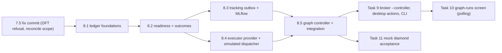

# Task 8 Graph Controller and Tracking Repair — Reviewable Sub-task Plan

> **For agentic workers:** REQUIRED SUB-SKILL: superpowers:subagent-driven-development (recommended) or
> superpowers:executing-plans. Each sub-task below is one implementer and one independent review, test-first.
> Steps use checkbox (`- [ ]`) syntax.

**Parent plan:** [General-purpose training workflows, Task 8](2026-10-17-general-training-workflows.md#task-8-여러-배정-pod의-지속-컨트롤러와-mlflow-저장-복구)
("여러 배정 Pod의 지속 컨트롤러와 MLflow 저장 복구"). **Spec:** [design §4, §7](../specs/2026-10-17-general-training-workflows-design.md#7-병렬-자원복구기록)
and the [SSH server extension](../specs/2026-10-19-ssh-gpu-servers-extension.md). **Builds on:** the
[Task 7 sub-plan](2026-10-20-task7-model-operations.md) §5 and the "Task 8 interface" in `docs/PROGRESS.md`.

**Goal:** One persistent controller per state directory dispatches ready graph nodes across several existing,
approved Pods and SSH servers. It only dispatches after the parents completed, their artifacts were verified
and their evidence was saved. Selection stays local. Pause, cancel, restart and reconcile never retrain. A total
budget and a bounded retry policy hold. Execution outcome and tracking status are stored separately, and MLflow
tracking is repaired through an idempotent outbox that never registers a model twice.

**Baseline:** HEAD `14c1ba4` on `codex/general-training-workflows`. The last full receipt in PROGRESS is
`uv run pytest -q` → 1054 passed, 1 skipped, Ruff clean. Task 7 is complete in software. **The 7.5 review-fix
commit (planning-time OFT refusal, restricted `reconcile` scope) is not yet committed; 8.1 starts only after it
lands** (§1).

**Status:** planning only. This document authorizes no GPU, SSH, network, model download, MLflow write,
institution data or paid resource.

---

## 0. Facts verified for this plan (evidence)

All facts were checked on 2026-10-20 against HEAD `14c1ba4`, the uncommitted 7.5 fix in the working tree
(read only), or a throwaway probe in `%TEMP%` (deleted).

| # | Fact | Evidence |
|---|---|---|
| F1 | **A held local-selection lock blocks every GPU claim.** `claim_ready` claims a select under `local:<run_id>` (graph_store.py:245-247), and `_resource_blocked` treats any held lock whose prefix differs from the claimant's provider as cross-provider hardware, exempting only `mock-cpu` (jobs.py:274-277). `foreign_provider_lock` reports it too (jobs.py:351). | Probe: with `local:run1` held, `_resource_blocked(db, "existing_runpod:pod1")` → `True` and `foreign_provider_lock("existing_runpod:pod1")` → `True`. A `simulation:`-prefixed lock behaves the same. `pod2` is not blocked by `pod1`, and `local:run1` is not blocked by `pod1`. |
| F2 | `claim_ready(facts, lease)` can return a **select** even when called for a GPU destination: the select branch ignores `resource_facts`. | graph_store.py:242-258. |
| F3 | The destination is pinned when the node is compiled, not at claim time. `prepare_ready` freezes `operation.resources` into the job manifest, and `claim_ready` only claims jobs whose pinned facts fit the observation. Without a resolver, `_bindings` always picks `allowed_resources[0]` (graph_store.py:172), so a node that lists several profiles can only ever run on the first one. | graph_store.py:162-221, 250-253; graph_planner.py:667-670. |
| F4 | Runs only have the statuses RUNNING/PAUSED/CANCELED, and `_state` lets `resume` reopen any non-canceled run. Nodes are never marked FAILED, and a CANCELED attempt leaves its node RUNNING. | graph_store.py:368-389; nodes are written only at :217, :257, :335, :380. |
| F5 | `record_outputs` refuses every `inspected_targets` (graph_store.py:316-319), and requires a model for a select (:281-282), so a no-winner selection can't be recorded. | Code. `select_best` returns `winner=None`, status `no_winner`, for an all-simulation candidate set (benchmarks.py:139-150, 224-229). |
| F6 | `compile_node` requires every explicit dependency to be completed **and** `tracking_acknowledged` (graph_planner.py:659-664), and producer evidence requires acknowledgement (`_check_producer`, :186-187). The acknowledgement comes from `tracking_outbox.acknowledged` (graph_store.py:142-154, 351-357). That is the existing "block dependants until evidence is saved" gate. | Code. |
| F7 | Only `time.time()` is used for leases and heartbeats (graph_store.py:115-137, jobs.py throughout). `JobStore.recover` is global: it marks any stale active job FAILED, legacy ones included (jobs.py:497-506). | Code. |
| F8 | The runner's order is `begin_launch` → `_prepare` (local only) → `transition(lease, "RUNNING")` → `executor.run_operation` (attempt_runner.py:117, 193-195). `run_operation` writes `remote-attempt.json` before its first `open_sftp` (execution.py:509-519) and **never consults the attempt lease**. | Code. This is the evidence for the automatic-release rule in 8.2 (D9). |
| F9 | The runner releases the lock, **then** seeds the remote cache (attempt_runner.py:219-222). Seeding is best effort, recorded in `<launch_id>.cache-seed.json`, and never retried. The next launch on that host uploads a missing entry itself (`remote_model_cache.ensure_cached`). | Code; PROGRESS 7.4/7.5. |
| F10 | v1 `register_candidate` calls `create_model_version` without any search (tracking.py:83-94). v1 `reconcile` calls it again (runner.py:317-319), so a crash after a successful registration duplicates the version. | Code. |
| F11 | The pinned MLflow client is `mlflow-skinny==3.17.1`. `search_model_versions` documents `name`, `run_id`, `source_path` and `tags.<key>` filters (backticks for keys with dots); `search_runs` takes a filter string. `MLflowTracker(uri, client=...)` accepts an injected client, so no network is needed in tests. | `uv.lock`; `inspect.getdoc(MlflowClient.search_model_versions)` locally (no network). The user's MLflow **server** version is unknown. |
| F12 | Nothing produces `ExecutorProfile.transport_settings_sha256` for RunPod, `TrackingDestination.public_settings_sha256`, or live RunPod `ResourceFacts`. Real planning requires the first two (graph_planner.py:434-436). `ResourceFacts.total_hourly_cost_usd` allows 0 (executor_profiles.py:34), which PROGRESS defers to Task 8. | `grep` over `src/`; PROGRESS "graph ResourceFacts still allows a 0 RunPod price (Task 8)". |
| F13 | `desktop_runtime.executor_for` builds an SSH executor with `config.profile(pod)`, whose identity is the default (`ssh-server`, revision `1`) unless a v1 receipt is passed (desktop_runtime.py:340). The runner requires `executor.server_profile == pinned profile` (attempt_runner.py:316-320). `recovery_executor` needs a `ServerApprovalReceipt` (desktop_runtime.py:359-373), and v2 jobs have none. | Code. |
| F14 | HF roots carry only hashes on the PC. `model_hub` keeps the config hash, not the bytes (model_hub.py:179). A frozen artifact must contain `config.json` and tokenizer files whose hashes equal the descriptor (model_artifacts.py:446-450), and an adapter's config/tokenizer must equal its HF base (`validate_lineage`). | Code. A simulated train on an HF root therefore needs a local config/tokenizer snapshot of that root (8.4). |
| F15 | The worker's evaluation limits are `training.check_generation_benchmark`: `"v2 evaluation supports greedy causal-LM generation benchmarks only"` and `"fp32 benchmark precision cannot be enforced by the pinned engine"` (training.py:60-65). `plan_graph` does not call it. | Code (plan Q8). |
| F16 | **7.5 fix (uncommitted, read only):** `reconcile` raises `ValueError("attempt is final: its lock is released, so reconcile never reopens it; use outputs_for …")` once an attempt no longer holds its lock (new private `_holds_lock`, which calls `_validate_lease`), and a COMPLETED final attempt is rebuilt with `outputs_for`. It also refuses a local `command.json` that differs from the ledger's request. `training.OFT_UNFREEZABLE` = `"OFT training is unsupported in graphs: its output cannot be frozen as a typed model artifact"` is refused at planning (`graph_planner`) and before launch (`attempt_runner`). The fix also edits `operation_outputs.py`, `execution.py` and `operation_dispatch.py`, but keeps the private imports of F17. | `git diff` of the working tree: `attempt_runner.py`, `graph_planner.py`, `training.py`, `operation_outputs.py`, `tests/test_operation_runner.py` (`test_reconcile_never_reopens_a_final_attempt`, `test_planning_refuses_an_oft_train_node_whose_output_must_be_frozen`). Line anchors in this plan are HEAD `14c1ba4`'s and will shift when the fix lands. |
| F17 | Private couplings: `attempt_runner` calls `GraphStore._bindings` (:254) and `JobStore._validate_lease` (:397). `operation_outputs` imports `dataset_splits._dataset` and `model_artifacts._files`, `_read_json`, `_tensor_header` (:31-43). `graph_store` and `runner` also call `_validate_lease`. | `grep`. |
| F18 | `GraphSpec.max_concurrent` defaults to 1 (graph_schema.py:99). `RetryPolicy` has `max_attempts` 1–5 and `backoff_seconds` 0–3600 (:91-93). `plan_graph` multiplies each node's maximum cost by `max_attempts` (graph_planner.py:488-495). Legacy `JobStore.claim` counts **all** active jobs, graph jobs included, against `Policy.max_concurrent` (jobs.py:318). | Code. |

---

## 1. Rules that apply to every sub-task

- Python 3.12, `uv sync --extra dev --extra tracking --locked`. Before each commit, run the sub-task's tests, its
  listed regressions, `uv run pytest -q` and `uv run ruff check src tests`.
- Work test-first. A missing module must fail tests, not collection. Use the `api()` pattern of
  `tests/test_operation_runner.py:49-61`.
- **No GPU, SSH, network, model download or MLflow write.** Every test uses fakes. Test modules for the provider,
  the simulated dispatcher, the outbox and the controller install an autouse fixture that makes
  `socket.socket.connect` raise, which proves there is no network. The main env must not import torch, peft,
  transformers, safetensors or huggingface_hub.
- **Coordination.** The 7.5 fix commit must be on the branch before 8.1 starts. Re-check every anchor in this
  plan against it, especially `reconcile`'s `attempt is final` rule and the OFT refusal. Do not edit files that
  another agent has uncommitted changes in. Stage and commit by path only.
- Legacy behaviour stays frozen: v1 `Factory.work`/`run_claimed` and their status semantics, v1 manifests,
  `desktop.py` actions, and both GPU locks (`git diff --exit-code containers/gpu-*.lock`).
- Default to dry-run. Simulation graphs never contact a provider or MLflow. Borrowed Pods and servers are never
  started, stopped or deleted, and remote cache entries are never deleted.
- Secrets live in memory only. No DB row, file, log line, exception text, `status()` field, tracking payload or
  MLflow tag may contain a credential. Each sub-task with secrets adds a synthetic-secret spy test.
- Crash injection uses `class Crash(BaseException)` (tests/test_operation_runner.py:64-65): it escapes every
  `except Exception`, so nothing after the crash point runs. Recovery then runs with a **new** controller
  instance and a new owner, after the old owner lease expired on the fake clock.
- Clock: the controller, `GraphStore` and `TrackingOutbox` take an injected `clock: Callable[[], float]` in epoch
  seconds (default `time.time`). `JobStore` keeps `time.time()`. Tests use `FakeClock(start=time.time())` with
  `advance(seconds)`. It must stay wall-clock compatible, because attempt heartbeats are written in wall time.
- Each sub-task appends to `docs/PROGRESS.md` what was actually verified and what remains unverified.
- **File-list deviations from the parent plan, which root must approve** (the parent lists `graph_controller.py`,
  `tracking_outbox.py`, `executor_profiles.py`, `tracking.py`, `runner.py`, `graph_store.py` and tests):
  - `jobs.py` (8.1): non-hardware lock namespaces, public lease API, the graph launch gate.
  - `graph_planner.py` (8.1): Q8 and RunPod-price planning refusals.
  - `attempt_runner.py` (8.1 public APIs; 8.2 `failure_kind`).
  - `operation_outputs.py`, `model_artifacts.py`, `dataset_splits.py` (8.1): public helper names.
  - `desktop_runtime.py` (8.4): `executor_for(..., profile_identity=)`.
  - New `simulated_dispatch.py` (8.4).
  - New test files `tests/test_graph_readiness.py` (8.2) and `tests/test_simulated_dispatch.py` (8.4).

---

## 2. Decisions taken here (conservative defaults; root or the user may overturn)

| # | Decision | Alternative |
|---|---|---|
| D1 | **Destination choice.** When a node becomes ready, the trusted resolver pins it to one of its *approved* alternatives. The ordering key is (resource currently blocked, number of this run's non-terminal jobs pinned to the same exclusivity key, index in `allowed_resources`). It is deterministic, never leaves the approval, and lets a diamond spread across two Pods. | Always the first alternative (F3). This is simpler, but it makes multi-profile nodes pointless. |
| D2 | **Concurrency.** Per run: at most `plan.graph.max_concurrent` (default **1**) active attempts, enforced by `claim_ready`, plus exclusive resource locks. Real concurrency therefore happens only on distinct exclusive resources. There is no cross-run cap: two approved runs may use two distinct Pods at once. Legacy `Policy.max_concurrent=1` is unchanged and keeps counting graph attempts (F18), so a legacy single job waits while a graph attempt is active. | A controller-wide cap. That is new scope. |
| D3 | **Cross-provider quarantine is kept for hardware.** A plan that mixes RunPod and SSH destinations runs those branches one at a time, and an uncertain lock on one provider stalls the other provider's work until it is reconciled. `status()` names that reason. Only the non-hardware namespaces `local:` and `simulation:` (plus the existing `mock-cpu`) are exempt (F1). | Map Pods to servers. There is no identity that proves they are distinct. |
| D4 | **Retry only provably finished remote failures.** An attempt is retryable only when its accepted remote result is FAILED. Pre-launch refusals, output verification failures, failures after `begin_launch` but before submission, cancellations and uncertain attempts are terminal for the node. Attempts that provably never ran (returned unlaunched, released before contact) are not counted against `max_attempts`, and their budget reservation is voided. | Retry everything. Deterministic failures would just burn budget. |
| D5 | **The tracking gate is the attempt evidence event.** A child is compiled only after its parents' graph, node and attempt runs exist and the attempt evidence is saved. Model registration does not gate children; it is shown separately. | Gate on registration. An uncertain registration would then stall the whole graph. |
| D6 | **Registration.** Every *real* (non-synthetic, non-simulation) model artifact of a train/merge/materialize attempt gets exactly one registered version, with tags `approval=pending` and `quality_qualified=false`, as v1 does. The key is artifact + producer attempt. Selection receipts are lineage artifacts and register nothing extra. | Register only selection winners. Fewer side effects, but a single-train graph would register nothing, unlike v1. |
| D7 | **Simulation graphs never write MLflow.** Their events are acknowledged by a local evidence sink under `state/tracking/`. | Mirror v1 `--mock`, which can log to MLflow. |
| D8 | **Cache seeding is not retried by the controller** (coordinator item 8). Seeding outside an attempt would use a borrowed host without holding its lock, and the next launch on that host uploads a missing entry anyway (F9). To keep the host exclusive while the runner seeds after `release_gpu`, the controller treats a resource as busy until the dispatch thread returns. | Retry seeding. That needs an unlocked remote write. |
| D9 | **Automatic release of an uncontacted attempt** (coordinator item 1). It happens only when the job is still PROVISIONING with `launch_started=1`, the controller took the attempt over in the same transaction, and the local `remote-attempt.json` is absent. The fenced old actor can then never pass `transition(..., "RUNNING")`, and `run_operation` is only reached after that transition (F8). A job that reached RUNNING without a remote record **stays manual**, because `run_operation` never re-checks the lease: a suspended old actor could still write the record and launch later. | Release whenever the record is absent. That is unsafe for the RUNNING window. |
| D10 | **v1 tracking.** Only `register_candidate` becomes idempotent (search by a stable key, adopt). v1 still turns a tracking failure into FAILED + `tracking-error.txt`. | Change v1 to separate tracking status. That is a behaviour change outside the graph scope. |
| D11 | **Destination hashes Task 9 must reuse.** `executor_profiles.runpod_transport_sha256(settings)` covers provider, Pod ID, SSH fingerprint and key-path reference, mirroring `SSHTransport`. `tracking.tracking_settings_sha256(public)` covers tracking URI, experiment, artifact location and auth mode, never a secret. | Leave them to Task 9 (F12). Then the controller cannot verify the pinned destinations. |
| D12 | **Pause/cancel gate at the point of no return.** `JobStore.begin_launch` refuses a graph-owned job whose run is not RUNNING. A pause that commits after a claim but before the launch therefore returns the attempt unlaunched. | A controller-side check. That leaves a race. |
| D13 | RunPod facts with a price ≤ 0 or non-finite are refused at planning (simulation too), and the live observation refuses them. Stored older plans stay readable. | Keep 0 allowed (F12). |
| D14 | `run_forever(stop_event)` stops claiming, keeps settling and tracking until in-flight dispatches return, then releases the owner lease. A killed process leaves uncertain attempts for the next controller to reconcile. | Release immediately. That orphans attempts until the TTL expires. |

---

## 3. Sub-tasks and sequence

| Sub-task | One line |
|---|---|
| **8.1** | Ledger foundations: non-hardware lock namespaces, public lease and helper APIs (`bindings_for`, `validate_lease`, public artifact helpers), additive migration, owner and run leases, run state machine, `begin_launch` pause gate, budget reservations, select/GPU claim separation, Q8 and RunPod-price planning refusals. |
| **8.2** | Readiness and outcomes: the trusted ledger binding resolver (with destination choice), gated `prepare_ready`, failure/blocked propagation, partial join, no-winner selection, atomic local selection with cancel precedence, persisted `inspected_targets`, retry dispositions and backoff, automatic release of provably uncontacted attempts, run finalization. |
| **8.3** | `TrackingOutbox` and MLflow: event schema and idempotency keys, graph/node/attempt hierarchy with lineage artifacts, stable-tag adoption after a lost receipt, bounded backoff, HTTPS rules, local sink for simulations, idempotent v1 registration. |
| **8.4** | Dispatch adapters: `ExecutorProvider` (in-memory secrets, approved revision, observed canonical Pod, v2 recovery executor) and the simulated dispatcher for dry-run graphs (Q21), which reuses `build_output_descriptor`. |
| **8.5** | `GraphController`: owner lease, tick/settle loop, threads per distinct resource, reconcile after takeover within the restricted scope, retries, pause/cancel, restart, status for polling, every parent RED item end to end, final verification. |



8.3 and 8.4 touch disjoint files and may run in parallel worktrees after 8.2. 8.3 adds enqueue hooks to
`graph_store.py`, and 8.4 must not edit it. Root integrates in order.

Runtime sequence of one real node after 8.5:

```mermaid
sequenceDiagram
  participant G as GraphController (tick)
  participant S as GraphStore / JobStore
  participant P as ExecutorProvider
  participant R as OperationAttemptRunner (thread)
  participant O as TrackingOutbox
  participant M as MLflow (tracker)
  G->>S: renew owner + run leases; settle jobs; readiness
  G->>S: prepare_ready(lease, node_ids=ready) (resolver pins destination, D1)
  G->>P: resolve(profile_id, approved_revision, pinned=…)
  P-->>G: ResolvedDestination(profile, observation, executor)
  G->>S: claim_ready(observation, lease) (budget reserved in the same txn)
  G->>R: run_claimed(claimed, executor, approval) in a thread
  R->>S: begin_launch (refused if paused/canceled) → … → COMPLETED, release_gpu, seed cache
  R-->>G: OperationOutcome (outputs, inspected_targets)
  G->>S: record_outputs(lease, NodeOutputs(…, inspected_targets)) + enqueue events (one txn)
  G->>O: claim_pending(owner) → publish
  O->>M: find-or-create graph/node/attempt runs, upload lineage, register (search first)
  O->>S: record_receipt → tracking_outbox.acknowledged=1 (gate)
  G->>S: next tick: children become ready
```

---

## 4. Sub-tasks

### 8.1 Ledger foundations

**Goal / scope.** Give the controller store-level primitives that are correct under concurrency:
- non-hardware lock namespaces;
- public replacements for the private couplings (coordinator item 3);
- an additive migration;
- an owner lease plus owner-bound run leases;
- a strict run state machine and the `begin_launch` pause gate;
- budget reservations and select/GPU separation in `claim_ready`;
- the Q8 and RunPod-price planning refusals (coordinator item 5).

**Non-goals.** Readiness, the binding resolver, failure propagation and retries (8.2); tracking (8.3); providers
and the controller loop (8.4/8.5).

**Files**
- `src/tuning_factory/jobs.py` (deviation): `_resource_blocked` (:260-286), `foreign_provider_lock` (:342-351),
  `begin_launch` (:432-439), the new public lease API next to `_validate_lease` (:217-226).
- `src/tuning_factory/graph_store.py`: `__init__` (:47-71), `acquire_controller` (:107-119), `_controller`
  (:121-129), `_bindings` (:162-176), `claim_ready` (:226-259), `_state`/`pause`/`resume`/`cancel` (:368-389).
- `src/tuning_factory/graph_planner.py` (deviation): `plan_graph` EvaluateNode block (:470-478), resource facts
  check (after the facts are validated at :422).
- `src/tuning_factory/attempt_runner.py` (deviation): `_continuation_evidence` (:248-255), `_attempt` (:395-397),
  and the 7.5 fix's new `_holds_lock`, all switched to the public APIs.
- `src/tuning_factory/model_artifacts.py`, `dataset_splits.py`, `operation_outputs.py` (deviation): public
  helper names.
- `src/tuning_factory/runner.py`: `reconcile` uses the public `validate_lease` (:295).
- Tests: `tests/test_graph_store.py`, `tests/test_graph_planner.py`, `tests/test_operation_runner.py` (new
  cases only; do not edit cases the 7.5 agent owns), `tests/test_model_artifacts.py`.

**Interfaces**

```python
# jobs.py
NON_HARDWARE = ("local:", "simulation:")          # new; plus the existing literal "mock-cpu"
GRAPH_LAUNCH_REFUSED = "graph run is not running; launch refused"   # new
class JobStore:
    def validate_lease(self, db, lease) -> sqlite3.Row      # new public name; _validate_lease = validate_lease
    def validated_attempt(self, lease) -> dict              # new: own connection, same row as validate_lease
    def begin_launch(self, lease) -> str                    # existing; adds the graph run gate (D12)

# model_artifacts.py / dataset_splits.py (new public names; the private names become aliases)
def list_files(directory) -> list[tuple[str, Path]]        # = _files
def read_json(path)                                          # = _read_json
def tensor_header(path, relative) -> tuple[TensorMetadata, ...]   # = _tensor_header
def load_dataset(registry, ref) -> tuple[dict, list, dict]   # dataset_splits; = _dataset

# graph_store.py
@dataclass(frozen=True)
class OwnerLease:                                          # new
    owner_id: str
    lease_token: str
OWNER_HELD = "controller already running"                  # new
STALE_OWNER = "stale controller owner lease"               # new
class GraphStore:
    def __init__(self, path, *, registry=None, artifact_store=None, binding_resolver=None,
                 clock: Callable[[], float] = time.time)    # clock is new
    def acquire_owner(self, owner_id: str, *, ttl_seconds: float = 60) -> OwnerLease          # new
    def renew_owner(self, owner: OwnerLease, *, ttl_seconds: float = 60) -> None               # new
    def release_owner(self, owner: OwnerLease) -> None                                         # new (expires = 0)
    def owner_state(self) -> dict | None     # new: owner_id, acquired, heartbeat, expires; never the token
    def acquire_controller(self, run_id, ttl_seconds=60, *, owner: OwnerLease | None = None)   # owner is new
    def bindings_for(self, run_id: str, node_id: str) -> VerifiedBindings                      # new public hook
    def claim_ready(self, resource_facts, controller_lease)   # existing; semantics below
    def return_unlaunched(self, controller_lease, attempt_lease, *, reason: str) -> str        # new
    def reserved_budget(self, run_id) -> float                # new: sum of RESERVED reservations
```

- `owner_id` must match `^[A-Za-z0-9][A-Za-z0-9_.:-]{0,127}$`.
- `acquire_controller(owner=...)` validates the owner lease in the same transaction. It replaces an existing run
  lease that has expired or whose `owner_token` is set and differs from ours. An unexpired run lease with a NULL
  `owner_token` (taken through the old API) is never stolen: `controller lease already held`. With
  `owner=None` the old behaviour is unchanged.
- `bindings_for(run_id, node_id)` replaces `_bindings(plan, entry, run_id)`, and `_bindings` is removed. 8.1 keeps
  today's behaviour; 8.2 backs it with the resolver. `attempt_runner._continuation_evidence` calls `bindings_for`,
  and `_attempt` calls `jobs.validated_attempt`.
- `claim_ready`:
  - With `resource_facts` given, it skips selects. With `None`, it claims only selects (F2).
  - A simulation plan claims `simulation:` + the exclusivity key.
  - In the same transaction it inserts a `budget_reservations` row for the new attempt. The cost is the pinned
    `facts.cost(timeout_seconds)`, or 0 for a select.
  - It skips a job whose counted attempts already reached `retry_policy.max_attempts`. That integer check is
    authoritative.
  - It skips a job when `reserved + cost > plan.max_estimated_cost_usd * (1 + 1e-9)`. This is defence in depth
    against float summation order.
- `return_unlaunched` applies only to PROVISIONING with `launch_started=0`. It releases the lock, voids the
  reservation, writes the disposition `returned_unlaunched` (uncounted), and moves the job through RETRYING to
  QUEUED (node READY) when the run is RUNNING or PAUSED, or to CANCELED (node CANCELED) when the run is CANCELED.
- `_state`:
  - pause: only RUNNING → PAUSED (`only a running graph can pause`); PAUSED is idempotent.
  - resume: only PAUSED → RUNNING (`only a paused graph can resume`); RUNNING is idempotent. The existing
    `canceled graph cannot resume` stays.
  - cancel: from RUNNING or PAUSED; CANCELED is idempotent; a COMPLETED or FAILED run refuses
    (`a finished graph cannot be canceled`). The existing job/node updates stay.
- `begin_launch`: when `row['graph_run_id']` is set and that run's status is not RUNNING, it raises
  `GRAPH_LAUNCH_REFUSED` and leaves `launch_started=0`. Non-graph jobs are untouched.
- `plan_graph`:
  - EvaluateNode calls `training.check_generation_benchmark(benchmark)`, with the worker's exact messages (F15).
  - RunPod `ResourceFacts` with `total_hourly_cost_usd` ≤ 0 or non-finite are refused:
    `RunPod resource facts require a positive live hourly price`. SSH facts may still cost 0.
  - Both rules apply in simulation too. They sit beside the 7.5 OFT refusal and must not reorder it.

**SQLite migration** (one `BEGIN IMMEDIATE` in `GraphStore.__init__`; `CREATE TABLE IF NOT EXISTS` plus
`PRAGMA table_info`-guarded `ALTER TABLE ... ADD COLUMN`, as `JobStore` does at jobs.py:67-71):

```sql
CREATE TABLE IF NOT EXISTS controller_owner (
  id INTEGER PRIMARY KEY CHECK (id = 1), owner_id TEXT NOT NULL, lease_token TEXT NOT NULL,
  acquired REAL NOT NULL, heartbeat REAL NOT NULL, expires REAL NOT NULL);
-- controller_leases: ADD COLUMN owner_token TEXT          (NULL for pre-Task-8 rows)
-- nodes:             ADD COLUMN retry_not_before REAL; ADD COLUMN wait_reason TEXT; ADD COLUMN updated REAL
CREATE TABLE IF NOT EXISTS budget_reservations (
  attempt_id TEXT PRIMARY KEY, run_id TEXT NOT NULL, node_id TEXT NOT NULL, job_id TEXT NOT NULL,
  resource_id TEXT NOT NULL, max_cost_usd REAL NOT NULL,
  status TEXT NOT NULL CHECK (status IN ('RESERVED','VOID')), created REAL NOT NULL);
CREATE TABLE IF NOT EXISTS attempt_dispositions (
  attempt_id TEXT PRIMARY KEY, run_id TEXT NOT NULL, node_id TEXT NOT NULL, job_id TEXT NOT NULL,
  disposition TEXT NOT NULL, counted INTEGER NOT NULL, detail TEXT, created REAL NOT NULL);
-- backfill: INSERT OR IGNORE a RESERVED row for every existing graph attempt (cost from its manifest)
```

Run statuses become RUNNING, PAUSED, CANCELED, COMPLETED and FAILED; the last two are written by 8.2. Node
statuses become PENDING, READY, RUNNING, COMPLETED, CANCELED, FAILED and BLOCKED. Existing rows are valid
unchanged.

**Failing tests**
1. `test_local_selection_lock_never_blocks_gpu_claims`: with `local:<run>` held, neither a RunPod nor an SSH claim
   is blocked, and `foreign_provider_lock` is False (RED today, F1).
2. `test_simulation_namespace_is_isolated_from_hardware_locks`: real and simulated locks on the same Pod never
   block each other. Two simulated claims on the same key do.
3. `test_unknown_and_cross_provider_locks_still_quarantine`: `legacy-unknown:` and cross-provider hardware locks
   block exactly as before (D3 regression).
4. `test_public_lease_api_matches_private`: `validate_lease`/`validated_attempt` return the old row and raise
   `stale attempt lease`. `_validate_lease is validate_lease`.
5. `test_pre_task8_state_db_migrates_additively`:
   - Setup: a DB built with HEAD's DDL (graph_store.py:53-71 and jobs.py:43-66 copied verbatim), holding a run,
     a completed node with `node_outputs`, an unacknowledged `tracking_outbox` row and a held attempt.
   - The new tables and columns exist, and `ledger()` is byte-identical.
   - An old NULL-owner run lease still validates, the held attempt gets a backfilled reservation, and a second
     open changes nothing.
6. `test_owner_lease_excludes_a_second_controller_and_expires`: the second acquire raises `controller already
   running`. After `FakeClock.advance(ttl + 1)` it succeeds, and the old `renew_owner` raises `stale controller
   owner lease`. `release_owner` allows an immediate re-acquire.
7. `test_owner_takes_over_run_leases_of_an_expired_owner`: owner B replaces expired owner A's run lease. A's
   `ControllerLease` then fails `prepare_ready`, `claim_ready` and `takeover_attempt` with `stale controller
   lease`. A NULL-owner unexpired lease is not stolen.
8. `test_run_state_machine`: every allowed and refused transition above, including resume of CANCELED and pause,
   resume and cancel of COMPLETED/FAILED runs.
9. `test_begin_launch_refuses_when_graph_paused_or_canceled`: claim, pause, `begin_launch` →
   `graph run is not running; launch refused`, and `launch_started` stays 0. After resume it succeeds. A legacy
   job's `begin_launch` is unaffected.
10. `test_return_unlaunched_requeues_without_counting`: the lock is free, the job is QUEUED, the reservation is
    VOID and the disposition is uncounted. Under cancel the job is CANCELED.
11. `test_claim_ready_separates_local_selection_from_gpu_claims`: with a higher-priority queued select, a call with
    facts returns the train. `claim_ready(None)` returns only the select.
12. `test_claim_reserves_budget_atomically_and_refuses_over_budget`: one reservation per attempt. Reservations at
    the approved total stop further claims, and so do counted attempts at `max_attempts`. Four racing threads
    never exceed either.
13. `test_simulation_plan_claims_in_simulation_namespace`: the attempt's `resource_id` starts with `simulation:`,
    and a legacy `JobStore.claim` on the real key still succeeds.
14. `test_planning_refuses_benchmarks_the_pinned_engine_cannot_enforce` (parametrized: `sample`, `fp32`,
    `reward_model`; simulation and real): the worker's exact messages (Q8).
15. `test_planning_refuses_a_zero_or_nonfinite_runpod_price`: a zero or non-finite RunPod price is refused; an SSH
    price of 0 is accepted.
16. `test_operation_outputs_uses_only_public_helpers`: an AST check that `operation_outputs` imports no
    `_`-prefixed name from `model_artifacts` or `dataset_splits`. The aliases are identical objects.
17. `test_runner_uses_public_bindings_for`: a spy on `GraphStore.bindings_for` sees the continuation call, and
    `GraphStore` has no `_bindings` attribute.

**Implementation notes**
- `_resource_blocked`:
  - A held lock whose name starts with a `NON_HARDWARE` prefix (or equals `mock-cpu`) is skipped when the
    claimant is hardware.
  - A non-hardware claimant is blocked only by an exact match. That is already true, because its provider is
    None.
  - `foreign_provider_lock` filters the same names.
- The reservation cost reuses `ResourceFacts.cost`/`SSHServerFacts.cost` on the manifest's pinned facts. Counted
  attempts = `job_attempts` rows of the job minus dispositions with `counted=0`.
- `begin_launch` reads `graph_runs` inside its existing `BEGIN IMMEDIATE`. The table always exists when
  `graph_run_id` is set.
- Keep `_controller`'s query, and use `self.clock()` instead of `time.time()`.

**Verification**
- `uv run pytest tests/test_graph_store.py tests/test_graph_planner.py tests/test_jobs.py tests/test_reconciliation.py tests/test_operation_runner.py tests/test_gpu_servers.py tests/test_desktop_servers.py -q`:
  all pass.
- Then the full `uv run pytest -q` and `uv run ruff check src tests`.

**Commit:** `feat: fence graph controllers and reserve budgets in the graph ledger`

---

### 8.2 Readiness, outcomes, failure propagation and safe release

**Goal / scope.**
- The trusted `LedgerBindingResolver` assembles `VerifiedBindings` from the ledger, including D1.
- `prepare_ready` only compiles nodes the controller found ready.
- Failure becomes FAILED, and its descendants BLOCKED.
- Partial join; no-winner selection; atomic local selection where cancel wins.
- `inspected_targets` are persisted through the verifier (coordinator item 4).
- Retry dispositions and backoff on the injected clock.
- Automatic release of provably uncontacted attempts (coordinator item 1, D9).
- `OperationAttemptRunner.failure_kind`, and run finalization.

**Non-goals.** Tracking events (8.3 adds the enqueue calls to the same transactions); providers (8.4); the loop
(8.5).

**Files**
- `src/tuning_factory/graph_store.py`: `prepare_ready` (:178-221), `record_outputs` (:274-335), `ledger`
  (:139-160), `NodeOutputs` (:38-43), and the new methods below.
- `src/tuning_factory/attempt_runner.py` (deviation): new `failure_kind`.
- Tests: new `tests/test_graph_readiness.py`, plus additions to `tests/test_operation_runner.py`. It reuses
  `build_graph`/`world` from that module and `inputs` helpers from `tests/test_model_inputs.py`.

**Interfaces**

```python
@dataclass(frozen=True)
class NodeOutputs:                                   # existing; one new optional field
    model: NodeModelBinding | None = None
    evaluation: NodeEvaluationBinding | None = None
    inspected_targets: tuple[ModelTargetEvidence, ...] = ()
    selection: SelectionResult | None = None         # new: only a no-winner selection uses it

class LedgerBindingResolver:                         # new, trusted; installed as store.binding_resolver
    def __init__(self, store: GraphStore)
    def __call__(self, plan, node_id, ledger) -> VerifiedBindings

@dataclass(frozen=True)
class Readiness:                                     # new
    node_id: str
    state: Literal["ready", "waiting", "blocked", "done"]
    reason: str | None                               # e.g. "waiting for tracking of train.1"
    failed_parents: tuple[str, ...] = ()

class GraphStore:
    def readiness(self, run_id) -> tuple[Readiness, ...]                                     # new, pure read
    def prepare_ready(self, controller_lease, node_ids: Iterable[str] | None = None)         # node_ids is new
    def fail_node(self, controller_lease, node_id, error) -> None                             # new
    def block_descendants(self, controller_lease, node_id) -> tuple[str, ...]                # new
    def complete_local_selection(self, controller_lease, claimed) -> NodeOutputs | None      # new
    def classify_attempt(self, controller_lease, job_id, kind: FailureKind) -> str           # new: disposition
    def requeue_retry(self, controller_lease, job_id) -> bool                                 # new
    def release_uncontacted(self, controller_lease, job_id) -> bool                           # new (D9)
    def recover_stale(self, controller_lease, *, stale_before: float) -> tuple[str, ...]     # new, run-scoped
    def finalize_run(self, controller_lease) -> str | None                                    # new
    def set_wait_reason(self, controller_lease, node_id, reason: str | None) -> None         # new
    def record_outputs(self, attempt_lease, outputs)   # existing; accepts verified targets and no-winner

# attempt_runner.py (new method; dispatchers implement the same)
FailureKind = Literal["remote_failed", "output_invalid", "refused_before_launch",
                      "failed_before_submit", "canceled", "uncertain"]
class OperationAttemptRunner:
    def failure_kind(self, job_id: str) -> FailureKind | None   # None for COMPLETED
```

**Resolver rules** (`VerifiedBindings` fields, graph_planner.py:628-644):
- `outputs`: `NodeModelBinding` of every completed node with a model.
- `producers`: the plan's artifact producers plus `producer_evidence(current_lease(job), model)` for each
  completed producer node. This reuses graph_store.py:346-366, which refuses unacknowledged tracking.
- `evaluations`: completed evaluate nodes, with `NodeExecutionEvidence` as the producer and
  `tracking_acknowledged=True` only when acknowledged.
- `failed_parent_node_ids`: a select's evaluation parents in FAILED, BLOCKED or CANCELED.
- `base_targets`: the plan's evidence plus every persisted `inspected_targets` entry, re-checked with
  `verify_inspected_targets(evidence, store.artifacts.verify(base), base)` on read.
- `completed_nodes`: from `ledger()`.
- `tracking_destination`: the plan's.
- `destination_profile`: the job manifest's executor when the node already has a job. Otherwise it is chosen by
  D1. Exclusivity keys come from `facts.exclusivity_key`, so aliases share load; "blocked now" comes from
  `JobStore._resource_blocked` on that key.

**Readiness rules**
- `ready`: every parent in `graph_edges` (graph_schema.py:110-112) is COMPLETED and its attempt evidence is
  acknowledged.
- `waiting`: a parent is not terminal, or its tracking is pending.
- `blocked`: a parent is FAILED, BLOCKED or CANCELED, or the model port comes from a no-winner select
  (`selection produced no winner`).
- A select with `allow_partial` is ready once every evaluation parent is terminal. Without it, a failed
  evaluation parent blocks it (`partial selection is not allowed`).
- `prepare_ready(node_ids=None)` keeps today's behaviour exactly; existing tests rely on it. With `node_ids`, a
  compile `ValueError` calls `fail_node` and `block_descendants` instead of leaving PENDING with an error.

**Outputs**
- `inspected_targets`:
  - Accepted only for a model output, each through `verify_inspected_targets(evidence, descriptor, model.model)`,
    and stored in the payload.
  - An evaluation with targets is refused: `evaluation cannot publish inspected targets`.
  - The verifier's own messages pass through, e.g. `inspected target evidence belongs to another base`.
  - A payload without targets keeps today's bytes (`"inspected_targets": []`).
- No-winner select: `outputs.model is None` is allowed only for a select whose `outputs.selection` equals
  `resolve_local_selection(spec)` with status `no_winner`. The payload gains a `"selection"` key **only when
  present**, so earlier receipts keep their bytes.
- `complete_local_selection` runs in one `BEGIN IMMEDIATE`:
  1. Validate the controller lease and the attempt lease.
  2. Check the run status:
     - CANCELED → the job and node become CANCELED, the `local:` lock is released, and nothing is recorded
       (**cancel wins over join**);
     - PAUSED → `return_unlaunched` semantics.
  3. Compute the receipt with `resolve_local_selection`.
  4. Move the job PROVISIONING → RUNNING → EVALUATING → COMPLETED, with one `events` row per step.
  5. Insert `node_outputs` and the `tracking_outbox` row, and release the lock.

  A crash anywhere rolls back everything.

**Dispositions and retries**
- `classify_attempt` writes `attempt_dispositions` once per attempt. Writes are idempotent; a differing kind for
  the same attempt raises `attempt disposition is immutable`.
  - `remote_failed`: counted and retryable. When counted attempts < `max_attempts`, it sets
    `nodes.retry_not_before = clock() + backoff_seconds`. Otherwise the node becomes FAILED and its descendants
    BLOCKED.
  - `output_invalid`, `refused_before_launch`, `failed_before_submit`: counted and terminal.
  - `canceled`: terminal, and the node becomes CANCELED.
  - `uncertain` is never classified; it is reconciled.
- `requeue_retry` requires a RUNNING run, a FAILED job with no lock, a due `retry_not_before` and counted
  attempts below the limit. It moves the job FAILED → QUEUED and the node to READY, then clears
  `retry_not_before`.
- `failure_kind` reads the job, the attempt row and the runner's persisted `launches/<launch_id>.result.json`:
  - result FAILED → `remote_failed`;
  - result COMPLETED but job FAILED → `output_invalid`;
  - `launch_started=0` → `refused_before_launch`;
  - started, no result, lock released → `failed_before_submit`;
  - lock held and FAILED → `uncertain`.

**Safe automatic release (D9)**

`release_uncontacted` runs in one transaction:
1. Validate the controller lease.
2. Require the job to belong to the run and to be PROVISIONING with `launch_started=1` and `legacy=0`.
3. Rotate the attempt token (the same effect as `takeover_attempt`).
4. Check that `<state>/jobs/<job>/launches/<launch_id>/remote-attempt.json` is absent.
5. If all of this holds, set the job FAILED with `attempt stopped before remote contact; released after
   takeover`, release the lock, void the reservation, and write the disposition `released_before_contact`
   (uncounted).
6. Otherwise return False and change nothing except the token rotation.

Why this is safe: the old actor's next `transition(lease, "RUNNING")` now fails, and the runner calls
`run_operation`, the only writer of the record, after that transition (F8). The file check after the rotation is
therefore stable. A job already RUNNING (or FAILED through any `recover`) is never released automatically.

`recover_stale` is the run-scoped equivalent of `JobStore.recover`. It never touches a PROVISIONING attempt with
`launch_started=1`, which goes to `release_uncontacted` first, and it never touches legacy jobs.

**Finalization.** `finalize_run` acts when every node is terminal and no job of the run holds a lock:
- every node COMPLETED → run COMPLETED;
- any node FAILED or BLOCKED → run FAILED;
- a CANCELED run stays CANCELED.

Tracking does not hold back finalization (D5). Its status is separate.

**Failing tests** (`tests/test_graph_readiness.py`, unless noted)
1. `test_resolver_assigns_parallel_branches_to_distinct_destinations`: in a diamond with two approved Pods, B and C
   are pinned to `pod1` and `pod2`. With a legacy lock on `pod1`, B goes to `pod2`.
2. `test_resolver_aliases_share_load_and_lock`: two profiles of the same Pod, and two SSH profiles of the same
   `server_id`, have one exclusivity key and one load count.
3. `test_bindings_for_reuses_the_pinned_destination_and_ledger_evidence`: for a prepared node, `bindings_for`
   returns the manifest's executor. The runner's continuation evidence equals what compile used.
4. `test_children_compile_only_after_parent_completion_and_tracking_ack`: while tracking is unacknowledged the
   child is `waiting` and nothing is compiled or written to `error`. After `acknowledge_tracking` it compiles.
5. `test_parent_failure_blocks_descendants`: a FAILED parent makes the whole subtree BLOCKED, with no job created
   or claimed.
6. `test_partial_join_selects_from_surviving_evaluations`:
   - three evaluations, one failed, `allow_partial` and `min_success=2` → the select compiles with
     `failed_parent_node_ids` and picks between two;
   - without `allow_partial` → BLOCKED (`partial selection is not allowed`);
   - with one survivor → a recorded no-winner receipt with `insufficient_partial_success`.
7. `test_no_winner_selection_is_recorded_and_blocks_model_children`: a simulation candidate set gives
   `no_winner`, the model child is BLOCKED, and older payload bytes are unchanged.
8. `test_local_selection_completes_atomically_and_cancel_wins`: a `Crash` after the `node_outputs` insert rolls
   back, and a rerun records once. A cancel before completion makes the select CANCELED with no outputs.
9. `test_inspected_targets_are_verified_and_persisted` (item 4):
   - materialized-model targets are persisted, returned by `ledger()` and used by the resolver;
   - forged dimensions or another base are refused;
   - re-recording is idempotent, and evaluation targets are refused.
10. `test_retry_is_bounded_and_backs_off_by_the_injected_clock`: `requeue_retry` is False before
    `retry_not_before` and True after `advance`. After `max_attempts` counted attempts the node is FAILED and its
    descendants BLOCKED. Uncounted dispositions consume nothing.
11. `test_terminal_failures_are_never_retried` (parametrized over the terminal kinds): the node becomes FAILED (or
    CANCELED) at once.
12. `test_release_uncontacted_only_with_provable_non_contact` (item 1), parametrized:
    - PROVISIONING, started, no record → released, uncounted and requeueable; the old lease's
      `transition(RUNNING)` raises `stale attempt lease`;
    - record present → False, lock held;
    - RUNNING → False;
    - FAILED after `JobStore.recover` → False (manual);
    - a never-started attempt → False (that is `return_unlaunched`/resume territory).
13. `test_recover_stale_is_run_scoped`: a stale legacy job and another run's job are untouched.
14. `test_finalize_run_statuses`: COMPLETED, FAILED and CANCELED as above. A held uncertain lock prevents
    finalization.
15. `tests/test_operation_runner.py::test_runner_failure_kind_classifies_from_persisted_records`: the 7.5 world
    cases (remote fail, freeze refusal, pre-launch refusal, uncertain, completed) map to the kinds above.

**Implementation notes**
- The resolver is installed by whoever owns the store's trusted path: the controller in 8.5, and tests directly.
  The store's default stays the root-only bindings, so Task 6/7 tests keep passing.
- Use the store's own transactions with direct SQL for multi-step state changes. The `events` rows must mirror
  `JobStore.transition` exactly: one row per status, with detail.
- The `release_uncontacted` file check must use the attempt's persisted `launch_id`, never a value from the
  caller.

**Verification**
- `uv run pytest tests/test_graph_readiness.py tests/test_graph_store.py tests/test_operation_runner.py tests/test_graph_planner.py -q`.
- Then the full `uv run pytest -q` and Ruff.

**Commit:** `feat: resolve ready graph nodes from verified ledger evidence`

---

### 8.3 Tracking outbox and MLflow repair

**Goal / scope.**
- `TrackingOutbox` with `enqueue(event, transaction)`, `claim_pending(lease)`, `record_receipt(event_id,
  remote_identity)` and `retry(event_id, error)`, as the parent plan names them.
- A publisher that maps events to an MLflow graph → node → attempt hierarchy with full lineage artifacts.
- Stable-tag adoption after a lost receipt, and no automatic create while a search is uncertain.
- Bounded backoff; HTTPS rules; a local sink for simulations (D7).
- Idempotent v1 registration (D10).

**Non-goals.** Scheduling (8.5); UI and operator screens (Task 9/10 call `rearm`/`status`); deleting remote runs
or versions (never).

**Files**
- Create `src/tuning_factory/tracking_outbox.py` and `tests/test_tracking_outbox.py`.
- Modify `src/tuning_factory/tracking.py`: new `MLflowTracker` methods, `tracking_settings_sha256`, and
  `register_candidate(..., attempt_id=)`.
- Modify `src/tuning_factory/graph_store.py`: enqueue in `submit`, `claim_ready`, `record_outputs`,
  `complete_local_selection` and `classify_attempt`; the gate update.
- Modify `src/tuning_factory/runner.py`: pass `attempt_id` at :205 and :319.

**Interfaces** (all new unless noted; §6 has the design and rationale)

```python
# tracking_outbox.py
EventKind = Literal["graph_run", "node_run", "attempt_run", "attempt_evidence", "model_registration",
                    "graph_summary"]
class TrackingEvent(StrictModel):
    run_id: LocalId; node_id: LocalId | None = None; job_id: LocalId | None = None
    attempt_id: LocalId | None = None; kind: EventKind; idempotency_key: str
    depends_on_key: str | None = None
    payload: dict                       # identities, hashes and relative evidence paths only
    @property
    def event_id(self) -> str           # sha256(canonical({"kind": kind, "key": idempotency_key}))
@dataclass(frozen=True)
class ClaimedEvent:
    event_id: str; claim_token: str; event: TrackingEvent
    intent: dict | None                 # a create may already have been sent
    parent_identity: dict | None        # receipt of depends_on (e.g. MLflow parent run ID)
@dataclass(frozen=True)
class OutboxRetryPolicy:
    max_tries: int = 8; base_seconds: float = 30; factor: float = 2; cap_seconds: float = 3600
class TrackingOutbox:
    def __init__(self, store: GraphStore, *, clock=time.time, policy=OutboxRetryPolicy())
    def enqueue(self, event: TrackingEvent, transaction: sqlite3.Connection) -> str
    def claim_pending(self, lease: OwnerLease, *, limit: int = 16) -> tuple[ClaimedEvent, ...]
    def record_intent(self, event_id: str, intent: dict, *, claim_token: str) -> None
    def record_receipt(self, event_id: str, remote_identity: dict, *, claim_token: str) -> None
    def retry(self, event_id: str, error: str, *, claim_token: str, uncertain: bool = False,
              permanent: bool = False) -> None
    def rearm(self, event_id: str) -> None   # operator: FAILED/UNCERTAIN → PENDING, tries=0, intent kept
    def backfill(self, lease: OwnerLease) -> int   # events for pre-8.3 unacknowledged tracking_outbox rows
    def status(self, run_id: str) -> dict          # counts and per-node tracking_status
class TrackingPublisher:
    def __init__(self, outbox: TrackingOutbox, store: GraphStore, tracker: GraphTracker | None, *,
                 local_sink: LocalEvidenceSink)
    def process(self, lease: OwnerLease, *, limit: int = 16) -> int
class LocalEvidenceSink:                  # simulation runs and runs without a pinned destination
    def __init__(self, state_root: Path)

# tracking.py (existing class; new methods only)
TRACKING_UNCERTAIN = "MLflow outcome is uncertain; searching before any new create"
def tracking_settings_sha256(public: Mapping) -> str
class MLflowTracker:
    def public_settings(self) -> dict    # tracking_uri, experiment, artifact_location, auth_mode; no secret
    def find_keyed_runs(self, key: str) -> list[dict]          # run_id, start_time, artifact_uri
    def create_keyed_run(self, key, *, parent_run_id, run_name, tags) -> dict
    def check_run_artifacts(self, run_id) -> None              # require_secure_artifacts on the run's root
    def log_lineage(self, run_id, files: Mapping[str, Path], *, params, metrics, artifact_path="lineage")
    def terminate(self, run_id, status: Literal["FINISHED", "FAILED", "KILLED"]) -> None
    def upload_model(self, run_id, directory: Path) -> None    # artifact_path="model"
    def ensure_registered_model(self, name) -> None
    def find_keyed_model_versions(self, name, run_id, key) -> list[dict]   # name, version
    def create_keyed_model_version(self, name, *, run_id, key, tags) -> dict
    def register_candidate(self, run_id, manifest, qualified, *, attempt_id=None)   # existing; adds search-first
```

**Failing tests** (`tests/test_tracking_outbox.py`; autouse socket guard and credential env isolation)
1. `test_outbox_schema_migrates_and_backfills_unacknowledged_attempts`: pre-8.3 `tracking_outbox` rows get events
   once. The ledger acknowledgement stays 0 until the attempt evidence is acknowledged.
2. `test_enqueue_is_idempotent_by_key_and_refuses_payload_drift`: the same key with a different payload raises
   `tracking idempotency key reused with different payload`.
3. `test_enqueue_shares_the_record_outputs_transaction`: a `Crash` after the enqueue and before the commit leaves
   neither `node_outputs` nor events. A rerun writes each once.
4. `test_hierarchy_graph_node_attempt_runs_with_lineage_artifacts`:
   - one graph run; node runs with `mlflow.parentRunId`; attempt runs under their node;
   - `lineage/plan.json`, `manifest.json`, `descriptor.json`, `inventory.json`, `evaluation.json`;
   - the documented tags and terminal statuses.
5. `test_dependants_wait_for_evidence_ack_while_the_gpu_lock_is_free`: after COMPLETED and `record_outputs` the
   lock is released, but the child stays `waiting`. After the receipt the child is `ready`. Execution status and
   tracking status are reported separately.
6. `test_lost_run_receipt_adopts_by_stable_tag`: `create_run` commits on the fake server, then raises `Crash`. A
   new outbox instance searches, adopts, and records `adopted=True`; `create_run` is called once.
7. `test_lost_registration_receipt_adopts_existing_version` (parent RED): `create_model_version` commits, then
   `Crash`. After the restart, `find_keyed_model_versions` adopts; there is one version.
8. `test_uncertain_search_never_creates` (parent RED):
   - with an intent recorded and the search raising, there are 0 further create calls;
   - after `max_tries` the event is UNCERTAIN, and `rearm` searches first again;
   - `create_model_version` is called exactly once in total.
9. `test_definitive_empty_search_after_a_failed_create_creates_once`: a create that fails before commit, then an
   authoritative empty search, gives exactly one version.
10. `test_duplicate_versions_adopt_lowest_and_are_never_deleted`: two pre-seeded versions with the key → the
    lowest is adopted and the receipt lists the duplicate. No delete API is called (the fake has none).
11. `test_bounded_exponential_backoff`: delays 30, 60, 120, 240, 480, 960, 1920, 3600 (capped), then FAILED. Before
    `next_attempt_at`, `claim_pending` returns nothing.
12. `test_tracking_retries_never_touch_execution`: during failing and retried uploads there are no
    `jobs`/`job_attempts`/`gpu_locks` changes and no new attempt.
13. `test_stale_tracking_claims_are_fenced`: owner A claims, then expires; owner B claims after `claim_expires`.
    A's `record_receipt` raises `stale tracking claim`.
14. `test_https_rules_apply_to_created_and_adopted_runs`:
    - with a token set and an http run artifact root, a created run is terminated FAILED and the event FAILED
      with `INSECURE_TRACKING`, before any upload;
    - an adopted http run is refused the same way;
    - the existing constructor refusals still hold.
15. `test_tracking_destination_must_match_the_pinned_plan`: when `tracking_settings_sha256` differs from the
    plan's `TrackingDestination`, events stay PENDING with `tracking destination differs from the approved plan;
    restart the controller with the approved MLflow settings`. There are no client calls and no tries consumed.
16. `test_simulation_runs_use_the_local_sink_only`: zero client calls, receipts under `state/tracking/<run_id>/`,
    and the gate opens.
17. `test_no_secrets_in_events_receipts_or_tags`: synthetic `MLFLOW_TRACKING_TOKEN` and OIDC secret values never
    appear in rows, receipt files or recorded client arguments.
18. `test_local_evidence_change_after_enqueue_is_refused`: a manifest edited after the enqueue gives a FAILED event
    with `local evidence changed after enqueue`. Nothing is uploaded.
19. `test_v1_register_candidate_adopts_after_a_lost_receipt`: commit, then `Crash` in `register_candidate`; v1
    `Factory.reconcile` adopts, and there is one version. The key includes the attempt.
20. `test_v1_tracking_failure_semantics_unchanged`: a v1 persistence failure is still FAILED with
    `tracking-error.txt` (D10 regression).

**Verification**
- `uv run pytest tests/test_tracking_outbox.py tests/test_evaluation_tracking.py tests/test_tracking_https.py tests/test_runner_cli.py tests/test_reconciliation.py tests/test_graph_store.py -q`.
- Then the full `uv run pytest -q` and Ruff.

**Commit:** `feat: repair MLflow tracking through an idempotent outbox`

---

### 8.4 Executor provider and simulated dispatcher

**Goal / scope.**
- `ExecutorProvider.resolve(profile_id, approved_revision)` resolves secrets in memory only, refuses a changed
  profile or transport, and checks the observed canonical Pod (or SSH facts) against the plan.
- A v2 recovery executor.
- Live RunPod facts with the price rule (D13).
- `SimulatedExecutorProvider`, and the simulated dispatcher for dry-run graphs (coordinator item 6, Q21; design
  in §5).

**Non-goals.** The broker and vault reading (Task 9 supplies the in-memory profile map); scheduling (8.5).

**Files**
- Modify `src/tuning_factory/executor_profiles.py`: protocol, concrete providers, `runpod_facts`,
  `runpod_transport_sha256`. `desktop_runtime` is imported lazily inside methods.
- Modify `src/tuning_factory/desktop_runtime.py` (deviation): `executor_for(..., profile_identity=None)` at
  :312-356 passes `profile_id/revision/name/credential_scope` to `config.profile(...)` at :340.
- Create `src/tuning_factory/simulated_dispatch.py` (deviation) and `tests/test_simulated_dispatch.py`.
- Add cases to `tests/test_executor_profiles.py` and `tests/test_desktop_runtime.py`.

**Interfaces**

```python
# executor_profiles.py
@dataclass(frozen=True)
class ResolvedDestination:
    profile: PublicExecutorProfile        # the approved, pinned public profile
    observation: ResourceObservation      # live (or simulated) canonical observation
    executor: object | None               # launch executor in its connection() context; None in simulation
@dataclass(frozen=True)
class ProfileSecrets:                     # in memory only; __repr__ redacts settings
    public: PublicExecutorProfile
    settings: Mapping[str, str]
class ExecutorProvider(Protocol):
    def resolve(self, profile_id: str, approved_revision: str, *, pinned: PublicExecutorProfile,
                runtime_profile: str | None = None, model_ops: bool = False
                ) -> AbstractContextManager[ResolvedDestination]: ...
    def recover(self, profile_id: str, approved_revision: str, *, pinned: PublicExecutorProfile,
                pinned_facts: ResourceObservation, manifest_sha256: str) -> AbstractContextManager[object]: ...
class SettingsExecutorProvider:           # implements ExecutorProvider
    def __init__(self, profiles: Mapping[str, ProfileSecrets], state_root: Path, *, clock=time.time)
class SimulatedExecutorProvider:          # implements ExecutorProvider; never imports desktop_runtime
    def __init__(self, *, clock=time.time)
PROFILE_CHANGED = "executor profile changed after approval; re-plan before running"
PROFILE_MISSING = "executor profile is not configured in this controller"
TRANSPORT_CHANGED = "executor transport settings changed after approval; re-plan before running"
POD_DIFFERS = "observed Pod differs from the approved Pod"
def runpod_facts(pod: Mapping, *, observed_at: datetime) -> ResourceFacts   # "positive finite live RunPod API price required"
def runpod_transport_sha256(settings: Mapping) -> str                         # D11

# simulated_dispatch.py
SIMULATION_ONLY = "simulated dispatch requires a simulation manifest"
ROOT_SNAPSHOT_MISSING = "simulated execution requires a local config/tokenizer snapshot of {repo}@{revision}"
class RootSnapshotSource(Protocol):
    def snapshot(self, root: HFRootRef) -> Path | None: ...
class DirectoryRootSnapshots:             # <dir>/<owner>/<name>/<revision>/ checked by local_config_sha256/local_tokenizer_fingerprint
    def __init__(self, directory: Path)
class SimulatedWorker:                    # writes worker-shaped launch outputs; no graph_store/jobs import
    def execute(self, operation, launch_dir: Path, request: WorkerRequest, resolved: ResolvedModelInputs, *,
                artifacts: ModelArtifactStore, roots: RootSnapshotSource | None,
                target_evidence: tuple[ModelTargetEvidence, ...]) -> OperationResult
class SimulatedOperationDispatcher:       # same protocol as OperationAttemptRunner
    def __init__(self, graph_store: GraphStore, *, root: Path, roots: RootSnapshotSource | None = None)
    def run_claimed(self, claimed, executor, *, approval) -> OperationOutcome
    def reconcile(self, job_id, executor) -> OperationOutcome | None
    def outputs_for(self, job_id) -> OperationOutcome
    def failure_kind(self, job_id) -> FailureKind | None
```

`SettingsExecutorProvider.resolve` steps:
1. The profile must exist (`PROFILE_MISSING`).
2. `public.revision == approved_revision` and `approval_destination(public) == approval_destination(pinned)`
   (`PROFILE_CHANGED`). This runs before any connection.
3. RunPod: `runpod_transport_sha256(settings) == pinned.transport_settings_sha256` (`TRANSPORT_CHANGED`).
4. `desktop_runtime.executor_for(settings, state_root, runtime_profile=…, model_ops=…,
   profile_identity=<pinned identity>)`.
5. The observation:
   - RunPod: `runpod_facts(executor.pod, observed_at=now)`, requiring `pod["id"] == pinned.pod_id` (`POD_DIFFERS`);
   - SSH: `executor.server_facts`, requiring `executor.server_profile == pinned`.
   - `observation_key(observation) == observation_key(pinned)` in both cases.

Price and inventory against the pinned facts are left to `claim_ready`'s `observation_fits` and the runner's
`_check_destination`, which keeps one rule.

`recover`:
- RunPod: `executor_for(settings, state_root, preflight=False, runtime_profile=…)`, as v1 reconcile does.
- SSH: `executor_for(settings, state_root, recovery=True, server_receipt=ServerApprovalReceipt.create(
  manifest_sha256, pinned, pinned_facts))`. This envelope exists in memory only and is never stored in
  `job_destinations`. It reuses the recovery identity checks, which tolerate GPU inventory drift (F13).

**Failing tests**
1. `tests/test_executor_profiles.py::test_provider_refuses_a_changed_profile_before_connecting`: a revision, body
   or transport change raises the fixed message, and a spy shows `executor_for` was not called.
2. `test_provider_compares_the_observed_canonical_pod`: another Pod ID gives `POD_DIFFERS`; a zero, missing or
   non-finite price is refused; SSH facts from another server fail the key check.
3. `test_runpod_facts_from_a_live_pod`: field mapping, timezone and refusals.
4. `test_provider_secrets_stay_in_memory`: synthetic secrets are absent from `jobs.db`, every file under
   `state/`, `repr(provider)`, exception texts and `status()`.
5. `tests/test_desktop_runtime.py::test_ssh_executor_carries_the_pinned_profile_identity`: with paramiko-shaped
   fakes as in that module, `executor.server_profile == pinned`. The default identity is unchanged without the
   keyword.
6. `test_v2_recovery_executor_uses_an_in_memory_receipt`: recovery-only, tolerant of inventory drift, and no
   `job_destinations` row is written.
7. `tests/test_simulated_dispatch.py::test_simulated_provider_contacts_nothing`: socket guard; the observation fits
   the pinned facts, and `desktop_runtime`/`paramiko` are not imported (subprocess `sys.modules` check).
8. `test_simulated_dispatch_refuses_real_manifests`: `abandon_unlaunched` with `SIMULATION_ONLY`, and no launch
   directory.
9. `test_simulated_train_freezes_through_build_output_descriptor`: `descriptor.simulation is True`, producer IDs
   from the ledger, root and effective base, and tokenizer bytes from the base. `record_outputs` accepts it.
10. `test_simulated_outputs_chain_through_compile_node`:
    - a simulation plan train → continue → merge → materialize → evaluate → select compiles child by child, with
      evidence and a root snapshot;
    - the select records `no_winner`.
11. `test_simulated_hf_root_requires_a_local_snapshot`: a missing snapshot, or one with a wrong config hash, is
    refused before `begin_launch` with `ROOT_SNAPSHOT_MISSING`.
12. `test_simulated_dispatch_is_deterministic_and_idempotent`: two fresh states give identical artifact IDs.
    `outputs_for` twice is identical. A crash after the freeze rebuilds identically through `reconcile` (lock
    held) or `outputs_for` (final).
13. `test_simulated_evaluation_is_never_selection_eligible`: `record.simulation is True`, and `select_best` excludes
    it with `simulation`.
14. `test_simulated_dispatch_imports_no_network_or_heavy_modules`: no paramiko, desktop_runtime, mlflow, torch or
    transformers in `sys.modules` after a full simulated chain.

**Verification**
- `uv run pytest tests/test_simulated_dispatch.py tests/test_executor_profiles.py tests/test_desktop_runtime.py tests/test_operation_runner.py tests/test_model_inputs.py -q`.
- Then the full `uv run pytest -q` and Ruff.

**Commit:** `feat: resolve approved destinations and simulate dry-run graph operations`

---

### 8.5 Graph controller and end-to-end recovery

**Goal / scope.** `GraphController(store, executor_provider, operation_dispatcher, tracker, clock)` with
`acquire_controller(owner_id)`, `tick(controller_lease)`, `run_forever(stop_event)` and `status()`. It:
- settles every graph job from DB state, so a crash and normal operation take the same path;
- dispatches one thread per claimed attempt;
- reconciles only within the restricted scope, after `takeover_attempt` (coordinator items 2 and 7);
- persists inspected targets from outcomes;
- applies D8 and drives the outbox.

It covers every parent RED item end to end and runs the final verification.

**Non-goals.** The broker process, stdin protocol, Windows vault, CLI commands and UI (Task 9/10).

**Files.** Create `src/tuning_factory/graph_controller.py` and `tests/test_graph_controller.py`; modify
`docs/PROGRESS.md`.

**Interfaces**

```python
Clock = Callable[[], float]
@dataclass(frozen=True)
class ControllerSettings:
    lease_ttl_seconds: float = 60; tick_seconds: float = 5; stale_attempt_seconds: float = 120
    reconcile_interval_seconds: float = 60; max_dispatch_threads: int = 8
class OperationDispatcher(Protocol):      # OperationAttemptRunner and SimulatedOperationDispatcher
    def run_claimed(self, claimed, executor, *, approval) -> OperationOutcome: ...
    def reconcile(self, job_id, executor) -> OperationOutcome | None: ...
    def outputs_for(self, job_id) -> OperationOutcome: ...
    def failure_kind(self, job_id) -> FailureKind | None: ...
class DispatchRouter:                     # routes by the manifest's lineage.simulation
    def __init__(self, real: OperationDispatcher, simulated: OperationDispatcher)
class DispatchPool(Protocol):
    def submit(self, key: str, fn: Callable[[], OperationOutcome]) -> Future: ...
@dataclass(frozen=True)
class TickReport:
    prepared: tuple[str, ...]; claimed: tuple[str, ...]; settled: tuple[str, ...]; reconciled: tuple[str, ...]
    retried: tuple[str, ...]; blocked: tuple[str, ...]; released: tuple[str, ...]; tracking_processed: int
class GraphController:
    def __init__(self, store: GraphStore, executor_provider: ExecutorProvider,
                 operation_dispatcher: OperationDispatcher, tracker: GraphTracker | None, clock: Clock, *,
                 simulated_provider: ExecutorProvider | None = None, outbox: TrackingOutbox | None = None,
                 pool: DispatchPool | None = None, settings: ControllerSettings = ControllerSettings())
    def acquire_controller(self, owner_id: str) -> OwnerLease
    def tick(self, controller_lease: OwnerLease) -> TickReport
    def run_forever(self, stop_event: threading.Event) -> None
    def status(self) -> dict
def graph_status(store: GraphStore, run_id: str | None = None, *, now: float) -> dict   # DB-only, secret-free
```

The constructor installs `LedgerBindingResolver(store)` as `store.binding_resolver`. `acquire_controller` is
`store.acquire_owner(owner_id, ttl_seconds=settings.lease_ttl_seconds)`.

**Tick phases.** Each phase is idempotent, and the DB is the source of truth.
1. **Leases.** `renew_owner`; a refusal stops the controller. The managed runs are those that are RUNNING or
   PAUSED, or that have a non-terminal node, a held lock or a non-terminal tracking event. For each,
   `acquire_controller(run_id, owner=lease)`, renewed every tick.
2. **Harvest** finished futures:
   - cache the `OperationOutcome` by job;
   - a `ValueError` that is `GRAPH_LAUNCH_REFUSED` → `return_unlaunched`;
   - any other exception becomes a wait reason; the next phase decides from the DB.
3. **Settle** each job of each managed run. Attempts that are in flight in this process are never touched.

   | Job state | Action |
   |---|---|
   | PROVISIONING, `launch_started=0`, stale | `takeover_attempt` → if RUNNING: dispatch the same attempt (`run_claimed`, launches once); else `return_unlaunched` |
   | PROVISIONING, `launch_started=1`, stale | `release_uncontacted` (D9) → requeue (uncounted). If it returns False: `recover_stale` → uncertain path |
   | RUNNING/EVALUATING, stale | `recover_stale` → FAILED with the lock kept |
   | FAILED **and lock held**, every `reconcile_interval_seconds` | `takeover_attempt` (fences the old actor) → `provider.recover(...)` → `dispatcher.reconcile(job_id, executor)`. None → keep waiting; the wait reason is `operator confirmation required: release-lock --confirm-execution-stopped` when no remote record exists |
   | COMPLETED **and lock held** | `takeover_attempt` → `reconcile` (rebuilds and releases) |
   | COMPLETED, no lock, no `node_outputs` | cached outcome, else `outputs_for` → `record_outputs(takeover lease, NodeOutputs(model, evaluation, inspected_targets=outcome.inspected_targets))` |
   | FAILED, no lock, no disposition | `classify_attempt(failure_kind(job))` |
   | retry due | `requeue_retry` |
   | CANCELED, node not CANCELED | mark the node CANCELED |

   `reconcile` is never called for a final attempt (F16). A defensive `attempt is final` refusal is treated as
   final, and the next row applies.
4. **Prepare** (run RUNNING): `readiness` → `prepare_ready(lease, node_ids=ready)`; then `set_wait_reason` for
   every waiting or blocked node.
5. **Local selections** (run RUNNING): `claim_ready(None, lease)` → `complete_local_selection`.
6. **GPU claims** (run RUNNING).
   - Candidate destinations are the distinct pinned `(profile_id, revision)` of QUEUED jobs.
   - Skip a destination whose exclusivity key is blocked in the DB, busy in-process (D8: a dispatch thread on that
     key has not returned), or whose run is at `max_concurrent`.
   - Otherwise open `provider.resolve(...)` (`simulated_provider` for simulation plans) → `claim_ready(observation,
     lease)`.
   - A claim is handed to the pool with the open destination context. The thread runs `run_claimed(claimed,
     destination.executor, approval=run["approval"])` and closes the context. With no claim, the context closes
     at once.
   - A provider refusal becomes the node's wait reason and consumes no attempt.
7. **Tracking:** the publisher's `process(owner_lease)`.
8. **Finalize:** `finalize_run` and the `graph_summary` event.

**`run_forever`** loops `tick` and `stop_event.wait(tick_seconds)`. After `stop_event`, it stops phases 5–6,
keeps 1–4 and 7 until the pool is empty, then calls `release_owner` (D14). **`status()`** returns
`graph_status(store, now=clock())` plus in-process data: in-flight job IDs and busy keys.

**`graph_status` contract** (Task 9 `graph_run_get`/`controller_status`; Task 10 polling). The DB is read only;
no secret, no remote path and no settings value appears.
- `controller`: `owner_id` and `state` (`running` if the heartbeat is fresh, `stale` if it expired, `absent` with
  no row), plus `heartbeat_age_seconds`.
- `runs[]`: `run_id`, `status`, `simulation`, `plan_sha256`, `approved_cost_usd`, `reserved_cost_usd`, `created`,
  and `tracking` (counts by event status), with `nodes[]` holding:
  - `node_id`, `label`, `kind`, `status`, `job_status`, `attempt_id`, `attempts`, `counted_attempts`,
    `max_attempts`;
  - `resource_id`, `destination_profile_id`;
  - `uncertain`, `needs_operator`, `wait_reason`, `error`, `retry_at`;
  - `tracking_status`: `not_started`, `pending`, `retrying`, `saved`, `uncertain` or `failed`;
  - `registration_status`, `output` (artifact ID or evaluation summary), `selection` (winner or `no_winner`),
    `cache_seed` (`published`, `failed` or `missing`).

**Deterministic fakes** (in `tests/test_graph_controller.py`)
- `FakeClock`.
- `FakeProvider`: `profile_id` → (pinned profile, observation, fake executor with `remote=True`, `pod` or
  `server_facts`, `model_cache_root`). It records resolve and recover calls and can be scripted to refuse, change
  the price or be unavailable.
- `ScriptedDispatcher`: implements `OperationDispatcher` with the real `JobStore` attempt API (`begin_launch`,
  `transition`, `release_gpu`, `reconcile_result`) and produces outputs with 8.4's `SimulatedWorker` and the real
  `freeze_operation_output`/`evaluation_record`. Per node it can be scripted to `complete`, `fail_remote`,
  `uncertain` (a later `deliver(job)` makes `reconcile` return a result), `block` on a `threading.Event`, hold in
  a `seed` phase after `release_gpu`, or `Crash` at a named step. It counts `training_calls[node_id]` and
  `launches[node_id]`.
- `ManualPool`: `submit` stores the callable; `run(job_id)` and `run_all()` execute it in the test thread. Two
  attempts can therefore be in flight deterministically, with no sleeps.
- `FakeMlflowClient` and the real `MLflowTracker` from 8.3.

**Failing tests** (`tests/test_graph_controller.py`; autouse socket guard)
1. `test_two_resources_run_a_diamond_concurrently` (RED): A → {B, C} → D with two approved Pods and
   `max_concurrent=2`. After A, one tick claims B on `pod1` and C on `pod2`, and both are in flight before either
   finishes. D runs after both. `training_calls` is 1 per node.
2. `test_one_pod_runs_ready_branches_sequentially` (RED): the same graph with one Pod, even with
   `max_concurrent=2`, never has two in flight. Every node completes once.
3. `test_aliases_of_one_pod_are_mutually_exclusive` (RED), parametrized: two profiles of one Pod; two SSH profiles
   of one `server_id`; two servers sharing a GPU UUID. Never concurrent.
4. `test_parent_failure_blocks_and_partial_join_proceeds` (RED): an evaluation failure with `allow_partial` (2 of
   3) → the select proceeds. Without it → BLOCKED. A train failure blocks its subtree, and the run is FAILED.
5. `test_pause_dispatches_nothing_new` (RED):
   - after `pause`, ticks make zero `resolve` (launch) calls, claims and `run_claimed` calls;
   - an in-flight attempt still settles, is recorded, and its tracking is saved;
   - the claim-then-pause race: `begin_launch` refuses → `return_unlaunched`, with zero executor calls;
   - after `resume`, exactly one dispatch.
6. `test_cancel_wins_over_join` (RED): B is done and C in flight; `cancel` → C's late completion is CANCELED (runner
   semantics, scripted), the select is never compiled or claimed, and the run is CANCELED. B's tracking is still
   saved.
7. `test_duplicate_controller_is_refused` (RED): a second controller's `acquire_controller` raises `controller
   already running` and makes zero claims.
8. `test_restart_adopts_runs_and_never_relaunches` (RED), parametrized crash points:
   - after the claim, before dispatch → the same attempt resumes and launches once;
   - after `begin_launch`, before remote contact → released, requeued uncounted; one launch in total;
   - after `run_claimed` returns, before `record_outputs` → `outputs_for` and record;
   - after `record_outputs`, before the tracking receipt;
   - inside the local selection.

   Invariants: one training call and one launch per node, unique artifacts, and reservations ≤ approved.
9. `test_late_result_never_retrains` (RED): an uncertain attempt survives restarts while `reconcile` returns None
   several times. There is no new attempt and no claim of that node. After `deliver`, it is COMPLETED and recorded,
   and the child runs. One training call.
10. `test_ambiguous_launch_waits_for_the_operator` (RED): with a remote record and no result, `needs_operator` is
    true and the lock is held through many ticks, with zero relaunches. After CLI `release-lock
    --confirm-execution-stopped`, the node is FAILED with no retry (D4).
11. `test_takeover_fences_the_old_actor_before_reconcile` (item 2): a call-order spy shows `takeover_attempt` before
    `reconcile`. Afterwards the old lease's `heartbeat` and `transition` raise `stale attempt lease`.
12. `test_reconcile_is_called_only_for_lock_holding_attempts` (item 7): `reconcile` is never called for a final
    attempt. A COMPLETED attempt without a lock goes to `outputs_for`. A dispatcher raising `attempt is final` is
    settled as final.
13. `test_inspected_targets_from_outcomes_are_persisted` (item 4): a materialize outcome's targets reach the
    ledger, and a downstream merge or continuation on that base compiles with them.
14. `test_cache_seeding_window_keeps_the_resource_exclusive_and_is_not_retried` (item 8):
    - the dispatcher releases the lock and then holds in `seed`: the same key is not claimed until the thread
      returns, while another key is;
    - a `Crash` during seeding → the next controller makes zero `publish_cached_artifact` calls, and status shows
      `cache_seed: missing`.
15. `test_upload_failure_restart_resave_trains_once` (RED): the fake client's `log_artifact` fails. The controller
    crashes and restarts with a new owner after the TTL. The re-save succeeds and the child is dispatched. One
    training call, and one MLflow attempt run (adopted).
16. `test_registration_receipt_lost_then_adopted_end_to_end` (RED): `create_model_version` commits and then
    crashes. After the restart, the version is adopted; one version.
17. `test_budget_reservation_and_bounded_retry`: a remote failure retries after the backoff on the fake clock, up
    to `max_attempts`. Reservations never exceed the approved total, and status shows reserved/approved.
18. `test_profile_or_price_change_never_runs_the_old_plan`: a provider refusal, or a live price above the pinned
    one, means no claim, and the wait reason mentions re-planning.
19. `test_mixed_provider_plan_serializes_by_quarantine` (D3): RunPod and SSH nodes with `max_concurrent=2` are
    never concurrent, and the wait reason names the cross-provider lock.
20. `test_simulated_diamond_dry_run_end_to_end` (Q21): `SimulatedOperationDispatcher` +
    `SimulatedExecutorProvider` + the local sink complete the diamond, also in restart and cancel variants. Zero
    socket connects, and the select is `no_winner`.
21. `test_status_is_db_only_and_secret_free`: `graph_status` from a fresh `GraphStore` (no controller object)
    reports the owner state, node and tracking statuses and wait reasons. No synthetic secret appears.
22. `test_end_to_end_with_the_real_attempt_runner`: a train → evaluate chain on `GPUHost` (7.5 fixtures) with the
    real `OperationAttemptRunner`, through a provider that yields the GPUHost `SSHExecutor`. One launch per node;
    tracking acknowledged through the fake client.
23. `test_run_forever_stops_claiming_and_releases_owner`: after `stop_event`, no new claims, in-flight attempts
    drain, `release_owner` runs, and a new controller acquires immediately.
24. `test_legacy_work_and_graph_controller_coexist`: `Factory.work` never claims graph jobs. While a graph attempt
    is active, legacy `claim` with `Policy.max_concurrent=1` returns None (D2, documented).

**Final verification for Task 8**
- `uv run pytest tests/test_graph_controller.py tests/test_tracking_outbox.py -q` (the parent plan's step 2 set).
- `uv run pytest tests/test_evaluation_tracking.py tests/test_execution.py tests/test_reconciliation.py tests/test_runner_cli.py -q`
  (the parent plan's step 4 regressions), plus every sub-task set above.
- `uv run pytest -q`, `uv run ruff check src tests`, `uv run python scripts/check_secrets.py` (0 findings),
  `git diff --exit-code containers/gpu-requirements.lock containers/gpu-ppo-requirements.lock`, and
  `git ls-files --eol` shows no CRLF.
- PROGRESS records what was verified and what remains unverified:
  - real multi-Pod concurrency, real SSH, a real MLflow server (version, tag search, artifact roots);
  - the Windows broker, a real lost launch response, and RunPod transport hashes from real settings.

**Commit:** `feat: automate graph scheduling and repair tracking without retraining` (the parent plan's Task 8
message).

---

## 5. Simulated dispatcher for dry-run graphs (Q21)

**Why it is needed.** The real runner and worker refuse simulation manifests (attempt_runner.py:283-284), yet
dry-run graphs, the Task 8 tests and Task 11's mock diamond need scheduling, restart and cancel with real ledger
semantics. The simulated dispatcher is a drop-in `OperationDispatcher` that never leaves the PC.

**Same path as a real attempt.**
1. It verifies the manifest (schema 2, graph-owned, `lineage.simulation`, source hash), the approval
   (`validate_plan`), resources among the approved alternatives, and a lease resource equal to
   `simulation:<pinned key>`. A refusal goes through `abandon_unlaunched`, as in the runner.
2. `begin_launch` runs once, so the D12 pause gate applies.
3. It creates the same launch directory `jobs/<job>/launches/<launch_id>/` with `manifest.json`. For a train it
   runs `LlamaFactoryBackend().prepare(...)` (local); for an evaluation, `write_benchmark_data`.
4. It runs the real `stage_model_inputs` with evidence from `bindings_for`, and writes `command.json`.
5. `SimulatedWorker.execute` writes the worker's output layout and an `OperationResult` with an evidence hash for
   every file. It is kept as `<launch_id>.result.json`.
6. RUNNING → EVALUATING. Outputs go through the **real** `freeze_operation_output` (and so
   `build_output_descriptor` and `check_result`) or `evaluation_record`. Then COMPLETED and `release_gpu`.

`reconcile`, `outputs_for` and `failure_kind` read the same records, with the same restricted reconcile scope as
F16. The executor argument is always None.

**Bytes the simulated worker writes** (deterministic: zero-valued F32 tensors through a stdlib safetensors writer,
canonical LF JSON). Each output also carries a `simulated.json` marker listed in the evidence:

| Kind | Output |
|---|---|
| train LoRA/QLoRA | `output/adapter_config.json`: a PEFT-shaped export from the recipe (r, alpha, dropout, sorted targets, `task_type` CAUSAL_LM, `inference_mode` true, root repo as `base_model_name_or_path`), consistent with `model_ops.adapter_metadata_from_config` and `expected_continuation_adapter`. `output/adapter_model.safetensors`: `…lora_A.weight (r, in)` and `…lora_B.weight (out, r)` per target. `base-snapshot/`: base `config.json` and tokenizer files |
| train full/freeze | `output/config.json` (base bytes), `output/model.safetensors` (`<module>.weight (out, in)` per evidence module), `target-inventory.json` |
| rm/ppo | additionally `value_head.safetensors` with `v_head.summary.weight (1, 1)` and `v_head.summary.bias (1,)` |
| merge | `model-op/output/` with an adapter of rank Σr (concatenated A/B dimensions) plus base config/tokenizer; `operation-receipt.json` with `MergeReceipt` (policy `model-ops-f32-v1`, zero errors) and outer `"simulated": true` |
| materialize | `model-op/output/` full model per evidence plus tokenizer/config, `target-inventory.json`, `MaterializeReceipt` with `"simulated": true` |
| evaluate | `output/predictions.json` with the benchmark's `ordered_sample_ids` and empty-string predictions |

**Inputs it cannot invent.**
- Base `config.json` and tokenizer bytes come from the store for artifact bases, or from `RootSnapshotSource`
  for HF roots (F14). Missing or mismatched snapshots are refused before `begin_launch` with
  `ROOT_SNAPSHOT_MISSING`.
- Module names and dimensions come from the base target evidence (plan plus persisted).
  - An explicit `lora_target` without evidence uses `model.<target>` with dimension 1. This is a documented
    placeholder: such artifacts can never be real, and a child that needs evidence fails at compile exactly as a
    real run would.
  - `lora_target: all`, full/freeze training and materialization require evidence:
    `simulated <kind> requires inspected base target evidence`.

**Safety.** Every descriptor has `simulation=True` (from `lineage`), so `eligible_for_real_use` is False, the
records are excluded from selection, and nothing is registered (D6/D7). The module imports no `graph_store` at
import time in `SimulatedWorker`, and no paramiko, desktop_runtime, mlflow or heavy library. It uses only the
public helpers from 8.1, never `operation_runner._write_atomic`.

---

## 6. MLflow side: outbox, keys, adoption, retries, HTTPS, no-network tests

**Outbox schema** (8.3, additive; the existing `tracking_outbox` table stays as the per-attempt gate that
`ledger()` and `producer_evidence()` already read):

```sql
CREATE TABLE IF NOT EXISTS tracking_events (
  event_id TEXT PRIMARY KEY,                 -- sha256(canonical({"kind","key"}))
  idempotency_key TEXT UNIQUE NOT NULL, kind TEXT NOT NULL,
  run_id TEXT NOT NULL, node_id TEXT, job_id TEXT, attempt_id TEXT,
  depends_on TEXT,                           -- parent event_id
  payload TEXT NOT NULL,                     -- canonical JSON: identities, sha256 of evidence files, relative paths
  status TEXT NOT NULL CHECK (status IN ('PENDING','ACKNOWLEDGED','FAILED','UNCERTAIN')),
  tries INTEGER NOT NULL DEFAULT 0, next_attempt_at REAL NOT NULL,
  claim_token TEXT, claim_expires REAL,
  intent TEXT,                               -- set durably before any non-idempotent create
  remote_identity TEXT, last_error TEXT, created REAL NOT NULL, updated REAL NOT NULL);
CREATE INDEX IF NOT EXISTS tracking_events_due ON tracking_events(status, next_attempt_at);
```

**Events and idempotency keys**

| Kind | Key | Enqueued in the transaction of | Depends on | Gates children |
|---|---|---|---|---|
| graph_run | `graph:{run_id}` | `submit` (and `backfill`) | — | yes |
| node_run | `node:{run_id}:{node_id}` | first `claim_ready` of the node | graph_run | yes |
| attempt_run | `attempt:{attempt_id}` | `record_outputs`, `complete_local_selection`, `classify_attempt` | node_run | yes |
| attempt_evidence | `evidence:{attempt_id}` | same as attempt_run | attempt_run | **yes (D5)** |
| model_registration | `register:{artifact_id}:{inventory_sha256}:{producer_attempt_id}` | `record_outputs` of a real eligible train/merge/materialize model (D6) | attempt_evidence | no |
| graph_summary | `graph-summary:{run_id}:{final_status}` | `finalize_run` | graph_run | no |

Acknowledging an `attempt_evidence` event sets `tracking_outbox.acknowledged=1` for that attempt in the same
transaction. That is the existing gate (F6), so `compile_node` and `producer_evidence` need no change.

**What is uploaded**
- `lineage/plan.json` and `lineage/approval.json` on the graph run.
- On each attempt run:
  - `lineage/manifest.json`, `command.json`, `model-inputs.json`, `binding-evidence.json` (if present), the
    accepted `result.json`, `remote-result.json` and `remote-artifacts.json`;
  - `train.log`/`worker.log` (if present), and `error.txt` for failures;
  - the frozen artifact's `descriptor.json` and `inventory.json`;
  - `evaluation.json` (the `EvaluationRecord`), `selection.json` (the receipt) and `node-outputs.json`.
- Finite numeric metrics, logged at step 0 with the payload's timestamp, so a retry repeats identical points.
- Params: the manifest summary, the same values on every retry.
- Tags: `factory.tracking_key`, `factory.graph_run_id`, `factory.node_id`, `factory.job_id`, `factory.attempt_id`,
  `factory.launch_id`, `factory.plan_sha256`, `factory.manifest_sha256`, `factory.simulation`,
  `factory.workflow_id` (project ID), `mlflow.parentRunId`, and `factory.operator` (as v1).
- Model registration additionally uploads the frozen `files/` to `model/` and creates a version of
  `factory-{project_id}-{node_id}`, with tags `factory.registration_key`, artifact ID, inventory hash, producer
  job/attempt, manifest and plan hashes, `base_model`, `model_revision`, `quality_qualified=false` and
  `approval=pending`.

The payload stores the SHA256 of every local evidence file. A mismatch at send time fails the event: `local
evidence changed after enqueue`.

**Adoption after a lost receipt** (every non-idempotent create: run, registered model, model version)

```text
if event.intent is None:
    record_intent(event, {"op", "key", "at"})            # durable before the request leaves the PC
    try: identity = create(...)                           # create_keyed_run / create_keyed_model_version
    except Exception as exc: retry(event, exc, uncertain=True)    # the server may have committed
    else: record_receipt(event, identity)
else:                                                     # a create may already exist
    try: found = find(...)                                # find_keyed_runs / find_keyed_model_versions
    except Exception as exc: retry(event, exc, uncertain=True); return   # never create here
    if found: record_receipt(event, lowest(found) | {"adopted": True, "duplicates": rest})
    else: clear the intent and create once, as above (the search was authoritative)
```

- Runs are found with `search_runs([experiment], "tags.`factory.tracking_key` = '<key>'")`.
- Versions are found with `search_model_versions("name = '<name>' and run_id = '<attempt run>'")`, paginated,
  with the `factory.registration_key` tag checked client-side. The `run_id` filter is understood by older servers
  (F11).
- Duplicates are adopted by the lowest version number or earliest `start_time`. They are listed in the receipt and
  never deleted.
- An event whose searches keep failing becomes UNCERTAIN after `max_tries`. `rearm` searches first again, so an
  operator re-arm can never create blindly. This is the parent's "조회도 불확실하면 자동 추가 create 금지".

**Bounded retry.**
- `OutboxRetryPolicy(max_tries=8, base_seconds=30, factor=2, cap_seconds=3600)` gives delays of 30, 60, 120, 240,
  480, 960, 1920 and 3600 s (about 2 h in total), on the injected clock, without jitter (one controller).
- Exhausted definite errors become FAILED; exhausted uncertainty becomes UNCERTAIN. `permanent=True` (our own
  `ValueError`s: an insecure artifact root, a destination mismatch, changed local evidence) fails at once.
- Retries never touch `jobs`, attempts or locks: tracking never re-enters the GPU queue.

**Interaction with `MLflowTracker` and the HTTPS rules.**
- New methods sit beside `start`/`finish`/`register_candidate`, which keep their behaviour; only
  `register_candidate` gains search-first with an `attempt_id` key (D10).
- The constructor's `require_secure_tracking`/`require_secure_artifacts` and `configure_oidc` still run once
  (tracking.py:13-22).
- `create_keyed_run` repeats `start`'s per-run artifact-root check: an insecure root terminates the run FAILED and
  refuses before any upload. `check_run_artifacts` applies the same rule to adopted runs before any upload.
- The controller receives one tracker for the single shared auth scope that the Task 9 broker configures. The
  outbox processes a run only when `tracking_settings_sha256(tracker.public_settings())` equals the plan's pinned
  `TrackingDestination.public_settings_sha256` (D11).
- Simulation runs, and runs without a pinned destination (simulation only, because real plans require one), use
  `LocalEvidenceSink` (D7).
- The tracker is built lazily (`LazyMLflowTracker`), so an idle controller with no due events never contacts
  MLflow.

**No-network test strategy.**
- `FakeMlflowClient` implements the client subset used: `get_experiment_by_name`, `create_experiment`,
  `create_run`, `get_run`, `search_runs`, `log_param`, `log_batch`, `log_artifact`, `log_artifacts`, `set_tag`,
  `set_terminated`, `search_registered_models`, `create_registered_model`, `search_model_versions` and
  `create_model_version`. It keeps state in dictionaries with deterministic IDs and has no delete methods.
- Failure injection per call: `fail[op]` (raise before the side effect), `commit_then_fail[op]` (apply, then
  raise `Crash` or `ConnectionError`: the lost receipt) and `search_unavailable`.
- Tests construct the real `MLflowTracker("https://mlflow.invalid", client=fake)`.
- An autouse fixture makes `socket.socket.connect` raise and clears the MLflow credential variables;
  `monkeypatch.setenv` sets synthetic ones only where a test needs them.

---

## 7. How Tasks 9 and 10 consume the controller

| Need | Task 8 contract |
|---|---|
| Headless `--controller` broker (Task 9) | `scripts/desktop_entry.py --controller` reads one stdin JSON message: `owner_id`, per-profile `{public profile, settings}` and the MLflow settings. It builds `GraphStore(state/jobs.db)`, `SettingsExecutorProvider(profiles, state)`, `SimulatedExecutorProvider()`, `DispatchRouter(OperationAttemptRunner(store, root=state), SimulatedOperationDispatcher(store, root=state, roots=DirectoryRootSnapshots(...)))`, a lazy `MLflowTracker` and `clock=time.time`, then runs `GraphController(...).acquire_controller(owner_id)` and `run_forever(stop_event)`. `controller already running` means a duplicate broker; exit with a fixed code. Closing stdin or a termination signal sets `stop_event` (D14). Secrets never reach argv, env, DB, files or logs (8.4 test 4). |
| Status polling (Task 9 actions, Task 10 screen) | `graph_status(store, run_id, now=time.time())` works from any process without a controller object, because it reads only the DB. `controller.state` running/stale/absent drives "동작 중/정지/연결 끊김". Node `wait_reason`, `needs_operator`, `tracking_status`, `registration_status`, `selection` and `cache_seed` are display fields. The screen only polls (parent Task 10). |
| Pause / resume / cancel | Desktop actions call `GraphStore.pause/resume/cancel(run_id)` directly; no controller round trip is needed. The controller observes the change on its next tick, and the D12 gate makes pause and cancel atomic with launches. The fixed refusals (`only a running graph can pause`, …) map to 409-style issues. |
| Settings changed while running | The provider refuses with `PROFILE_CHANGED`/`TRANSPORT_CHANGED`, which becomes a wait reason. The UI tells the user to re-plan, or to restart the controller after saving (parent Task 9). |
| Dry-run graph runs | Simulation plans run through the same controller with the simulated dispatcher and the local sink. HF-root nodes need a root snapshot (§5); Task 9 decides how snapshots are fetched (Q-B). |
| Destination and tracking hashes | Task 9 must build `ExecutorProfile.transport_settings_sha256` with `runpod_transport_sha256` and `TrackingDestination.public_settings_sha256` with `tracking_settings_sha256` (D11). Otherwise real runs wait forever with a destination-mismatch reason. |
| Operator actions | `release-lock --confirm-execution-stopped` (existing CLI) for `needs_operator`; `TrackingOutbox.rearm(event_id)` for FAILED/UNCERTAIN tracking (Task 9 exposes it). |

---

## 8. Risks and open questions

**Fixed by this plan (found while planning)**
- **R1 (F1).** A local-selection lock blocks every GPU claim, through the cross-provider quarantine. 8.1 exempts
  non-hardware namespaces.
- **R2 (F2).** `claim_ready(facts)` can hand back a select. 8.1 separates the two.
- **R3 (F3).** Multi-profile nodes always pin the first profile. 8.2 adds the resolver with D1.
- **R4 (F4/F5).** Missing run and node terminal states; resume of finished runs; unrecordable no-winner
  selections and inspected targets. 8.1/8.2.
- **R5 (F10).** v1 can register a model version twice after a crash. 8.3 (D10).
- **R6 (F9).** The runner seeds the cache after releasing the lock, so another job could start on the host
  meanwhile. 8.5 keeps the key busy in-process (D8).

**Need a decision (the conservative default is in place)**
- **Q-A.** D1 (least-loaded among approved alternatives) vs always the first alternative.
- **Q-B.** Root snapshots for simulated HF-root operations (F14): Task 9 would fetch `config.json` and tokenizer
  files only (no weights) through `model_hub`. This is a network action and needs the user's explicit trigger.
  Until then, dry-run execution supports artifact bases and fixture snapshots only. Dry-run *planning* is
  unaffected.
- **Q-C.** D6 (register every real model output) vs only selection winners.
- **Q-D.** D4: should a provably uncontacted attempt also be requeued when `max_attempts=1`? Default: yes, because
  it is uncounted.
- **Q-E.** D2: no cross-run concurrency cap.
- **Q-F.** D9: the RUNNING-without-record window stays manual. Closing it would require `run_operation` to accept a
  lease-checking fence callback before writing `remote-attempt.json` (an `execution.py` change, out of scope).
- **Q-G.** D11 hash definitions are new contracts that Task 9 must adopt verbatim.

**Operational risks**
- **MLflow server version** is unknown (F11). Tag filters and pagination differ across servers. The design uses the
  `run_id` filter for versions and client-side tag checks, and treats any search error as uncertain, so the
  failure mode is "wait", never "duplicate". Unverified until a real server is authorized.
- **Eventually consistent registries** (none known for MLflow's SQL store) could hide a committed version from an
  authoritative search. Later searches detect duplicates; they are adopted lowest-first and never deleted.
- **Mixed clocks** (F7). The injected clock must be wall time, or stale-attempt detection would misfire. Wall-clock
  jumps can expire leases early. A new owner then fences the old one, which is safe but may restart claims;
  attempts themselves are never relaunched.
- **Cross-provider quarantine** (D3) serializes mixed-provider plans, and one uncertain lock stalls the other
  provider indefinitely. Status says why.
- **Legacy interaction** (D2/F18). An active graph attempt makes legacy `work` wait under the default policy.
- **Uploads.** Large full-model uploads to MLflow on registration (D6) are slow and only retried as a whole; MLflow
  overwrites the same artifact path. Storage and bandwidth are the user's MLflow cost.
- **Thread model.** A dispatch thread holds an SSH connection for hours. A process kill leaves uncertain
  attempts, which the next controller reconciles. A suspended PC stops heartbeats; the next owner then fences and
  reconciles without relaunching.
- **Unverified hardware paths** carried from Task 7: real lost launch responses, a real RunPod API price, a real
  SSH recovery identity, and real cache seeding.

---

## 9. Review Focus — Task 8

1. **Never retrain.** Every path that could start remote work goes through `begin_launch` once per attempt (and
   the D12 gate). A timeout, restart, late result, lost start response or tracking failure never creates a new
   attempt. Only an accepted remote FAILED result is retried, within `max_attempts` and the budget.
2. **Fencing.** Owner lease → run lease → attempt lease. The controller calls `takeover_attempt` before
   `reconcile` and before recording outputs for an orphan, and `release_uncontacted` rotates the token in its own
   transaction. Old owners, old actors and old tracking claims are refused.
3. **Safe release.** It is automatic only for PROVISIONING with `launch_started=1`, after takeover, with no local
   `remote-attempt.json` (D9). RUNNING without a record, and FAILED after any `recover`, stay manual. Locks of
   uncertain attempts are never released without a result or operator confirmation.
4. **Reconcile scope.** Only lock-holding FAILED or COMPLETED attempts are reconciled. Final COMPLETED attempts
   are rebuilt with `outputs_for` (F16).
5. **Exclusivity and concurrency.** One attempt per exclusivity key (aliases and shared GPU UUIDs included);
   `max_concurrent` per run (default 1). The CPU select never blocks GPUs, and simulations never block hardware.
   The quarantine remains for hardware, and the seeding window keeps the key busy.
6. **Approval and budget.** Destinations come only from approved alternatives with the pinned revision and body.
   A changed profile, transport or price never runs the old plan. Reservations are atomic with claims and never
   exceed the approved total. Uncounted attempts are voided.
7. **Gating.** Children compile only after parents completed, outputs were verified (`record_outputs`) and attempt
   evidence was acknowledged. The GPU lock is released at remote completion regardless of tracking.
8. **Pause and cancel.** Pause → zero new launches; cancel beats join. Late completions after a cancel are
   CANCELED, and the selection never completes after a cancel.
9. **Tracking idempotency.** One key per event; an intent before every create; search-first after any
   uncertainty; adoption by stable tags; no create while a search is uncertain; no deletes. Registration is keyed
   by artifact + producer attempt; v1 adopts too.
10. **Secrets and HTTPS.** No credentials in DB, files, logs, status, events, receipts or tags. HTTPS rules hold for
    created and adopted runs. Simulations never contact MLflow or a provider.
11. **Persisted evidence.** `inspected_targets` are accepted only through `verify_inspected_targets` and reused by
    the resolver. No-winner selections are recorded without changing older payload bytes. Migrations are
    additive, and pre-Task-8 DBs open unchanged.
12. **Boundaries.** No private cross-module calls remain for `_bindings`, `_validate_lease` or the
    `operation_outputs` helpers. The simulated dispatcher reuses `build_output_descriptor` and imports no network
    or heavy module. Legacy v1 behaviour is unchanged except idempotent registration.

---

## 10. Self-review

Parent RED items → tests:
- two resources, diamond concurrent: 8.5 test 1 (8.2 test 1);
- one Pod sequential: 8.5 test 2;
- aliases exclusive: 8.5 test 3 (8.1 tests 1–3, 8.2 test 2);
- parent failure and partial join: 8.5 test 4 (8.2 tests 5–7);
- pause → zero new dispatch: 8.5 test 5 (8.1 tests 9–10);
- cancel beats join: 8.5 test 6 (8.2 test 8);
- duplicate controllers: 8.5 test 7 (8.1 tests 6–7);
- controller restart: 8.5 test 8;
- late results: 8.5 test 9;
- ambiguous launch: 8.5 test 10;
- upload failure → restart → re-save with one training call: 8.5 test 15 (8.3 test 12);
- registration receipt lost → adopt by stable tag: 8.5 test 16 (8.3 tests 6–7, 10);
- uncertain search → no automatic create: 8.3 test 8.

Coordinator items → sub-tasks:
1. Automatic release without a remote record: 8.2 (D9; test 12) and 8.5 test 8.
2. `takeover_attempt` before `reconcile`: 8.5 test 11.
3. Public couplings: 8.1 (`bindings_for`, `validate_lease`/`validated_attempt`, public artifact helpers; tests 4,
   16, 17).
4. Persisted `inspected_targets`: 8.2 test 9 and 8.5 test 13.
5. Q8 planning refusals: 8.1 test 14 (beside the 7.5 OFT refusal).
6. Q21 simulated dispatcher: 8.4 (§5; tests 7–14) and 8.5 test 20.
7. Restricted reconcile scope: 8.5 test 12.
8. Cache seeding: D8; 8.5 test 14.

Other assigned items: the RunPod price rule (D13; 8.1 test 15, 8.4 tests 2–3), the private `_bindings` call (8.1),
and the PROGRESS "Task 8 interface" consumption (`run_claimed`/`reconcile`/`outputs_for`, uncertain semantics,
exceptions): 8.5 settle table.

Every existing symbol named here was checked against HEAD `14c1ba4`; new symbols are marked new. The 7.5 fix's
contract (F16) is read from the uncommitted working tree and must be re-checked when it lands (§1). The
deviations from the parent file list are flagged for root approval (§1).
