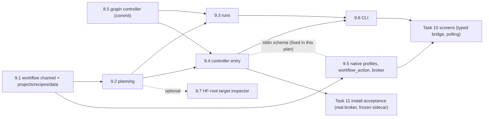

# Task 9 Secure Desktop Broker, Workflow API and CLI — Reviewable Sub-task Plan

> **For agentic workers:** REQUIRED SUB-SKILL: superpowers:subagent-driven-development (recommended) or
> superpowers:executing-plans. Each sub-task below is one implementer and one independent review, test-first.
> Steps use checkbox (`- [ ]`) syntax.

**Parent plan:** [General-purpose training workflows, Task 9](2026-10-17-general-training-workflows.md#task-9-windows-보안-경계와-프로젝트그래프-apicli-연결)
("Windows 보안 경계와 프로젝트·그래프 API/CLI 연결"). **Spec:** [design §3, §4, §7](../specs/2026-10-17-general-training-workflows-design.md#7-병렬-자원복구기록),
the [SSH server extension](../specs/2026-10-19-ssh-gpu-servers-extension.md) (including
[MLflow 인증 없음](../specs/2026-10-19-ssh-gpu-servers-extension.md#mlflow-인증-없음-2026-10-19-추가)) and the
[first-run tutorial design](../specs/2026-10-19-first-run-tutorial-design.md). **Builds on:** the
[Task 8 sub-plan](2026-10-20-task8-graph-controller.md) §4 "8.5" (`graph_status` contract), §7 "How Tasks 9 and 10
consume the controller" and D11, plus every PROGRESS note addressed to Task 9.

**Goal:** Expose projects, recipes, mapped data, graph planning and graph runs to the Windows app and the CLI through
strict, side-effect-free request models. Run the persistent graph controller as a hidden background process that a
native broker starts with credentials read from Windows Credential Manager and injected only through a stdin pipe.
The controller survives the GUI, is discovered through its DB heartbeat, and never relaunches an attempt on restart.

**Baseline:** HEAD `73e1bd7` (Task 8.4) on `codex/general-training-workflows`. The last full receipt in PROGRESS is
`uv run pytest -q` → **1283 passed, 1 skipped** (8.4 rebased onto 8.3), Ruff clean, `check_secrets.py` 0 findings.
Desktop: `cargo test --manifest-path desktop/src-tauri/Cargo.toml --locked --offline --release` **12 passed**,
`npx playwright test` **81 passed**, `npm run build` passes (PROGRESS 2026-10-19). **Task 8.5 (`graph_controller.py`)
is in progress and uncommitted** in this tree; every item that depends on it is marked **[8.5]** and must be
re-checked when 8.5 lands (§1).

**Status:** planning only. This document authorizes no GPU, SSH, network, model download, MLflow write, institution
data, dataset transfer or paid resource.

---

## 0. Facts verified for this plan (evidence)

All facts were checked on 2026-10-20 against HEAD `73e1bd7` by reading files, or against the uncommitted 8.5 working
tree (read only). Nothing was executed. Line anchors are HEAD's unless marked **[8.5 WT]** (working tree).

| # | Fact | Evidence |
|---|---|---|
| F1 | **How the sidecar is launched today.** `factory_action` checks the allowlist, reads settings **with** vault secrets, and spawns one `factory-bridge` process per request: debug `binaries/factory-bridge-x86_64-pc-windows-msvc.exe`, release `factory-bridge.exe` next to the app. stdin piped, stdout piped, stderr null, `CREATE_NO_WINDOW`. It writes one JSON line `{"root": <app_root>/state, "settings", "action", "data"}`, waits, and maps `{"ok", "result"}`/`{"ok": false, "error"}` to `Result`. No argv, no env. | main.rs:192-221 (allowlist 194, `read_settings(&root, true)` 196, binary 198-202, stdio 204, flags 205-208, request 210, stdin 211-214, response 215-219). |
| F2 | **Python side of one request.** `desktop.main` reads one stdin line, serves under `redirect_stdout(sys.stderr)`, returns error text only for `ValueError`/`KeyError`/`FileNotFoundError`/`ExecutionUncertain`/`TimeoutError` (else the type name), redacts every settings value of ≥8 chars in raw and `repr` form, and writes one ASCII JSON line. | desktop.py:564-586. |
| F3 | **Settings become process env.** `DesktopService.__init__` pops every `ENV_SETTINGS` name and re-sets the present ones in `os.environ`, drops MLflow auth values for `auth_mode=none`, checks the HTTPS rules and builds a `LazyMLflowTracker`. This is safe only because there is one request per process ("authentication environment is never shared across profiles"). | desktop.py:101-118, 565; connections.py:14-18. |
| F4 | **How secrets are stored today.** Seven names (`RUNPOD_API_KEY`, `MLFLOW_OIDC_CLIENT_SECRET`, `MLFLOW_TRACKING_TOKEN`, three S3 names, `HF_TOKEN`) live in Windows Credential Manager under service `kr.kbiofoundry.tuningfactory`, entry name = field name. `settings.json` holds public strings only; reads drop plaintext secrets and add `<name>_saved`. `filter_mlflow_auth` withholds per `auth_mode` only for the sidecar (`secrets=true`). `settings_save` validates everything, writes non-empty secrets (empty keeps the saved one), then `settings.json` via tmp+copy. `forget_credentials` deletes the seven entries. **There is exactly one RunPod key and one connection: no per-profile secret exists.** | main.rs:7-8, 29-31, 33-54, 56-66, 137-161, 163-172. |
| F5 | **Native field validation.** 28 allowlisted `FIELDS`; unknown field refused; strings ≤2048; pasted OpenSSH/PEM/PuTTY markers refused in key-file fields; `.ppk` paths refused including trailing dots/spaces; `provider` ∈ {"", existing_runpod, ssh_server}; `auth_mode` ∈ {"", oidc, token, none}; GPU selection is a JSON array of ≤8 strings; S3 endpoint must be a credential-free https origin. | main.rs:9-17, 73-79, 81-135 (.ppk 95-100). |
| F6 | **Allowlist and Rust tests.** `allowed()` lists 34 legacy actions, `tutorial_sample` included (corrected from 35 by the 9.5 review). 12 Rust tests exist, all on pure functions (no keyring access); the fake private-key header is assembled at runtime for the history-walking secret scan. | main.rs:183-190, 231-421 (fake header 367-371); scripts/check_secrets.py:11-17. |
| F7 | **Rust constraints.** Release builds use `windows_subsystem = "windows"` (no console). Capabilities are `core:default` only. Direct dependencies are tauri, serde, serde_json, keyring, rfd; `Cargo.lock` has no SQLite crate, so **Rust cannot read `jobs.db`**. Any new crate changes `Cargo.lock`, which `--locked --offline` refuses. | main.rs:1; capabilities/default.json; Cargo.toml:9-14; `grep` of Cargo.lock (rusqlite absent). |
| F8 | **Sidecar entry and packaging.** `scripts/desktop_entry.py` ignores argv and calls `desktop.main`. `build_desktop.py` builds a PyInstaller 6.20.0 **onefile, console** `factory-bridge` with `--collect-submodules tuning_factory` and assets (locks, configs, tutorial sample, wheel) under `assets/`. Both package verifiers run the exe **without arguments**. | desktop_entry.py:1-5; build_desktop.py:22-28, 41-52; verify_desktop_package.py:16; verify_desktop_readonly.py:19. |
| F9 | **Desktop actions and their models.** `dispatch` takes untyped dicts (`data["..."]`) with ad hoc dict responses; no strict request model exists. Reserved-ID guard: `reserved_tutorial_id` (casefold + `rstrip(".")`), `check_tutorial_registration`, `dataset` and `s3_import` refusals, and `PRACTICE_SUBMIT_REFUSAL` at `submit`. `CROSS_PROVIDER_LOCK` is raised by server `execute` and `runtime_prepare`. | desktop.py:187-512, 41, 67-79, 296-304, 311-313, 351-353, 38-40, 387-389, 472-474. |
| F10 | **Approvals today.** `require_approval` (`approved is True`) gates submit/execute/resume; `runtime_prepare` needs `approved`, `runtime_release` needs `approved` + `confirm_preparation_stopped`, `s3_import` needs `approved`. Legacy `plan` is offline. | desktop.py:515-517, 463-464, 486-487, 314-315, 329-339. |
| F11 | **What the CLI exposes.** doctor, server-inspect/runtime/runtime-status/runtime-release, dataset-register, validate, plan, run, batch, work (`--approve-execution-and-transfer`), status, logs, cancel, resume, recover, reconcile, release-lock (`--confirm-execution-stopped`), compare, evaluate, pod-create/start/stop, guard. The callback loads `.env` with `setdefault` and builds a `LazyMLflowTracker`; the RunPod key is read from `os.environ`. **No project or graph command exists.** | cli.py:24-42, 45-420 (work 167-233, release-lock 349-359, key 188); connections.py:21-27. |
| F12 | **Projects and recipes.** Both stores share `workflow-revisions.sqlite3` under one root. Save is a CAS (`definition revision conflict`); create is idempotent by request ID (`request ID reused with different project details`). `TrainNode.recipe_revision` is a bare hash, but `RecipeStore.get` needs the recipe ID: **there is no lookup by revision hash.** | projects.py:92, 156-182 (167-168), 207-224 (218-219), 190-192; graph_schema.py:37. |
| F13 | **Imports and splits.** `ImportService(root)` works under the registry root and registers through `Registry(self.root)`. Row issues are `{ordinal, code, message}` with codes `duplicate_header`, `invalid_source`, `invalid_row`, `size_limit`, `invalid_dataset`. Fixed refusals: `import preview changed; inspect the mapping again`, `unknown or changed import preview`, `import has validation issues`, `split preview hash mismatch or dataset origins changed`, `immutable dataset version already registered`. | dataset_import.py:169-248 (191-212, 232-238, 241); dataset_splits.py:213-246 (225-226); registry.py:181, 222. |
| F14 | **The existing issue type.** `graph_schema.Issue` has `code`, `message`, `node_id` only (no path, no row number). `validate_graph` collapses every `GraphSpec` validation error into one `graph_schema` issue. | graph_schema.py:13-16, 145-156 (149-151). |
| F15 | **What planning needs.** `plan_graph` takes `ExecutionChoices` (recipes; `BenchmarkRevision` keyed by `BenchmarkSpec.fingerprint()`; `DatasetSnapshot`s; `ModelContext(root=HFRootRef)` whose `tokenizer_fingerprint` the caller must supply; artifacts; executors; `NodeResources`; `base_targets`; `TrackingDestination`) and resource snapshots. Real plans require every `transport_settings_sha256` and a tracking destination; RunPod prices must be > 0; a root without context fails (`verified root/tokenizer model context is not ready`). **No benchmark store and no producer of tokenizer fingerprints exist**; `model_hub.inspect` returns only `config_sha256`, and `ModelHub.get` caps responses at 4 MiB. | graph_planner.py:81-85, 104-125, 164-167, 197-212, 423-519 (434-437, 444-446, 476-478); model_artifacts.py:36-39, 46-50, 308-326; model_hub.py:123-124, 179. |
| F16 | **Frozen-bundle defect (static analysis).** `graph_planner._runtime` reads the lock at `Path(__file__).resolve().parents[2] / lock_file`. In the onefile sidecar the module lives at `_MEIPASS/tuning_factory/` and the locks at `_MEIPASS/assets/containers/`, so **graph planning would raise `FileNotFoundError` inside the installed app**. `manifest.resolve` and `desktop.assets_root` already switch to `sys._MEIPASS/assets`. | graph_planner.py:381-384; manifest.py:34-35; desktop.py:46-49; build_desktop.py:22-25. |
| F17 | **Target evidence gap.** Compile needs inspected effective-base evidence for continuation and for merge/materialize. The inspector needs torch, which the main env and the frozen sidecar lack. The simulated dispatcher needs evidence for `lora_target: all`, full/freeze and materialize, and **`lora_target` defaults to `all`**. PROGRESS expects "Task 9's inspector" to supply HF-root evidence. | graph_planner.py:855-862, 884-887; target_inspection.py:59-69; simulated_dispatch.py:105 (TARGETS_REQUIRED); config.py:26; PROGRESS 1700-1701. |
| F18 | **Task 8 APIs at HEAD.** Owner lease (`OWNER_HELD = 'controller already running'`, `acquire_owner`, `owner_state`); `submit` (`request ID reused with different plan`); `_state`/`pause`/`resume`/`cancel` with fixed refusals; `ProfileSecrets`, `SettingsExecutorProvider` (`_approved` checks profile, revision and transport before any connection), `SimulatedExecutorProvider.for_plan`; `runpod_facts` (`gpu.id`, positive finite price, D13); `runpod_transport_sha256` (D11); `ResourceFacts.total_hourly_cost_usd` still `ge=0` (planning refuses ≤0); `tracking_settings_sha256`, `public_tracking_settings`, `current_auth_mode`, `LazyMLflowTracker`; `TrackingOutbox.rearm`/`status`; `DirectoryRootSnapshots`; `SimulatedOperationDispatcher`. | graph_store.py:61, 297-320 (309), 361-374, 405-409, 1245-1278; executor_profiles.py:39-46, 57-61, 133-180, 191-207, 233-289, 339-360; tracking.py:41-80, 289-305; tracking_outbox.py:421, 457; simulated_dispatch.py:145-160, 436-440. |
| F19 | **[8.5 WT] Controller interfaces as they stand.** `ControllerSettings(lease_ttl_seconds=60, tick_seconds=5, stale_attempt_seconds=120, reconcile_interval_seconds=60, max_dispatch_threads=8, lease_heartbeat_seconds=20, tracking_claim_ttl_seconds=600, tracking_batch=16)` with heartbeat ≤ TTL/2 and claim TTL ≥ 3 heartbeats; `DispatchRouter(real, simulated, *, store=None)`; `controller_tracker(uri)` → `LazyMLflowTracker(uri, bounded_requests=…)`; `GraphController(store, executor_provider, operation_dispatcher, tracker, clock, *, simulated_provider=None, outbox=None, pool=None, settings=…)` (one `SimulatedExecutorProvider.for_plan` per simulation run when `simulated_provider` is None); `acquire_controller(owner_id)`; `run_forever(stop_event)` drains in-flight attempts, then releases the owner unless fenced; `status()`; `graph_status(store, run_id=None, *, now)` with `controller.state` ∈ running/stale/absent. The working tree also makes `tracking._public` refuse credentialed http (`AUTHENTICATED_HTTPS`) and adds `auth.current_auth_mode`. | graph_controller.py [8.5 WT]:97-125, 158-188, 228-230, 277-318, 824-834, 870-909, 924-959; tracking.py [8.5 WT]:32-35, 62-68, 333-344 (the working tree is still changing; these anchors drift). |
| F20 | **Auth is process-global env.** `credentials_configured` reads env; the OIDC refresher writes `MLFLOW_TRACKING_TOKEN` into `os.environ`; `MLflowTracker` reads env when built. The desktop RunPod path passes the key as a value (`RunPodController(settings["RUNPOD_API_KEY"])`), never env; the CLI reads it from env. | auth.py:32, 66-69; tracking.py:93-110; desktop_runtime.py:87; cli.py:188. |
| F21 | **SSH profiles need an observation; RunPod profiles do not.** `SSHServerProfile` requires `server_id` and ≥1 selected GPU and is built from observed facts by `SSHServerSettings.profile(facts, profile_id=…, revision=…, name=…, credential_scope=…)`. `ExecutorProfile` (RunPod) can be built offline. | gpu_servers.py:90-96, 99-115, 124-150; executor_profiles.py:39-54. |
| F22 | **Test patterns to reuse.** `api()` turning a missing module into a test failure; cross-test helper imports (`import test_graph_readiness as readiness`); fakes `fake_pod` and `ssh_destination` (paramiko-shaped `FakeServer`); the socket guard; the env isolation fixture; the autouse `stable_code_revision`; Playwright's mocked `__TAURI_INTERNALS__.invoke`. CI runs pytest on **ubuntu-latest and windows-latest**. | test_operation_runner.py:50-55; test_graph_controller.py [8.5 WT]:30-33; test_executor_profiles.py:15-19, 73-97; test_desktop.py:76-82; conftest.py; connections.spec.ts:39; .github/workflows/ci.yml:7-21. |
| F23 | **Tutorial contract.** The tour calls `tutorial_sample`, `dataset_preview`, `dataset`, `catalog`, `capabilities` and `plan` through `factory_action`; it never calls submit, prepare, connection checks or `settings_save`. Anchors: `overview-setup`, `connection-provider`, `connection-fields`, `connection-runtime`, `dataset-form`, `dataset-submit`, `train-dataset`, `training-plan`, `plan-summary`, `jobs-list`. | tutorial-steps.ts:29-72; tutorial.ts:51; main.ts:285-423; tutorial design spec 74-84, 95, 100-106. |
| F24 | **Line endings.** `.gitattributes` sets `* text=auto eol=lf` and `core.autocrlf=true` is on; manifests hash exact source bytes across Windows and Linux, so a CRLF working-tree file changes `source_sha256`. | .gitattributes:1-2; `git config core.autocrlf`. |
| F25 | **PROGRESS notes addressed to Task 9.** (a) Build `TrackingDestination.public_settings_sha256` with `tracking_settings_sha256(public_tracking_settings(...))`, or real runs wait with the destination-mismatch reason. (b) "the plan adds evidence for the HF root, as Task 9's inspector would supply". (c) `RunPodController.status` shape and `gpu.id` are assumptions until a live Pod is observed; nothing yet produces planning-time `runpod_facts` or `transport_settings_sha256`. (d) Per-action provider forks in `desktop.py` "should be consolidated in Task 8/9/10". (e) Deferred: some sidecar refusals in English; key identity is a hash of the key path. (f) The root's description of the **8.4 review Minor 5** ("forbid editing a profile whose attempts hold locks") is **not yet recorded in PROGRESS** at HEAD. | PROGRESS 1602-1603, 1700-1701, 1755-1757, 159-162, 66-69, 198-200; `grep "Minor 5"` (only an 8.3 note in tracking.py [8.5 WT]). |

---

## 1. Rules that apply to every sub-task

- Python 3.12, `uv sync --extra dev --extra tracking --locked`. Before each commit run the sub-task's tests, its listed
  regressions, `uv run pytest -q`, `uv run ruff check src tests` and `uv run python scripts/check_secrets.py`.
- **Test-first.** Write the failing tests, run them and see them fail for the intended reason, then implement. A
  missing module must fail tests, not collection: use the `api()` pattern (F22), e.g.
  `def workflows(): try: return importlib.import_module("tuning_factory.desktop_workflows") except ModuleNotFoundError: pytest.fail("the desktop workflow channel is missing")`.
- **No network, no GPU, no SSH, no model download, no MLflow write, no provider call.** Every test uses fakes. Test
  modules that touch providers, HF or the controller install an autouse fixture that makes `socket.socket.connect`
  raise (test_executor_profiles.py:15-19). HF downloads use `httpx.MockTransport`; RunPod uses a fake
  `RunPodController`; SSH uses `test_gpu_servers.FakeServer`. The main env must not import torch, peft, transformers,
  safetensors, huggingface_hub or **keyring**.
- **Subprocess tests** run `[sys.executable, str(ROOT / "scripts" / "desktop_entry.py"), "--controller"]` and must work
  on Windows and Linux (CI runs both, F22): detach with `creationflags=CREATE_NEW_PROCESS_GROUP | DETACHED_PROCESS` on
  Windows and `start_new_session=True` elsewhere. Every spawned process is killed in a `finally`/fixture teardown, and
  every wait has a timeout (≤30 s).
- **Synthetic secrets only, built at runtime.** Never commit a literal PEM private-key header (use the runtime
  assembly of main.rs:367-371) or a string matching the scanner's token shapes (scripts/check_secrets.py:11-17). Use
  values such as `"synthetic-" + "runpod-" + "k" * 12`. The CI scan walks all reachable history, so a single commit
  that ever contained such a literal fails the branch.
- **LF only** (F24). Agent edit tools introduced CRLF on this machine before. Before staging, every changed text file
  must satisfy `git ls-files --eol -- <path>` → `w/lf` (or `python -c "import pathlib,sys; bad=[p for p in sys.argv[1:] if b'\r' in pathlib.Path(p).read_bytes()]; sys.exit(bad)" <paths>`).
- **Stage and commit by path only** (`git add <paths>`). Never `git add -A`. Do not edit files another agent has
  uncommitted changes in. While 8.5 is uncommitted that includes `graph_controller.py`, `graph_store.py`,
  `tracking.py`, `tracking_outbox.py`, `auth.py`, `simulated_dispatch.py`, `attempt_runner.py`,
  `executor_profiles.py`, `tests/conftest.py` and `docs/PROGRESS.md`. Root integrates PROGRESS text.
- **[8.5] Coordination.** 9.3, 9.4 and 9.6 start only after the 8.5 commit is on the branch. Re-check every **[8.5]**
  item in this plan against it (constructor keywords, `ControllerSettings` constraints, `graph_status` keys,
  `controller_tracker`, `run_forever` drain/fence semantics) and record any deviation in the sub-task report.
- **Legacy stays frozen.** Every legacy desktop action keeps its request and response contract; the one-request
  sidecar mode (no argv) is byte-for-byte unchanged; 0.3.0 `settings.json` and vault entries keep working; v1 CLI
  commands keep their flags and output. Only the new `--controller` argv branch and the new `workflow` channel are added.
- **Default to dry-run.** Planning defaults to simulation. Nothing in Task 9 provisions, starts, stops or deletes a Pod
  or server, and no dataset leaves the PC except through an approved real graph run executed by the controller.
- **Credentials:** never in manifests, plans, DB rows, files, env of a spawned process, argv, stdout, stderr, logs,
  exception texts or status payloads. Python gets no keyring dependency (`git diff --exit-code pyproject.toml uv.lock`).
- **No arbitrary execution.** No request field, CLI option or native command accepts an executable, command, script or
  shell text. The only programs ever spawned are the app's own executable (`--controller`) and the bundled sidecar.
- **MLflow HTTPS rule** (6B): credentials mean `MLFLOW_TRACKING_TOKEN`, or an OIDC token URL **plus** client secret. With
  credentials, the tracking URI must be https and an http artifact location is refused. `auth_mode=none` allows local
  http. Task 9 applies the rule at planning (issue) and at controller start (refusal), in addition to the existing
  constructor checks.
- **Rust:** `cargo test --manifest-path desktop/src-tauri/Cargo.toml --locked --offline --release`. No new crate
  (`git diff --exit-code desktop/src-tauri/Cargo.toml desktop/src-tauri/Cargo.lock`). Keyring access goes through a
  `Vault` trait so tests use an in-memory vault and never touch the real Credential Manager.
- **UI regression:** Task 9 changes no TypeScript. From `desktop/`: `npx playwright test` (mocked
  `__TAURI_INTERNALS__.invoke`, F22) must still report 81 passed, and `npm run build` must pass.
- Each sub-task appends to `docs/PROGRESS.md` (through root) what was actually verified and what remains unverified.
- **File-list deviations from the parent plan, which root must approve** (the parent lists `desktop_workflows.py`,
  `desktop.py`, `cli.py`, `scripts/desktop_entry.py`, `main.rs`, `tests/test_desktop_projects.py`,
  `tests/test_controller_entry.py`):
  - New `workflow_planning.py` (9.2), `workflow_runs.py` (9.3), `controller_entry.py` (9.4): one responsibility per
    module and disjoint files for parallel worktrees.
  - `projects.py` (9.2): `_RevisionStore.get_by_revision` (F12).
  - `graph_planner.py` (9.2): `_runtime` frozen-bundle lock path (F16).
  - New `desktop/src-tauri/src/profiles.rs` and `broker.rs` (9.5).
  - New tests `tests/test_workflow_planning.py`, `tests/test_workflow_runs.py`, `tests/test_native_contract.py`,
    `tests/test_cli_graph.py`.

---

## 2. Decisions taken here (conservative defaults; root or the user may overturn)

Root and the user accepted Task 8's conservative defaults wholesale. Each Task 9 decision has the same form.

**Root decisions (2026-10-20).** D1–D14 and D16–D21 are accepted as written, including the file-list deviations in
§1. **Q-A is accepted: 9.7 is required, not optional.** D15's refusal applies only to HF roots that have no
evidence yet. 9.7 runs after 9.2 and must land before Task 10. The reason: `lora_target` defaults to `all`, and
Task 10's merge flow and Task 11's mock diamond need HF-root target evidence to compile and to run simulated.
`model_root_targets` network access follows D14: it runs only on an explicit `download_approved: true`, makes
header-only range requests, and never downloads weights.

| # | Decision (conservative default) | Alternative |
|---|---|---|
| D1 | **Broker shape.** The **Tauri executable itself** is the broker in a headless mode selected by argv exactly `[exe, "--controller"]`, checked in `main()` before `tauri::Builder` (no window, no WebView). The GUI's `controller_start` spawns it detached. The broker reads the vault, `settings.json` and `executor-profiles.json`, spawns the sidecar `factory-bridge(.exe) --controller`, and supervises it. It never restarts a sidecar that exited. | The GUI spawns the sidecar directly and stops it only through a DB request. One process fewer, but the GUI then holds every credential for the background run and there is no lifeline. |
| D2 | **Secret transport.** Credentials travel **only** as one UTF-8 JSON line (≤1 MiB) on the sidecar's stdin, written by the broker immediately after spawn (schema `factory-controller/1`, §4 9.4). Never argv (argv is exactly `--controller`), never env (the broker adds no env; the sidecar also pops inherited credential variables), never a file, never a log. The GUI hands the broker **one non-secret line** on the broker's stdin: `{"schema": "factory-broker/1", "app_root": "<abs path>"}`. The broker keeps the sidecar's stdin open and writes nothing more; **EOF on that pipe means stop** (Task 8 D14 drain), so killing the broker stops the controller gracefully. | The broker derives `app_root` from `%APPDATA%` itself (two path computations that can drift); or secrets through a named pipe (more code, same trust boundary). |
| D3 | **Single instance, discovery, lifetime.** One controller per state directory, enforced by the 8.1 owner lease: a second sidecar gets `controller already running`, prints `{"ok": false, "code": "owner_held"}` and exits **3** without writing any status file. The GUI discovers the controller through `controller_status` → `graph_status(...)["controller"]` (`running` = fresh heartbeat, `stale` = expired, `absent`), shown as 동작 중 / 연결 끊김 / 정지. **GUI exit never stops the controller** (detached broker). No auto-start (the user, or Task 10 after an explicit submit, calls `controller_start`), no supervisor restart, no idle exit. After sleep or a lost owner lease the controller exits; the user restarts it (design §7 "다시 앱을 열어 … 컨트롤러 복구 후 이어간다"). | Auto-start on app open or on submit; idle exit after N minutes; a restart loop in the broker. |
| D4 | **Stopping.** `controller_stop` writes `state/controller/stop-request.json` naming the current owner; the controller polls it every tick and drains (no new claims; in-flight attempts finish; tracking flushed; owner released). There is **no kill-now action** in Task 9: a killed process leaves uncertain attempts that the next controller reconciles without relaunching (Task 8). | A "stop now" that exits without draining. Safe by Task 8 design but leaves operator-visible uncertain attempts. |
| D5 | **Settings changes apply at the next controller start.** The controller snapshots profiles and the MLflow scope at start and writes their public revisions to `state/controller/current.json`. `controller_status` returns `restart_required: {profiles: [...], tracking: bool}` when the saved settings differ. UI procedure (Task 10 text): 일시정지 → 진행 중 단계 완료 대기(또는 컨트롤러 정지) → 설정 저장 → 컨트롤러 시작. **Editing or deleting a profile is refused while any graph job pinned to it holds a lock or is active** (8.4 review Minor 5, F25f): the native save calls the sidecar check `executor_profile_edit_check` first. The check-then-save race is harmless, because a running controller keeps the old in-memory profile and the provider refuses a changed revision (`PROFILE_CHANGED`). | Hot reload of profiles inside a running controller. |
| D6 | **Executor profile model.** Native store `<app_root>/executor-profiles.json` (`{"schema_version": 1, "profiles": {id: {public string fields}}}`), ≤32 profiles. Fields: RunPod `provider, name, pod_id, ssh_fingerprint, ssh_key_file`; SSH `provider, name, server_ssh_host, server_ssh_port, server_ssh_username, server_ssh_fingerprint, server_remote_root, server_ssh_key_file, server_total_hourly_cost_usd, server_selected_gpu_uuids` (the same names as today's settings, so `server_settings` and `runpod_transport_sha256` apply unchanged). Per-profile secret: RunPod `RUNPOD_API_KEY` only, vault entry `executor-profile/<id>/RUNPOD_API_KEY`. **Revision = SHA256 of canonical public fields, name included** (computed in Python only); `credential_scope = "local"`; `provider` is immutable per profile. The API key is not in the revision (rotation keeps approvals valid, matching D11's transport hash). No implicit migration of the legacy connection; `executor_profile_save` may copy the legacy RunPod key on request (`copy_legacy_credential`). Content revisions make recovery robust: restoring the old values restores the old revision. | A monotonically increasing revision counter (edits that change nothing would still invalidate approvals). |
| D7 | **One shared auth scope.** The controller process applies the MLflow scope **once** to `os.environ`, after popping every inherited credential variable and before any thread starts. RunPod keys exist only in `ProfileSecrets.settings` and reach `RunPodController` as values (F20); SSH uses key-file paths. S3 and HF credentials never reach the controller. Nothing writes auth env per connection or per profile. | Per-run trackers with separate auth scopes. Not possible while MLflow auth is env-based. |
| D8 | **Least-privilege workflow channel.** A new native command `workflow_action(action, data)` with its own closed allowlist (33 names: the 32 of §4 9.1 plus 9.7's `model_root_targets`) sends `{"channel": "workflow", "root", "settings": <public view with *_saved flags>, "profiles": <public profiles>, "secrets": <scoped>, "action", "data"}`. Only three actions get a scoped secret: `executor_profile_inspect` (that profile's RunPod key), `model_root_snapshot` and 9.7's `model_root_targets` (`HF_TOKEN`). Python refuses any credential in `settings` and any secret outside the action's scope. Legacy `factory_action` is unchanged and refuses workflow names; the workflow channel refuses legacy names. | Route new actions through `factory_action` with full secrets (simpler, but every project/recipe/plan request would carry every credential). |
| D9 | **Where approval lives.** `graph_plan` defaults to `simulation: true`. A real plan needs `simulation: false`, fresh observations and a tracking destination. `graph_submit` loads the **stored plan by hash**, re-checks freshness (project revision, profile revisions, tracking hash → 409 `plan_stale`), and for a real plan requires **both** `approve_execution` and `approve_data_transfer` to be `true`, refuses practice data and non-exportable data, then builds `ApprovalGrant.for_plan(plan)` and calls `GraphStore.submit`. A simulation plan needs no approval. Starting the controller is **not** an approval: it executes only runs already approved at submit. | One combined approval flag; or a second approval at controller start. |
| D10 | **CLI.** `project-list`, `graph-validate`, `graph-plan`, `graph-submit`, `graph-status`, `graph-pause`, `graph-resume`, `graph-cancel`, `graph-rearm-tracking`, `executor-profile-inspect`, `graph-work`. Real submission needs `--approve-execution` **and** `--approve-data-transfer`; real execution in `graph-work` needs `--executor-profiles FILE` **and** `--approve-execution-and-transfer` (the existing `work` flag name). Credentials come from files referenced by the profiles file or from the existing `.env`/env, never from option values. | Only the parent's six commands (real CLI plans would then be impossible: no way to observe resources). |
| D11 | **Issue model and envelope.** Every workflow action returns `{"ok": true, "result": WorkflowResult}`, where `WorkflowResult = {status: "ok"|"invalid"|"conflict", issues: [WorkflowIssue], data}` and `WorkflowIssue = {code, path, message, node_id?, row_number?}`. `path` is an RFC 6901 pointer into the request (`""` = whole request). `row_number` is the 1-based source record number (CSV header excluded). **`conflict` is the 409 equivalent** (`revision_conflict`, `request_reused`, `preview_changed`, `version_exists`, `plan_stale`, `run_state`, `tracking_state`, `profile_in_use`). Non-blocking notes go to `data["warnings"]` (same shape). `{"ok": false, "error"}` is kept for envelope errors and unexpected exceptions, exactly as legacy. `graph_schema.Issue` is unchanged and mapped. | Change `graph_schema.Issue` itself; or HTTP-like numeric codes. |
| D12 | **Strict requests.** Every request is a frozen `StrictModel` (`extra="forbid"`). Unknown fields → `invalid`/`extra_field` with the pointer. No request field name matches `command|cmd|exec|executable|script|shell|argv|program|entrypoint` (introspection test). File inputs are local absolute paths only: UNC (`\\server\…`, `//server/…`) and device paths (`\\?\`, `\\.\`) are refused, because reading them is network or device access. | Lenient models that ignore extra fields. |
| D13 | **Planning-time facts and hashes.** RunPod: `executor_profile_inspect` calls `RunPodController(key).status(pod_id)` (read-only GET), `validate_pod`, then **`runpod_facts(pod, observed_at=now)` with `gpu.id`** (D13 of Task 8). SSH: `desktop_runtime.connection(settings)` yields `SSHServerFacts`, and the public profile is `server_settings(fields).profile(facts, …)`. The observation (public profile + facts + revision) is stored in `state/workflows/observations/<profile_id>.json`. `graph_plan` itself is **offline**: a real plan needs an observation of the same profile revision **≤3600 s old**; a simulation plan accepts an observation of any age or a simulation-only **planning estimate** (`estimate-*` profile, positive price). D11 hashes are reused verbatim: `transport_settings_sha256 = runpod_transport_sha256(fields)`; `TrackingDestination(profile_id="mlflow", revision=h, public_settings_sha256=h)` with `h = tracking_settings_sha256(public_tracking_settings(uri, DEFAULT_EXPERIMENT, artifact_location, auth_mode=public_auth_mode(settings)))`, where `public_auth_mode` derives the mode from `auth_mode` and the `*_saved` flags exactly as the controller's `current_auth_mode` will see it (parity test). | Observe live inside `graph_plan` (planning would then make network calls); or no age limit. |
| D14 | **HF root context.** New action `model_root_snapshot` (explicit `download_approved: true`) downloads **only** `config.json` and the `TOKENIZER_FILES` / `chat_templates/` files of a pinned revision (≤64 MiB each, ≤128 MiB total; never weights) into `state/workflows/roots/<owner>/<name>/<revision>/`, the `DirectoryRootSnapshots` layout, and indexes the resulting `HFRootRef` (with `tokenizer_fingerprint`) and `ModelProfile`. The same directory is the simulated dispatcher's root snapshot source. This resolves Task 8 Q-B as an explicit, user-triggered metadata download. | Fetch snapshots silently at planning time. |
| D15 | **HF-root target evidence is not produced in Task 9** (F17). `graph_plan` refuses with `base_targets_missing` any node whose compile will need evidence for an HF-root base (continuation from an adapter, merge, materialize), in real and simulation plans. For simulation plans it adds the warning `simulated_execution_needs_targets` to train nodes on HF roots with `lora_target: all` or full/freeze (planning succeeds; simulated execution would refuse). | Optional sub-task **9.7**: a header-only inspector that reads safetensors headers over HTTP range requests (§4 9.7, §6 Q-A). Without it, Task 10's merge diamond and dry-run execution of default recipes on HF roots cannot run. |
| D16 | **External artifact inputs** (a `ModelArtifactRef` from an earlier run used in a new graph) are refused at planning with `external_artifact_unsupported`. | A ledger lookup that builds `ArtifactSnapshot` + `ProducerEvidence` from this state's completed, acknowledged runs. |
| D17 | **Benchmarks** are stored content-addressed by `BenchmarkSpec.fingerprint()` in `state/workflows/benchmarks/` (`benchmark_save`, `benchmarks_list`); sample IDs are validated against the registered dataset at save. | Benchmarks inline in each plan request (lost on reopen). |
| D18 | **Frozen bundle.** `graph_planner._runtime` resolves the lock through `sys._MEIPASS/assets` when frozen, as `manifest.resolve` does (F16). | Leave it for Task 11 (the installed app could not plan at all). |
| D19 | **Public status files** under `state/controller/`: `current.json` (written by the sidecar), `broker.json` (written by the broker only when it fails before the sidecar starts) and `stop-request.json`. They hold IDs, revisions, hashes, timestamps, fixed codes and fixed texts only. | Status in new DB tables (would touch `graph_store.py`, owned by 8.x). |
| D20 | **Rust structure.** New modules `profiles.rs` (store, validation, `Vault` trait) and `broker.rs` (headless mode, commands, message builder); `main.rs` wires commands and keeps the legacy code path. `factory_action`'s spawn moves into a shared `run_sidecar(request)` without behaviour change. | Everything in `main.rs`. |
| D21 | **Operator lock release stays CLI-only** (`release-lock --confirm-execution-stopped`). `graph_run_get` shows `needs_operator` and the wait reason; Task 9 adds no desktop action that releases a lock. | A desktop release action with double confirmation. |

---

## 3. Sub-tasks and sequence

| Sub-task | One line |
|---|---|
| **9.1** | Workflow channel foundations: `desktop_workflows.py` (envelope, `WorkflowIssue`/`WorkflowResult`, closed action table, secret scopes, strict request models), project/recipe/data actions, reserved-ID guard on the new paths, `desktop.main` channel branch. |
| **9.2** | Planning: profile revisions and public profiles, read-only `executor_profile_inspect`, `model_root_snapshot`, benchmark store, `graph_validate`, offline `graph_plan` with D11 hashes and planning estimates, stored plans; `get_by_revision`; frozen lock path. |
| **9.3** | Runs: `graph_submit` with plan hash, freshness 409 and separate approvals; `graph_runs_list`, `graph_run_get`, `graph_pause/resume/cancel`, `tracking_rearm`, `executor_profile_edit_check` (8.4 Minor 5). |
| **9.4** | Controller entry: `controller_entry.py` (strict stdin start message, single auth scope, provider/dispatcher/tracker wiring, owner lease, EOF and stop-request draining, exit codes, `current.json`), `desktop_entry.py` argv routing, `controller_status`/`controller_stop` actions. |
| **9.5** | Native: `executor_profiles_get/save/delete`, `workflow_action`, `controller_start/status/stop`, headless broker; Rust tests with an in-memory vault; Python↔Rust contract test. |
| **9.6** | CLI: project and graph commands, profiles file with credential-file references, foreground `graph-work`. |
| 9.7 (optional) | Only if root accepts Q-A: header-only HF-root target inspector. |



**Parallel worktrees.**
- 9.1 first; it fixes the action names and the envelope that everything else uses.
- After 9.1: **9.2 ∥ 9.5** (9.5 touches only Rust files and a new Python contract test).
- After 9.2 **and** the 8.5 commit: **9.3 ∥ 9.4** (disjoint modules and test files; neither edits `desktop_workflows.py`,
  because 9.1's action table already maps their names to their modules).
- 9.6 after 9.3 and 9.4.
- 9.1 and 9.2 do not depend on 8.5 and may start while 8.5 is still uncommitted, provided they edit none of the files
  listed in §1.

**File ownership** (a file is edited only by its owner; root integrates PROGRESS).

| Sub-task | Creates | Modifies |
|---|---|---|
| 9.1 | `src/tuning_factory/desktop_workflows.py`, `tests/test_desktop_projects.py` | `src/tuning_factory/desktop.py` (`main` only) |
| 9.2 | `src/tuning_factory/workflow_planning.py`, `tests/test_workflow_planning.py` | `src/tuning_factory/projects.py`, `src/tuning_factory/graph_planner.py` (`_runtime` only), `tests/test_desktop_projects.py` (append the parent flow test) |
| 9.3 | `src/tuning_factory/workflow_runs.py`, `tests/test_workflow_runs.py` | — |
| 9.4 | `src/tuning_factory/controller_entry.py`, `tests/test_controller_entry.py` | `scripts/desktop_entry.py` |
| 9.5 | `desktop/src-tauri/src/profiles.rs`, `desktop/src-tauri/src/broker.rs`, `tests/test_native_contract.py` | `desktop/src-tauri/src/main.rs` |
| 9.6 | `tests/test_cli_graph.py` | `src/tuning_factory/cli.py` |

Runtime sequence of a desktop controller start and stop after Task 9:

```mermaid
sequenceDiagram
  participant G as GUI (Tauri window)
  participant B as Broker (same exe, --controller)
  participant V as Windows Credential Manager
  participant S as Sidecar (factory-bridge --controller)
  participant D as state/jobs.db + state/controller/*.json
  G->>S: workflow_action controller_status (one-request sidecar)
  S->>D: graph_status → controller.state absent
  G->>B: spawn detached, argv [--controller]; stdin line {"schema":"factory-broker/1","app_root":…}; close
  B->>V: read MLflow secrets (filtered by auth_mode) + each profile's RUNPOD_API_KEY
  B->>S: spawn, argv [--controller], no env added; stdin line factory-controller/1 (secrets); keep pipe open
  S->>S: strict parse; pop inherited credential env; apply MLflow scope once
  S->>D: acquire owner lease (else exit 3); write current.json (public)
  loop every tick
    S->>D: renew owner + run leases; settle; prepare; claim; dispatch (8.5)
  end
  G->>S: workflow_action controller_status (polling)
  S-->>G: running + restart_required
  G->>S: workflow_action controller_stop → stop-request.json
  S->>D: drain in-flight, flush tracking, release owner; current.json stopped_at
  S-->>B: exit 0
  B-->>B: exit 0
```

---

## 4. Sub-tasks

### 9.1 Workflow channel, issue model, projects, recipes and data

**Goal / scope.**
- `desktop_workflows.py`: the workflow envelope, `WorkflowIssue`/`WorkflowResult`, the closed action table with module
  routing and secret scopes, the registration decorator, validation-to-issue mapping and the 409 table.
- Handlers for `projects_list`, `project_create`, `project_get`, `project_save`, `project_import_legacy`,
  `recipes_list`, `recipe_get`, `recipe_save`, `recipe_clone`, `dataset_import_source`, `dataset_import_preview`,
  `dataset_import_register`, `dataset_split_preview`, `dataset_split_commit`.
- The reserved tutorial ID guard on the new registration paths.
- `desktop.main` branches on `request["channel"] == "workflow"`; the legacy path is untouched.

**Non-goals.** Planning, runs, the controller, Rust and the CLI (9.2–9.6). No change to any legacy action, to
`DesktopService` or to the tutorial path.

**Files**
- Create `src/tuning_factory/desktop_workflows.py`.
- Modify `src/tuning_factory/desktop.py`: `main()` (:564-586) only.
- Create `tests/test_desktop_projects.py`.

**Interfaces**

```python
# desktop_workflows.py
WORKFLOW_CHANNEL = "workflow"
WORKFLOW_ACTIONS: tuple[str, ...] = (
    # 9.1
    "projects_list", "project_create", "project_get", "project_save", "project_import_legacy",
    "recipes_list", "recipe_get", "recipe_save", "recipe_clone",
    "dataset_import_source", "dataset_import_preview", "dataset_import_register",
    "dataset_split_preview", "dataset_split_commit",
    # 9.2
    "executor_profile_inspect", "model_root_snapshot", "model_roots_list", "benchmark_save", "benchmarks_list",
    "graph_validate", "graph_plan", "graph_plan_get",
    # 9.3
    "graph_submit", "graph_runs_list", "graph_run_get", "graph_pause", "graph_resume", "graph_cancel",
    "tracking_rearm", "executor_profile_edit_check",
    # 9.4
    "controller_status", "controller_stop",
)
ACTION_MODULES: Mapping[str, str]   # each name -> "tuning_factory.desktop_workflows" | ".workflow_planning" |
                                    #               ".workflow_runs" | ".controller_entry" (fixed here, used by all)
SECRET_SCOPES: Mapping[str, frozenset[str]] = {"executor_profile_inspect": frozenset({"RUNPOD_API_KEY"}),
                                               "model_root_snapshot": frozenset({"HF_TOKEN"})}
SECRET_FIELDS = ("RUNPOD_API_KEY", "MLFLOW_OIDC_CLIENT_SECRET", "MLFLOW_TRACKING_TOKEN", "S3_ACCESS_KEY_ID",
                 "S3_SECRET_ACCESS_KEY", "S3_SESSION_TOKEN", "HF_TOKEN")          # = main.rs SECRETS
RUNPOD_PROFILE_FIELDS = ("provider", "name", "pod_id", "ssh_fingerprint", "ssh_key_file")
SERVER_PROFILE_FIELDS = ("provider", "name", "server_ssh_host", "server_ssh_port", "server_ssh_username",
                         "server_ssh_fingerprint", "server_remote_root", "server_ssh_key_file",
                         "server_total_hourly_cost_usd", "server_selected_gpu_uuids")
FORBIDDEN_FIELD = re.compile(r"(?i)command|cmd|exec|executable|script|shell|argv|program|entrypoint")
CREDENTIALS_REFUSED = "workflow requests must not carry credentials"
SCOPE_REFUSED = "this workflow action does not accept these credentials"
UNSUPPORTED_ACTION = "unsupported workflow action"
NOT_AVAILABLE = "이 기능은 아직 설치되지 않았습니다."
LOCAL_FILE_ONLY = "이 PC의 로컬 파일 경로만 가져올 수 있습니다."
CONFLICTS: Mapping[str, str] = {   # exact domain texts (F12, F13, F18) -> conflict code; matched by prefix
    "definition revision conflict": "revision_conflict",
    "request ID reused with different project details": "request_reused",
    "request ID reused with different plan": "request_reused",
    "import preview changed; inspect the mapping again": "preview_changed",
    "unknown or changed import preview": "preview_changed",
    "split preview hash mismatch or dataset origins changed": "preview_changed",
    "immutable dataset version already registered": "version_exists",
    "only a running graph can pause": "run_state", "only a paused graph can resume": "run_state",
    "canceled graph cannot resume": "run_state", "a finished graph cannot be canceled": "run_state",
    "only a failed or uncertain tracking event can be re-armed": "tracking_state",
}
INVALID_CODES: Mapping[str, str] = {   # exact domain texts -> invalid code; matched by prefix
    "dataset exceeds 32 MiB limit": "size_limit", "import has validation issues": "import_issues",
    "unknown definition": "unknown_definition",          # also covers "unknown definition revision"
    "unknown graph run": "run_unknown", "unknown tracking event": "tracking_event_unknown",
}

class WorkflowIssue(StrictModel):
    code: str = Field(pattern=r"^[a-z][a-z0-9_]{0,63}$")
    path: str = Field(default="", max_length=512)             # RFC 6901 pointer into the request
    message: str = Field(min_length=1, max_length=2000)
    node_id: str | None = None
    row_number: int | None = Field(default=None, ge=1)        # 1-based source record (CSV header excluded)

class WorkflowResult(StrictModel):
    status: Literal["ok", "invalid", "conflict"]
    issues: tuple[WorkflowIssue, ...] = ()
    data: JsonValue = None

class NativeProfile(StrictModel):                             # public view sent by Rust; validator enforces the
    profile_id: LocalId                                       # per-provider field allowlist and 2048-char values
    fields: dict[str, str]
    RUNPOD_API_KEY_saved: bool = False

class WorkflowEnvelope(StrictModel):
    channel: Literal["workflow"]
    root: str                                                 # <app_root>/state
    settings: dict[str, str | bool] = Field(default_factory=dict)
    profiles: tuple[NativeProfile, ...] = Field(default=(), max_length=32)
    secrets: dict[str, str] = Field(default_factory=dict)
    action: str
    data: dict[str, JsonValue] = Field(default_factory=dict)

@dataclass(frozen=True, repr=False)
class WorkflowContext:
    state_dir: Path
    settings: Mapping[str, str | bool]
    profiles: Mapping[str, NativeProfile]
    secrets: Mapping[str, str]
    clock: Callable[[], float] = time.time
    # properties: workflows_dir (state_dir/"workflows"), registry() (Registry(state_dir/"registry")),
    #             projects(), recipes() (both rooted at workflows_dir), imports() (ImportService(state_dir/"registry"))

def workflow_action(name: str, request: type[StrictModel]):   # decorator; refuses names outside ACTION_MODULES or
    ...                                                       # registered from another module
def ok(data=None, *, warnings: Iterable[WorkflowIssue] = ()) -> WorkflowResult   # warnings -> data["warnings"]
def invalid(*issues: WorkflowIssue, data=None) -> WorkflowResult
def conflict(*issues: WorkflowIssue) -> WorkflowResult
def issues_from_validation(exc: ValidationError, prefix: str = "") -> tuple[WorkflowIssue, ...]
def refusal(exc: ValueError, *, path: str = "", node_id: str | None = None) -> WorkflowResult  # CONFLICTS else "refused"
def local_file(path: str) -> Path
def dispatch_action(context: WorkflowContext, action: str, data: Mapping) -> WorkflowResult    # used by the CLI (9.6)
def handle(request: Mapping) -> dict                       # the workflow channel: WorkflowResult.model_dump(mode="json")
```

Request models of 9.1 (all `StrictModel`):

```python
RequestId = Annotated[str, Field(pattern=r"^[A-Za-z0-9][A-Za-z0-9_.:-]{0,127}$")]
class Empty(StrictModel): pass                                   # projects_list, recipes_list
class ProjectCreate(StrictModel):
    request_id: RequestId; name: str = Field(min_length=1, max_length=200)
    purpose: str = Field(default="", max_length=4000); task_type: str = Field(default="", max_length=200)
class ProjectRef(StrictModel): project_id: LocalId; revision: Sha256 | None = None
class ProjectSave(StrictModel): spec: ProjectSpec; expected_revision: Sha256       # creation only via project_create
class LegacyImport(StrictModel): request_id: RequestId; ai_id: str = Field(pattern=r"^[A-Za-z0-9_-]{1,128}$")
class RecipeRef(StrictModel): recipe_id: LocalId; revision: Sha256 | None = None
class RecipeSave(StrictModel): spec: RecipeSpec; expected_revision: Sha256 | None  # required key; null creates
class RecipeClone(StrictModel):
    recipe_id: LocalId; revision: Sha256 | None = None; name: str | None = Field(None, min_length=1, max_length=200)
    new_recipe_id: LocalId | None = None; version: LocalId = "1"
class ImportSource(StrictModel): path: str = Field(min_length=1, max_length=1024)
class ImportPreview(StrictModel): source_id: Sha256; mapping: ImportMapping
class ImportRegister(StrictModel):
    source_id: Sha256; mapping: ImportMapping; preview_sha256: Sha256; dataset_id: LocalId; version: LocalId
    synthetic: bool = Field(default=False, strict=True); export_allowed: bool = Field(default=False, strict=True)
class SplitPreview(StrictModel): plan: SplitPlan
class SplitCommit(StrictModel): plan_sha256: Sha256
```

Result `data` shapes (public, JSON):
- `projects_list` → `{"projects": [{project_id, name, purpose, task_type, revision_sha256, legacy_origin, datasets, graph_nodes}]}`.
- `project_create`/`project_get`/`project_save` → `{"project": <ProjectSpec>, "revision_sha256"}`.
- `project_import_legacy` → `{"project", "revision_sha256", "recipe", "recipe_revision_sha256", "datasets": [DatasetBinding]}`.
  Recipe ID is deterministic: `"legacy-" + digest(request_id.encode())[:24]`; the project's graph draft stays `{}`.
- `recipes_list` → `{"recipes": [{recipe_id, version, name, description, training_stage, training_method, input_kind, revision_sha256}]}`.
- `recipe_get`/`recipe_save`/`recipe_clone` → `{"recipe": <RecipeSpec>, "revision_sha256"}`.
- `dataset_import_source` → `{"source_id", "source_sha256", "size"}`.
- `dataset_import_preview` → the `ImportService.inspect` result. Row issues become `WorkflowIssue`s
  (`row_number = ordinal + 1`, `path = "/mapping"`), and the status is `invalid` whenever there is a row issue (the
  preview data is still returned).
- `dataset_import_register` → `{"dataset": {dataset_id, version, sha256}, "preview_sha256"}`.
- `dataset_split_preview` → `{"plan_sha256", "counts", "outputs"}` (the full manifest stays on disk).
- `dataset_split_commit` → `{"plan_sha256", "outputs"}`.

**`desktop.main` change** (the only `desktop.py` edit):

```python
with contextlib.redirect_stdout(sys.stderr):
    if isinstance(request, dict) and request.get("channel") == "workflow":
        from .desktop_workflows import handle
        response = {"ok": True, "result": handle(request)}
    else:
        service = DesktopService(request["root"], request.get("settings"))        # unchanged
        response = {"ok": True, "result": service.dispatch(request["action"], request.get("data", {}))}
```

The redaction loop also iterates `request.get("secrets", {})` values. Nothing else changes: the legacy envelope, error
classes and output line are identical.

**Failing tests** (`tests/test_desktop_projects.py`; autouse socket guard)
1. `test_workflow_action_table_is_closed_and_partitioned`: `WORKFLOW_ACTIONS` equals the tuple above (32 unique names);
   `set(ACTION_MODULES) == set(WORKFLOW_ACTIONS)`; it is disjoint from the 34 legacy names (main.rs:184-189, copied
   into the test); `SECRET_SCOPES` keys are workflow actions.
2. `test_every_workflow_request_refuses_extra_fields` (parametrized over the 14 actions of 9.1, each with a minimal
   valid body plus `{"command": "calc.exe"}`): status `invalid`, one issue `extra_field` at `/command`, and the state
   directory's file list and bytes are unchanged.
3. `test_workflow_envelope_refuses_credentials_and_unknown_actions` (through `desktop.main` with a patched stdin):
   each `SECRET_FIELDS` name in `settings` → `{"ok": false, "error": CREDENTIALS_REFUSED}`; a secret on an unscoped
   action → `SCOPE_REFUSED`; `"shell"` and the legacy `"plan"` on the workflow channel → `UNSUPPORTED_ACTION`; a
   workflow name on the legacy channel → the unchanged `unsupported desktop action`.
4. `test_request_models_have_no_command_like_fields`: recursively walks every registered request model's fields
   (nested models included); no name matches `FORBIDDEN_FIELD`. Later sub-tasks' models are covered as soon as their
   modules exist (the test imports every module in `ACTION_MODULES` that is importable).
5. `test_project_lifecycle_conflicts_and_idempotency`: the same `project_create` twice → one project; reuse with
   another name → `conflict`/`request_reused` at `/request_id`; `project_save` with a stale revision →
   `conflict`/`revision_conflict` at `/expected_revision` and the current revision is unchanged; get by revision;
   list; an empty project (no data, no model, `graph={}`) saves.
6. `test_recipe_save_clone_and_strict_spec`: create with `expected_revision: null`; a clone edited later leaves the
   original byte-identical; `spec` fields `reward_model`, `dataset_id`, `pod_id`, `RUNPOD_API_KEY`, `command` →
   `extra_field` at `/spec/<name>`; a stage/input mismatch → `invalid_value` at `/spec`.
7. `test_project_import_legacy_is_idempotent_and_preserves_legacy_bytes`: a profile saved by the legacy `save_profile`
   action and the registry keep their bytes; `legacy_origin == ai_id`; the recipe ID is deterministic and a retry
   returns the same project and recipe; the train binding carries the registry SHA256; an unknown `ai_id` →
   `invalid`/`legacy_profile_missing`.
8. `test_mapped_preview_reports_row_numbers`: a CSV with `question`/`context`/`answer` mapped to
   `instruction`/`input`/`output` previews cleanly; a JSONL whose third record lacks a mapped key → `invalid_row` with
   `row_number == 3`; a duplicate CSV header → `duplicate_header` with no row number; a CP949 CSV with the explicit
   encoding previews.
9. `test_import_register_conflicts_and_reserved_ids`: a changed preview hash → `conflict`/`preview_changed`; a preview
   with issues → `invalid`/`import_issues`; `tutorial_sample`, `TUTORIAL_SAMPLE.` and `Tutorial_Sample..` →
   `invalid`/`practice_reserved` with `TUTORIAL_REFUSAL`; the same registration again → `ok`; the same version with
   other bytes → `conflict`/`version_exists`.
10. `test_split_preview_commit_conflicts_and_reserved_outputs`: preview counts sum to the rows; commit registers the
    outputs; a tampered preview file → `conflict`/`preview_changed`; a reserved output ID → `practice_reserved` at
    `/plan/outputs/<role>/dataset_id`.
11. `test_import_source_reads_local_files_only`: `\\server\share\a.csv`, `//server/a.csv`, `\\?\C:\a.csv`,
    `\\.\pipe\x` and a relative path → `invalid`/`local_file_only`; a file over 32 MiB → `invalid`/`size_limit`; a local
    file is snapshotted under `registry/imports/sources/`. String checks only, so the test passes on Linux too.
12. `test_project_recipe_and_data_actions_mutate_no_provider_or_job` (part of the parent's "zero provider mutations"):
    spies on `RunPodController.__init__`, `desktop_runtime.connection`, `paramiko.SSHClient.connect`,
    `httpx.Client.send`, `JobStore.submit` and `JobStore.claim` record nothing across all 14 actions, and `jobs.db`
    either does not exist or has no `jobs`/`graph_runs` rows.
13. `test_legacy_requests_keep_their_envelope`: a legacy `{"root", "settings", "action": "jobs", "data": {}}` line
    produces exactly `{"ok": true, "result": []}`, and the legacy `tutorial_sample` action still answers as before.

**Implementation notes**
- `handle`: validate the envelope (errors are native bugs → `ValueError` → `{"ok": false}`); refuse credentials and
  scope violations; resolve the module from `ACTION_MODULES` with `importlib` (a missing module or handler →
  `invalid` with `not_available`/`NOT_AVAILABLE`); validate `data` with the registered model (errors →
  `issues_from_validation`); call the handler; return `model_dump(mode="json")`.
- `issues_from_validation`: `path = prefix + "/" + "/".join(map(str, loc))`; pydantic type `extra_forbidden` →
  `extra_field`, anything else → `invalid_value`; the message is pydantic's `msg` (it never echoes an input value).
- `refusal` maps the exact texts in `CONFLICTS` (prefix match) to `conflict` and those in `INVALID_CODES` to
  `invalid` with their code; any other `ValueError` becomes `invalid`/`refused` with the domain text. Domain texts from Tasks 1–8 stay English; Task 9's own texts are Korean
  (F25e).
- `local_file`: refuse values starting with `\\` or `//` (covers UNC and `\\?\`/`\\.\` device paths), then require
  `Path(value).is_absolute()`.
- The workflow channel never sets `os.environ` and never constructs `DesktopService`.

**Verification**
- `uv run pytest tests/test_desktop_projects.py tests/test_desktop.py tests/test_desktop_tutorial.py tests/test_projects.py tests/test_recipes.py tests/test_dataset_import.py tests/test_dataset_splits.py tests/test_legacy_migration.py -q`.
- Then the full `uv run pytest -q`, Ruff and `check_secrets.py`.

**Commit:** `feat: add the strict desktop workflow channel for projects, recipes and data`

---

### 9.2 Planning: profiles, observations, roots, benchmarks, validation and dry plans

**Goal / scope.**
- Content-addressed profile revisions and the one function that turns native fields into a public pinned profile.
- `executor_profile_inspect` (read-only observation, stored publicly), `model_root_snapshot` and `model_roots_list`
  (D14), `benchmark_save` and `benchmarks_list` (D17).
- `graph_validate` with per-node, per-path issues; `graph_plan` (offline, D13, D15, D16) that stores the plan;
  `graph_plan_get`.
- `projects.get_by_revision` (F12) and the frozen lock path (D18).

**Non-goals.** Submission, run control and the controller (9.3/9.4); an HF-root target inspector (9.7, optional);
external artifacts (D16).

**Files**
- Create `src/tuning_factory/workflow_planning.py`.
- Modify `src/tuning_factory/projects.py` (deviation): add `_RevisionStore.get_by_revision` after `get` (:190-192).
- Modify `src/tuning_factory/graph_planner.py` (deviation): `_runtime` (:381-384) only.
- Create `tests/test_workflow_planning.py`; append the parent flow test to `tests/test_desktop_projects.py`.

**Interfaces**

```python
# workflow_planning.py
OBSERVATION_MAX_AGE_SECONDS = 3600
TRACKING_PROFILE_ID = "mlflow"
ESTIMATE_PREFIX = "estimate-"
MAX_ROOT_FILE_BYTES = 64 * 1024 * 1024
MAX_ROOT_TOTAL_BYTES = 128 * 1024 * 1024
OBSERVATION_STALE = "실제 실행 계획에는 1시간 이내에 확인한 자원 정보가 필요합니다. 실행 프로필에서 자원을 다시 확인하세요."
TRACKING_REQUIRED = "실제 실행 계획에는 MLflow 서버 주소가 필요합니다."
BASE_TARGETS_MISSING = ("이 단계는 기반 모델의 모듈 구조 정보가 필요하지만 아직 지원하지 않습니다(이어 학습·병합·전체 모델 확정). "
                        "기반 모델을 바꾸거나 이 단계를 빼고 다시 계획하세요.")

def profile_revision(profile_id: str, fields: Mapping[str, str]) -> str
    # digest(canonical({"schema": "executor-profile/1", "profile_id": profile_id, "fields": dict(fields)}))
def public_profile(profile_id: str, fields: Mapping[str, str],
                   facts: ResourceObservation | None = None) -> PublicExecutorProfile
    # RunPod: ExecutorProfile(profile_id, revision, name, pod_id, credential_scope="local",
    #                         transport_settings_sha256=runpod_transport_sha256(fields))
    # SSH:    server_settings({"provider": "ssh_server", **fields}).profile(facts, profile_id=…, revision=…,
    #                         name=fields["name"], credential_scope="local"); facts=None -> ValueError
def public_auth_mode(settings: Mapping[str, object]) -> Literal["oidc", "token", "none"]
    # "none" -> none; "token" -> token iff MLFLOW_TRACKING_TOKEN_saved is True else none;
    # "" | "oidc" -> oidc iff MLFLOW_OIDC_TOKEN_URL and MLFLOW_OIDC_CLIENT_SECRET_saved is True else none
def tracking_destination(settings: Mapping[str, object], *, auth_mode: str) -> TrackingDestination | None
def save_observation(state_dir: Path, profile: PublicExecutorProfile, facts: ResourceObservation, *,
                     revision: str, observed_at: datetime) -> None   # state/workflows/observations/<id>.json
def load_observation(state_dir: Path, profile_id: str) -> dict | None
def root_snapshots_dir(state_dir: Path) -> Path                       # state/workflows/roots (DirectoryRootSnapshots)
class BenchmarkStore:                                                 # state/workflows/benchmarks/<fingerprint>.json
    def __init__(self, root: Path)
    def save(self, spec: BenchmarkSpec) -> BenchmarkRevision          # immutable_write; idempotent
    def get(self, revision_sha256: str) -> BenchmarkRevision          # re-validates the fingerprint
    def list(self) -> list[BenchmarkRevision]
def stored_plan(state_dir: Path, plan_sha256: str) -> GraphPlan       # _check_plan on read (used by 9.3)
def plan_summary(plan: GraphPlan) -> dict                             # used by 9.3 and the CLI
def current_profile_revisions(context: WorkflowContext) -> dict[str, str]   # used by 9.3 and 9.4

class ProfileInspect(StrictModel): profile_id: LocalId
class RootSnapshot(StrictModel):
    repo_id: str = Field(pattern=r"^[A-Za-z0-9][A-Za-z0-9_.-]{0,95}/[A-Za-z0-9][A-Za-z0-9_.-]{0,95}$")
    revision: str = Field(pattern=r"^[0-9a-f]{40}$")
    download_approved: bool = Field(strict=True)
class BenchmarkSave(StrictModel): spec: BenchmarkSpec
class GraphValidate(StrictModel): project_id: LocalId; revision: Sha256 | None = None
class NodeResourceChoice(StrictModel):
    node_id: LocalId; timeout_seconds: int = Field(strict=True, ge=60, le=604800)
    runtime_profile: Literal["primary", "ppo"] = "primary"
class PlanningEstimate(StrictModel):
    profile_id: str = Field(pattern=r"^estimate-[A-Za-z0-9_.-]{1,56}$")
    gpu_type: str = Field(min_length=1, max_length=100, pattern=r"^[A-Za-z0-9][A-Za-z0-9 ._()-]*$")
    gpu_count: int = Field(strict=True, ge=1, le=8)
    total_hourly_cost_usd: float = Field(gt=0, le=1000)
class GraphPlanRequest(StrictModel):
    project_id: LocalId; project_revision: Sha256 | None = None
    simulation: bool = Field(default=True, strict=True)
    node_resources: tuple[NodeResourceChoice, ...] = Field(default=(), max_length=64)
    estimates: tuple[PlanningEstimate, ...] = Field(default=(), max_length=16)
class PlanRef(StrictModel): plan_sha256: Sha256

# projects.py (new method)
class _RevisionStore:
    def get_by_revision(self, revision_sha256: str) -> Revision[T]
    # exactly one entity of this namespace holds the revision ("unknown definition revision" otherwise), and the body
    # is verified as in _get

# graph_planner.py
def _project_root() -> Path      # sys._MEIPASS/"assets" when frozen, else Path(__file__).resolve().parents[2]
def _runtime(profile): ...       # lock = _project_root() / details["lock_file"]
```

**`executor_profile_inspect`** (scope `RUNPOD_API_KEY`):
- RunPod: `RunPodController(context.secrets["RUNPOD_API_KEY"]).status(fields["pod_id"])` (a missing saved key →
  `invalid`/`credential_missing`), `desktop_runtime.validate_pod(pod)`, `runpod_facts(pod, observed_at=now)`. No SSH
  connection.
- SSH: `with desktop_runtime.connection({"provider": "ssh_server", **fields}) as (facts, _)` (launch-mode facts, which
  require the saved GPU selection), then `public_profile(id, fields, facts)`.
- Store the observation, return `{"profile", "facts", "observed_at", "revision"}`. Provider errors →
  `invalid`/`inspection_failed` with `ExecutionUncertain`/`TimeoutError`/`ValueError` texts (fixed texts) and only the
  type name otherwise.

**`model_root_snapshot`** (scope `HF_TOKEN`): `download_approved` must be true (else `invalid`/`approval_required` and
zero requests). `ModelHub(token=…).inspect(repo, revision)` must be supported. File names come from the revision info's
`siblings[].rfilename`; select `config.json` plus `model_artifacts.is_tokenizer_file(name)`. Each file is streamed with
size caps into a temporary directory under `state/workflows/roots/`, `config.json`'s SHA256 must equal the inspected
`config_sha256`, the directory is published atomically to `<owner>/<name>/<revision>/`, `tokenizer_fingerprint(dir)`
gives the `HFRootRef`, and `root-index/<digest(canonical(root))>.json` stores `{root, profile}`. The HTTP client is built
by a module-level `_hub(token)` factory (patched in tests). Never request `*.safetensors`, `*.bin`, `*.pt`, `*.gguf`.

**`graph_plan` steps** (each failure is an issue; blocking issues stop before `plan_graph`):
1. Load the project revision (`unknown_definition` at `/project_id` or `/project_revision`).
2. Validate `GraphSpec` with pydantic → issues at `/graph/...` (`extra_field`/`invalid_value`).
3. Recipes by `get_by_revision` for every train node (`recipe_missing`, `node_id`, `/graph/nodes/<i>/recipe_revision`).
4. `validate_graph(project, recipes, registry)` → map each `graph_schema.Issue` (`node_id` → `/graph/nodes/<i>`).
5. Benchmarks from `BenchmarkStore` (`benchmark_missing`).
6. HF roots referenced by `ModelInput`/`ModelLoadRef` → `ModelContext(root, profile)` from the root index
   (`model_root_missing`, with the `repo@revision` in the message).
7. Any `ModelArtifactRef` input → `external_artifact_unsupported` (D16).
8. Executors per referenced profile ID: an estimate (simulation only, else `estimate_real`; IDs colliding with a native
   profile → `estimate_collision`) or a native profile plus its stored observation (`executor_profile_missing`,
   `observation_missing`; real: `observation_revision_differs`, `observation_stale`).
9. `node_resources` for every non-select node (`node_resource_missing`, `node_resource_unknown`).
10. Real only: tracking (`tracking_required`; credentials with a non-https URI or an http artifact location →
    `tracking_insecure` with `auth.INSECURE_TRACKING`; OIDC URL and saved secret without a client ID →
    `tracking_incomplete` with `auth.OIDC_CLIENT_MISSING`).
11. Real only: data used by any node — a reserved tutorial ID → `practice_data` (`desktop.PRACTICE_SUBMIT_REFUSAL`);
    `export_allowed` false → `export_not_allowed`.
12. D15 pre-check (below).
13. `plan_graph(revision, ExecutionChoices(...), facts, simulation)`; a `ValueError` → `plan_refused` with its text.
14. `immutable_write(state/workflows/plans/<sha>.json, canonical(plan.model_dump(mode="json")))`; return
    `plan_summary(plan)` + `warnings`.

**D15 pre-check.** Walk back from each node to its adapter bases: through `NodeOutputRef` to a LoRA/QLoRA train node
(its `model_input` policy base, recursively for continuations), to a merge node (its inputs), or to a select node (all
candidates). A materialize parent ends the walk with an artifact base, whose evidence arrives at run time. If a merge,
a materialize, or a train node whose policy continues an adapter reaches an **HF root**, add the blocking
`base_targets_missing` issue for that node (real and simulation). In simulation, a train node on an HF root with
`lora_target: all` or a full/freeze method gets the warning `simulated_execution_needs_targets`.

**`plan_summary`** returns `{plan_sha256, simulation, project_id, project_revision, max_estimated_cost_usd,
max_duration_seconds, max_concurrent_gpu_count, retry_policy, nodes: [{node_id, kind, label, max_estimated_cost_usd,
max_duration_seconds, allowed: [{profile_id, revision, resource_id, gpu_type, gpu_count, total_hourly_cost_usd,
cost_source}]}], datasets: [{dataset_id, version, sha256, synthetic, export_allowed}], tracking: {public settings, sha} |
null}`. It never contains a key path, an API key or any setting other than the public tracking settings.

**Failing tests** (`tests/test_workflow_planning.py`; autouse socket guard; helpers imported from
`test_desktop_projects`, `test_executor_profiles` and `test_gpu_servers`)
1. `test_profile_revision_is_content_addressed_over_public_fields`: deterministic; changes with name, Pod ID,
   fingerprint and key path; a `RUNPOD_API_KEY` key in `fields` is refused by `NativeProfile`.
2. `test_public_profiles_reuse_the_task8_destination_hashes` (D11): RunPod `transport_settings_sha256 ==
   runpod_transport_sha256(fields)`; SSH `transport == server_settings(fields).transport`; SSH without facts raises.
3. `test_runpod_inspection_is_read_only_and_stores_public_facts`: the fake controller records only `status`; the
   stored facts equal `runpod_facts(pod, …)` using `gpu.id`; the observation file contains neither the synthetic key nor
   the key path; no SSH connect.
4. `test_runpod_inspection_refuses_a_missing_or_nonpositive_price` (parametrized: 0, -1, `"nan"`, missing, `True`):
   `invalid` with `positive finite live RunPod API price required`; nothing stored.
5. `test_ssh_inspection_builds_the_profile_from_observed_facts` (`FakeServer`, native `server_*` fields): stored
   `server_id == facts.server_id`, revision recorded.
6. `test_model_root_snapshot_downloads_only_config_and_tokenizer_files`: requested URLs ⊆ {revision info,
   `config.json`, tokenizer files}; a weights file listed in `siblings` is never requested; without approval → zero
   requests; a config hash mismatch or an oversized file → refused and nothing published; the returned root's
   fingerprint equals `tokenizer_fingerprint(dir)`; `DirectoryRootSnapshots(root_snapshots_dir(state)).snapshot(root)`
   returns the directory; an `Authorization` header is sent only when `HF_TOKEN` was scoped.
7. `test_benchmark_store_is_content_addressed_by_fingerprint`: saving twice gives one revision; a tampered file is
   refused; an out-of-range sample ID → `invalid`.
8. `test_graph_validate_maps_issues_to_paths_and_nodes`: an extra node key → `extra_field` at `/graph/nodes/0/foo`;
   an unknown recipe revision → `recipe_missing` with `node_id`; a cycle → `cycle` at `/graph`; a train node bound to a
   validation binding → `train_contract` with `node_id`.
9. `test_graph_plan_is_offline_and_mutates_no_provider` (parent: zero provider mutations from plan): spies on
   `RunPodController` (every method), `desktop_runtime.connection`/`executor_for`, `paramiko.SSHClient.connect`,
   `httpx.Client.send`, `GraphStore.submit`, `JobStore.submit`/`claim` record nothing; no `jobs`/`graph_runs` rows; the
   plan file exists.
10. `test_real_plan_pins_destination_and_tracking_hashes`: a native RunPod profile with a fresh observation and https
    token-mode settings (`MLFLOW_TRACKING_TOKEN_saved: true`) → the pinned executor's transport hash equals
    `runpod_transport_sha256(fields)`, and `tracking_destination.public_settings_sha256 ==
    tracking_settings_sha256(public_tracking_settings(uri, DEFAULT_EXPERIMENT, None, auth_mode="token"))`.
11. `test_real_plan_refusals` (parametrized): no URI → `tracking_required`; saved token + http → `tracking_insecure`;
    OIDC URL + saved secret without client ID → `tracking_incomplete`; observation 3601 s old → `observation_stale`;
    fields changed since the observation → `observation_revision_differs`; an estimate → `estimate_real`; the practice
    dataset → `practice_data`; non-exportable data → `export_not_allowed`. `auth_mode: none` with an http URI plans.
12. `test_simulation_estimates_are_validated`: a missing `estimate-` prefix, a collision with a native ID or a price ≤0
    → `invalid`; valid estimates plan with `ResourceFacts(pod_id=<estimate id>)` snapshots.
13. `test_nodes_needing_hf_root_target_evidence` (D15): a real continuation train → train on an HF root and a merge of
    HF-root adapters → blocking `base_targets_missing` on the child; a simulation train with `lora_target: all` plans
    with the warning; `q_proj,v_proj` gives no warning.
14. `test_external_artifact_inputs_are_reported_unsupported` (D16).
15. `test_recipe_lookup_by_revision_is_unique_and_verified` (`projects.get_by_revision`): found; unknown → `unknown
    definition revision`; a tampered body → `definition revision hash mismatch`.
16. `test_planning_reads_the_lock_from_the_frozen_bundle` (D18): with `sys._MEIPASS` patched to a tmp dir holding
    `assets/containers/gpu-requirements.lock`, `_runtime("primary").dependency_sha256` equals that file's digest, and
    changing the file changes the digest; without `_MEIPASS` the source lock is used as before.
17. `test_public_auth_mode_follows_saved_flags` (table of `auth_mode` × saved flags × OIDC URL).
18. `tests/test_desktop_projects.py::test_blank_project_to_mapped_data_recipe_and_dry_plan_without_examples`
    (parent RED): through `handle` only — `project_create` (a non-example name and purpose) → `dataset_import_source`
    of a CSV → preview → register → `recipe_save` (SFT LoRA) → `model_root_snapshot` (MockTransport) → `project_save`
    with one train binding and a one-node graph on that root and the estimate profile → `graph_validate` (`ok`) →
    `graph_plan` (`simulation: true`). Assert `status == "ok"`, `simulation is True`, cost = price × timeout / 3600 ×
    `max_attempts`, the dataset ref equals the mapped import, no job rows. `desktop.assets_root` is patched to an empty
    tmp dir and a spy fails if anything under `configs/ai` or `examples/` is opened.

**Verification**
- `uv run pytest tests/test_workflow_planning.py tests/test_desktop_projects.py tests/test_graph_planner.py tests/test_graph_schema.py tests/test_projects.py tests/test_executor_profiles.py tests/test_model_hub.py -q`.
- Then the full `uv run pytest -q`, Ruff and `check_secrets.py`.

**Commit:** `feat: plan training graphs from desktop projects with pinned destinations`

---

### 9.3 Runs: submission, status and steering

**Goal / scope.** `graph_submit` (D9), `graph_runs_list`, `graph_run_get` (DB-only, **[8.5]** `graph_status`),
`graph_pause`, `graph_resume`, `graph_cancel` (direct `GraphStore` calls, Task 8 §7), `tracking_rearm`
(`TrackingOutbox.rearm`), and `executor_profile_edit_check` (D5, 8.4 Minor 5).

**Non-goals.** The controller process and its actions (9.4); a desktop lock release (D21).

**Files.** Create `src/tuning_factory/workflow_runs.py` and `tests/test_workflow_runs.py`.

**Interfaces**

```python
# workflow_runs.py
PLAN_STALE = "실행 계획 이후 프로젝트·실행 프로필·MLflow 설정이 바뀌었습니다. 다시 계획하세요."
APPROVAL_REQUIRED = "실제 실행에는 실행 승인과 데이터 전송 승인이 모두 필요합니다."
PROFILE_IN_USE = ("이 실행 프로필로 실행 중이거나 결과 확인이 끝나지 않은 작업이 있어 수정·삭제할 수 없습니다. "
                  "작업이 끝나거나 재조정된 뒤 다시 시도하세요.")
class GraphSubmit(StrictModel):
    plan_sha256: Sha256; request_id: RequestId
    approve_execution: bool = Field(default=False, strict=True)
    approve_data_transfer: bool = Field(default=False, strict=True)
class RunRef(StrictModel): run_id: str = Field(pattern=r"^[0-9a-f]{32}$")
class EventRef(StrictModel): event_id: Sha256
class ProfileEditCheck(StrictModel): profile_id: LocalId
def staleness(context: WorkflowContext, plan: GraphPlan) -> tuple[WorkflowIssue, ...]
def profile_usage(store: GraphStore, profile_id: str) -> dict    # {"jobs": [...], "affected_runs": [...]} (public)
```

**`graph_submit`.**
1. `stored_plan(state, plan_sha256)` (missing → `invalid`/`plan_unknown`).
2. `staleness`: project current revision ≠ the plan's (`/project`); for a real plan, any pinned profile whose current
   native revision differs or which no longer exists (`/profiles/<id>`), or a tracking hash that differs from the
   pinned one (`/tracking`) → `conflict` with `plan_stale` issues and no run.
3. Real plan: both approvals true (each missing one → an `approval_required` issue at its path); practice or
   non-exportable data → `invalid` (defence in depth for plans stored by older code).
4. `ApprovalGrant.for_plan(plan)` → `GraphStore(state/"jobs.db").submit(plan, request_id, approval)`
   (`request ID reused with different plan` → `conflict`/`request_reused`).
5. Write `state/workflows/submissions/<run_id>.json` `{run_id, plan_sha256, request_id, simulation,
   approve_execution, approve_data_transfer, created}` (`created` = the run row's), immutable.
6. Return `{run_id, status, simulation, plan_sha256, controller: graph_status(...)["controller"]}`.

**`graph_run_get`** → `{"run": graph_status(store, run_id, now=clock())["runs"][0], "controller": …["controller"],
"plan": plan_summary(run["plan"])}` **[8.5]**. **`graph_runs_list`** → `{"runs": [{run_id, status, simulation,
plan_sha256, created, nodes_by_status}], "controller"}`. Pause/resume/cancel return the run's status entry.

**`executor_profile_edit_check`.** Scan graph-owned jobs whose `manifest.operation.resources.executor.profile_id`
equals the ID and that hold a `gpu_locks` row or are PROVISIONING/RUNNING/EVALUATING → `conflict`/`profile_in_use`
with `{jobs: [{run_id, node_id, job_id, status, locked}]}`. Otherwise `ok` with `affected_runs` (RUNNING/PAUSED runs
whose approval pins the profile), which the UI shows as "이 변경 후 해당 실행은 다시 계획해야 합니다".

**Failing tests** (`tests/test_workflow_runs.py`; autouse socket guard; plans built with 9.2 helpers)
1. `test_real_submit_requires_the_plan_hash_and_both_approvals`: no approvals → two `approval_required` issues at
   `/approve_execution` and `/approve_data_transfer`; an unknown hash → `plan_unknown`; both approvals → a RUNNING real
   run whose approval equals `ApprovalGrant.for_plan(plan)`; the submission receipt holds no credential.
2. `test_simulation_submit_needs_no_transfer_approval_and_contacts_nothing`: provider/HTTP spies record nothing.
3. `test_submit_refuses_a_stale_plan_as_a_conflict` (parametrized: project saved, profile fields changed, profile
   removed, tracking URI or auth mode changed): `conflict`/`plan_stale` with the matching path, no `graph_runs` row.
4. `test_real_submit_refuses_practice_and_unexported_data`: a real plan stored by calling `plan_graph` directly with
   the practice dataset → `PRACTICE_SUBMIT_REFUSAL`; with non-exportable data → `export_not_allowed`; a simulation plan
   with the practice dataset is accepted.
5. `test_submit_is_idempotent_by_request_id`: the same request → the same run; another plan with the same request ID →
   `conflict`/`request_reused`.
6. `test_pause_resume_cancel_map_refusals_to_conflicts`: pause (twice, idempotent) → PAUSED; resume → RUNNING; cancel →
   CANCELED; resume of a canceled run → `conflict`/`run_state` with `canceled graph cannot resume`; cancel of a
   finished run → `conflict`; an unknown run → `invalid`/`run_unknown`.
7. `test_run_status_is_db_only_and_secret_free` **[8.5]**: without any controller, `graph_run_get` reports
   `controller.state == "absent"` and every node; the serialized result contains no synthetic secret and no remote
   POSIX path.
8. `test_profile_edit_check_refuses_profiles_with_lock_holding_attempts` (D5): a real run's job pinned to profile `p`
   claimed through the store (lock held) → `conflict`/`profile_in_use`; after `release_gpu(execution_stopped=True)` and
   a terminal job → `ok` with the RUNNING run in `affected_runs`; profile `q` → `ok`, nothing affected.
9. `test_tracking_rearm_rearms_failed_events_only`: a FAILED event → PENDING; a PENDING event →
   `conflict`/`tracking_state`; an unknown ID → `invalid`/`tracking_event_unknown`.
10. `test_run_actions_refuse_extra_fields` (parametrized over the eight actions).

**Verification**
- `uv run pytest tests/test_workflow_runs.py tests/test_workflow_planning.py tests/test_graph_store.py tests/test_tracking_outbox.py tests/test_graph_controller.py -q`.
- Then the full `uv run pytest -q`, Ruff and `check_secrets.py`.

**Commit:** `feat: submit and steer graph runs from the desktop with explicit approvals`

---

### 9.4 Controller entry: stdin start, single auth scope, lifecycle

**Goal / scope.** `controller_entry.py`: the strict start message, scope application (D7), profile construction from
native fields and observations, wiring of the **[8.5]** controller, owner lease, EOF and stop-request draining (D2,
D4), exit codes, `current.json` (D19); `desktop_entry.py` argv routing; the `controller_status` and `controller_stop`
workflow actions.

**Non-goals.** The Rust broker (9.5); scheduling itself (8.5); the CLI wrapper (9.6).

**Files**
- Create `src/tuning_factory/controller_entry.py` and `tests/test_controller_entry.py`.
- Modify `scripts/desktop_entry.py`.

**Interfaces**

```python
# controller_entry.py
START_SCHEMA = "factory-controller/1"
EXIT_OK, EXIT_INTERNAL, EXIT_INVALID_START, EXIT_OWNER_HELD, EXIT_SETTINGS_REFUSED = 0, 1, 2, 3, 4
MAX_START_BYTES = 1024 * 1024
INVALID_START = "invalid controller start message"
UNSUPPORTED_ARGUMENTS = "unsupported sidecar arguments"
CREDENTIAL_ENV = ("RUNPOD_API_KEY", "MLFLOW_TRACKING_URI", "MLFLOW_TRACKING_TOKEN", "MLFLOW_TRACKING_USERNAME",
                  "MLFLOW_TRACKING_PASSWORD", "MLFLOW_OIDC_TOKEN_URL", "MLFLOW_OIDC_CLIENT_ID",
                  "MLFLOW_OIDC_CLIENT_SECRET", "FACTORY_MLFLOW_ARTIFACT_LOCATION", "FACTORY_OPERATOR",
                  "S3_ACCESS_KEY_ID", "S3_SECRET_ACCESS_KEY", "S3_SESSION_TOKEN", "AWS_ACCESS_KEY_ID",
                  "AWS_SECRET_ACCESS_KEY", "AWS_SESSION_TOKEN", "HF_TOKEN", "HUGGING_FACE_HUB_TOKEN")

class TrackingScope(StrictModel):          # keys = main.rs CONTROLLER_TRACKING_FIELDS (9.5 contract test)
    MLFLOW_TRACKING_URI: str = ""; FACTORY_MLFLOW_ARTIFACT_LOCATION: str = ""; FACTORY_OPERATOR: str = ""
    auth_mode: Literal["", "oidc", "token", "none"] = ""
    MLFLOW_OIDC_TOKEN_URL: str = ""; MLFLOW_OIDC_CLIENT_ID: str = ""
    MLFLOW_OIDC_CLIENT_SECRET: SecretStr = SecretStr(""); MLFLOW_TRACKING_TOKEN: SecretStr = SecretStr("")
    @classmethod
    def from_environment(cls) -> "TrackingScope"       # the CLI (9.6)
class ProfileStart(StrictModel):
    profile_id: LocalId; fields: dict[str, str]          # NativeProfile's allowlist applies
    secrets: dict[Literal["RUNPOD_API_KEY"], SecretStr] = Field(default_factory=dict)
class StartSettings(StrictModel):                         # optional; the broker never sends it; tests do
    lease_ttl_seconds: float = Field(default=60, ge=2, le=600)
    tick_seconds: float = Field(default=5, ge=0.05, le=60)
    lease_heartbeat_seconds: float = Field(default=20, ge=0.5, le=300)
    tracking_claim_ttl_seconds: float = Field(default=600, ge=3, le=7200)
    stale_attempt_seconds: float = Field(default=120, ge=5, le=3600)
class ControllerStart(StrictModel):                       # model_config adds populate_by_name; __repr__ is redacted
    schema_: Literal["factory-controller/1"] = Field(alias="schema")
    state_root: str                                       # absolute, no UNC/device prefix
    owner_id: str = Field(pattern=r"^[A-Za-z0-9][A-Za-z0-9_.:-]{0,127}$")   # graph_store.OWNER_ID
    tracking: TrackingScope = Field(default_factory=TrackingScope)
    profiles: tuple[ProfileStart, ...] = Field(default=(), max_length=32)   # unique IDs
    settings: StartSettings = Field(default_factory=StartSettings)

def read_start(stream: BinaryIO) -> ControllerStart       # one line ≤ MAX_START_BYTES; ValueError(INVALID_START)
def apply_tracking_scope(scope: TrackingScope) -> None     # pop CREDENTIAL_ENV, set the scope once, then
                                                           # require_secure_tracking / require_secure_artifacts /
                                                           # require_complete_oidc (ValueError -> exit 4)
def provider_profiles(start: ControllerStart) -> tuple[dict[str, ProfileSecrets], dict[str, str]]
    # usable map and {profile_id: reason} for skipped ones ("invalid_fields", "observation_missing",
    # "observation_revision_differs"); RunPod via public_profile(id, fields); SSH via the stored observation's facts
    # when its revision equals profile_revision(id, fields)
def build_controller(start: ControllerStart, *, clock=time.time) -> tuple[GraphController, dict]   # [8.5]
def request_stop(state_dir: Path, owner_id: str) -> None   # atomic write of controller/stop-request.json
def stop_requested(state_dir: Path, owner_id: str) -> bool
def serve(start: ControllerStart, *, stdin: BinaryIO | None = None, stop_event: threading.Event | None = None,
          clock=time.time, max_ticks: int | None = None) -> int
def main() -> int                                          # desktop_entry --controller

class ControllerStatusRequest(StrictModel): pass           # workflow action "controller_status"
class ControllerStopRequest(StrictModel): pass             # workflow action "controller_stop"
```

`build_controller` **[8.5]** wires, exactly as Task 8 §7 says:

```python
store = GraphStore(state / "jobs.db", clock=clock)
provider = SettingsExecutorProvider(usable, state, clock=clock)
dispatcher = DispatchRouter(OperationAttemptRunner(store, root=state),
                            SimulatedOperationDispatcher(store, root=state,
                                                         roots=DirectoryRootSnapshots(root_snapshots_dir(state))),
                            store=store)
tracker = controller_tracker(uri) if (uri := start.tracking.MLFLOW_TRACKING_URI) else None
controller = GraphController(store, provider, dispatcher, tracker, clock,
                             settings=ControllerSettings(lease_ttl_seconds=…, tick_seconds=…, lease_heartbeat_seconds=…,
                                                         tracking_claim_ttl_seconds=…, stale_attempt_seconds=…))
```

**`serve` order.**
1. `state.mkdir(parents=True, exist_ok=True)`.
2. `apply_tracking_scope` → a refusal writes `current.json` `{ok: false, code: "settings_refused", error: <fixed text>,
   at}` and returns 4, **before** any owner lease.
3. `build_controller`; `controller.acquire_controller(owner_id)` → `controller already running` → print
   `{"ok": false, "code": "owner_held"}`, write **no** file, return 3.
4. Write `current.json` `{owner_id, pid, started_at, ok: true, profiles: {id: revision}, skipped_profiles,
   tracking_settings_sha256}`; print one ready line `{"ok": true, "owner_id", "pid"}`; redirect `sys.stdout` to
   `os.devnull`.
5. Watchers (daemon threads): the stdin reader (after the first line, `stdin.read()` until EOF → set `stop_event`)
   and the stop-request poller (every `tick_seconds`).
6. `controller.run_forever(stop_event)` **[8.5]** (it drains, then releases the owner unless fenced). With `max_ticks`
   (CLI tests), call `tick` that many times, then `run_forever` with `stop_event` already set, so the drain still runs.
7. Update `current.json` with `stopped_at`; remove `stop-request.json` if it names this owner; return 0. An unexpected
   exception records its type name in `current.json` and returns 1.

**`desktop_entry.py`:**

```python
import sys

def run(argv: list[str]) -> int:
    if not argv:
        from tuning_factory.desktop import main
        main()                                  # legacy one-request mode, unchanged
        return 0
    if argv == ["--controller"]:
        from tuning_factory.controller_entry import main as controller_main
        return controller_main()
    sys.stderr.write("unsupported sidecar arguments\n")
    return 2

if __name__ == "__main__":
    sys.exit(run(sys.argv[1:]))
```

**`controller_status`** → `{"controller": graph_status(store, now)["controller"] [8.5], "current": current.json | null,
"broker": broker.json | null, "stop_requested": bool, "restart_required": {"profiles": [ids whose current native
revision differs from current.json's], "tracking": bool}, "runs": {"active": n}}`. `restart_required` is filled only
while `state == "running"` and `current.owner_id == controller.owner_id`. **`controller_stop`** → `{"requested": true,
"owner_id"}`, or `{"requested": false, "reason": "not_running"}` when the state is not `running`.

**Failing tests** (`tests/test_controller_entry.py`; synthetic secrets built at runtime; subprocesses per §1)
1. `test_start_message_is_strict_bounded_and_never_echoed` (in-process, parametrized): an extra key, a second line
   before EOF is ignored but a missing line is refused, >1 MiB, non-JSON, a wrong schema, duplicate profile IDs, an
   unknown secret name, a relative or UNC `state_root`, out-of-range settings → `ValueError(INVALID_START)`; the error
   text never contains any input value.
2. `test_desktop_entry_routes_only_the_exact_controller_flag` (subprocess): no argv + a legacy `jobs` request →
   `{"ok": true, "result": []}`; `--controller` with broken stdin → exit 2 and one stdout line with `invalid_start`;
   `--bogus` → exit 2 and `unsupported sidecar arguments` on stderr without reading stdin.
3. `test_controller_secrets_never_reach_argv_stdout_stderr_db_or_files` (parent RED; subprocess): a start message with
   a synthetic RunPod key, a token-mode MLflow token over `https://mlflow.invalid` and a synthetic OIDC secret in an
   unused field; a submitted simulation run; a few ticks; stop request. Assert the synthetic values are absent from
   `proc.args`, captured stdout, captured stderr, and every file under the state dir read as bytes (`jobs.db`,
   `controller/*.json`, `tracking/`, `workflows/`). No MLflow contact happens (no real run, lazy tracker).
4. `test_controller_heartbeat_continues_after_the_gui_proxy_exits` (parent RED; subprocess chain): a "GUI proxy"
   process starts a detached broker stand-in (a script written to tmp at runtime that spawns the controller with
   `stdin=PIPE`, writes the start line it received on its own stdin, then waits holding the pipe) and exits at once.
   After the proxy exited, `GraphStore.owner_state()["heartbeat"]` increases at least twice (`tick_seconds=0.2`,
   `lease_heartbeat_seconds=0.5`, `lease_ttl_seconds=2`). Then `request_stop` → the controller exits 0, the stand-in
   exits, and the owner row has `expires == 0`.
5. `test_stdin_eof_drains_and_releases_the_owner` (subprocess): killing the stand-in closes the pipe → the controller
   drains, releases the owner and writes `stopped_at`.
6. `test_stop_request_drains_and_releases_the_owner` (subprocess, through the `controller_stop` action).
7. `test_duplicate_broker_exits_with_owner_held` (subprocess): a second controller exits 3 with `owner_held`; the
   first keeps its owner row and `current.json` is unchanged.
8. `test_restart_adopts_the_same_run_and_never_restarts_a_running_attempt` (parent RED; subprocess): the test submits a
   simulation run, takes an owner and run lease itself, prepares and claims the train node, calls `begin_launch` and
   `transition(RUNNING)`, keeps the attempt heartbeat fresh from a test thread, and releases its owner. Controller #1
   starts (TTL 2 s) and adopts; the test kills it; after the TTL, controller #2 starts. Assert: the run's
   `controller_leases.owner_token` belongs to #2; the job keeps the same `active_attempt_id`, `launch_id` and
   `launch_started`; the job's `job_attempts` count is unchanged; no launch directory gains a second launch.
9. `test_tracking_scope_is_applied_once_and_never_per_profile` (in-process): inherited `RUNPOD_API_KEY`, S3, HF and
   MLflow variables are popped and the scope is set; resolving two RunPod profiles through `SettingsExecutorProvider`
   with a fake `RunPodController` gives each its own key, and `os.environ` is identical before and after both resolves.
10. `test_public_auth_mode_matches_the_controller_scope` (in-process, parametrized over `auth_mode` and saved
    secrets): `public_auth_mode(public view)` (9.2) equals `current_auth_mode()` after `apply_tracking_scope` of the
    same settings filtered as `filter_mlflow_auth` does (main.rs:56-66).
11. `test_credentialed_tracking_over_http_is_refused_before_the_owner_lease` (in-process `serve`): exit 4,
    `owner_state()` is None, `current.json` code `settings_refused`; `auth_mode: none` with `http://127.0.0.1:5000`
    starts.
12. `test_provider_profiles_come_from_native_fields_and_observations` (in-process): RunPod built offline with the 9.2
    revision; SSH from a stored observation with the matching revision; mismatches skipped with a reason;
    `current.json` lists IDs and revisions only (no fields).
13. `test_controller_status_reports_state_and_restart_required` **[8.5]** (action): with a fabricated owner row and
    `current.json`, changed native fields → `restart_required.profiles == [id]`; changed tracking settings →
    `tracking: true`; no owner → `absent` and nothing required.
14. `test_controller_stop_without_a_running_controller_is_a_noop` (action).
15. `test_entry_modules_import_no_keyring` (subprocess): importing `controller_entry`, `desktop_workflows`,
    `workflow_planning` and `workflow_runs` leaves `keyring` out of `sys.modules`.

**Implementation notes**
- Secrets are `SecretStr`; `.get_secret_value()` is called only inside `apply_tracking_scope` and when building
  `ProfileSecrets` settings. `ControllerStart.__repr__`/`__str__` name only the owner and profile IDs.
- `auth_mode == "none"` drops the four MLflow auth values even if present (as `DesktopService` does, desktop.py:105-107).
- The stdin reader must not block shutdown: daemon thread, and `serve` never joins it.
- Logging: no handler is configured; library warnings reach stderr through Python's last-resort handler. The 8.5
  controller already redacts its texts **[8.5]**; the entry logs nothing itself.

**Verification**
- `uv run pytest tests/test_controller_entry.py tests/test_graph_controller.py tests/test_executor_profiles.py tests/test_simulated_dispatch.py tests/test_desktop.py -q`.
- Then the full `uv run pytest -q`, Ruff, `check_secrets.py`, `git diff --exit-code pyproject.toml uv.lock`.

**Commit:** `feat: run the graph controller as a stdin-configured background sidecar`

---

### 9.5 Native: executor profiles, workflow channel and the headless broker

**Goal / scope.** Rust commands `executor_profiles_get`, `executor_profile_save`, `executor_profile_delete`,
`workflow_action`, `controller_start`, `controller_status`, `controller_stop`; the headless broker (D1, D2); per-profile
vault entries (D6); least-privilege workflow requests (D8); `forget_credentials` also removes profile secrets.

**Non-goals.** Any TypeScript (Task 10); any new crate; running the real app or Credential Manager in tests.

**Files**
- Create `desktop/src-tauri/src/profiles.rs` and `desktop/src-tauri/src/broker.rs`.
- Modify `desktop/src-tauri/src/main.rs`: `mod` declarations, `run_sidecar` extraction from `factory_action`
  (:192-221) without behaviour change, the new commands, `forget_credentials` (:163-172), `main()` (:223-229).
- Create `tests/test_native_contract.py` (Python reads the Rust constants).

**Interfaces**

```rust
// profiles.rs
pub const SERVICE: &str = "kr.kbiofoundry.tuningfactory";
pub const PROFILE_SECRETS: [&str; 1] = ["RUNPOD_API_KEY"];
pub const RUNPOD_PROFILE_FIELDS: [&str; 5] = ["provider", "name", "pod_id", "ssh_fingerprint", "ssh_key_file"];
pub const SERVER_PROFILE_FIELDS: [&str; 10] = ["provider", "name", "server_ssh_host", "server_ssh_port",
    "server_ssh_username", "server_ssh_fingerprint", "server_remote_root", "server_ssh_key_file",
    "server_total_hourly_cost_usd", "server_selected_gpu_uuids"];
pub const MAX_PROFILES: usize = 32;
pub trait Vault {
    fn get(&self, name: &str) -> Result<Option<String>, String>;
    fn set(&self, name: &str, value: &str) -> Result<(), String>;
    fn delete(&self, name: &str) -> Result<(), String>;      // Ok for a missing entry
}
pub struct KeyringVault;                                       // keyring::Entry::new(SERVICE, name)
pub fn valid_profile_id(id: &str) -> bool                      // ^[A-Za-z0-9_-][A-Za-z0-9_.-]{0,63}$, not "estimate-*"
pub fn profile_secret_entry(id: &str, name: &str) -> String    // "executor-profile/{id}/{name}"
pub fn merge_profile(existing: Option<&Map<String, Value>>, input: &Map<String, Value>)
    -> Result<Map<String, Value>, String>                      // allowlist per provider, provider immutable,
                                                               // strings ≤2048, pasted key / .ppk / GPU selection
pub fn read_profiles(root: &Path, vault: &dyn Vault, secrets: bool) -> Result<Value, String>
    // {"profiles": [{"profile_id", "fields": {...}, "RUNPOD_API_KEY_saved": bool,
    //                ("secrets": {"RUNPOD_API_KEY": ...}) only when secrets}]}, sorted by ID
pub fn save_profile(root: &Path, vault: &dyn Vault, id: &str, input: &Map<String, Value>,
                    legacy_key: Option<String>) -> Result<Value, String>
pub fn delete_profile(root: &Path, vault: &dyn Vault, id: &str) -> Result<(), String>
pub fn forget_profile_secrets(root: &Path, vault: &dyn Vault) -> Result<(), String>

// broker.rs
pub const CONTROLLER_ARG: &str = "--controller";
pub const BROKER_SCHEMA: &str = "factory-broker/1";
pub const START_SCHEMA: &str = "factory-controller/1";
pub const CONTROLLER_TRACKING_FIELDS: [&str; 8] = ["MLFLOW_TRACKING_URI", "FACTORY_MLFLOW_ARTIFACT_LOCATION",
    "FACTORY_OPERATOR", "auth_mode", "MLFLOW_OIDC_TOKEN_URL", "MLFLOW_OIDC_CLIENT_ID", "MLFLOW_OIDC_CLIENT_SECRET",
    "MLFLOW_TRACKING_TOKEN"];
pub const CREATE_NO_WINDOW: u32 = 0x0800_0000;
pub const CREATE_NEW_PROCESS_GROUP: u32 = 0x0000_0200;
pub const CREATE_BREAKAWAY_FROM_JOB: u32 = 0x0100_0000;
pub fn is_controller_mode(args: &[String]) -> bool              // exactly [exe, "--controller"]
pub fn sidecar_binary() -> Result<PathBuf, String>              // the same path rule as factory_action (F1)
pub fn sidecar_command(binary: &Path) -> Command                // args ["--controller"]; stdin piped; stdout/stderr
                                                                // null; CREATE_NO_WINDOW; no .env()
pub fn broker_command(exe: &Path, breakaway: bool) -> Command   // args ["--controller"]; stdin piped; stdout/stderr
                                                                // null; NO_WINDOW|NEW_PROCESS_GROUP(|BREAKAWAY)
pub fn parse_broker_start(line: &str) -> Result<PathBuf, String>   // {"schema": BROKER_SCHEMA, "app_root": abs}
pub fn owner_id(pid: u32, nanos: u128) -> String                // "desktop.{pid}.{nanos}"
pub fn controller_message(state_root: &Path, owner_id: &str, settings_with_secrets: &Map<String, Value>,
                          profiles_with_secrets: &Value) -> Value
pub fn run_broker(vault: &dyn Vault) -> i32                     // 10 bad start line, 11 settings/vault, 12 spawn,
                                                                // else the sidecar's exit code

// main.rs
const WORKFLOW_ACTIONS: [&str; 32] = [ /* exactly desktop_workflows.WORKFLOW_ACTIONS */ ];
const PROFILE_SCOPED_ACTIONS: [&str; 1] = ["executor_profile_inspect"];
const HF_SCOPED_ACTIONS: [&str; 1] = ["model_root_snapshot"];
fn workflow_request(root: &Path, public_settings: Value, public_profiles: Value, secrets: Map<String, Value>,
                    action: &str, data: Value) -> Value
fn run_sidecar(request: &Value) -> Result<Value, String>        // extracted from factory_action, identical behaviour
#[tauri::command] async fn workflow_action(app, action: String, data: Value) -> Result<Value, String>
#[tauri::command] fn executor_profiles_get(app) -> Result<Value, String>
#[tauri::command] async fn executor_profile_save(app, profile_id: String, values: Value,
                                                 copy_legacy_credential: Option<bool>, lock) -> Result<Value, String>
#[tauri::command] async fn executor_profile_delete(app, profile_id: String, lock) -> Result<Value, String>
#[tauri::command] async fn controller_start(app) -> Result<Value, String>
#[tauri::command] async fn controller_status(app) -> Result<Value, String>   // = workflow_action("controller_status")
#[tauri::command] async fn controller_stop(app) -> Result<Value, String>     // = workflow_action("controller_stop")
```

**Behaviour.**
- `main()`: `if broker::is_controller_mode(&args) { std::process::exit(broker::run_broker(&KeyringVault)) }` before
  the builder; otherwise the existing builder with the new commands added to `generate_handler!`.
- `workflow_action`: refuse names outside `WORKFLOW_ACTIONS`; build the request with `read_settings(&root, false)`
  (public + `*_saved`), `read_profiles(root, vault, false)["profiles"]`, and the scoped secret only for the scoped
  actions (`data.profile_id`'s RunPod key; the legacy `HF_TOKEN`); call `run_sidecar`.
- `executor_profile_save`/`delete`: validate first (`merge_profile`), then call the sidecar
  `executor_profile_edit_check` for the profile; on `conflict` return its message as `Err`; else write the vault entry
  (non-empty input only), then `executor-profiles.json` (tmp + copy, as `settings_save`), and return the public view plus
  `affected_runs`. Delete removes the entry from the file and deletes that profile's vault entry.
- `controller_start`: call `controller_status`; when `state == "running"` return `{"started": false, "reason":
  "already_running"}`. Otherwise spawn `broker_command(current_exe(), true)` (retry once with `breakaway=false` if the
  spawn fails with OS error 5), write the broker start line, drop stdin, and return `{"started": true}`. The GUI never
  waits for the broker.
- `run_broker`: read ≤64 KiB from stdin, `parse_broker_start`; read settings with secrets (`filter_mlflow_auth`
  applied) and profiles with secrets; keep only `CONTROLLER_TRACKING_FIELDS` from settings (never S3/HF/legacy RunPod);
  spawn `sidecar_command`, write `controller_message` + newline, flush, **keep stdin open**, `wait()`, exit with the
  child's code. On failure before the spawn, write `<app_root>/state/controller/broker.json` `{at, code, error}` with a
  fixed Korean message.

**Failing tests** (Rust, in their modules; all with an in-memory `Vault` and `std::env::temp_dir()` subdirectories)
1. `profiles::profile_ids_are_bounded_local_ids_and_estimate_prefix_is_reserved`.
2. `profiles::profile_fields_are_allowlisted_per_provider_and_provider_is_immutable`: SSH fields on a RunPod profile,
   unknown fields, secret names and non-strings are refused; changing `provider` is refused.
3. `profiles::each_profile_keeps_its_own_secret_and_empty_input_preserves_it` (parent: "preserved per profile").
4. `profiles::public_profile_views_never_contain_secret_values` (parent: "native secrets never exposed"): the public
   JSON file and `read_profiles(..., false)` contain no synthetic secret, only `RUNPOD_API_KEY_saved`.
5. `profiles::profile_key_paths_refuse_pasted_keys_and_ppk_files` (reusing `pasted_key` and the `.ppk` rule, with the
   runtime-assembled fake header).
6. `profiles::profile_gpu_selection_and_cost_are_validated`.
7. `profiles::deleting_a_profile_removes_its_secret_only`.
8. `profiles::forget_credentials_removes_profile_secrets_too`.
9. `broker::controller_mode_requires_exactly_the_flag`: `[exe]`, `[exe, "--controller", "x"]`, `[exe, "--Controller"]`
   → false.
10. `broker::broker_and_sidecar_commands_have_fixed_arguments_and_no_environment`: `get_args()` is exactly
    `["--controller"]` and `get_envs()` is empty for both commands.
11. `broker::broker_start_line_is_strict`: extra keys, a wrong schema, a relative path or an over-long line are refused.
12. `broker::controller_message_carries_scoped_secrets_only`: tracking keys ⊆ `CONTROLLER_TRACKING_FIELDS`, filtered by
    `auth_mode` (`none` → no auth values; `token` → no OIDC values; `oidc` → no token); no S3/HF/legacy RunPod value;
    each profile carries only its own key; the schema and owner ID format are exact.
13. `broker::owner_ids_match_the_python_pattern`.
14. `tests::workflow_actions_are_a_closed_list_disjoint_from_legacy_actions`: `allowed()` is false for every workflow
    name and unchanged otherwise.
15. `tests::workflow_requests_carry_public_settings_and_scoped_secrets_only` (parent: "native secrets never exposed"):
    `workflow_request` for an unscoped action has no `SECRETS` key or value anywhere; the profile-scoped action carries
    exactly one key under `secrets`.

Python `tests/test_native_contract.py`:
1. `test_rust_workflow_allowlist_matches_python`: `WORKFLOW_ACTIONS`, `PROFILE_SCOPED_ACTIONS` and `HF_SCOPED_ACTIONS`
   parsed from `main.rs` equal `desktop_workflows.WORKFLOW_ACTIONS` and `SECRET_SCOPES`.
2. `test_rust_profile_fields_and_secret_names_match_python`: `RUNPOD_PROFILE_FIELDS`, `SERVER_PROFILE_FIELDS`
   (`profiles.rs`) and `SECRETS` (`main.rs`) equal the Python constants.
3. `test_rust_controller_message_matches_python`: `START_SCHEMA` and `CONTROLLER_TRACKING_FIELDS` (`broker.rs`) equal
   `controller_entry.START_SCHEMA` and `TrackingScope.model_fields`.

**Verification**
- `cargo test --manifest-path desktop/src-tauri/Cargo.toml --locked --offline --release` (12 existing + 15 new pass).
- `git diff --exit-code desktop/src-tauri/Cargo.toml desktop/src-tauri/Cargo.lock`.
- `uv run pytest tests/test_native_contract.py -q` (after 9.4 lands; until then its third test is the only one that
  waits).
- From `desktop/`: `npx playwright test` (81 passed, unchanged) and `npm run build`.

**Commit:** `feat: expose secure desktop workflow automation and controller lifecycle` (the parent plan's message)

---

### 9.6 CLI: project and graph commands

**Goal / scope.** The D10 command set on top of `desktop_workflows.dispatch_action` and `controller_entry.serve`.

**Non-goals.** Changing any existing command's flags or output.

**Files.** Modify `src/tuning_factory/cli.py`; create `tests/test_cli_graph.py`.

**Interfaces**

```text
factory project-list
factory executor-profile-inspect PROFILE_ID --executor-profiles FILE        (read-only network observation)
factory graph-validate PROJECT_ID [--revision SHA256]
factory graph-plan PROJECT_ID --request FILE [--executor-profiles FILE] [--real]
factory graph-submit PLAN_SHA256 --request-id ID [--approve-execution] [--approve-data-transfer]
                     [--executor-profiles FILE]
factory graph-status [RUN_ID]
factory graph-pause RUN_ID | graph-resume RUN_ID | graph-cancel RUN_ID
factory graph-rearm-tracking EVENT_ID
factory graph-work [--executor-profiles FILE] [--approve-execution-and-transfer] [--max-ticks N] [--tick-seconds S]
```

```python
# cli.py
class CliProfile(StrictModel):
    profile_id: LocalId; fields: dict[str, str]                 # NativeProfile's allowlist
    credential_file: Path | None = None                         # env file with RUNPOD_API_KEY, relative to the file
class CliProfiles(StrictModel):
    schema_version: Literal[1] = 1
    profiles: tuple[CliProfile, ...] = Field(default=(), max_length=32)
def cli_context(ctx, profiles_file: Path | None, *, scope_secret: str | None = None) -> WorkflowContext
    # settings = MLFLOW_TRACKING_URI and FACTORY_MLFLOW_ARTIFACT_LOCATION from os.environ, auth_mode =
    # current_auth_mode(), plus the *_saved flags and MLFLOW_OIDC_TOKEN_URL chosen so that
    # public_auth_mode(settings) == current_auth_mode(); never a credential value
def emit(result: WorkflowResult) -> None                        # JSON on stdout; exit 0 for ok, 1 otherwise
```

- `--request FILE` holds a `GraphPlanRequest` body without `project_id` (the argument supplies it); `--real` sets
  `simulation: false`.
- `graph-work` builds `ControllerStart(schema=START_SCHEMA, state_root=root, owner_id=f"cli.{os.getpid()}.{time.time_ns()}",
  tracking=TrackingScope.from_environment() if approved else TrackingScope(), profiles=<from file> if approved else (),
  settings=StartSettings(tick_seconds=...))` and calls `serve` in a worker thread; the main thread waits and turns
  `KeyboardInterrupt` into `stop_event.set()` (a second Ctrl+C exits at once). Without the approval flag, real runs wait
  with `PROFILE_MISSING`/tracker-missing reasons; simulation runs proceed. Exit code = `serve`'s (3 for a duplicate).
- `executor-profile-inspect` passes the profile's `RUNPOD_API_KEY` from its credential file as the scoped secret.

**Failing tests** (`tests/test_cli_graph.py`; `CliRunner`; autouse socket guard; helpers from 9.1/9.2 tests)
1. `test_cli_project_list_prints_projects`.
2. `test_cli_graph_plan_defaults_to_a_dry_run_and_stores_the_plan`: `simulation: true` and a plan SHA; `--real` without
   profiles or tracking → exit 1 with the issues.
3. `test_cli_graph_submit_requires_hash_and_separate_approvals`: a real plan with no flag or only one flag → exit 1 with
   `approval_required`; both → a run ID.
4. `test_cli_graph_status_pause_resume_cancel`: JSON shapes; a refused resume → exit 1 with `run_state`.
5. `test_cli_graph_work_runs_simulated_runs_without_network`: root snapshot via MockTransport, a one-node train with
   `lora_target: "q_proj,v_proj"`, simulation submit, `graph-work --max-ticks 40 --tick-seconds 0.05` → the run is
   COMPLETED **[8.5]** and the owner is released.
6. `test_cli_graph_work_refuses_a_second_controller`: with an owner lease held by the test → exit 3 and `controller
   already running`.
7. `test_cli_graph_work_without_approval_leaves_real_runs_waiting`: a real run (fake profiles), `--max-ticks 2` without
   the flag → node wait reasons name the missing profile/tracker; zero `RunPodController`/paramiko calls.
8. `test_cli_options_never_take_credential_values`: no option of any command is named like a key, token, secret or
   password, except path options (`--executor-profiles`, the existing `--key-file`, `--policy-file`, `--env-file`,
   `--connection-file`, `--server-profile`).
9. `test_cli_profiles_file_refuses_inline_secrets`: `fields` with `RUNPOD_API_KEY` → exit 1; a credential file is read
   and its value never printed.
10. `test_existing_cli_commands_are_unchanged` (regression): `tests/test_runner_cli.py` passes unchanged, and
    `--help` still lists every pre-existing command.

**Verification**
- `uv run pytest tests/test_cli_graph.py tests/test_runner_cli.py tests/test_controller_entry.py tests/test_workflow_runs.py -q`.
- Then the full `uv run pytest -q`, Ruff and `check_secrets.py`.

**Commit:** `feat: add project and graph commands to the factory CLI`

---

### 9.7 Header-only HF-root target inspector (required: root accepted Q-A on 2026-10-20)

**Goal.** Produce `ModelTargetEvidence` for an HF root without torch: action `model_root_targets {repo_id, revision,
download_approved}` reads `model.safetensors.index.json` (or the single `model.safetensors`), then for each shard two
HTTP range requests (`bytes=0-7` for the header length, capped at 16 MiB, then the header JSON). Modules are the 2D
`*.weight` tensors that `target_inspection._not_a_target` keeps, with `(out, in)` dimensions; the same rule
`verify_inspected_targets` applies to full-model artifacts. Evidence is stored beside the root index and supplied as
`ExecutionChoices.base_targets`; D15's refusal is then lifted for roots with evidence. Architectures whose linear
modules are not plain 2D weights (fused or 3D experts) are refused, not guessed. Tests use MockTransport with synthetic
headers. Commit `feat: inspect HF base targets from safetensors headers`.

---

## 5. What Task 10 consumes

**Typed bridge** (`desktop/src/api.ts`, Task 10). Tauri converts camelCase argument keys to snake_case parameters.

```ts
export type WorkflowIssue = { code: string; path: string; message: string; node_id?: string | null; row_number?: number | null };
export type WorkflowResult<T> = { status: "ok" | "invalid" | "conflict"; issues: WorkflowIssue[]; data: T | null };
export const workflow = <T>(action: WorkflowAction, data: object = {}) =>
  invoke<WorkflowResult<T>>("workflow_action", { action, data });
export const executorProfiles = () => invoke<{ profiles: PublicProfile[] }>("executor_profiles_get");
export const saveExecutorProfile = (profileId: string, values: Record<string, string>, copyLegacyCredential = false) =>
  invoke<{ profile: PublicProfile; affected_runs: string[] }>("executor_profile_save", { profileId, values, copyLegacyCredential });
export const deleteExecutorProfile = (profileId: string) => invoke("executor_profile_delete", { profileId });
export const startController = () => invoke<{ started: boolean; reason?: "already_running" }>("controller_start");
export const controllerStatus = () => invoke<WorkflowResult<ControllerStatus>>("controller_status");
export const stopController = () => invoke<WorkflowResult<{ requested: boolean; owner_id?: string; reason?: string }>>("controller_stop");
```

- `WorkflowAction` is the 33-name union of §4 9.1 plus 9.7's `model_root_targets`. `PublicProfile` = `{profile_id, fields, RUNPOD_API_KEY_saved}`.
- `status: "conflict"` is the 409 case: the view keeps the user's draft, shows the issues, and offers reload or
  re-plan (`plan_stale` invalidates the shown plan and its approval).
- Issues map to fields by `path`, to graph cards by `node_id`, to import rows by `row_number`. `data.warnings` are
  non-blocking notices.

**Polling.** The runs view polls `graph_run_get` every 3 s while visible and the run is not final, and
`controller_status` every 5 s; both are DB-only and never contact a provider. No controller, provider or HF action runs
on page load. Fields to show (Task 8 §4 8.5 contract **[8.5]**): `controller.state` (동작 중/연결 끊김/정지),
`restart_required`, per node `status`, `wait_reason`, `needs_operator`, `tracking_status`, `registration_status`,
`selection` (`no_winner`), `cache_seed`, run `reserved_cost_usd`/`approved_cost_usd`/`budget_exhausted`.

**Flows Task 10 builds on.**
- Blank project → `dataset_import_*` (and optional `dataset_split_*`) → `recipe_save`/`recipe_clone` →
  `model_root_snapshot` (explicit button with the download notice) → `project_save` with the graph draft →
  `graph_validate` while editing → `graph_plan` (dry by default; estimates allowed) → approval dialog from
  `plan_summary` → `graph_submit` → `controller_start` (an explicit button, or right after a real submit) → polling.
- Executor profiles screen: `executor_profiles_get`/`save`/`delete`, "자원 확인" = `executor_profile_inspect`; a
  `profile_in_use` refusal and `affected_runs` are shown as written.
- Settings changed while running: show `restart_required` with the D5 procedure.

**Tutorial (`data-tour`).** Task 9 changes no screen and no anchor (F23). Rules for Task 10:
- The practice dataset stays on the **legacy** data form: `tutorial_sample` registration is legacy-only, and every new
  registration path refuses the reserved ID (9.1 test 9). Keep `dataset-form`, `dataset-submit`, `train-dataset`,
  `training-plan`, `plan-summary` and `jobs-list` rendering exactly once on their pages, or move them together with
  `tutorial-steps.ts` and `desktop/tests/tutorial.spec.ts`.
- New screens may add anchors such as `data-tour="data-import"`, `graph-editor`, `executor-profiles` and `graph-runs`
  for new explain steps; each must render exactly once on its page (the existing contract test).
- A simulation `graph_plan` with the practice dataset is allowed (it never leaves the PC); a real plan or submit
  refuses it with `PRACTICE_SUBMIT_REFUSAL`.

---

## 6. Risks and open questions

**Found while planning (fixed by this plan)**
- **R1 (F16).** Graph planning would fail inside the installed onefile sidecar (lock read from the source tree). 9.2
  fixes `_runtime` (D18).
- **R2 (F12).** Recipes cannot be found from a graph's recipe revision. 9.2 adds `get_by_revision`.
- **R3 (F15).** Nothing produces tokenizer fingerprints or benchmark revisions, so no train or evaluate node could be
  planned from the app. 9.2 adds `model_root_snapshot` (D14) and the benchmark store (D17).
- **R4 (F25a, F25c).** Without D11 hashes real runs wait forever; 9.2 builds them from the same functions the controller
  checks, with a parity test for the auth mode.

**Need a decision (the conservative default is in place)**
- **Q-A (D15, F17).** HF-root target evidence. Default: none, refused at planning. Consequence: continuation, merge and
  materialize on HF roots, and simulated execution of default (`lora_target: all`) recipes on HF roots, are not
  possible until 9.7 or another inspector exists. Task 10's "병렬 비교 후 병합" starting point and Task 11's mock diamond
  (if it includes a merge) depend on this. Recommend deciding before Task 10.
- **Q-B (D1/D2).** Broker in the Tauri executable vs the sidecar alone.
- **Q-C (D3).** No auto-start, no idle exit, no supervisor restart.
- **Q-D (D6).** Content revisions including the display name (renaming a profile invalidates its approvals).
- **Q-E (D16).** External artifacts from earlier runs as inputs of new graphs.
- **Q-F (D21).** Desktop operator lock release.
- **Q-G (D13).** The 3600 s observation age for real plans.

**Operational risks**
- **Detached processes on Windows.** A parent running inside a job object with kill-on-close would kill the broker;
  `CREATE_BREAKAWAY_FROM_JOB` is attempted and falls back. PyInstaller onefile spawns a child Python process: killing
  the bootloader may leave the child running, but the inherited stdin pipe still delivers EOF when the broker dies.
  Both are verifiable only in Task 11's installed-app acceptance.
- **Credential Manager from a background process** is untested (all Rust tests use the in-memory vault).
- **Restart after sleep** relies on the user reopening the app (D3). A long sleep fences the owner; attempts are never
  relaunched, but the run idles until a restart.
- **Drain can take hours** (D4): stopping with an attempt in flight waits for it. The UI must say so.
- **Stale native views.** Task 10 must reload profiles after a save; the controller ignores saved changes until
  restart (D5).
- **Process-global env.** The in-progress 8.3 review fix bounds MLflow requests by temporarily setting
  `MLFLOW_HTTP_REQUEST_*` env vars in the controller process **[8.5]**; D7 holds because only the tracking thread
  calls MLflow there, and no Task 9 code writes those variables.
- **Live shapes unverified** (F25c): `RunPodController.status`, `gpu.id` values, real SSH facts, HF `siblings` listing
  and gated-model access are exercised only with fakes.
- **Legacy forks** (F25d): Task 9 does not consolidate the provider forks in `desktop.py`; the new workflow API is
  provider-neutral through profiles, and the legacy actions stay frozen.
- **English domain texts** (F25e) pass through `refusal`; Task 10 localizes by `code`.

---

## 7. Review Focus — Task 9

1. **Secret boundary.** Credentials appear only in the vault, in the broker's memory, on the sidecar's stdin line, in
   `ProfileSecrets`, and in the controller's single MLflow env scope. Never in argv, spawned env, files, DB, logs,
   stdout/stderr, status, plans or workflow requests (except the three scoped actions). The workflow channel refuses
   credentials in `settings`.
2. **Legacy freeze.** `factory_action`, its allowlist, the one-request sidecar (no argv), `DesktopService`, the
   tutorial and the v1 CLI behave byte-for-byte as before; `run_sidecar` is a pure extraction.
3. **No side effects before approval.** Save, preview, validate and plan make zero provider, SSH, HF or job calls;
   only `executor_profile_inspect` (read-only), `model_root_snapshot` and `model_root_targets` (explicit flag)
   touch the network.
4. **Approval integrity.** Real submit needs the stored plan hash and both approvals; any change of project, profile
   revision or tracking hash is a 409; the controller runs only approved plans; practice and non-exportable data never
   run for real.
5. **Single controller and survival.** The owner lease is the only exclusion; GUI exit never stops the controller;
   EOF or a stop request drains; a restart adopts runs without a new attempt.
6. **Destination hashes.** Plans pin exactly the D11 hashes the 8.4 provider and 8.3 outbox verify; the auth-mode
   parity test holds.
7. **Strictness.** Every request refuses extra fields with a pointer; no command-like field exists; file inputs are
   local only.
8. **Profile safety.** Per-profile secrets never leak across profiles; content revisions; edits refused while attempts
   pinned to the profile hold locks or are active (8.4 Minor 5).
9. **MLflow HTTPS rule** at planning and at controller start; `none` allows local http.
10. **Rust hygiene.** No new crate; vault behind a trait; fixed argv and no env on every spawned command.

---

## 8. Self-review

**Parent RED items → tests.**
- Project → mapped data → recipe → dry plan with no examples: 9.2 test 18 (+ 9.1 tests 5–10, 9.2 tests 6, 9).
- Extra request fields and arbitrary commands refused: 9.1 tests 2–4, 11; 9.3 test 10; 9.4 tests 1–2; 9.5 tests 9–10,
  14; 9.6 test 8.
- Zero provider mutations from save, preview or plan: 9.1 test 12; 9.2 test 9; 9.3 test 2.
- Native secrets never exposed and preserved per profile: 9.5 tests 3, 4, 7, 8, 12, 15; 9.1 test 3.
- No synthetic secret in controller argv, stdout, stderr or the DB: 9.4 test 3 (+ tests 9, 12; 9.5 test 10).
- Controller heartbeat continues after the GUI proxy exits: 9.4 test 4.
- Restart adopts the same run without restarting a running attempt: 9.4 test 8 (+ 8.5's own restart tests).
- Parent step 4 (subprocess start/normal stop/duplicate broker/broken input): 9.4 tests 2, 5–7.

**Parent interfaces → sub-tasks.** All parent action names are in the 9.1 table (`project_import_legacy`,
`executor_profile_inspect` included). Additions, flagged: `model_root_snapshot`, `model_roots_list`, `benchmark_save`,
`benchmarks_list`, `graph_plan_get`, `graph_runs_list`, `tracking_rearm`, `executor_profile_edit_check`,
`controller_status`, `controller_stop` (actions); `executor_profile_delete`, `workflow_action`, `controller_stop`
(native); `graph-validate`, `graph-rearm-tracking`, `executor-profile-inspect` (CLI).

**PROGRESS notes → coverage.** F25a → 9.2 test 10 and 9.4 test 10; F25b → D15/Q-A (gap kept open, 9.7 optional);
F25c → D13, 9.2 tests 3–4 (live shapes remain unverified); F25d → not consolidated (risk); F25e → `refusal` codes;
F25f → D5, 9.3 test 8.

**Every place that depends on 8.5 [8.5]** (confirm against the 8.5 commit): `GraphController` constructor and
keywords, `ControllerSettings` fields and constraints, `acquire_controller`, `run_forever` drain/fence/release,
`status()`, `controller_tracker`/`LazyMLflowTracker(…, bounded_requests=…)`, `DispatchRouter(…, store=…)`, the
per-run simulated provider when `simulated_provider` is None, `graph_status(store, run_id, *, now)` and its keys
(`controller.state`, `heartbeat_age_seconds`, run and node fields), the `tracking._public` HTTPS refusal and
`auth.current_auth_mode`. Affected: 9.3 (`graph_run_get`, `graph_runs_list`, test 7), 9.4 (`build_controller`,
`serve`, `controller_status`, tests 3–8, 13), 9.6 (tests 5–7), and the §5 polling fields.

**Placeholders and names.** Every function, constant and test named in a later sub-task is defined in an earlier one
(`dispatch_action`, `public_profile`, `profile_revision`, `public_auth_mode`, `stored_plan`, `plan_summary`,
`current_profile_revisions`, `root_snapshots_dir`, `TrackingScope.from_environment`, `serve`). Existing symbols were
checked against HEAD `73e1bd7` or the 8.5 working tree as marked; new symbols are marked new. The file-list deviations
are listed in §1 for root approval.
