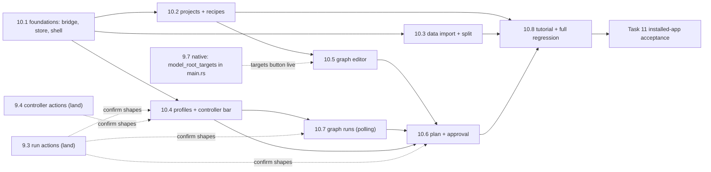
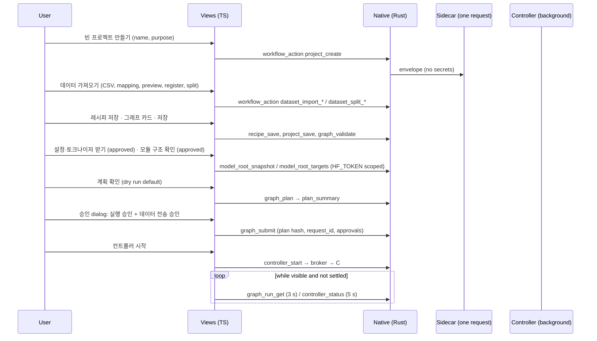

# Task 10 Purpose, Data, Recipe and Graph Workbench (Windows UI) — Reviewable Sub-task Plan

> **For agentic workers:** REQUIRED SUB-SKILL: superpowers:subagent-driven-development (recommended) or
> superpowers:executing-plans. Each sub-task below is one implementer and one independent review, test-first.
> Steps use checkbox (`- [ ]`) syntax.

**Parent plan:** [General-purpose training workflows, Task 10](2026-10-17-general-training-workflows.md#task-10-목적데이터레시피그래프-중심-windows-화면)
("목적·데이터·레시피·그래프 중심 Windows 화면"). **Spec:** [design §3, §4, §6, §7](../specs/2026-10-17-general-training-workflows-design.md#3-범용-프로젝트데이터레시피)
and the [first-run tutorial design](../specs/2026-10-19-first-run-tutorial-design.md) with its
[plan](2026-10-19-first-run-tutorial.md). **Builds on:** the [Task 9 sub-plan](2026-10-20-task9-secure-desktop-broker.md)
§5 "What Task 10 consumes", D3, D5, D8, D9, D11, D13–D15, D21, and every PROGRESS note addressed to Task 10; the
[Task 8 sub-plan](2026-10-20-task8-graph-controller.md) §4 "8.5" `graph_status` contract and §7.

**Goal:** Give the Windows app screens that start from a blank project with a free name and purpose, map CSV/JSON
columns into registered data versions and splits, keep reusable recipes, edit serial and parallel training graphs as
cards with a preview built from the same draft, plan them (dry run by default), approve execution and data transfer
separately, run them through the background controller and follow them by polling. The UI only calls the typed bridge
and polls; it never schedules. The legacy single-job, HF/S3, history and tutorial flows stay reachable and green.

**Baseline:** HEAD `960c99e` on `codex/general-training-workflows` (the 8.5 re-review Minors). Last receipts in
PROGRESS: `uv run pytest -q` → **1557 passed, 2 skipped** (PROGRESS 2751), Ruff clean, `check_secrets.py` 0 findings;
`cargo test --manifest-path desktop/src-tauri/Cargo.toml --locked --offline --release` → **48 passed** (PROGRESS
2531, 2538); `npx playwright test` → **81 passed** and `npm run build` passes (PROGRESS 2539–2540). On 2026-10-21
`npx playwright test --list` reports **81 tests in 3 files** (23 workspace, 24 tutorial, 34 connections). Tasks 9.3
and 9.4 are **not yet on this branch** (9.3 is committed on `codex/task-9.3` at `d5315b2`; 9.4 is uncommitted in
`D:\llm-tuning-factory-wt94`), and the 9.7 native follow-up that adds `model_root_targets` to `main.rs` is in progress
in `D:\llm-tuning-factory-wt95`. Every item depending on them is marked **[9.3]**, **[9.4]** or **[9.7-native]**
("confirm when landed", §1). Re-baseline all counts when 10.1 starts.

**Status:** planning only. This document authorizes no GPU, SSH, network, model download, MLflow write, institution
data, dataset transfer or paid resource.

---

## 0. Facts verified for this plan (evidence)

Checked on 2026-10-21 against HEAD `960c99e` by reading files; the [9.3]/[9.4]/[9.7-native] trees were read only.
The only command run was `npx playwright test --list` from `desktop/` (read-only). Line anchors are HEAD's unless
marked.

| # | Fact | Evidence |
|---|---|---|
| F1 | **How screens are built.** One untyped `state` object; a `pages` map of six pages; `render()` rebuilds `#app` with `innerHTML` from `views[state.page]()`, then `bind()` attaches per-element listeners and `tutorial.afterRender()` runs. Navigation is `action("nav:<page>")`. The sidebar renders every page except `connections` in "워크스페이스", then "설정" with 연결 설정 and 튜토리얼. The overview header's single primary action is "새 학습". | main.ts:14-27, 471-489 (views map 479, nav 481-482, header action 484), 529-544, 657-673 |
| F2 | **How `invoke` is called today.** `api(action, data)` → `invoke("factory_action")`; native commands are called directly (`settings_get`, `settings_save`, `forget_credentials`, `pick_file`). No TypeScript calls `workflow_action`, the profile commands or the controller commands. `desktop/src` has no `api.ts`, `project-store.ts`, `views/` or `components/`. | main.ts:1, 54-56, 495, 536, 680, 758, 839; `ls desktop/src` |
| F3 | **HTML escaping.** `esc` (main.ts:34) and `escapeHtml` (workbench.ts:2-3) are identical. `field()`/`select()` escape labels and values (main.ts:48-53). `button(label, action)` escapes only the action; **labels are raw HTML** (workbench.ts:23-24). The tour escapes step text (tutorial.ts:220). The CSP is `script-src 'self'` (inline handlers cannot run). | as cited; desktop/src-tauri/tauri.conf.json:15 |
| F4 | **Busy and dialogs.** `task()` sets `state.busy` and re-renders; `bind()` disables every non-nav `button[data-action]` and every submit button while busy and locks the connection inputs. `approve()` appends a modal `<dialog>` to `body` (Esc = cancel). Ctrl+K refuses while a dialog is open; the tour ignores Esc while a dialog is open. | main.ts:58-64, 538-543, 255-265, 88; tutorial.ts:253-257 |
| F5 | **Drafts and renders.** `captureDrafts()` reads forms into state before every task and navigation; renders wait while a pointer is pressed (deferral with a 1 s fallback). Drafts live in memory only (DESIGN.md:41 "Preserve drafts in memory when changing views"). | main.ts:65-86, 451-478 |
| F6 | **Polling today.** Only the jobs page polls: every 10 s, skipped while busy or while a poll is in flight, `captureDrafts()` then a full `render()`. | main.ts:844-852 |
| F7 | **Boot and examples.** Boot calls `settings_get`, `catalog`, `jobs`, `capabilities` only. "업무별 시작점" loads a legacy template into the single-job training page. | main.ts:838-842, 283-284, 674-677 |
| F8 | **Defect: graph jobs break the legacy pages.** Legacy `jobs` returns every job (`JobStore.list()`), graph-owned jobs included (`graph_run_id` column). Their manifests are v2 (`{"schema_version": 2, "operation": …}`, no `config`). The overview and jobs pages dereference `j.manifest.config.ai_id` and `.base_model`, so **once any graph run exists, `render()` throws** and the boot task's busy notice never clears. Neither plan mentions it. | desktop.py:394-399; jobs.py:78, 113-131, 222-224; manifest.py:79; main.ts:281, 425 |
| F9 | **Legacy `recover` is global.** The jobs page's "연결 끊긴 작업 확인" marks every stale active job FAILED, graph jobs included (the same FAILED-with-lock state the controller's own settle reaches). | desktop.py:416-417; jobs.py:537-546 |
| F10 | **Catalog data is shared.** `catalog` returns the full registry records (`dataset_id`, `version`, `sha256`, `kind`, `rows`, `synthetic`, `export_allowed`) from `state/registry`, the same root the workflow imports use. | desktop.py:196-197; runner.py:20; desktop_workflows.py:260-270 |
| F11 | **Tutorial contract.** Steps are data (`{id, page, anchor, title, body, kind, done?, enter?, cta?}`); an anchor resolves only as exactly one `#app [data-tour="…"]` on the step's page. The walkthrough asserts each anchor once, a non-centered popover, no forbidden `factory_action` and no `settings_save`. **Three tests hard-code `welcome` → `connection-provider`.** The tour snapshots and restores `config`, `plan`, `datasetDraft`, `preview`, and writes `localStorage["tuning-factory.tutorial.v1"]` only on end. | tutorial-steps.ts:14-72; tutorial.ts:17-26, 63-67, 90-115; tutorial.spec.ts:6-8, 97-135, 189-190, 370-371, 454-455 |
| F12 | **Playwright pattern.** Each spec installs `window.__TAURI_INTERNALS__ = { invoke }` with `page.addInitScript`, records `window.__testCalls`, and overrides per test by wrapping `invoke` in `page.evaluate`. Unknown commands return `undefined` (workspace), `{}` (tutorial) or `null` (connections). Specs may import pure source modules (`tutorial.spec.ts` imports `../src/tutorial-steps.ts`). Config: one worker, Vite dev server on 1420, viewport 1320×900. | workspace.spec.ts:5-46, 49-69, 41-42; tutorial.spec.ts:3, 11-50; connections.spec.ts:31-77; playwright.config.ts:1-6 |
| F13 | **Selectors that constrain any global chrome.** `.badge` first on the jobs page (workspace.spec.ts:128); `.notice` (connections.spec.ts:109 …); single `getByRole("alert")` and `getByRole("dialog")`; `localStorage.length === 0` after connection saves (workspace.spec.ts:90, 246; connections.spec.ts:132); `img` count 0 (workspace.spec.ts:145); `.sidebar-foot small` (workspace.spec.ts:94); exact nav names 작업 공간/데이터/학습 설정/실행 관리/튜토리얼; Ctrl+K `name: "학습 설정"` (workspace.spec.ts:155); jobs-page button "새로고침" exact. | as cited; `grep` of `desktop/tests` |
| F14 | **Dependencies.** Runtime dependency `@tauri-apps/api` only; dev: Playwright 1.64.0, Tauri CLI 2.12.2, TypeScript 7.0.2, Vite 8.3.4. No UI framework, no drag library. `vite-env.d.ts` references `vite/client`, so `import.meta.glob` is typed. Scripts: `build` = `tsc --noEmit && vite build`, `test` = `playwright test`. | desktop/package.json:6-20; src/vite-env.d.ts:1 |
| F15 | **Native commands.** `generate_handler!`: `settings_get`, `settings_save`, `forget_credentials`, `pick_file`, `factory_action`, `workflow_action`, `executor_profiles_get`, `executor_profile_save`, `executor_profile_delete`, `controller_start`, `controller_status`, `controller_stop`. `WORKFLOW_ACTIONS` has **32** names; Python has **33** (`model_root_targets` added by 9.7, scope `HF_TOKEN`); the native follow-up raising Rust to 33 is in progress. `workflow_action` returns `Ok(WorkflowResult)` or `Err(string)` (allowlist, envelope, sidecar spawn). | main.rs:26-42, 268-280, 337-343, 415-417; desktop_workflows.py:32-61; PROGRESS 2824-2829; wt95 `git diff` of main.rs |
| F16 | **`pick_file`.** Kind `"dataset"` filters to `json`/`jsonl`; every other kind is unfiltered. **A CSV cannot be picked for the mapped import.** | main.rs:227-234 |
| F17 | **Profile command shapes.** `executor_profiles_get` → `{profiles: [{profile_id, fields, RUNPOD_API_KEY_saved}]}`. Save → `{profile, affected_runs}`, delete → `{profile_id, affected_runs}`; both run the sidecar `executor_profile_edit_check` first and fail closed with `EDIT_CHECK_FAILED` (plus the reason) or `PROFILE_IN_USE`. **Until 9.3 lands the check answers `not_available`, so every save and delete is refused.** Fields are allowlisted per provider; key paths must be absolute; the API key goes in `values.RUNPOD_API_KEY` (empty keeps the saved one). | profiles.rs:10-13, 37, 47-48, 252-257, 276-297, 365-405; PROGRESS 2277-2280, 2495-2500, 2515-2516 |
| F18 | **Controller command shapes.** `controller_start` asks `controller_status` and spawns only for `absent`/`stale`, returns `{started: false, reason: "already_running"}` for `running`, else `Err` with `STATUS_UNKNOWN` (plus issue texts; before 9.4: `not_available`). Redirected AppData fails with `ROOT_UNUSABLE` while legacy flows keep working. `controller_status`/`controller_stop` are vault-free and carry **no `*_saved` flags**. | main.rs:40-42, 318-326, 388-407; broker.rs:32-33, 152-163; PROGRESS 2503-2511 |
| F19 | **Workflow envelope.** `WorkflowIssue {code, path, message, node_id?, row_number?}`, `WorkflowResult {status: ok/invalid/conflict, issues, data}`; the 409 table and invalid codes; a missing module answers `invalid`/`not_available` with `NOT_AVAILABLE` ("이 기능은 아직 설치되지 않았습니다."). Domain texts of Tasks 1–8 stay English; Task 9 texts are Korean. | desktop_workflows.py:82, 95-112, 156-167, 464-493 |
| F20 | **9.1 data shapes.** `projects_list` summaries; `project_save` only for existing projects (creation via `project_create`); `dataset_import_preview` returns `invalid` **with** the preview data when rows fail (row issues: `row_number = ordinal + 1`, path `/mapping`); preview data keys `source_fields`, `source_samples`, `samples` (5), `row_count`, `issues`, `preview_sha256`, `mapping`; register conflicts `preview_changed`/`version_exists`, `practice_reserved`; split preview `{plan_sha256, counts, outputs}`. | desktop_workflows.py:524-597, 624-872; dataset_import.py:42-87, 187-248; dataset_splits.py:24-48, 194-216 |
| F21 | **Definition stores.** Revisions are content-addressed; save is a CAS (`definition revision conflict`); identical content returns the same revision; `project_create` is idempotent by `request_id` and generates the `project_id`. `ProjectSpec.graph` is free JSON; `RecipeSpec.input_kind` must match the stage; a clone copies only recipe fields. **No workflow action looks a recipe up by revision hash alone** (only the internal `get_by_revision`). | projects.py:26-79, 156-238; recipes.py:36-110; main.rs:26-36 |
| F22 | **9.2 planning.** `graph_validate` and `graph_plan` load a **saved** project revision; request models (node timeouts 60–604800 s, `estimate-*` estimates); issue paths `/profiles/<id>`, `/estimates/<i>`, `/node_resources` (with `node_id`), `/tracking`, `/graph/nodes/<i>[/field]`, `/datasets`; warnings kept on `ok` and on blocked plans (`observation_revision_differs`, `simulated_execution_needs_targets`); `plan_summary` with `tracking.settings` read from `state_dir`; SSH `executor_profile_inspect` uses the launch probe, which **requires a saved GPU selection**; RunPod inspect needs the saved key (`credential_missing`). **No action lists stored observations.** | workflow_planning.py:627-702, 707-759, 1190-1202, 1216-1349, 1373-1431; desktop_runtime.py:64-84; PROGRESS 2362-2378 |
| F23 | **HF roots.** `model_root_snapshot {repo_id, revision (40 hex), download_approved}` downloads config and tokenizer files only (≤64 MiB each, ≤128 MiB total); `model_roots_list` reports `snapshot_ready`/`targets_ready`; `model_root_targets` (same request) needs the indexed root, reads safetensors headers only (≤64 MiB total), refuses architectures outside a reviewed set, and answers `conflict`/`version_exists` for different evidence. | workflow_planning.py:109-110, 665-668, 853-919; hf_targets.py:66, 73, 92-93, 281-324 |
| F24 | **Graph schema.** Node kinds and fields; `executor_profile_ids` ≥1 except select; merge 2–4 distinct models with weights summing exactly to 1 (`Fraction(str(w))`); limits 64 nodes / 256 edges; `max_concurrent` 1 default; `max_total_cost_usd` 100 default; retry 1–5. Structural issues `cycle`, `typed_port`, `missing_node`; definition issues `train_contract`, `parent_transition`, `dataset_role`, `input_overlap` carry English messages; OFT is refused in graphs. Benchmark sample IDs are `row:<n>`; v2 evaluation is greedy causal-LM in bf16/fp16 only. | graph_schema.py:19-101, 118-142; graph_planner.py:89-102, 316-379; training.py:62-67 |
| F25 | **Metrics per evaluator.** `text` exact_match/character_f1; `classification` accuracy/macro_f1; `extraction` accuracy/f1; `json` json_validity (format validity); `kbf_extraction` mean_name_f1/mean_id_f1/json_validity; `pipeline` none. `SelectionSpec.min_success ≥ 2`. | evaluation.py:21-39; benchmarks.py:29-70 |
| F26 | **`graph_status`.** Controller `{owner_id, state, heartbeat_age_seconds}`; runs with `approved_cost_usd`, `reserved_cost_usd`, `budget_exhausted`, `unpriced_attempts`, `tracking {events, graph, action}`; nodes with `uncertain`, `awaiting_result`, `result_deadline`, `needs_operator`, `wait_reason` (unfinished nodes only), `tracking_status`, `registration_status`, `tracking_action`, `output`, `selection`, `cache_seed`. **There is no `job_id`.** An unreadable run is `{run_id, error}`. Wait reasons are English fixed texts without codes. | graph_controller.py:62-89, 1061-1191; executor_profiles.py:122-124; graph_store.py:85-97, 1291-1304; tracking_outbox.py:62-65, 326-337, 505-537; PROGRESS 1836-1847, 2618-2624, 2653-2658 |
| F27 | **[9.3] run actions** (branch `codex/task-9.3` @ `d5315b2`). `graph_submit` → `{run_id, status, simulation, plan_sha256, controller}`; `conflict`/`plan_stale` at `/project`, `/profiles/<id>`, `/tracking`; `approval_required` at `/approve_execution`, `/approve_data_transfer`; `graph_runs_list` → `{runs: [{run_id, status, simulation, plan_sha256, created, nodes_by_status} \| {run_id, error}], controller}`; `graph_run_get` → `{run, controller, plan (nullable), tracking_failures: [{event_id, kind, node_id, status, tries, last_error, action}]}`; pause/resume/cancel → `{run, controller}`; `tracking_rearm` warns `tracking_evidence_changed`. | wt93 workflow_runs.py:118-148, 191-212, 271-392 |
| F28 | **[9.4] controller actions** (uncommitted, wt94). `controller_status` → `{controller, current, broker, stop_requested, restart_required: {profiles: [...], tracking: bool \| null}, runs: {active}}`; `controller_stop` → `{requested: true, owner_id}` or `{requested: false, reason: "not_running"}`. | wt94 controller_entry.py:773-824 |
| F29 | **Style rules.** Light neutral canvas, accent `#5367c8` only, semantic green/amber/red for real states, 13 px base, radius 6/8 px, no decorative shadows; visible focus; contained dialog focus; reduced motion; never show an unverified connection as online. | DESIGN.md:19-27, 40-42; style.css:2-16 |
| F30 | **Repository hygiene.** `.gitattributes` forces LF and `core.autocrlf=true` is on (Task 9 F24); `scripts/check_secrets.py` scans all reachable history for PEM private-key headers and token shapes. | scripts/check_secrets.py:11-17; Task 9 plan F24 |

---

## 1. Rules that apply to every sub-task

- **Test-first with Playwright.** Write the failing spec first against the mocked `__TAURI_INTERNALS__.invoke`
  (F12; 10.1's `tests/workflow-mock.ts`), run it, and see it fail for the intended reason (missing element, wrong
  payload), not for a typo. Pure logic (bridge parsing, store, graph model, poller) is tested in Node by importing the
  module from `../src/...` in a spec without the `page` fixture. A characterization test that passes on the current
  code is written first only for the 10.2 refactor, and is labelled as such.
- **No network.** No test or sub-task contacts HF, RunPod, SSH or MLflow. Every network-capable action
  (`executor_profile_inspect`, `model_root_snapshot`, `model_root_targets`, legacy `model_search`/`model_inspect`) is
  mocked, and the UI reaches it only after an explicit click.
- **Green after every sub-task**, from `desktop/`: the 81 existing Playwright tests (only 10.8 edits
  `tests/tutorial.spec.ts`, as listed there), every new spec, and `npm run build`. Cargo: `cargo test --manifest-path
  desktop/src-tauri/Cargo.toml --locked --offline --release` when Rust is touched (10.3) and in 10.8. Python:
  `uv run pytest -q` and `uv run ruff check src tests` when Python files are touched (10.5) and in 10.8. Before every
  commit: `uv run python scripts/check_secrets.py` (0 findings).
- **LF only.** Agent edit tools introduced CRLF on this machine before. Before staging, every changed text file must
  pass `git ls-files --eol -- <path>` → `w/lf`, or `python -c "import pathlib,sys; bad=[p for p in sys.argv[1:] if
  b'\r' in pathlib.Path(p).read_bytes()]; sys.exit(bad)" <paths>`.
- **Synthetic values only.** Never commit a literal PEM private-key header or an API-key-shaped string; the CI scan
  walks all history. Build fakes at runtime, e.g. `"synthetic-" + "runpod-" + "k".repeat(12)`.
- **Stage and commit by path** (`git add <paths>`), never `git add -A`. Do not edit files another agent has uncommitted
  changes in (today: `desktop/src-tauri/src/main.rs`, `profiles.rs`, `desktop_workflows.py`, `hf_targets.py`,
  `workflow_planning.py` in wt95; `controller_entry.py`, `scripts/desktop_entry.py` in wt94). Root integrates
  `docs/PROGRESS.md`.
- **No new npm dependency** (offline installs): `git diff --exit-code desktop/package.json desktop/package-lock.json`.
  No Rust crate (`git diff --exit-code desktop/src-tauri/Cargo.toml desktop/src-tauri/Cargo.lock`).
- **Style.** Keep the bright, restrained UI (F29): reuse `.card`, `.grid`, `.field`, `.actions`, `.badge`, `.notice`,
  `table`; one accent; no gradients, decorative shadows, images or ornamental charts. **Korean UI text** for every
  label, button, notice and dialog; fixed strings in code, dynamic values inserted escaped.
- **HTML-escape all dynamic text** with `escapeHtml` (workbench.ts) — names, purposes, labels, paths, IDs, issue
  messages, wait reasons, metrics, column names, sample values, SVG `<text>`. `button()` labels are raw HTML (F3): pass
  `escapeHtml(dynamic)`. No `` elements. Every spec includes an `` payload in at least one
  dynamic field and asserts `page.locator("img")` has count 0.
- **Keyboard and accessibility.** Every control has a visible label or `aria-label`; tab order follows the visual
  order; focus is visible; a new card or a created item receives focus; a closed dialog returns focus to its opener;
  poll-driven updates keep the focused control (10.1 `patch`); status regions use `role="status"`/`aria-live="polite"`;
  only the existing error notice uses `role="alert"`; `prefers-reduced-motion` is respected.
- **Duplicate submits.** While `state.busy`, the shell disables actions (F4). Each dialog's confirm button disables
  itself on the first activation. Create/submit requests carry a client `request_id` that is reused on retry of the
  same content (`project_create`, `graph_submit`) so a double activation cannot create twice.
- **No nested modal or form.** `form form` never exists; dialogs are appended to `body`; at most one `dialog[open]`
  (10.1 `openDialog` refuses a second); the graph card list is not inside the card's form; inline sub-forms (benchmark,
  estimates) are sibling forms.
- **Global chrome constraints** (F13): shell elements rendered on every page add no `.badge`, no `.notice`, no
  `role="alert"`/`role="dialog"`, no `<small>` in `.sidebar-foot`, no `data-run` attribute, and no button whose
  accessible name collides with an existing test name ("새로고침", "선택", "데이터", "학습 설정", …). **No
  `localStorage`/`sessionStorage` writes** outside the existing tutorial key.
- **Legacy stays reachable and green.** Single-job training, jobs, HF model search/import, S3, history and the
  connection screen keep their DOM, labels and `data-tour` anchors; the only legacy-page changes are those listed per
  sub-task. No workflow, profile or controller call happens on app boot or on a legacy page (F7).
- **The UI never owns scheduling.** Views call only `api.ts` wrappers and poll read-only actions; no client loop
  submits, retries, starts, pauses or cancels on its own. Every mutation follows a user action.
- **[9.3] / [9.4] / [9.7-native] coordination.** Code against the shapes in F27/F28/F15. When 9.3, 9.4 or the 9.7
  native follow-up lands, re-check every marked item (field names, nullability, codes) and record any deviation in the
  sub-task report. 10.4's fail-closed tests describe today's behaviour and stay valid after 9.3 (they mock the error).
- Each sub-task appends to `docs/PROGRESS.md` (through root) what was actually verified and what remains unverified
  (real WebView2, real Credential Manager, real controller — Task 11).
- **File-list deviations from the parent plan, which root must approve** (the parent lists `api.ts`,
  `project-store.ts`, `views/{projects,recipes,data-import,graph-editor,executor-profiles,graph-runs}.ts`,
  `components/recipe-fields.ts`, `main.ts`, `style.css`, `workbench.ts`, `desktop/tests/*.spec.ts`):
  - New pure modules `workflow-types.ts`, `issues.ts`, `poller.ts`, `nav-model.ts`, `view-types.ts`,
    `view-registry.ts` (10.1), `graph-model.ts` (10.5), `wait-reasons.ts` (10.7); components `controller-bar.ts`
    (10.4), `model-roots.ts`, `benchmark-form.ts` (10.5), `plan-panel.ts`, `plan-dialog.ts` (10.6); per-view CSS files
    `views/*.css`; test helper `tests/workflow-mock.ts`.
  - `desktop/src-tauri/src/main.rs` (10.3): `pick_file` kind `"import"` (D18).
  - `tests/test_desktop_ui_contract.py` (10.5): Python parity of the UI metric table (D7).

---

## 2. Decisions taken here (conservative defaults; root or the user may overturn)

Root and the user accepted the conservative defaults of Tasks 8 and 9 wholesale. Each Task 10 decision has the same
form.

| # | Decision (conservative default) | Alternative |
|---|---|---|
| D1 | **Navigation and coexistence.** Sidebar groups: **워크스페이스** = 작업 공간, 프로젝트, 데이터, 레시피, 그래프 실행, 기록 비교; **단일 학습** = 학습 설정, 실행 관리; **설정** = 연결 설정, 실행 프로필, 튜토리얼. New page IDs: `projects` (list, create, legacy import), `project` (one project: purpose, data bindings, links), `graph` (editor and planning of the open project), `recipes`, `data-import`, `runs`, `profiles`. `project`, `graph` and `data-import` are not sidebar items: `project`/`graph` are reached from 프로젝트 (sidebar highlights 프로젝트), `data-import` from the 데이터 page and from a project. Legacy page IDs, labels and DOM stay; the overview's header primary becomes "새 프로젝트" (the empty-runs panel keeps "새 학습 설정"), and "업무별 시작점" becomes "예제 시작점 · 선택". Ctrl+K lists sidebar pages only. | Replace the legacy pages by the project flow (breaks the tutorial, 81 tests and the single-job path); or tabs inside one "프로젝트" page (one huge view module, no parallel work). |
| D2 | **View modules without a framework.** Each page lives in a `views/*.ts` module exporting `view: View` (or `views: View[]` when one module serves two pages, as projects/project do) with `render`, `bind`, `capture`, `enter`, `leave`, `action` and optional overview/datasets slot panels. `view-registry.ts` discovers them with `import.meta.glob("./views/*.ts", { eager: true })`, so later sub-tasks add files without editing a shared registry. View-specific CSS lives in `views/<page>.css` imported by the view; shared tokens and common workflow classes in `style.css` (10.1). Views keep their own module state; the shell passes a `ViewContext`. | An explicit registry edited by each sub-task (shared-file conflicts); or a UI library (new offline dependency). |
| D3 | **Bridge discipline.** Only `api.ts` imports `invoke`. Every workflow answer is validated as a `WorkflowResult` (malformed → `BridgeError` "엔진 응답 형식이 올바르지 않습니다."); `invalid`/`conflict` are values, `Err` strings are `BridgeError`s shown verbatim. `not_available` renders a fixed fail-closed state ("이 기능은 아직 설치되지 않았습니다.") with the control disabled. Entering a workflow page runs only read-only actions (`*_list`, `*_get`, `controller_status`, `executor_profiles_get`). Network actions run only after an explicit click; those that download files or contact a destination (`model_root_snapshot`, `model_root_targets`, `executor_profile_inspect`) first show a notice dialog; HF metadata search/inspect (legacy `model_search`/`model_inspect`) shows an inline note "Hugging Face에서 메타데이터만 조회합니다", as the training page does today. | Lazy probing of availability at boot (calls on every start; breaks legacy mocks). |
| D4 | **Drafts and persistence.** Drafts live in memory (`project-store.ts`, view modules); saved state is the backend. Saving is explicit ("저장"), never automatic. `graph_validate` runs after every successful save, because validation reads the saved revision (F22). Planning inputs that no backend stores — node time limits, estimates, simulation choice — stay in memory per project for the session (D20). No `localStorage`/`sessionStorage`. | Autosave on change (a revision per keystroke; conflicts harder to explain); persisting drafts in WebView storage (breaks F13 tests, leaks drafts across users of a PC). |
| D5 | **Conflicts (409).** A `conflict` never discards the draft. `revision_conflict` shows a banner with two explicit choices: "최신 버전 불러오기" (confirm, then replace the draft) and "내 변경으로 덮어쓰기" (fetch the latest revision, confirm naming that another change will be replaced, then save with it as `expected_revision`). `plan_stale` closes the approval, drops the plan and its approval, keeps the draft, names what changed by path (`/project` → 프로젝트, `/profiles/<id>` → that profile, `/tracking` → MLflow 설정) and offers "다시 계획". `preview_changed` asks to preview again; `version_exists` asks for another version; `run_state`/`tracking_state` refresh the run; `request_reused` is shown as an error (the UI reuses request IDs only for identical content). | Silent last-writer-wins; or automatic re-plan on `plan_stale` (would re-approve without the user). |
| D6 | **Graph editor interaction.** Cards in topological columns plus an SVG preview, both generated from the same `GraphJson` through `graph-model.layout`. Select a card (click or Enter); "다음 단계 추가" adds a **serial** child whose input is the selected card's output; "나란히 추가" adds a **parallel** sibling with the same input; four starting shapes on an empty graph (단일 학습, 직렬 추가 학습, 병렬 비교, 병렬 비교 후 병합, design §4). Inputs are connected with `<select>` controls in the card form; incompatible sources are disabled **and** listed with reasons. ArrowUp/ArrowDown move focus between cards (roving tabindex). No drag and drop, no drag library. IDs are generated (`train-1`, `eval-1`, …); labels are free text. Add actions disable at 64 cards with the reason. | Drag-and-drop canvas (needs a library or a large pointer layer, poor keyboard story); JSON editing (design §4 forbids requiring it). |
| D7 | **Connection and metric reasons.** Local reasons for what the draft alone proves (port type, self/cycle, merge count and weights, OFT parent, a method change that needs a materialize step, different benchmarks under one selection, an evaluator without metrics); authoritative reasons from `graph_validate`/`graph_plan` issues mapped by `node_id`/path and localized (D12). The metric table per evaluator lives in `graph-model.ts` and is pinned to `evaluation.metric_schema` by `tests/test_desktop_ui_contract.py`. Text metrics carry "텍스트 정답 일치 지표 · 의미적 품질 점수가 아닙니다"; `json_validity` carries "형식 지표 · 품질 지표가 아닙니다". | Server-only reasons (feedback only after save); a new metrics action (Python + native change). |
| D8 | **Plan and approval dialog** (Task 9 D9). Dry run is the default (`simulation: true`); "실제 실행 계획" is an explicit choice. A plan is usable only while its basis holds: saved and clean draft at that revision, unchanged profiles, settings and recipes since planning. The dialog (appended to `body`) shows the plan hash, steps, **maximum estimated cost** (with retries, "제공자 청구 상한이 아닙니다 · 저장·대기 비용 별도"), maximum duration and concurrent GPUs, each **destination** (profile name, GPU, total hourly price, cost source, steps using it), each **dataset** (ID, version, SHA256 prefix, synthetic, export flag), the MLflow destination, and steps that will wait on a shared single destination. A real plan needs **two separate checkboxes** — "실행 승인" and "데이터 전송 승인" — before "승인하고 실행 등록" enables; a dry run needs none ("모의 실행 등록"). The `request_id` is generated once per plan hash and reused on retry. | One combined approval (contradicts D9); approval inside the plan panel instead of a dialog (easier to click through by accident). |
| D9 | **Controller lifecycle in the UI.** No auto-start, also not after a submit: the run page and the post-submit notice show "컨트롤러 시작" while the state is `absent`/`stale`. Stop opens a dialog that explains the drain ("진행 중인 단계가 끝날 때까지 기다린 뒤 정지합니다. 학습 중이면 몇 시간이 걸릴 수 있습니다. 앱을 닫아도 컨트롤러는 계속 동작합니다."). `restart_required.profiles` non-empty or `tracking === true` shows the D5 procedure "일시정지 → 진행 중 단계 완료 대기(또는 컨트롤러 정지) → 설정 저장 → 컨트롤러 시작"; `tracking: null` shows nothing (no `*_saved` flags, F18). `ROOT_UNUSABLE` is explained as the redirected-AppData limitation with single-job features still working. `not_available` disables start/stop. | Start the controller automatically right after a submit (allowed by Task 9 D3; one click fewer, but a background process that may use paid GPUs for hours starts without its own click). |
| D10 | **Polling.** Read-only, DB-only actions only, never on app boot. Runs detail: `graph_run_get` every 3 s while the runs page shows that run and it is not *settled* (final status, graph tracking `saved`/`failed`/`uncertain`, no node `pending`/`retrying`/`uncertain`). Runs list: `graph_runs_list` every 10 s while visible. Controller bar: `controller_status` every 5 s while a page showing it is visible. Rules: one poll in flight per page (pollers on a page share a queue, so at most one sidecar process at a time); the next delay is `max(base, 2 × last call duration)`, doubling on each failure up to 60 s and resetting on success; stop on page leave, `document.visibilityState === "hidden"` and settlement; skip while busy; re-render only on changed data, through `patch` so focus and typing survive. | Task 9 §5's fixed 3 s/5 s (each poll spawns a onefile sidecar; slow starts would pile up); server push (no channel exists). |
| D11 | **Operator states (overridden by root, see below).** `awaiting_result` → neutral "결과 대기" with "같은 실행의 결과를 기다립니다. 시간 제한이 지나기 전(… 까지)에는 다시 실행하지 않습니다." from `result_deadline`, no action. `needs_operator` → amber "운영자 확인 필요" with the reason and a copyable CLI instruction: confirm on the server/Pod that the remote process stopped, find the job with `factory status`, then `factory --state-dir "%APPDATA%\kr.kbiofoundry.tuningfactory\state" release-lock <JOB_ID> <ATTEMPT_ID> --confirm-execution-stopped` with the attempt ID filled in. **No desktop lock release** (Task 9 D21). | A desktop release with double confirmation (rejected in D21). |
| D12 | **Localization of English texts.** `issues.ts` maps known codes and known English domain messages (Tasks 1–8) to Korean; `wait-reasons.ts` maps the controller's fixed wait-reason prefixes (F26). The original text is always kept in a `<details>` "원문 보기". Unknown codes show the message as received (Task 9 texts are Korean already). | Show raw English; or change backend texts (out of scope). |
| D13 | **HF root panel.** On the graph page, a "기반 모델" panel lists `model_roots_list`, pins a model with its own "모델 검색"/"버전 확인" buttons calling the legacy `model_search`/`model_inspect` (the 40-hex revision comes from the inspection), and offers two separate buttons with their own approval dialogs: "설정·토크나이저 받기" (`model_root_snapshot`; "가중치는 받지 않습니다 · 파일당 64 MiB, 합계 128 MiB 이하 · 저장된 HF 토큰을 씁니다") and "모듈 구조 확인" (`model_root_targets`, after a snapshot; "safetensors 헤더만 읽고 가중치는 받지 않습니다 · 합계 64 MiB 이하"). Train cards show `simulated_execution_needs_targets`/`base_targets_missing` with a link to the second button. **[9.7-native]** until `main.rs` lists the action, the native refusal is shown verbatim. | Fetch snapshots or targets implicitly at planning (network without an explicit click; Task 9 D14 forbids). |
| D14 | **Executor profiles screen.** List, create and edit with the native commands; reload the list after every save/delete; show `affected_runs` ("이 변경 후 다시 계획해야 하는 실행: …"); show native errors verbatim — this is the **fail-closed state before 9.3** (`EDIT_CHECK_FAILED (이 기능은 아직 설치되지 않았습니다.)`) and `PROFILE_IN_USE` after it. The provider is chosen once (disabled on edit); the API key input is a password field cleared after save ("보안 저장됨 · 변경할 때만 입력"). SSH GPU UUIDs are entered one per line (saved as a JSON array string), because the profile probe needs a selection before it can observe (F22). "자원 확인" runs `executor_profile_inspect` after a read-only notice; its result is kept for the session only and real plans state "1시간 이내 확인 필요". Saving or deleting calls `store.markProfilesChanged()`. | A Python inventory-only probe for profiles (out of Task 10's scope, §6 Q-C); persisting observation summaries in the UI. |
| D15 | **Legacy isolation from graph jobs** (F8). Legacy job lists use only jobs without `graph_run_id` and with a v1 `manifest.config`; overview and jobs pages show "그래프 실행 단계 N개는 ‘그래프 실행’에서 확인하세요." with a link when the runs view exists. Legacy actions (`execute`, `resume`, `cancel`, `reconcile`, logs) are never offered for graph jobs. The global legacy `recover` stays as it is (§6 Q-K). | Render graph jobs in the legacy table (their v1 actions do not apply; misleading). |
| D16 | **Tutorial strategy.** The practice flow stays on the legacy data and training forms (registration of `tutorial_sample` is legacy-only; F11, Task 9 §5). New explain-only steps are **appended after `jobs-history`, before `finish`**: `project-start` (overview), `executor-profiles`, `data-import`, `graph-editor`, `graph-runs`; each view renders its anchor exactly once, also in its empty state. The welcome, finish and first-run card texts mention the project flow. The tour makes no mutating workflow or native call; the tutorial spec mock answers the read-only calls with empty valid results. | Insert the project steps right after `welcome` (breaks the three adjacency tests, which would be edited); move the practice to the project flow (creates a project that cannot be deleted; reserved ID refused on the new import path). |
| D17 | **Recipe fields extraction.** `components/recipe-fields.ts` takes over `stageSelect`, `methodSelect` and `trainingOptions`, parameterized by the attribute (`data-config` for the training page, `data-recipe` for recipes) and a value getter; `field`/`select` move to `workbench.ts`. The training form's DOM must stay identical: a characterization test written first pins its field list and labels for four stage/method combinations. Recipe mode omits the three PPO reward fields (RecipeSpec has none). | Duplicate the fields in the recipe view (no refactor risk, two copies to keep in step). |
| D18 | **CSV picker.** `pick_file` gains kind `"import"` filtering to `csv`, `json`, `jsonl` (a pure `picker_filter(kind)` with a Rust unit test); `"dataset"` and `"key"` are unchanged. | No Rust change: typed paths only, or reuse the unfiltered `"key"` picker for data (confusing and semantically wrong). |
| D19 | **Wording.** Business-fixed headings and descriptions on the overview and new screens use 프로젝트/실험/목적 ("업무별 시작점" → "예제 시작점 · 선택"; the training description "업무에 맞는…" → "목적에 맞는…"; "업무 AI 설정" → "실험 설정"). Legacy field labels that tests and saved profiles use (`업무 AI ID`, `업무 흐름 ID`, the history search placeholder) stay. | Rename every "업무" label (breaks dozens of tests for no functional gain). |
| D20 | **Planning inputs (overridden by root, see below).** Each non-select card gets a visible "최대 실행 시간" defaulting to 60 분 (3600 s; 1–10080 분) and a runtime profile derived from its recipe (PPO → `ppo`, else `primary`, read-only). Estimates ("계획용 추정 자원", simulation only) start empty: the user enters a name (`estimate-<name>`), GPU type, count and total hourly price; no made-up default price. Cards may reference native profiles and estimates; a real plan with an estimate shows `estimate_real` at that estimate. | Persist inputs in the graph JSON (GraphSpec refuses extra fields); default estimate price (misleading cost). |

### Root decisions (2026-10-21)

D1–D10, D12–D19 and the file-list deviations in §1 are accepted as written. D11 and D20 are replaced as described
below.

**Task 9.8, backend additions for the UI** (a small Python and native sub-task). It runs after 9.4 and the 9.7
native follow-up land, because both edit `main.rs`. It must land before 10.4, 10.5 and 10.7 use it. It closes
planning problems 3–7 and 13:

- **Node identifiers.** `graph_status` and `graph_run_get` nodes carry `job_id` and `attempt_id`.
- **Desktop operator release (replaces D11's "CLI only").** The installed app ships no `factory` CLI, so a stuck
  lock would otherwise be unrecoverable for desktop users.
  - New workflow action `graph_release_lock {run_id, node_id, job_id, attempt_id, confirm_execution_stopped: true}`.
    It needs no secret scope.
  - It is allowed **only** while that node's `needs_operator` is true and the attempt is the current one. It goes
    through exactly the same store path and semantics as CLI `release-lock --confirm-execution-stopped`: the node
    becomes FAILED and is not retried (D4).
  - Anything else is a refusal with a fixed code.
  - In the UI (10.7), it lives behind a dialog that explains the risk. The user must tick "원격 서버/Pod에서 해당
    실행이 멈춘 것을 확인했습니다" and type the node label before the button enables.
  - `awaiting_result` never offers it. The CLI instruction is still shown as an alternative.
- **`observations_list`.** Read-only. Lists each profile's last observation (revision, `observed_at`, public facts
  summary).
- **`executor_profile_inventory`.** A read-only SSH GPU listing for a profile that has no GPU selection yet. It reuses
  the 6A inventory command, shows the notice dialog first, and is no-op safe. 10.4 then offers GPU checkboxes instead
  of typed UUIDs.
- **Recipe lookup by revision hash.** `recipe_get` accepts `revision_sha256`.
- **Planning inputs persistence (replaces D20's session-only rule).** Add `planning_inputs_get` and
  `planning_inputs_save`, keyed by project ID with CAS on the project revision, stored under
  `state/workflows/planning-inputs/`. They hold node time limits, estimates and the simulation choice, never
  secrets.
- **`plan_summary`.** Includes per-node recipe and dataset references.
- **A test for legacy `recover`.** It must never fail a graph attempt whose heartbeat is fresh (Q-K).

The legacy-page crash when graph jobs exist (problem 1) is fixed UI-side in 10.1, test-first (D15). The legacy
`jobs` response contract stays frozen.

---

## 3. Sub-tasks and sequence

| Sub-task | One line |
|---|---|
| **10.1** | Foundations: `workflow-types.ts`, `api.ts`, `issues.ts`, `poller.ts`, `project-store.ts`, `nav-model.ts`, `view-types.ts`, `view-registry.ts`; shell integration in `main.ts` (nav groups, routing, capture, `patch`, slots, graph-job isolation, settings hook); `workbench.ts` dialog/focus helpers; shared styles; `tests/workflow-mock.ts`. |
| **10.2** | Projects and recipes: blank project on the first screen, save/reopen, data bindings, legacy import; recipe list/create/edit/clone/from-example; `components/recipe-fields.ts` extraction. |
| **10.3** | Data import and split: source, format and encoding, column mapping, preview with row issues, immutable registration, split preview/commit, project binding; native `"import"` picker. |
| **10.4** | Executor profiles screen and controller bar: native profile commands with fail-closed states, read-only inspection, controller status/start/stop, restart and drain explanations, polling. |
| **10.5** | Graph editor: `graph-model.ts`, cards and preview, click and keyboard serial/parallel add and connect, reasons, starting shapes, HF root panel, inline benchmarks, save and validate. |
| **10.6** | Plan and approval: planning inputs, `graph_plan` with issues and warnings, plan invalidation, approval dialog with separate approvals, `graph_submit`, conflicts. |
| **10.7** | Graph runs: list and detail with polling, node/tracking/selection display, wait-reason localization, operator states, pause/resume/cancel, tracking re-arm. |
| **10.8** | Tutorial update (anchors and explain steps), cross-page accessibility/escaping regression, full regression of legacy flows. |



**Parallel worktrees** (file ownership below is disjoint within each wave).
- 10.1 first; it fixes the bridge, store, view contract, mock helper and shared styles.
- After 10.1: **10.2 ∥ 10.3 ∥ 10.4**. 10.2 is the only one touching `main.ts` (the three recipe-field functions);
  10.3 the only one touching `main.rs` (after the 9.7 native follow-up lands, to avoid a conflict with wt95).
- After 10.2: **10.5**; after 10.4: **10.7** (10.5 ∥ 10.7).
- 10.6 after 10.5 and 10.7 (it edits `views/graph-editor.ts` sequentially and navigates to the runs view).
- 10.8 last.
- 10.1–10.3 and 10.5 need neither 9.3 nor 9.4 to land (mocked shapes). 10.4, 10.6 and 10.7 may be written against the
  [9.3]/[9.4] shapes but are merged only after a re-check against the landed code.

**File ownership** (a file is edited only by its owner; "→" marks a later sequential owner; root integrates PROGRESS).

| Sub-task | Creates | Modifies |
|---|---|---|
| 10.1 | `desktop/src/workflow-types.ts`, `api.ts`, `issues.ts`, `poller.ts`, `project-store.ts`, `nav-model.ts`, `view-types.ts`, `view-registry.ts`; `desktop/tests/workflow-mock.ts`, `workflow-core.spec.ts`, `navigation.spec.ts` | `desktop/src/main.ts` (shell), `workbench.ts`, `style.css` |
| 10.2 | `desktop/src/views/projects.ts`, `projects.css`, `recipes.ts`, `recipes.css`, `desktop/src/components/recipe-fields.ts`; `desktop/tests/projects.spec.ts`, `recipes.spec.ts` | `desktop/src/main.ts` (replace `stageSelect`/`methodSelect`/`trainingOptions` and their helpers only), `workbench.ts` (receive `field`/`select`) |
| 10.3 | `desktop/src/views/data-import.ts`, `data-import.css`; `desktop/tests/data-import.spec.ts` | `desktop/src-tauri/src/main.rs` (`pick_file` only, plus one Rust test) |
| 10.4 | `desktop/src/views/executor-profiles.ts`, `executor-profiles.css`, `desktop/src/components/controller-bar.ts`; `desktop/tests/executor-profiles.spec.ts` | — |
| 10.5 | `desktop/src/graph-model.ts`, `views/graph-editor.ts`, `graph-editor.css`, `components/model-roots.ts`, `components/benchmark-form.ts`; `desktop/tests/graph-model.spec.ts`, `graph-editor.spec.ts`; `tests/test_desktop_ui_contract.py` | — |
| 10.6 | `desktop/src/components/plan-panel.ts`, `plan-dialog.ts`; `desktop/tests/graph-plan.spec.ts` | `views/graph-editor.ts` (→ after 10.5: mount the plan panel) |
| 10.7 | `desktop/src/views/graph-runs.ts`, `graph-runs.css`, `desktop/src/wait-reasons.ts`; `desktop/tests/graph-runs.spec.ts` | — |
| 10.8 | `desktop/tests/workflow-regression.spec.ts` | `desktop/src/tutorial-steps.ts`, `desktop/tests/tutorial.spec.ts`, `desktop/src/main.ts` (→ first-run card text only) |

Main flow after Task 10 (all calls go through `api.ts`; `C` is the background controller of Task 9):



---

## 4. Sub-tasks

### 10.1 Foundations: typed bridge, project drafts, view shell

**Goal / scope.**
- `workflow-types.ts`: the TypeScript shapes of every workflow request and result used by Task 10 and the action list.
- `api.ts`: the only `invoke` caller for the new channel; result validation; `BridgeError`.
- `issues.ts`: issue routing (field path, card, row, plan section) and Korean localization (D12).
- `poller.ts`: the D10 poller.
- `project-store.ts`: project drafts with revision, dirty state, issues, conflicts, planning inputs and plan validity.
- `nav-model.ts`, `view-types.ts`, `view-registry.ts`: the view contract and discovery (D2).
- `main.ts`: nav groups (D1), routing `nav:<page>[:<arg>]` to views with `enter`/`leave`, capture hooks, `patch`,
  overview/datasets slots, header primary, D19 headings, graph-job isolation (D15), `store.markSettingsChanged()` after
  every successful `settings_save` of the connection form.
- `workbench.ts`: `openDialog`, `focusKey`/`restoreFocus`, `isGraphJob`, `statusPill`.
- `style.css`: nav group labels, `.status-pill`, `.issue-list`, `.wf-banner`, `.wf-columns`.
- `tests/workflow-mock.ts`: the shared mock.

**Non-goals.** Any workflow screen (10.2–10.7); tutorial steps (10.8); Rust.

**Files**
- Create `desktop/src/workflow-types.ts`, `api.ts`, `issues.ts`, `poller.ts`, `project-store.ts`, `nav-model.ts`,
  `view-types.ts`, `view-registry.ts`.
- Modify `desktop/src/main.ts`: `pages`/nav (:24-27, :481-482), `render()` (:471-489), `captureDrafts()` (:65-86),
  `action("nav:…")` (:673), `overview()` (:270-288), `datasets()` (:356-367, slot only), `jobs()` (:420-429),
  `refresh()` (:490), `saveSettings()` (:493-503), descriptions (:39-46), the training card heading (:373, D19 only).
- Modify `desktop/src/workbench.ts`, `desktop/src/style.css`.
- Create `desktop/tests/workflow-mock.ts`, `desktop/tests/workflow-core.spec.ts`, `desktop/tests/navigation.spec.ts`.

**Interfaces**

```ts
// workflow-types.ts (pure: no imports)
export const WORKFLOW_ACTIONS = [
  "projects_list", "project_create", "project_get", "project_save", "project_import_legacy",
  "recipes_list", "recipe_get", "recipe_save", "recipe_clone",
  "dataset_import_source", "dataset_import_preview", "dataset_import_register",
  "dataset_split_preview", "dataset_split_commit",
  "executor_profile_inspect", "model_root_snapshot", "model_roots_list", "benchmark_save", "benchmarks_list",
  "graph_validate", "graph_plan", "graph_plan_get",
  "graph_submit", "graph_runs_list", "graph_run_get", "graph_pause", "graph_resume", "graph_cancel",
  "tracking_rearm", "executor_profile_edit_check",
  "controller_status", "controller_stop",
  "model_root_targets",
] as const;                                                    // = desktop_workflows.WORKFLOW_ACTIONS (33)
export type WorkflowAction = (typeof WORKFLOW_ACTIONS)[number];
export const NATIVE_PENDING: readonly WorkflowAction[] = ["model_root_targets"];   // [9.7-native]: empty when main.rs lists it
export type Sha256 = string;
export interface WorkflowIssue { code: string; path: string; message: string; node_id?: string | null; row_number?: number | null }
export interface WorkflowResult<T> { status: "ok" | "invalid" | "conflict"; issues: WorkflowIssue[]; data: T | null }
export interface WithWarnings { warnings?: WorkflowIssue[] }

export interface DatasetRef { dataset_id: string; version: string; sha256: Sha256 }
export type BindingRole = "train" | "validation" | "test";
export interface DatasetBinding { binding_id: string; role: BindingRole; dataset: DatasetRef }
export interface ProjectSpec {
  schema_version: 1; project_id: string; name: string; purpose: string; task_type: string;
  datasets: DatasetBinding[]; default_executor_profile_id: string | null;
  graph: Record<string, unknown>;                              // GraphJson or {} (graph-model.ts, 10.5)
  legacy_origin: string | null;
}
export interface ProjectRevision { project: ProjectSpec; revision_sha256: Sha256 }
export interface ProjectSummary {
  project_id: string; name: string; purpose: string; task_type: string; revision_sha256: Sha256;
  legacy_origin: string | null; datasets: DatasetBinding[]; graph_nodes: number;
}
export type Stage = "pt" | "sft" | "rm" | "ppo" | "dpo" | "kto";
export type Method = "lora" | "qlora" | "full" | "freeze" | "oft";
export type InputKind = "text" | "instruction" | "preference" | "prompt" | "kto";
export interface RecipeSpec {
  schema_version: 1; recipe_id: string; version: string; name: string; description: string;
  training_backend: "llamafactory"; capability_version: "lf-text-v1";
  training_stage: Stage; training_method: Method; input_kind: InputKind; quantization_bit: 4 | 8;
  hyperparameters: Record<string, unknown>; finetuning_options: Record<string, unknown>;
  stage_options: Record<string, unknown>; evaluation_defaults: Record<string, unknown>;
}
export interface RecipeRevision { recipe: RecipeSpec; revision_sha256: Sha256 }
export interface RecipeSummary {
  recipe_id: string; version: string; name: string; description: string; training_stage: Stage;
  training_method: Method; input_kind: InputKind; revision_sha256: Sha256;
}
export type FieldPath = (string | number)[];
export interface ImportMapping {
  schema_version: 1; transform_version: "text-mapping-v1"; source_format: "csv" | "json" | "jsonl";
  encoding: "utf-8" | "utf-8-sig" | "cp949"; csv_delimiter: string; kind: InputKind;
  formatting: "alpaca" | "sharegpt"; fields: Record<string, FieldPath>;
  message_tags: Record<string, string>; boolean_labels: { true?: string[]; false?: string[] };
}
export interface ImportSource { source_id: Sha256; source_sha256: Sha256; size: number }
export interface ImportPreview {
  source_id: Sha256; source_sha256: Sha256; source_size: number; canonical_sha256: Sha256 | null;
  canonical_size: number | null; row_count: number; samples: Record<string, unknown>[];
  issues: { ordinal: number | null; code: string; message: string }[];
  source_samples: Record<string, unknown>[]; source_fields: string[]; mapping: ImportMapping; preview_sha256: Sha256;
}
export interface SplitPlan {
  dataset: DatasetRef; seed: number; train_basis_points: number; validation_basis_points: number;
  test_basis_points: number; group_field: FieldPath | null; outputs: Partial<Record<BindingRole, { dataset_id: string; version: string }>>;
}
export interface SplitPreview { plan_sha256: Sha256; counts: Partial<Record<BindingRole, number>>; outputs: Partial<Record<BindingRole, DatasetRef>> }
export interface PublicProfile { profile_id: string; fields: Record<string, string>; RUNPOD_API_KEY_saved?: boolean }
export interface ResourceFacts { gpu_type: string; gpu_count: number; total_hourly_cost_usd: number; observed_at: string; [key: string]: unknown }
export interface Observation { profile: Record<string, unknown>; facts: ResourceFacts; observed_at: string; revision: Sha256 }
export interface HFRootRef { repo_id: string; revision: string; config_sha256: Sha256; tokenizer_fingerprint: Sha256 }
export interface ModelProfile { repo_id: string; revision: string; config_sha256: Sha256; architecture: string; template: string; [key: string]: unknown }
export interface ModelRoot { root: HFRootRef; profile: ModelProfile; snapshot_ready: boolean; targets_ready: boolean }
export interface BenchmarkSpec {
  dataset: DatasetRef; evaluator_kind: string; evaluator_version: string; ordered_sample_ids: string[];
  max_new_tokens: number; cutoff_len: number; seed: number; generation_mode: "greedy";
  precision: "bf16" | "fp16"; quantization_bit: 4 | 8 | null; tokenizer_fingerprint: Sha256; template: string;
  semantic_model_kind: "causal_lm";
}
export interface BenchmarkRevision { revision_sha256: Sha256; spec: BenchmarkSpec }
export interface NodeResourceChoice { node_id: string; timeout_seconds: number; runtime_profile: "primary" | "ppo" }
export interface PlanningEstimate { profile_id: string; gpu_type: string; gpu_count: number; total_hourly_cost_usd: number }
export interface PlanRequest {
  project_id: string; project_revision: Sha256; simulation: boolean;
  node_resources: NodeResourceChoice[]; estimates: PlanningEstimate[];
}
export interface PlanResource {
  profile_id: string; revision: string; resource_id: string; gpu_type: string; gpu_count: number;
  total_hourly_cost_usd: number; cost_source: string;          // "runpod_api" | "estimate" | SSH cost source
}
export interface PlanSummary extends WithWarnings {
  plan_sha256: Sha256; simulation: boolean; project_id: string; project_revision: Sha256;
  max_estimated_cost_usd: number; max_duration_seconds: number; max_concurrent_gpu_count: number;
  retry_policy: { max_attempts: number; backoff_seconds: number };
  nodes: { node_id: string; kind: string; label: string; max_estimated_cost_usd: number; max_duration_seconds: number; allowed: PlanResource[] }[];
  datasets: (DatasetRef & { synthetic: boolean; export_allowed: boolean })[];
  tracking: { profile_id: string; public_settings_sha256: Sha256; settings: Record<string, string> | null } | null;
}
export interface ControllerView { owner_id: string | null; state: "running" | "stale" | "absent"; heartbeat_age_seconds: number | null }
export interface ControllerStatus {                              // [9.4]
  controller: ControllerView; current: Record<string, unknown> | null;
  broker: { at: string; code: string; error: string } | null; stop_requested: boolean;
  restart_required: { profiles: string[]; tracking: boolean | null }; runs: { active: number };
}
export type TrackingStatus = "not_started" | "pending" | "retrying" | "saved" | "uncertain" | "failed";
export interface GraphRunNode {
  node_id: string; label: string; kind: string;
  status: "PENDING" | "READY" | "RUNNING" | "COMPLETED" | "FAILED" | "BLOCKED" | "CANCELED";
  job_status: string | null; attempt_id: string | null; attempts: number; counted_attempts: number; max_attempts: number;
  resource_id: string | null; destination_profile_id: string | null; uncertain: boolean; awaiting_result: boolean;
  result_deadline: number | null; needs_operator: boolean; wait_reason: string | null; error: string | null;
  retry_at: number | null; tracking_status: TrackingStatus; registration_status: TrackingStatus | "none" | "registered";
  tracking_action: string | null;
  output: { artifact_id: Sha256; inventory_sha256: Sha256 } | { evaluation_status: string; metrics: Record<string, unknown> } | null;
  selection: Sha256 | "no_winner" | null; cache_seed: "published" | "failed" | "missing" | null;
}
export interface GraphRun {
  run_id: string; status: "RUNNING" | "PAUSED" | "CANCELED" | "COMPLETED" | "FAILED"; simulation: boolean;
  plan_sha256: Sha256; approved_cost_usd: number; reserved_cost_usd: number; budget_exhausted: boolean;
  unpriced_attempts: number; created: number;
  tracking: { events: Record<string, number>; graph: TrackingStatus; action: string | null }; nodes: GraphRunNode[];
}
export interface UnreadableRun { run_id: string; error: string }
export interface RunListEntry { run_id: string; status: GraphRun["status"]; simulation: boolean; plan_sha256: Sha256; created: number; nodes_by_status: Record<string, number> }
export interface TrackingFailure { event_id: Sha256; kind: string; node_id: string | null; status: "FAILED" | "UNCERTAIN"; tries: number; last_error: string | null; action: string | null }
export interface RunDetail { run: GraphRun | UnreadableRun; controller: ControllerView; plan: PlanSummary | null; tracking_failures: TrackingFailure[] }   // [9.3]
export interface SubmitResult { run_id: string; status: string; simulation: boolean; plan_sha256: Sha256; controller: ControllerView }  // [9.3]
```

```ts
// api.ts (the only module that imports invoke for the new channel)
import { invoke } from "@tauri-apps/api/core";
export class BridgeError extends Error {}
export const MALFORMED = "엔진 응답 형식이 올바르지 않습니다.";
export function parseWorkflowResult<T>(value: unknown): WorkflowResult<T>       // throws BridgeError(MALFORMED)
export async function workflow<T>(action: WorkflowAction, data: object = {}): Promise<WorkflowResult<T>>
  // invoke("workflow_action", { action, data }); a rejected invoke → BridgeError(String(reason))
export const projects = {
  list: () => workflow<{ projects: ProjectSummary[] }>("projects_list"),
  create: (r: { request_id: string; name: string; purpose: string; task_type: string }) => workflow<ProjectRevision>("project_create", r),
  get: (project_id: string, revision?: Sha256) => workflow<ProjectRevision>("project_get", revision ? { project_id, revision } : { project_id }),
  save: (spec: ProjectSpec, expected_revision: Sha256) => workflow<ProjectRevision>("project_save", { spec, expected_revision }),
  importLegacy: (request_id: string, ai_id: string) => workflow<ProjectRevision & { recipe: RecipeSpec; recipe_revision_sha256: Sha256; datasets: DatasetBinding[] } & WithWarnings>("project_import_legacy", { request_id, ai_id }),
};
export const recipes = {
  list: () => workflow<{ recipes: RecipeSummary[] }>("recipes_list"),
  get: (recipe_id: string, revision?: Sha256) => workflow<RecipeRevision>("recipe_get", revision ? { recipe_id, revision } : { recipe_id }),
  save: (spec: RecipeSpec, expected_revision: Sha256 | null) => workflow<RecipeRevision>("recipe_save", { spec, expected_revision }),
  clone: (r: { recipe_id: string; revision?: Sha256; name?: string; new_recipe_id?: string; version?: string }) => workflow<RecipeRevision>("recipe_clone", r),
};
export const imports = {
  source: (path: string) => workflow<ImportSource>("dataset_import_source", { path }),
  preview: (source_id: Sha256, mapping: ImportMapping) => workflow<ImportPreview>("dataset_import_preview", { source_id, mapping }),
  register: (r: { source_id: Sha256; mapping: ImportMapping; preview_sha256: Sha256; dataset_id: string; version: string; synthetic: boolean; export_allowed: boolean }) =>
    workflow<{ dataset: DatasetRef; preview_sha256: Sha256 }>("dataset_import_register", r),
  splitPreview: (plan: SplitPlan) => workflow<SplitPreview>("dataset_split_preview", { plan }),
  splitCommit: (plan_sha256: Sha256) => workflow<{ plan_sha256: Sha256; outputs: SplitPreview["outputs"] }>("dataset_split_commit", { plan_sha256 }),
};
export const planning = {
  inspect: (profile_id: string) => workflow<Observation>("executor_profile_inspect", { profile_id }),
  rootSnapshot: (repo_id: string, revision: string) => workflow<{ root: HFRootRef; profile: ModelProfile; files: string[] }>("model_root_snapshot", { repo_id, revision, download_approved: true }),
  rootTargets: (repo_id: string, revision: string) => workflow<{ root: HFRootRef; shards: string[]; module_count: number; targets: string[]; evidence_sha256: Sha256 }>("model_root_targets", { repo_id, revision, download_approved: true }),  // [9.7-native]
  roots: () => workflow<{ roots: ModelRoot[] }>("model_roots_list"),
  benchmarkSave: (spec: BenchmarkSpec) => workflow<BenchmarkRevision>("benchmark_save", { spec }),
  benchmarks: () => workflow<{ benchmarks: BenchmarkRevision[] }>("benchmarks_list"),
  validate: (project_id: string, revision: Sha256) => workflow<{ project_id: string; project_revision: Sha256; node_count: number }>("graph_validate", { project_id, revision }),
  plan: (request: PlanRequest) => workflow<PlanSummary>("graph_plan", request),
  planGet: (plan_sha256: Sha256) => workflow<PlanSummary>("graph_plan_get", { plan_sha256 }),
};
export const runs = {                                                            // [9.3]
  submit: (r: { plan_sha256: Sha256; request_id: string; approve_execution: boolean; approve_data_transfer: boolean }) => workflow<SubmitResult>("graph_submit", r),
  list: () => workflow<{ runs: (RunListEntry | UnreadableRun)[]; controller: ControllerView }>("graph_runs_list"),
  get: (run_id: string) => workflow<RunDetail>("graph_run_get", { run_id }),
  pause: (run_id: string) => workflow<{ run: GraphRun; controller: ControllerView }>("graph_pause", { run_id }),
  resume: (run_id: string) => workflow<{ run: GraphRun; controller: ControllerView }>("graph_resume", { run_id }),
  cancel: (run_id: string) => workflow<{ run: GraphRun; controller: ControllerView }>("graph_cancel", { run_id }),
  rearm: (event_id: Sha256) => workflow<{ event_id: Sha256; run_id: string; node_id: string | null; kind: string; status: string } & WithWarnings>("tracking_rearm", { event_id }),
};
const toBridgeError = (reason: unknown): never => { throw new BridgeError(String(reason)); };   // native Err strings are Korean
export const executorProfiles = () => invoke<{ profiles: PublicProfile[] }>("executor_profiles_get").catch(toBridgeError);
export const saveExecutorProfile = (profileId: string, values: Record<string, string>, copyLegacyCredential = false) =>
  invoke<{ profile: PublicProfile; affected_runs: string[] }>("executor_profile_save", { profileId, values, copyLegacyCredential }).catch(toBridgeError);
export const deleteExecutorProfile = (profileId: string) =>
  invoke<{ profile_id: string; affected_runs: string[] }>("executor_profile_delete", { profileId }).catch(toBridgeError);
export const startController = () => invoke<{ started: boolean; reason?: "already_running" }>("controller_start").catch(toBridgeError);
export const controllerStatus = async () => parseWorkflowResult<ControllerStatus>(await invoke("controller_status").catch(toBridgeError));        // [9.4]
export const stopController = async () => parseWorkflowResult<{ requested: boolean; owner_id?: string; reason?: "not_running" }>(await invoke("controller_stop").catch(toBridgeError)); // [9.4]
export const pickFile = (kind: "dataset" | "key" | "import") => invoke<string | null>("pick_file", { kind }).catch(toBridgeError);
export const newRequestId = () => crypto.randomUUID();
```

```ts
// issues.ts (pure)
export type PlanSection = "project" | "profile" | "estimate" | "tracking" | "node_resources" | "datasets" | "approval" | "graph" | "other";
export function issuesAt(issues: WorkflowIssue[], pointerPrefix: string): WorkflowIssue[]      // exact or child pointers
export function nodeIssues(issues: WorkflowIssue[], nodeId: string, indexToId: string[]): WorkflowIssue[]
  // node_id match, or /graph/nodes/<i>[/…] where indexToId[i] === nodeId
export function rowIssues(issues: WorkflowIssue[]): { row: number | null; issue: WorkflowIssue }[]
export function planSection(issue: WorkflowIssue): { section: PlanSection; key?: string }
  // /project → project; /profiles/<id> → profile(id, RFC 6901 unescaped); /estimates/<i> → estimate(i);
  // /tracking → tracking; /node_resources → node_resources (key = node_id); /datasets → datasets;
  // /approve_execution|/approve_data_transfer → approval; /graph… → graph
export interface Localized { text: string; original: string | null }
export function localize(issue: WorkflowIssue): Localized
  // CODE_TEXTS[code] or MESSAGE_PREFIXES (English domain texts of Tasks 1–8) → Korean; original kept when different
export function issueList(issues: WorkflowIssue[], options?: { heading?: string; limit?: number }): string
  // escaped <ul class="issue-list">, each item Korean text + <details>원문 보기</details>; "외 N건" past `limit` (default 50)
```

```ts
// poller.ts (pure; timers injectable)
export interface PollerOptions {
  baseMs: number; maxMs?: number;                                // maxMs default 60000
  tick(): Promise<"continue" | "stop">;
  active(): boolean;                                             // page shown, document visible, not busy
  timers?: { set(fn: () => void, ms: number): unknown; clear(handle: unknown): void; now(): number };
}
export interface Poller { start(): void; stop(): void; poke(): void; readonly running: boolean; readonly failures: number }
export function createPoller(options: PollerOptions): Poller
  // never overlaps; next delay = max(baseMs, 2 × last tick duration); each failure doubles up to maxMs, success resets;
  // inactive at fire time → no tick, re-check after baseMs; "stop" → stopped
export function createQueue(): { run<T>(work: () => Promise<T>): Promise<T> }   // one in-flight call per page
```

```ts
// project-store.ts (pure; bridge injected, so Node tests use a fake)
export interface ProjectStoreBridge {
  get(projectId: string, revision?: Sha256): Promise<WorkflowResult<ProjectRevision>>;
  save(spec: ProjectSpec, expected: Sha256): Promise<WorkflowResult<ProjectRevision>>;
  validate(projectId: string, revision: Sha256): Promise<WorkflowResult<unknown>>;
}
export interface PlanningInputs {
  simulation: boolean;                                           // default true (D8)
  nodeResources: Record<string, { timeout_seconds: number; runtime_profile: "primary" | "ppo" }>;
  estimates: PlanningEstimate[];
}
export interface PlanBasis { projectRevision: Sha256; recipeRevisions: Sha256[]; profilesGeneration: number; settingsGeneration: number }
export interface HeldPlan { summary: PlanSummary; basis: PlanBasis; requestId: string }
export interface ProjectDraft {
  projectId: string; saved: ProjectRevision | null; spec: ProjectSpec; dirty: boolean;
  issues: WorkflowIssue[]; warnings: WorkflowIssue[]; conflict: WorkflowIssue[] | null;
  planning: PlanningInputs; plan: HeldPlan | null; planDropped: string | null;   // Korean reason shown once
}
export interface ProjectStore {
  draft(projectId: string): ProjectDraft | undefined;
  adopt(revision: ProjectRevision): ProjectDraft;               // after create or legacy import
  open(projectId: string): Promise<WorkflowResult<ProjectRevision> | null>;     // null: a dirty draft is kept
  edit(projectId: string, change: (spec: ProjectSpec) => void, reason?: string): void; // dirty, drops the plan
  save(projectId: string): Promise<WorkflowResult<ProjectRevision>>;            // CAS; conflict keeps the draft
  validate(projectId: string): Promise<WorkflowResult<unknown>>;                // the saved revision only
  reloadLatest(projectId: string): Promise<WorkflowResult<ProjectRevision>>;    // discards the draft
  overwriteWithDraft(projectId: string): Promise<WorkflowResult<ProjectRevision>>;
  setPlanning(projectId: string, change: (inputs: PlanningInputs) => void): void; // drops the plan
  holdPlan(projectId: string, summary: PlanSummary, recipeRevisions: Sha256[]): HeldPlan;
  dropPlan(projectId: string, reason: string): void;
  planUsable(projectId: string): boolean;                        // basis matches and the draft is clean
  markProfilesChanged(): void; markSettingsChanged(): void; markRecipeChanged(previousRevision: Sha256): void;
}
export function createProjectStore(bridge: ProjectStoreBridge): ProjectStore
export function bindingIdFor(role: BindingRole, existing: DatasetBinding[]): string   // "train", "validation", "test", then "-2", "-3"
                                                                 // (used by 10.2 and 10.3, which run in parallel)
```

```ts
// view-types.ts
export interface Catalog { templates: { name: string; config: Record<string, any> }[]; profiles: Record<string, any>[];
  datasets: Record<string, any>[]; models: Record<string, any>[]; training_stages: { id: string; label: string; dataset_kind: string }[] }
export interface ViewContext {
  readonly page: string; readonly arg: string | null;            // nav:<page>[:<arg>]
  readonly settings: Readonly<Record<string, unknown>>;          // public settings (state.settings)
  readonly catalog: Catalog; readonly busy: boolean; readonly store: ProjectStore;
  hasPage(id: string): boolean;
  navigate(page: string, arg?: string): Promise<void>;
  render(): void;                                                // full render (respects press deferral)
  patch(regionId: string, html: string): void;                   // replace one region, rebind it, restore focus
  task(label: string, work: () => Promise<void>): Promise<void>;
  notify(message: string): void; fail(message: string): void;
  legacy<T>(action: string, data?: object): Promise<T>;          // factory_action: catalog, model_search, model_inspect
  reloadCatalog(): Promise<void>;
}
export interface View {
  id: string; title: string; description: string; parent?: string;
  nav?: { group: "workspace" | "settings"; label: string; icon: string; order: number };
  render(ctx: ViewContext): string;
  bind?(ctx: ViewContext): void; capture?(ctx: ViewContext): void;
  enter?(ctx: ViewContext): Promise<void>; leave?(ctx: ViewContext): void;
  action?(ctx: ViewContext, verb: string, arg: string | null): Promise<void>;   // data-action "wf:<view>:<verb>[:<arg>]"
  overviewPanel?(ctx: ViewContext): string; datasetsPanel?(ctx: ViewContext): string;
}
// nav-model.ts (pure)
export interface NavItem { id: string; label: string; icon: string; group: "workspace" | "single" | "settings" }
export function navModel(views: View[]): NavItem[]
  // workspace: overview, projects?, datasets, recipes?, runs?, history; single: training, jobs;
  // settings: connections, profiles?, tutorial — "?" items only when their view exists, ordered by nav.order
// view-registry.ts (a module exports `view` for one page or `views` for several)
const modules = import.meta.glob<{ view?: View; views?: View[] }>("./views/*.ts", { eager: true });
export const views: View[] = Object.values(modules).flatMap(module => module.views ?? (module.view ? [module.view] : []));
export const viewById = (id: string) => views.find(view => view.id === id);
```

```ts
// workbench.ts (new exports)
export const isGraphJob = (job: Record<string, any>) => Boolean(job.graph_run_id) || !job.manifest?.config;
export function focusKey(element: Element | null): string | null      // data-focus-key, else data-action, else id
export function restoreFocus(root: ParentNode, key: string | null): void
export function statusPill(kind: "neutral" | "good" | "warn" | "bad", text: string): string   // escaped, class status-pill
export interface DialogSpec {
  title: string; bodyHtml: string;                               // caller escapes dynamic parts
  checks?: { id: string; label: string }[];
  actions: { id: string; label: string; primary?: boolean; requires?: string[] }[];
}
export function openDialog(spec: DialogSpec): Promise<{ action: string; checked: string[] } | null>
  // refuses (resolves null) when a dialog is already open; appends to body; focuses the heading; Esc → null;
  // an action requiring checks stays disabled until they are checked; the first activation disables every action;
  // on close, focus returns to the element focused before opening
```

**Shell behaviour (`main.ts`).**
- Rendering: legacy pages unchanged; a page found by `viewById` renders `view.render(ctx)`; the heading/description
  come from the view; a view with `parent` shows the parent in the breadcrumb and highlights it in the sidebar.
- Navigation `nav:<page>[:<arg>]`: `captureConfig(); captureDrafts();` the current view's `leave`, set
  `state.page`/`state.arg`, render, then the new view's `enter` (its own tasks). An unknown page is ignored.
- `captureDrafts()` additionally calls every view's `capture`.
- Actions `wf:<view>:<verb>[:<arg>]` go to that view's `action`; everything else keeps the legacy switch.
- `patch(regionId, html)`: if a render is deferred, defer; else remember `focusKey(document.activeElement)` when focus
  is inside the region, replace `#regionId` content, rebind its `[data-action]` buttons, restore focus.
- Slots: overview renders `overviewPanel` of every view first in the left column; datasets renders `datasetsPanel`
  after the legacy registration card (the legacy form and its anchors are untouched).
- Header primary on the overview: "새 프로젝트" (`nav:projects`) when the projects view exists, else "새 학습".
- D15: `refresh()` keeps `state.jobs` for legacy jobs only (`!isGraphJob`) and sets `state.graphJobs` to the count;
  overview and jobs show the note; the activity marker counts legacy jobs only.
- `saveSettings()` and the connection form submit call `store.markSettingsChanged()` after a successful save.
- Headings per D19; nav per D1 through `navModel(views)`; the `.nav-label` groups are plain `div`s.

**Failing tests**

`desktop/tests/workflow-core.spec.ts` (Node, no `page`):
1. `the typed bridge lists exactly the native workflow actions`: parse `WORKFLOW_ACTIONS` from
   `../src-tauri/src/main.rs`; `new Set(WORKFLOW_ACTIONS) == Rust ∪ NATIVE_PENDING`, no duplicates, and every
   `NATIVE_PENDING` name is absent from Rust. **[9.7-native]**: when `main.rs` lists `model_root_targets`, the test
   fails until `NATIVE_PENDING` is emptied.
2. `workflow results are validated before use`: `parseWorkflowResult({})`, `{status: "done"}`, a missing `issues`
   array and a non-array `issues` throw `BridgeError(MALFORMED)`; a valid `ok`/`invalid`/`conflict` passes unchanged.
3. `issues map to fields, cards, rows and plan sections`: `issuesAt` for `/spec/name` vs `/spec/names`; `nodeIssues`
   by `node_id` and by `/graph/nodes/1/recipe_revision` with an index map; `rowIssues` keeps `row_number`;
   `planSection` for `/profiles/a~1b` → `profile` key `a/b`, `/estimates/0`, `/tracking`, `/node_resources` with
   `node_id`, `/approve_execution`.
4. `known codes and English domain texts are shown in Korean with the original kept`: `revision_conflict`,
   `typed_port` ("input requires model output"), `parent_transition` ("parent transition requires explicit
   materialize"), `invalid_source` with a codec message; an unknown code returns its message and no original;
   `issueList` escapes `` and truncates past 50 with "외 N건".
5. `a project draft tracks revision, dirty state and plan validity`: with a fake bridge — `adopt` → clean;
   `edit` → dirty and `plan === null` with `planDropped`; `save` ok → clean, new revision; `save` conflict → draft
   unchanged, `conflict` set, dirty; `overwriteWithDraft` fetches the latest revision and saves with it;
   `reloadLatest` replaces the draft; `holdPlan` then `markProfilesChanged()`, `markSettingsChanged()`,
   `markRecipeChanged(<pinned revision>)` each make `planUsable` false; a recipe change of an unpinned revision keeps it.
6. `the poller never overlaps, backs off on errors and stops when inactive`: fake timers; a slow tick (duration 4 s,
   base 3 s) schedules the next after 8 s; three failures give 6/12/24 s then a success resets to 3 s; `active()`
   false → no tick; `"stop"` stops; `createQueue` runs two submitted calls one after the other.
7. `the navigation model places workflow views beside the legacy pages`: with fake views for projects, recipes, runs
   and profiles the groups and order equal D1; with no views only the legacy items and the three group labels remain.

`desktop/tests/navigation.spec.ts` (page, `workflow-mock.ts`):
8. `legacy navigation, labels and anchors stay while no workflow call runs at boot`: the sidebar still has buttons
   named exactly 작업 공간, 데이터, 학습 설정, 실행 관리, 기록 비교, 연결 설정, 튜토리얼; group labels 워크스페이스,
   단일 학습, 설정; `__testCalls` after boot contain no `workflow_action`, `executor_profiles_get`,
   `controller_status` or `controller_start`; `localStorage.length === 0`; `.sidebar-foot small` count 1.
9. `legacy pages ignore graph-owned jobs without breaking`: the jobs mock returns one v1 job and one job with
   `graph_run_id` and a `{schema_version: 2, operation: {...}}` manifest. "작업 공간 불러오는 중" disappears; the
   overview table shows only the v1 job; "그래프 실행 단계 1개" is visible; the jobs page lists one row; no
   `pageerror` event fired. **RED today** (F8: render throws).

**`tests/workflow-mock.ts`** (owned by 10.1; later specs pass options, they do not edit it):

```ts
export const ok = <T>(data: T, warnings?: unknown[]) => ({ status: "ok", issues: [], data: warnings ? { ...data, warnings } : data });
export const invalid = (issues: unknown[], data: unknown = null) => ({ status: "invalid", issues, data });
export const conflict = (issues: unknown[]) => ({ status: "conflict", issues, data: null });
export const issue = (code: string, message: string, path = "", extra: object = {}) => ({ code, path, message, ...extra });
export interface BridgeOptions {
  settings?: Record<string, unknown>; catalog?: Record<string, unknown>; jobs?: unknown[];
  profiles?: unknown[];                                   // executor_profiles_get
  workflow?: Record<string, unknown | unknown[]>;         // scripted WorkflowResult per action (array = sequence, last repeats);
                                                          // { reject: "text" } makes invoke reject (a native Err string)
  native?: Record<string, unknown>;                       // other native results; { reject: "text" } rejects
  definitions?: boolean;                                  // stateful projects/recipes fake with 9.1 CAS and request-ID semantics
  holds?: string[];                                       // workflow action or native command names held until window.__release(name)
  clock?: boolean;                                        // page.clock.install() before goto
}
export async function openWorkbench(page: Page, options?: BridgeOptions): Promise<void>
export const calls = (page: Page, filter?: { command?: string; action?: string }) => Promise<any[]>
```

Defaults: the legacy `factory_action` answers of `workspace.spec.ts` (catalog with `dummy` v1 incl. `sha256`,
`jobs: []`, valid capabilities); unscripted workflow actions answer `invalid([issue("not_available",
"이 기능은 아직 설치되지 않았습니다.")])`; `executor_profiles_get` → `{profiles: options.profiles ?? []}`.

**Implementation notes**
- `api.ts` never logs request data. Passwords never enter view state beyond the form value read at save time.
- Graph-job isolation must not change legacy job JSON handling for v1 jobs (`server_destination` etc.).
- `openDialog` uses `<dialog>` + `showModal()` like `approve()`; `approve()` itself stays for legacy callers.
- The tutorial engine is untouched; `patch` never runs while the tour's popover holds focus inside a patched region
  (the popover lives outside `#app`).

**Steps**
- [ ] Write the 9 tests; run `npx playwright test tests/workflow-core.spec.ts tests/navigation.spec.ts` and see them
  fail (missing modules; test 9 on the render error).
- [ ] Implement the modules and the shell changes.
- [ ] Verify (below), check LF and secrets, commit.

**Verification** (from `desktop/`)
- `npx playwright test tests/workflow-core.spec.ts tests/navigation.spec.ts`
- `npx playwright test` (81 + 9 pass) and `npm run build`.
- `git diff --exit-code package.json package-lock.json`.

**Commit:** `feat: add the typed workflow bridge, project drafts and workbench navigation shell`

---

### 10.2 Projects and recipes

**Goal / scope.**
- `views/projects.ts` (`projects` and `project` pages):
  - the overview panel "빈 프로젝트 만들기" (`data-tour="project-start"`, exactly once) with name (required),
    purpose and task type (optional);
  - the project list and reopen; a project page with purpose and task type, data bindings (registered versions from
    the catalog, role, generated binding ID), default executor profile (optional), links to 학습 그래프/그래프 실행
    when those views exist;
  - legacy import ("기존 학습 설정 가져오기": `project_import_legacy` for a saved legacy profile);
  - save with conflict handling (D5).
- `views/recipes.ts`: list, create, edit, clone, "예제에서 만들기" (template → recipe without data or resources).
  Saving a recipe that replaces a revision calls `store.markRecipeChanged(previous)`.
- `components/recipe-fields.ts`: D17 extraction.

**Non-goals.** Graph editing (10.5); data import (10.3); deleting projects or recipes (no action exists); per-node
recipe overrides.

**Files**
- Create `desktop/src/views/projects.ts`, `projects.css`, `recipes.ts`, `recipes.css`,
  `desktop/src/components/recipe-fields.ts`.
- Modify `desktop/src/main.ts`: replace `configField`/`configSelect`/`configCheck`/`optionalConfigField`/
  `methodSelect`/`stageSelect`/`trainingOptions` (:119-127, :134-146, :154-156, :232-254) by calls into
  `recipe-fields.ts`; move `field`/`select` (:48-53) to `workbench.ts`.
- Create `desktop/tests/projects.spec.ts`, `desktop/tests/recipes.spec.ts`.

**Interfaces**

```ts
// components/recipe-fields.ts
export interface FieldSource { attr: "data-config" | "data-recipe"; value(path: string): unknown }
export interface RecipeFieldContext extends FieldSource {
  stages: { id: string; label: string; dataset_kind: string }[];
  capabilities: { supported_stages?: string[]; methods?: string[]; quantization_bits?: number[] } | null;
  recipeMode: boolean;                                           // omit PPO reward fields
}
export function stageSelect(ctx: RecipeFieldContext): string
export function methodSelect(ctx: RecipeFieldContext): string
export function trainingOptions(ctx: RecipeFieldContext): string   // stage cards + method cards, markup identical to today
export function readFields(root: ParentNode, attr: FieldSource["attr"], target: Record<string, any>): void  // = captureConfig rules
export function inputKindFor(stage: Stage, stages: RecipeFieldContext["stages"]): InputKind
// views/projects.ts
export const views: View[];                                      // [projects: nav workspace order 20; project: parent "projects"]
                                                                 // binding IDs from project-store's bindingIdFor (10.1)
// views/recipes.ts
export const view: View;                                         // id "recipes", nav workspace order 40
export function recipeFromTemplate(config: Record<string, any>, name: string, recipeId: string, stages: RecipeFieldContext["stages"]): RecipeSpec
  // copies stage, method, quantization, hyperparameters, finetuning options, stage options without reward fields,
  // evaluation defaults without dataset_id/dataset_version; never ai_id, workflow_id, dataset, base model, resources
```

**Failing tests**

`desktop/tests/recipes.spec.ts`:
1. `training form keeps its fields after the recipe field extraction` (characterization, written first; passes on
   today's code and must keep passing): for sft/lora, dpo/freeze with `pref_loss` simpo, kto/qlora and ppo/oft the
   ordered list of `#training-form [data-config]` attribute values, `data-number`/`data-optional` flags and labels
   equals the fixed expected list in the spec.
2. `a recipe stores stage, method and options without data, Pod or approval`: create " DPO 비교"; stage
   dpo, method lora, `pref_loss` simpo; `recipe_save` payload has `expected_revision: null`, `training_stage: "dpo"`,
   `input_kind: "preference"`, `stage_options.pref_loss: "simpo"`; a deep scan of the payload finds none of
   `dataset_id`, `dataset_version`, `pod_id`, `resource_profile`, `approved`, `RUNPOD_API_KEY`, `reward_model`;
   the name is shown escaped; `img` count 0.
3. `cloning copies only the recipe and leaves the original unchanged`: "복제" sends `recipe_clone {recipe_id,
   revision, name}`; editing and saving the clone sends `recipe_save` with the clone's ID and revision; reopening the
   original shows its old values.
4. `an example becomes a recipe without its dataset or resources`: "예제에서 만들기" (paper_extraction) → the
   `recipe_save` spec equals `recipeFromTemplate(...)` and contains no `ai_id`, `workflow_id`, `dataset_id`,
   `base_model`, `resource_profile`, `evaluation_defaults.dataset_id`.
5. `recipe validation issues point at their fields`: `recipe_save` → `invalid` with `/spec/stage_options/pref_beta`
   (`invalid_value`) and `/spec` ("input kind does not match training stage") → the first shows under the β field,
   the second in the form summary in Korean, each with "원문 보기".
6. `a recipe edit that conflicts keeps the draft`: `revision_conflict` → typed values stay; "최신 버전 불러오기"
   replaces them after the confirm dialog.

`desktop/tests/projects.spec.ts`:
7. `the first screen offers a blank project with a free name and purpose`: the overview panel with
   `data-tour="project-start"` (count 1); name " 단백질 서열 요약", purpose "논문 없이 서열 설명 생성";
   "만들기" → one `project_create` with those strings and a `request_id`; the project page heading shows the name as
   text; `img` count 0.
8. `a blank project saves and reopens without any example`: catalog `templates: []`; edit purpose and task type,
   "저장" → `project_save` with `expected_revision` = the created revision and the edited spec; navigate to 기록 비교
   and back to 프로젝트 → the list shows the project; opening it calls `project_get` and shows the saved values;
   no `recipe_save` or template use happened.
9. `examples stay optional starting points`: the overview shows "예제 시작점 · 선택"; choosing an example still opens
   the legacy training page with that template (unchanged) and creates no project.
10. `a stale project save keeps the draft and offers reload or overwrite`: `project_save` → `conflict`
    `revision_conflict` at `/expected_revision` → the banner with "최신 버전 불러오기" and "내 변경으로 덮어쓰기"; the
    edited fields keep their values; "내 변경으로 덮어쓰기" → confirm → `project_get` then `project_save` with the
    latest revision.
11. `data bindings choose registered versions and refuse duplicate IDs`: add `dummy · v1` as 학습 → binding
    `{binding_id: "train", role: "train", dataset: {dataset_id: "dummy", version: "1", sha256}}`; adding another
    학습 binding gets `train-2`; a `tutorial_sample` version is labelled "연습 데이터 · 실제 실행 불가"; the saved spec
    carries exactly these bindings.
12. `a legacy setting imports as a draft project and recipe`: catalog `profiles: [{ai_id: "paper_extraction", …}]`;
    "기존 학습 설정 가져오기" → `project_import_legacy {request_id, ai_id}`; the warning `legacy_dataset_missing` is
    shown; the project page opens.
13. `project creation is not submitted twice while busy`: `holds: ["project_create"]`; two clicks and an Enter →
    one call; the button is disabled while held.
14. `project forms are not nested and keep focus after saving`: `form form` count 0 on both pages; after "저장"
    succeeds, the focused element is still the save button.

**Implementation notes**
- `project_create`'s `request_id` is generated when the create form is first submitted and reused until the name,
  purpose or task type changes (retry-safe).
- The project page never calls `graph_validate`; the graph page does (10.5).
- Binding removal is offered only when no graph node references the binding ID (10.5's draft); otherwise the reason
  is shown.
- The recipe form's hyperparameter section reuses `field()` (a fixed list mirroring today's training page:
  epochs, learning rate, batch size, cutoff, precision, max steps, gradient accumulation, seed, save steps/limit,
  LoRA rank/target).

**Steps**
- [ ] Write test 1 and see it **pass** on the current code (characterization).
- [ ] Write tests 2–14; run `npx playwright test tests/projects.spec.ts tests/recipes.spec.ts`; see 2–14 fail.
- [ ] Extract `recipe-fields.ts`; test 1 and the 81 legacy tests still pass.
- [ ] Implement the views; verify; commit.

**Verification** (from `desktop/`)
- `npx playwright test tests/projects.spec.ts tests/recipes.spec.ts tests/workspace.spec.ts tests/tutorial.spec.ts`
- `npx playwright test` and `npm run build`.

**Commit:** `feat: create projects and reusable recipes from the Windows workbench`

---

### 10.3 Data import and split

**Goal / scope.** `views/data-import.ts` (`data-import` page, `data-tour="data-import"` on the source card, exactly
once) with the steps 원본 파일 → 형식 → 열 연결 → 미리보기 → 등록 → 분할 (선택) → 프로젝트에 연결 (when opened as
`nav:data-import:<projectId>`); a datasets-page slot panel "열 연결해 가져오기 · CSV·JSON·JSONL" linking to it;
native `"import"` picker (D18).

**Non-goals.** S3 import (the legacy S3 card stays); ShareGPT conversation mapping (`messages`/`conversations` with
message tags — use the legacy JSON registration for ShareGPT files; shown as a hint); nested JSON field paths (top-level
keys only in this sub-task; the request supports paths, the UI does not expose them).

**Files**
- Create `desktop/src/views/data-import.ts`, `data-import.css`, `desktop/tests/data-import.spec.ts`.
- Modify `desktop/src-tauri/src/main.rs`: `pick_file` (:227-234) uses a new pure `picker_filter(kind)`; one test in
  `mod tests`. Coordinate: start the Rust edit only after the 9.7 native follow-up is committed.

**Interfaces**

```ts
// views/data-import.ts
export const view: View;                                         // id "data-import", parent "datasets"
export const CANONICAL_FIELDS: Record<InputKind, { required: string[]; optional: string[] }>;
  // instruction: required instruction, output; optional input, system
  // text: required text; preference: required instruction, chosen, rejected; optional input
  // kto: required instruction, output, kto_tag; optional input; prompt: required instruction; optional input
export interface ImportDraft {
  path: string; source: ImportSource | null;
  format: ImportMapping["source_format"]; encoding: ImportMapping["encoding"]; delimiter: string; kind: InputKind;
  columns: Record<string, string | "">;                         // canonical field → source column ("" = unused)
  trueLabels: string; falseLabels: string;                       // KTO, comma separated
  preview: ImportPreview | null; previewIssues: WorkflowIssue[]; previewStale: boolean;
  datasetId: string; version: string; synthetic: boolean; exportAllowed: boolean;
  registered: DatasetRef | null;
  split: { percents: Record<BindingRole, number>; seed: number; groupField: string; outputs: Record<BindingRole, string>; preview: SplitPreview | null };
}
export function mappingFrom(draft: ImportDraft): ImportMapping    // fields: { canonical: [column] } for mapped columns only
export function basisPoints(percents: Record<BindingRole, number>): { train: number; validation: number; test: number } | null
  // integers summing to 10000, else null (client refusal "합계가 100%가 되어야 합니다.")
```

```rust
// main.rs
const DATASET_EXTENSIONS: &[&str] = &["json", "jsonl"];
const IMPORT_EXTENSIONS: &[&str] = &["csv", "json", "jsonl"];
fn picker_filter(kind: &str) -> Option<(&'static str, &'static [&'static str])> {
    match kind {
        "dataset" => Some(("학습 데이터", DATASET_EXTENSIONS)),
        "import" => Some(("가져올 데이터", IMPORT_EXTENSIONS)),
        _ => None,
    }
}
// pick_file: if let Some((name, extensions)) = picker_filter(&kind) { dialog = dialog.add_filter(name, extensions); }
```

**Behaviour.**
- 원본 파일: "파일 찾기" (`pickFile("import")`) or a typed absolute path → "가져오기" → `dataset_import_source`
  (`local_file_only`/`file_unreadable`/`size_limit` shown at the path). The format is guessed from the extension.
- Column discovery: the first preview runs with `fields: {}`; its rows fail, but `source_fields` and
  `source_samples` arrive (F20). Issues are listed up to 50 ("외 N건"). Selects then list `source_fields`.
- Encoding: `cp949` is offered only for CSV. An `invalid_source` whose message contains "codec can't decode" shows
  "문자 인코딩이 맞지 않습니다. Windows에서 만든 CSV라면 CP949로 바꿔 다시 미리보세요."
- Any change of format, encoding, delimiter, kind, columns or labels marks the preview stale and disables 등록.
- 등록 needs a non-stale preview with zero issues; `synthetic`/`export_allowed` default unchecked and are sent as
  booleans; `version_exists` asks for another version; `practice_reserved` shows the backend text.
- 분할: percents (integers), seed (default 42, visible), optional group column (from `source_fields` when this
  import is the source), output IDs default `<id>-train`/`-validation`/`-test`, version `1`; `dataset_split_preview`
  shows counts "학습 n · 검증 n · 시험 n"; "분할 등록" → `dataset_split_commit`.
- 프로젝트에 연결 (project context only): split outputs bind by role, else the registered version binds as 학습, with
  IDs from `bindingIdFor` (10.1 `project-store.ts`); `store.open(projectId)` first when no draft is loaded, then
  `store.edit(projectId, …)`; the page lists the staged bindings, and the user saves on the project page (the draft is
  marked dirty; no automatic save). 10.3 does not import `views/projects.ts` (10.2 runs in parallel).
- After registration or commit, `ctx.reloadCatalog()` so the legacy pages list the new versions.

**Failing tests** (`desktop/tests/data-import.spec.ts`)
1. `CSV question, context and answer map to instruction, input and output`: `native.pick_file` returns
   `C:\data\qa.csv`; `pick_file` was called with `{kind: "import"}`; source → first preview (`fields: {}`) returns
   `source_fields: ["question", "context", "answer"]` with row issues; map 지시문←question, 입력←context,
   정답←answer; the next `dataset_import_preview` has `mapping.fields == {instruction: ["question"], input:
   ["context"], output: ["answer"]}`, `source_format: "csv"`, `encoding: "utf-8"`, `kind: "instruction"`; the five
   canonical samples render escaped (`` in a cell, `img` count 0).
2. `a wrong encoding is re-selected and previewed again`: the preview answers `invalid_source` "'utf-8' codec can't
   decode byte 0xb1 …" (no row) → the CP949 hint; choosing CP949 sends a preview with `encoding: "cp949"`; 등록
   enables only after an `ok` preview.
3. `row errors show their source row numbers and block registration`: `invalid_row` with `row_number: 3` and
   `duplicate_header` without a row → "3행" with the Korean text and the original; "헤더" for the second; 등록
   disabled; `dataset_import_register` never called.
4. `changing the mapping invalidates the shown preview`: after an `ok` preview, change one column → the preview is
   marked "열 연결이 바뀌어 다시 미리보아야 합니다", 등록 disabled; after a new preview, `register` carries the new
   `preview_sha256`.
5. `registration keeps versions immutable and refuses the practice ID`: `conflict` `version_exists` at `/version` →
   "이미 등록된 버전입니다. 다른 버전을 입력하세요."; `invalid` `practice_reserved` at `/dataset_id` → the backend text;
   the request has `synthetic: false`, `export_allowed: false` (booleans); success shows `dataset_id · v · sha256 8자`.
6. `split preview shows counts per role before commit`: 80/10/10, seed 42 → `dataset_split_preview` with
   `train_basis_points: 8000`, `validation_basis_points: 1000`, `test_basis_points: 1000`, three outputs; counts
   "학습 8 · 검증 1 · 시험 1"; "분할 등록" → `dataset_split_commit {plan_sha256}`; 70/10/10 → client error, no call.
7. `registered data is staged for the project that opened the import`: open via `nav:data-import:<id>` with
   `definitions: true`; after commit, "프로젝트에 연결" → `project_get` loads the draft, the page lists "저장 전 연결:
   train, validation, test" with each split output's dataset ref, and no `project_save` call was made (saving from the
   project page is covered end to end by 10.8 test 3).
8. `import steps are not submitted twice while busy`: `holds: ["dataset_import_preview"]`; two clicks → one call.
9. `the datasets page links to the mapped import without changing the legacy form`: the 데이터 page shows the slot
   button; `#dataset-form` and `[data-tour="dataset-form"]`/`[data-tour="dataset-submit"]` have count 1; the
   legacy test names ("파일 찾기", "샘플 미리보기", "검사하고 등록") still resolve uniquely.

Rust (`main.rs` `mod tests`):
10. `import_picker_accepts_csv_json_and_jsonl`: `picker_filter("import")` lists exactly `csv`, `json`, `jsonl`;
    `"dataset"` is unchanged; `"key"` is `None`.

**Steps**
- [ ] Write tests 1–10; run them and see them fail.
- [ ] Implement; verify; commit.

**Verification**
- From `desktop/`: `npx playwright test tests/data-import.spec.ts tests/workspace.spec.ts tests/tutorial.spec.ts`,
  then `npx playwright test` and `npm run build`.
- `cargo test --manifest-path desktop/src-tauri/Cargo.toml --locked --offline --release` (48 + 1, or the count after
  the 9.7 native follow-up + 1); `git diff --exit-code desktop/src-tauri/Cargo.toml desktop/src-tauri/Cargo.lock`.
- `uv run pytest tests/test_native_contract.py -q` (the allowlists are unchanged).

**Commit:** `feat: map CSV and JSON columns and split datasets in the Windows workbench`

---

### 10.4 Executor profiles and the controller bar

**Goal / scope.** `views/executor-profiles.ts` (`profiles` page, nav 설정 order 20, `data-tour="executor-profiles"` on
the list card) and `components/controller-bar.ts` (region `#controller-bar`, shown on the profiles page and, after
10.7, the runs page). D9, D10, D14.

**Non-goals.** Editing the legacy single connection (연결 설정 stays); observation persistence in the UI; an SSH GPU
inventory probe for profiles.

**Files**
- Create `desktop/src/views/executor-profiles.ts`, `executor-profiles.css`, `desktop/src/components/controller-bar.ts`,
  `desktop/tests/executor-profiles.spec.ts`.

**Interfaces**

```ts
// views/executor-profiles.ts
export const view: View;                                         // id "profiles"
export const RUNPOD_FIELDS = ["provider", "name", "pod_id", "ssh_fingerprint", "ssh_key_file"] as const;
export const SERVER_FIELDS = ["provider", "name", "server_ssh_host", "server_ssh_port", "server_ssh_username",
  "server_ssh_fingerprint", "server_remote_root", "server_ssh_key_file", "server_total_hourly_cost_usd",
  "server_selected_gpu_uuids"] as const;                         // = profiles.rs RUNPOD/SERVER_PROFILE_FIELDS
export interface ProfileDraft {
  profileId: string; isNew: boolean; provider: "existing_runpod" | "ssh_server";
  fields: Record<string, string>; apiKey: string; copyLegacy: boolean; gpuLines: string;
}
export function profileValues(draft: ProfileDraft): Record<string, string>
  // allowlisted public fields; server_selected_gpu_uuids = JSON.stringify(non-empty trimmed lines);
  // RUNPOD_API_KEY only when typed (RunPod only)
export interface InspectionSummary { observedAt: string; facts: ResourceFacts; revision: Sha256 }   // session only
export function sessionInspections(): Readonly<Record<string, InspectionSummary>>   // read by 10.6's plan hints
// components/controller-bar.ts
export const RESTART_PROCEDURE = "일시정지 → 진행 중 단계 완료 대기(또는 컨트롤러 정지) → 설정 저장 → 컨트롤러 시작";
export const DRAIN_NOTICE = "진행 중인 단계가 끝날 때까지 기다린 뒤 정지합니다. 학습 중이면 몇 시간이 걸릴 수 있습니다. 앱을 닫아도 컨트롤러는 계속 동작합니다.";
export const REDIRECTED_APPDATA = "앱 저장 폴더가 네트워크 경로(리디렉션된 AppData)에 있으면 백그라운드 컨트롤러를 시작할 수 없습니다. 단일 학습 기능은 계속 사용할 수 있습니다.";
export interface ControllerBarState { status: ControllerStatus | null; unavailable: boolean; error: string | null }
export function controllerBarHtml(state: ControllerBarState, busy: boolean): string   // escaped; role="status"
export function attachControllerBar(ctx: ViewContext): { poller: Poller; refresh(): Promise<void>; detach(): void }
export function startControllerFlow(ctx: ViewContext): Promise<void>
export function stopControllerFlow(ctx: ViewContext): Promise<void>     // openDialog with DRAIN_NOTICE
```

**Display rules.**
- States: `running` → "동작 중 · 마지막 신호 N초 전" (good); `stale` → "연결 끊김 · 신호 N초 전 · PC가 절전·종료되었다면
  다시 시작하세요" (warn); `absent` → "정지" (neutral); `not_available` → "컨트롤러 기능이 아직 설치되지 않았습니다"
  with start/stop disabled; `stop_requested` → "정지 요청됨 · 진행 중 단계가 끝나면 정지합니다".
- `broker` non-null → its fixed Korean `error`; `current.ok === false` → its fixed error.
- `restart_required.profiles.length > 0` → "컨트롤러 시작 후 바뀐 실행 프로필: p1, p2" + `RESTART_PROCEDURE`;
  `tracking === true` → "MLflow 설정이 바뀌었습니다" + procedure; `null` → nothing.
- Start → `startController()`: `{started: true}` → notice "컨트롤러를 시작했습니다. 상태가 ‘동작 중’이 되는지
  확인하세요." and an immediate status poll; `already_running` → notice; a rejection containing `ROOT_UNUSABLE` text
  → error plus `REDIRECTED_APPDATA`; others verbatim.

**Failing tests** (`desktop/tests/executor-profiles.spec.ts`)
1. `profiles list public fields and never echo a saved key`: two profiles (one RunPod with `RUNPOD_API_KEY_saved:
   true`, one SSH named " 서버"); the list shows provider, Pod ID or `user@host:port`; editing the RunPod
   profile shows an empty password field with "보안 저장됨 · 변경할 때만 입력"; no element contains a synthetic key;
   `img` count 0; the page entry called `executor_profiles_get` and `controller_status` only.
2. `a RunPod profile saves through the native command and reloads`: new profile `pod-a` with name, Pod ID,
   fingerprint, absolute key file and a synthetic key → `executor_profile_save {profileId: "pod-a", values: {provider,
   name, pod_id, ssh_fingerprint, ssh_key_file, RUNPOD_API_KEY}, copyLegacyCredential: false}`; then
   `executor_profiles_get` again; the key input is empty; `affected_runs: ["<run>"]` → "이 변경 후 다시 계획해야 하는
   실행" lists it. Editing without typing a key sends no `RUNPOD_API_KEY`.
3. `an SSH profile takes GPU UUIDs one per line and keeps its provider`: SSH fields plus two UUID lines →
   `server_selected_gpu_uuids` is the JSON string of both; reopening for edit shows the provider select disabled.
4. `profile save and delete fail closed until the edit check is available`: `native.executor_profile_save: {reject:
   "실행 프로필 사용 여부를 확인할 수 없어 변경하지 않았습니다. (이 기능은 아직 설치되지 않았습니다.)"}` → that text in
   the error notice, the form keeps its values, the list is unchanged, exactly one call; delete (after its confirm
   dialog) behaves the same.
5. `a profile in use is refused with the backend reason`: reject with the `PROFILE_IN_USE` text → shown verbatim; the
   form keeps its values and no "다시 계획해야 하는 실행" message appears.
6. `resource inspection is explicit and read-only`: no `executor_profile_inspect` on entry; "자원 확인" → dialog
   ("RunPod API로 Pod 상태를 읽기만 합니다…") → cancel → no call; confirm → `{profile_id}`; the result shows GPU type ×
   count, total hourly price, cost source and "방금 확인"; `invalid` `credential_missing` shows its Korean text.
7. `controller status shows running, stale and stopped without saved-credential flags`: `clock: true`;
   `controller_status` sequence absent → running (heartbeat 2 s) → stale; after `page.clock.runFor(5000)` steps the
   pill reads 정지, 동작 중, 연결 끊김; `restart_required: {profiles: ["pod-a"], tracking: null}` → the procedure
   banner names `pod-a` and no MLflow line appears; leaving the page stops further `controller_status` calls.
8. `starting the controller is explicit and explains redirected AppData`: start → `controller_start` once →
   notice; `already_running` → notice; `{reject: "앱 저장 폴더 경로를 백그라운드 실행기에 전달할 수 없습니다."}` → the
   error plus `REDIRECTED_APPDATA`; with `not_available` status the start button is disabled.
9. `stopping explains that a drain can take hours`: the stop dialog contains "몇 시간"; Esc → no `controller_stop`;
   confirm → one call; `stop_requested: true` → "정지 요청됨".
10. `profile forms are not nested and saving is not submitted twice`: `form form` count 0; `holds:
    ["executor_profile_save"]` — two clicks → one call; focus returns to the save button.

**Implementation notes**
- A successful save or delete calls `ctx.store.markProfilesChanged()`; the end-to-end effect on a held plan is tested
  in 10.6 test 4(b) and the store rule in 10.1 test 5 (no test-only hook is exposed).
- The profile ID input enforces nothing beyond `maxlength=64`; native validation texts (F17) are shown verbatim.

**Steps**
- [ ] Write tests 1–10; run them and see them fail.
- [ ] Implement; verify; commit. **[9.3]/[9.4]**: re-run against the landed shapes before merge.

**Verification** (from `desktop/`)
- `npx playwright test tests/executor-profiles.spec.ts tests/connections.spec.ts`, then `npx playwright test` and
  `npm run build`.

**Commit:** `feat: manage executor profiles and the background controller from the workbench`

---

### 10.5 Graph editor

**Goal / scope.** `graph-model.ts` (pure draft operations, layout, preview, reasons, starting shapes, metric table);
`views/graph-editor.ts` (`graph` page, `data-tour="graph-editor"` on its root container, also rendered in the empty
state "프로젝트를 먼저 여세요"); `components/model-roots.ts` (D13); `components/benchmark-form.ts` (inline benchmark
creation as a sibling form); save and validate with issue mapping; D6, D7, D13.

**Non-goals.** Planning, approval and submission (10.6); recipe overrides per node (preserved untouched); editing
`depends_on` (preserved and drawn dashed); external artifact inputs (refused by the backend, D16 of Task 9).

**Files**
- Create `desktop/src/graph-model.ts`, `desktop/src/views/graph-editor.ts`, `graph-editor.css`,
  `desktop/src/components/model-roots.ts`, `desktop/src/components/benchmark-form.ts`,
  `desktop/tests/graph-model.spec.ts`, `desktop/tests/graph-editor.spec.ts`, `tests/test_desktop_ui_contract.py`.

**Interfaces**

```ts
// graph-model.ts (pure; imports only types)
export type NodeKind = "train" | "evaluate" | "select" | "merge" | "materialize";
export interface NodeOutputRef { node_id: string; output_name: "model" | "evaluation" }
export interface ArtifactRefJson { artifact_id: Sha256; inventory_sha256: Sha256 }
export interface ModelLoadRefJson { base: HFRootRef | ArtifactRefJson; adapter: ArtifactRefJson | null }
export interface ModelInputJson {
  policy: ModelLoadRefJson; initialization: "new_adapter" | "continue_adapter" | "full_weights";
  frozen_reference?: ModelLoadRefJson | null; reward_model?: ModelLoadRefJson | null;
}
interface NodeBase { id: string; label: string }
export interface TrainNodeJson extends NodeBase { kind: "train"; recipe_revision?: Sha256; overrides?: Record<string, unknown>;
  model_input?: ModelInputJson | NodeOutputRef; dataset_binding?: string; reward_binding?: NodeOutputRef | ModelLoadRefJson | null; executor_profile_ids?: string[] }
export interface EvaluateNodeJson extends NodeBase { kind: "evaluate"; model?: NodeOutputRef; benchmark_revision?: Sha256; executor_profile_ids?: string[] }
export interface SelectNodeJson extends NodeBase { kind: "select"; evaluations?: NodeOutputRef[]; selection?: SelectionJson }
export interface MergeNodeJson extends NodeBase { kind: "merge"; models?: NodeOutputRef[]; weights?: number[]; executor_profile_ids?: string[] }
export interface MaterializeNodeJson extends NodeBase { kind: "materialize"; model?: NodeOutputRef; executor_profile_ids?: string[] }
export type NodeJson = TrainNodeJson | EvaluateNodeJson | SelectNodeJson | MergeNodeJson | MaterializeNodeJson;
export interface SelectionJson { metric: string; direction: "max" | "min"; thresholds: { metric: string; direction: "max" | "min"; value: number }[];
  allow_partial: boolean; min_success: number; merge_regression_tolerance: number }
export interface GraphJson { nodes: NodeJson[]; depends_on?: { node_id: string; depends_on: string }[]; max_concurrent?: number;
  max_total_cost_usd?: number; retry_policy?: { max_attempts: number; backoff_seconds: number } }
export const MAX_NODES = 64, MAX_EDGES = 256;
export const EVALUATOR_VERSION = "1";
// Pinned by tests/test_desktop_ui_contract.py: the text between "export const EVALUATOR_METRICS = " and " as const;"
// must stay valid JSON (quoted keys, no trailing comma, no comments inside).
export const EVALUATOR_METRICS = {
  "text": ["exact_match", "character_f1"], "classification": ["accuracy", "macro_f1"], "extraction": ["accuracy", "f1"],
  "json": ["json_validity"], "kbf_extraction": ["mean_name_f1", "mean_id_f1", "json_validity"], "pipeline": []
} as const;
export interface DraftContext {
  recipes: Map<Sha256, RecipeSummary>; bindings: DatasetBinding[]; roots: ModelRoot[];
  benchmarks: Map<Sha256, BenchmarkRevision>; defaultProfiles: string[];
}
export function emptyGraph(): GraphJson                           // {nodes: [], max_concurrent: 1, max_total_cost_usd: 100, retry_policy: {max_attempts: 1, backoff_seconds: 0}}
export function readGraph(value: Record<string, unknown>): GraphJson   // {} → emptyGraph(); keeps unknown node keys as they are
export function nextId(graph: GraphJson, kind: NodeKind): string  // train-1, eval-1, select-1, merge-1, model-1
export function addNode(graph: GraphJson, kind: NodeKind, ctx: DraftContext): { graph: GraphJson; id: string }
export function addSerial(graph: GraphJson, fromId: string, kind: NodeKind, ctx: DraftContext): { graph: GraphJson; id: string }
  // train/evaluate/materialize child: input = {node_id: fromId, output_name: "model"} (select: evaluation of an evaluate parent)
export function addParallel(graph: GraphJson, siblingId: string, ctx: DraftContext): { graph: GraphJson; id: string }
  // same kind and same inputs as the sibling (a root train copies its model_input)
export function removeNode(graph: GraphJson, id: string): GraphJson   // also clears references to it
export type InputPort = "model_input" | "model" | "evaluations" | "models" | "reward_binding";
export function connect(graph: GraphJson, nodeId: string, port: InputPort, value: NodeOutputRef | NodeOutputRef[] | ModelInputJson | null): GraphJson
export interface InputOption { value: NodeOutputRef; label: string; allowed: boolean; reason?: string }
export function inputOptions(graph: GraphJson, nodeId: string, port: InputPort, ctx: DraftContext): InputOption[]
export function localIssues(graph: GraphJson, ctx: DraftContext): WorkflowIssue[]   // codes local_* with node_id
export interface Layout { columns: string[][]; edges: { from: string; to: string; kind: "data" | "order" }[] }
export function layout(graph: GraphJson): Layout                  // column = longest path from a root
export function previewSvg(graph: GraphJson, layout: Layout, marks: { selected?: string; waiting: Set<string>; issues: Set<string> }): string
  // role="img", aria-label "학습 그래프 미리보기: 단계 N개, 연결 M개"; <g data-node="<id>"> per node; labels escaped
export function waitingOnSharedProfile(graph: GraphJson, allowed?: Map<string, string[]>): Set<string>
  // nodes with exactly one destination that equals another non-ancestor node's single destination
  // (draft: executor_profile_ids; 10.6 passes plan resource_ids)
export type StarterShape = "single" | "serial" | "parallel" | "parallel_merge";
export function starter(shape: StarterShape, ctx: DraftContext): GraphJson
export function metricChoices(evaluatorKinds: string[]): { metric: string; label: string; note?: string; allowed: boolean; reason?: string }[]
export function equalWeights(count: 2 | 3 | 4): number[]          // basis-point exact: [0.5,0.5], [0.34,0.33,0.33], [0.25,0.25,0.25,0.25]
// components/model-roots.ts
export function modelRootsPanel(state: { roots: ModelRoot[]; pinned: { repo_id: string; revision: string } | null; error: string | null }, busy: boolean): string
export async function snapshotRoot(ctx: ViewContext, repoId: string, revision: string): Promise<void>   // openDialog first
export async function inspectTargets(ctx: ViewContext, root: HFRootRef): Promise<void>                  // openDialog first [9.7-native]
// components/benchmark-form.ts
export interface BenchmarkDraft { binding: string; evaluator: keyof typeof EVALUATOR_METRICS; sampleCount: number;
  maxNewTokens: number; cutoffLen: number; seed: number; precision: "bf16" | "fp16"; quantization: 4 | 8 | null; rootKey: string }
export function benchmarkSpec(draft: BenchmarkDraft, ctx: DraftContext): BenchmarkSpec
  // dataset from the binding (validation/test role suggested), ordered_sample_ids row:0..n-1, tokenizer_fingerprint
  // and template from the chosen root, generation_mode "greedy", semantic_model_kind "causal_lm", evaluator_version "1"
```

**Behaviour.**
- Page layout: left column — project header (name, saved revision short, unsaved marker), "기반 모델" panel, graph
  settings (최대 동시 실행 1–64, 최대 총비용 USD > 0, 재시도 1–5 and backoff 0–3600 s); centre — card list in
  columns and the preview; right — the selected card's `<form id="node-form">` and, when asked, the sibling
  `<form id="benchmark-form">`.
- Card form per kind: label; train — recipe (current recipes; a pinned revision not among them shows "고정된 이전
  버전 · <8자>" with "현재 버전으로 바꾸기"), input (root model with initialization derived from the recipe method:
  LoRA/QLoRA → `new_adapter`, Full/Freeze → `full_weights`; or a parent output), data binding (train-role bindings;
  others disabled with "학습 단계에는 학습용(train) 데이터만 연결할 수 있습니다"), reward input for PPO recipes only,
  execution profiles (native profiles and session estimates, multi-select); evaluate — model input, benchmark (list +
  "새 평가 기준"), profiles; select — evaluations (checkboxes over evaluate cards), metric (D7), direction, optional
  threshold, partial success with minimum ≥2, merge regression tolerance (default 0), help text "자동 선택은 추천
  결과 확정이며 배포하지 않습니다. 텍스트 정답 일치 지표는 의미적 품질을 보장하지 않습니다."; merge — 2–4 model
  inputs and weights in % (sum 100 exact); materialize — model input.
- Applying a recipe changes only `recipe_revision` (and the derived initialization when the method family changes);
  bindings, profiles and the store's planning inputs stay.
- "저장" → `store.save` → on `ok`, `store.validate` → issues mapped to cards (`nodeIssues`) and fields (`issuesAt`);
  `/datasets` issues link to the project page.
- Keyboard: cards are buttons with roving tabindex; ArrowUp/ArrowDown move focus within the list; Enter selects;
  after an add, focus moves to the new card's label input.

**Failing tests**

`desktop/tests/graph-model.spec.ts` (Node):
1. `a serial card is fed by the selected card's output`: `addSerial(g, "train-1", "train")` → the new node's
   `model_input` is `{node_id: "train-1", output_name: "model"}`; `addSerial(g, "eval-1", "select")` →
   `evaluations: [{node_id: "eval-1", output_name: "evaluation"}]`.
2. `a parallel card takes the same input as its sibling`: on a root train the new node copies the HF `model_input`;
   on a child train it references the same parent; IDs are unique.
3. `starting shapes build single, serial, parallel and parallel-merge drafts`: node kinds and references per shape;
   `parallel_merge` has two trains, two evaluates, a merge with `equalWeights(2)`, its evaluate, and one select over
   the three evaluations.
4. `layout places every node after its inputs and draws every edge once`: columns by longest path; edges = data refs
   + `depends_on` (kind `order`); `previewSvg` escapes a `` label and has one `g[data-node]` per node.
5. `connection options explain why a source cannot be used`: for an evaluate model input, an evaluate output is
   disabled "평가 결과는 모델 입력으로 쓸 수 없습니다"; the node itself and its descendants "연결하면 순환이 생깁니다";
   an OFT-recipe train "OFT 결과는 다음 단계로 넘길 수 없습니다"; for a train child of a LoRA parent with a Full
   recipe "학습 방법이 바뀌는 연결은 먼저 ‘전체 모델 확정’ 단계가 필요합니다"; a merge refuses a fifth model.
6. `metric choices follow the evaluator and explain unsuitable objectives`: `["text"]` → exact_match, character_f1
   with the text note; `["pipeline"]` → none, reason "평가 지표가 없어 자동 선택에 쓸 수 없습니다"; `["json"]` →
   json_validity with the format note; `["text", "classification"]` → none, reason "서로 다른 평가 기준은 비교할 수
   없습니다".
7. `drafts serialize to the strict graph shape`: missing fields are omitted (not empty strings); unknown node keys
   (`overrides`) survive `readGraph` → serialize; `addNode` at 64 nodes throws "단계는 최대 64개입니다";
   `equalWeights(3)` sums to exactly 1 by decimal strings.

`desktop/tests/graph-editor.spec.ts` (page; `definitions: true`, recipes, roots, benchmarks and profiles scripted):
8. `cards and preview come from the same draft`: a project with one train card; "나란히 추가" → two cards and two
   `svg g[data-node]` with the same labels; a label " 비교" appears as text in both; `img` count 0.
9. `serial and parallel cards are added and connected with the keyboard only`: Tab to the first card, Enter, Tab to
   "다음 단계 추가", Enter, choose 평가 with the keyboard, focus is in the new card's label input; ArrowUp moves focus to
   the first card; the evaluate card's model input select is set with the keyboard; the saved spec contains the
   reference.
10. `unsupported connections show their reasons`: the evaluate card lists "연결할 수 없는 단계" with the local reasons;
    after "저장", `graph_validate` returns `typed_port` (node `eval-1`) and `parent_transition` (node `train-2`) →
    each card shows a Korean reason with "원문 보기" containing the English text.
11. `selection cards explain metric choices and that text metrics are not semantic quality`: a select over two
    evaluations on a `text` benchmark offers exact_match/character_f1 and shows the help text; switching one input to
    a `pipeline` benchmark disables the metric with its reason.
12. `applying a recipe keeps the card's data and profiles`: change the recipe of `train-1` (same method) → the saved
    node differs only in `recipe_revision`; `dataset_binding` and `executor_profile_ids` are unchanged.
13. `saving validates the saved revision and maps issues to cards and fields`: `project_save` then `graph_validate
    {project_id, revision: <saved>}`; `invalid` at `/graph/nodes/0/recipe_revision` highlights the recipe field of
    card 0; `/datasets` shows a link to the project page.
14. `a stale graph save keeps the draft`: `revision_conflict` → cards unchanged, the D5 banner, no validate call.
15. `base model snapshot and module inspection need separate approvals`: the panel lists roots; "설정·토크나이저 받기"
    → dialog containing "가중치는 받지 않습니다" and "128 MiB" → Esc → no call; confirm → `model_root_snapshot
    {repo_id, revision, download_approved: true}`; "모듈 구조 확인" → its own dialog ("safetensors 헤더만", "64 MiB") →
    `model_root_targets`; the root shows "모듈 구조 확인됨"; with `workflow.model_root_targets: {reject: "허용하지 않은
    작업"}` (today's native refusal) that text is shown **[9.7-native]**.
16. `a benchmark is created inline from a registered binding and a root`: "새 평가 기준" opens the sibling
    `#benchmark-form`; 10 samples → `benchmark_save` with `ordered_sample_ids` `row:0`…`row:9`, the root's
    `tokenizer_fingerprint` and `template`, `generation_mode: "greedy"`, `precision: "bf16"`; `benchmark_unsupported`
    shows its text; the new revision is selected on the card.
17. `parallel cards on one execution profile are marked as waiting`: two parallel trains with only `pod-a` → both
    cards and preview nodes carry "같은 실행 자원을 써서 순서대로 실행됩니다 (대기)".
18. `the graph editor never nests forms or dialogs and stops at 64 cards`: `form form` count 0 with the benchmark
    form open; while a snapshot dialog is open, Ctrl+K opens no second dialog; a 64-node draft disables the add
    buttons with the limit reason.
19. `saving the graph is not submitted twice`: `holds: ["project_save"]`; two clicks → one call.

Python `tests/test_desktop_ui_contract.py`:
20. `test_ui_metric_table_matches_metric_schema`: read `desktop/src/graph-model.ts`, take the text between
    `export const EVALUATOR_METRICS = ` and ` as const;`, parse it as JSON (keys quoted in the source), and compare
    with `{kind: [d.name for d in metric_schema(kind)]}` for the six evaluator kinds (`json.loads` of that text).

**Steps**
- [ ] Write tests 1–20; run `npx playwright test tests/graph-model.spec.ts tests/graph-editor.spec.ts` and
  `uv run pytest tests/test_desktop_ui_contract.py -q`; see them fail.
- [ ] Implement; verify; commit.

**Verification**
- From `desktop/`: the two specs, then `npx playwright test` and `npm run build`.
- `uv run pytest tests/test_desktop_ui_contract.py -q`, `uv run pytest -q`, `uv run ruff check src tests`.

**Commit:** `feat: edit training graphs with cards, preview and keyboard connections`

---

### 10.6 Plan and approval

**Goal / scope.** `components/plan-panel.ts` mounted by the graph page: planning inputs (D20), "계획 확인"
(`graph_plan`), issue and warning display by section, plan validity (D8), and the approval dialog
(`components/plan-dialog.ts`) leading to `graph_submit` **[9.3]**; post-submit navigation to the run.

**Non-goals.** Starting the controller automatically (D9); the runs screen itself (10.7).

**Files**
- Create `desktop/src/components/plan-panel.ts`, `desktop/src/components/plan-dialog.ts`,
  `desktop/tests/graph-plan.spec.ts`.
- Modify `desktop/src/views/graph-editor.ts`: render `planPanelHtml` below the editor and route its actions.

**Interfaces**

```ts
// components/plan-panel.ts
export function planRequest(draft: ProjectDraft, graph: GraphJson, recipes: Map<Sha256, RecipeSummary>): PlanRequest
  // node_resources for every non-select node (timeout from inputs, default 3600; runtime "ppo" for PPO recipes),
  // estimates only when simulation
export function planPanelHtml(draft: ProjectDraft, view: { profiles: PublicProfile[]; inspections: Readonly<Record<string, InspectionSummary>>; settings: Record<string, unknown> }, busy: boolean): string
  // inspections = sessionInspections() from views/executor-profiles.ts (10.4)
export function planBlockers(draft: ProjectDraft, settings: Record<string, unknown>): string[]
  // "먼저 저장하세요" (dirty or never saved); real: "MLflow 서버 주소가 필요합니다", "실행 프로필 자원을 1시간 이내에 확인하세요"
  // (session hints only; the backend decides)
export async function runPlan(ctx: ViewContext, projectId: string): Promise<void>    // graph_plan → holdPlan or issues
export async function approveAndSubmit(ctx: ViewContext, projectId: string): Promise<void>
// components/plan-dialog.ts
export interface ApprovalChoice { approveExecution: boolean; approveDataTransfer: boolean }
export function approvalBodyHtml(summary: PlanSummary, profiles: PublicProfile[], waiting: Set<string>, projectName: string): string
export async function openApproval(summary: PlanSummary, profiles: PublicProfile[], waiting: Set<string>, projectName: string): Promise<ApprovalChoice | null>
  // openDialog: simulation → actions [돌아가기, 모의 실행 등록]; real → checks [execution, transfer], action
  // "승인하고 실행 등록" requires both
export const EXECUTION_APPROVAL = "위 실행 자원에서 학습·평가·병합을 실행하고, 최대 추정 비용까지 GPU 요금이 발생하는 것을 승인합니다.";
export const TRANSFER_APPROVAL = "위 데이터를 위 실행 자원으로 전송하는 것을 승인합니다.";
export const COST_NOTE = "재시도를 포함한 최대 추정치입니다. 제공자 청구 상한이 아니며 저장·대기 비용은 별도입니다.";
```

**Behaviour.**
- The plan panel is disabled with reasons from `planBlockers`; "계획 확인" sends `planRequest(...)` with the saved
  `project_revision`.
- `ok` → `store.holdPlan(id, summary, <recipe revisions of the saved spec>)`; warnings shown non-blocking:
  `observation_revision_differs` at its profile ("자원 확인 후 프로필이 바뀌었습니다 · 모의 계획은 확인 당시 자원으로
  계산했습니다") and `simulated_execution_needs_targets` on its card (link to "모듈 구조 확인").
- `invalid` → issues by `planSection`: profile cards, estimate rows, MLflow line, node time limits, cards, datasets;
  blocked-plan warnings shown too.
- A held plan shows a summary card and "계획 승인·실행…"; `store.planUsable` false → the card is replaced by the
  dropped reason ("변경되어 다시 계획해야 합니다: …") and no approve button.
- Dialog → `runs.submit({plan_sha256, request_id: held.requestId, approve_execution, approve_data_transfer})`.
  `ok` → notice "실행을 등록했습니다." + navigate `nav:runs:<run_id>` when the runs view exists (else the notice
  carries the run ID); `conflict` `plan_stale` → `store.dropPlan` with the changed parts named, dialog closed, draft
  kept, "다시 계획"; `invalid` (`approval_required`, `practice_data`, `export_not_allowed`) → issues shown, plan kept.
- The `request_id` of a held plan is reused when the dialog is reopened after a bridge error.

**Failing tests** (`desktop/tests/graph-plan.spec.ts`)
1. `a dry run is the default plan and needs no transfer approval`: "계획 확인" → `graph_plan {project_id,
   project_revision, simulation: true, node_resources: [{node_id: "train-1", timeout_seconds: 3600,
   runtime_profile: "primary"}], estimates: [...]}`; the dialog says "모의 실행" and has no checkbox; "모의 실행 등록"
   → `graph_submit` with both approvals `false`.
2. `a real plan shows destinations, data and maximum cost before two separate approvals`: "실제 실행 계획" → the
   dialog lists profile name and ID, "NVIDIA A100 ×1", total hourly price and "RunPod API", datasets with ID, version,
   8-character SHA256, 합성/사용자 and 전송 허용, the MLflow URI from `tracking.settings`, maximum cost with
   `COST_NOTE`, duration and concurrent GPUs; "승인하고 실행 등록" stays disabled with one checkbox and enables with
   both; the request has both approvals `true`; after a rejected first submit, the retry reuses the same `request_id`.
3. `planning issues point to profiles, estimates, MLflow and cards`: `invalid` with `observation_stale` at
   `/profiles/pod-a`, `estimate_real` at `/estimates/0`, `tracking_insecure` at `/tracking`, `node_resource_missing`
   with `node_id: "eval-1"` → each shows in its section; an `ok` with both warnings shows them without blocking.
4. `a changed draft, profile, recipe, input or setting blocks the shown plan`: after a held plan, each of (a) a card
   label edit, (b) a profile save on the profiles page, (c) applying another recipe revision, (d) a changed data
   binding, (e) saving the connection settings removes the approve button and shows the dropped reason; no
   `graph_submit` call in any case.
5. `a stale plan at submit keeps the draft and asks to plan again`: `graph_submit` → `conflict` `plan_stale` at
   `/profiles/pod-a` and `/tracking` → the dialog closes; the banner names "pod-a" and "MLflow 설정"; cards keep their
   values; "다시 계획" sends a new `graph_plan`.
6. `parallel steps on one destination are shown as waiting in the plan`: two parallel nodes whose `allowed` share a
   single `resource_id` → the dialog and the summary say "대기 후 순차 실행" for the second; distinct resources → no
   waiting text.
7. `the approval dialog keeps focus, closes on Escape and never submits twice`: the dialog heading is focused; Esc →
   no submit and focus returns to "계획 승인·실행…"; a double click on the confirm button → one `graph_submit`.
8. `after submit the run opens and starting the controller stays explicit`: `ok` with `controller.state: "absent"`
   → the runs page for that run shows "컨트롤러 시작"; `controller_start` was not called.
9. `practice data plans only as a dry run`: a real plan → `invalid` `practice_data` at
   `/graph/nodes/0/dataset_binding` → the backend Korean text on the train card's data field; the dry run plans.

**Steps**
- [ ] Write tests 1–9; run them and see them fail.
- [ ] Implement; verify; **[9.3]** re-check submit shapes when landed; commit.

**Verification** (from `desktop/`)
- `npx playwright test tests/graph-plan.spec.ts tests/graph-editor.spec.ts`, then `npx playwright test` and
  `npm run build`.

**Commit:** `feat: plan graphs and approve execution and data transfer separately`

---

### 10.7 Graph runs (polling)

**Goal / scope.** `views/graph-runs.ts` (`runs` page, nav 워크스페이스 order 50, `data-tour="graph-runs"` on the list
card) with the controller bar, the runs list and one run's detail; `wait-reasons.ts`; D10, D11, D12. **[9.3]** shapes.

**Non-goals.** Lock release (D11); deleting runs; MLflow browsing (기록 비교 stays).

**Files**
- Create `desktop/src/views/graph-runs.ts`, `graph-runs.css`, `desktop/src/wait-reasons.ts`,
  `desktop/tests/graph-runs.spec.ts`.

**Interfaces**

```ts
// wait-reasons.ts (pure)
export type ReasonKind = "waiting" | "operator" | "replan" | "budget" | "error";
export interface LocalizedReason { text: string; original: string; kind: ReasonKind }
export function localizeWaitReason(reason: string | null): LocalizedReason | null
  // prefixes (graph_controller.py:62-89, executor_profiles.py:122-124, graph_store.py:85-86):
  // "waiting for destination " → waiting "같은 실행 자원의 다른 단계가 끝나기를 기다리는 중입니다"
  // "waiting: the run is at its max_concurrent limit" → waiting "최대 동시 실행 수에 도달해 기다리는 중입니다"
  // "waiting: every dispatch thread" → waiting; "waiting for the retry backoff" → waiting (attempt n of m kept)
  // "waiting for a cross-provider hardware lock" → waiting "다른 연결 대상(RunPod 등)의 잠금이 풀리기를 기다립니다"
  // "waiting for the result of the same launch" → waiting; "no result after the launch's time limit" → operator
  // "operator confirmation required" → operator; "the completed attempt's outputs could not be recorded" → operator
  // "ledger integrity check failed" → operator; "live destination facts differ" / "executor profile changed after approval" /
  // "executor transport settings changed after approval" / "the opened destination is not this job's pinned profile" → replan
  // "approved budget exhausted" / "a pre-Task-8 attempt could not be priced" → budget; "destination unavailable" /
  // "dispatch failed" / "settling the attempt failed" / "reconcile could not reach" → error; unknown → error with the original
export const NODE_STATUS: Record<GraphRunNode["status"], string>;   // 대기, 준비됨, 실행 중, 완료, 실패, 앞 단계 실패로 중단, 취소
export const RUN_STATUS: Record<GraphRun["status"], string>;        // 실행 중, 일시정지, 취소, 완료, 실패
export const TRACKING_STATUS: Record<string, string>;               // 기록 전, 기록 대기, 기록 재시도, 기록됨, 기록 확인 필요, 기록 실패, 등록됨, 없음
// views/graph-runs.ts
export const view: View;                                         // id "runs"; arg = run ID
export function settled(run: GraphRun): boolean                  // D10 rule
export function operatorInstruction(runId: string, node: GraphRunNode): string
  // escaped text with `factory status` and
  // `factory --state-dir "%APPDATA%\kr.kbiofoundry.tuningfactory\state" release-lock <JOB_ID> <attempt_id> --confirm-execution-stopped`
export function selectionText(run: GraphRun, node: GraphRunNode, graph: { nodes?: unknown[] } | null): string
  // the planned ProjectSpec.graph read structurally; 10.7 does not import graph-model.ts (10.5 runs in parallel)
  // winner / no_winner ("모든 후보가 기준을 통과하지 못해 최상 모델을 정하지 않았습니다") / "원본 최상 모델 유지" when the winner
  // is not the output of a merge feeding the evaluated candidates (derived, §6); simulation → "모의 결과는 실제 품질이 아닙니다"
```

**Behaviour.**
- Entry: `graph_runs_list` (+ controller bar). A run ID argument opens the detail with `graph_run_get`; pollers per D10
  share one queue. Once per opened run, `project_get` with the plan's `project_id` and `project_revision` loads the
  planned graph (labels of recipes, the merge relation for `selectionText`); a failure leaves those parts generic.
- Detail: run status, 모의/실제, plan hash, created; approved and reserved cost; `budget_exhausted` → "승인 예산 소진:
  예약 $R / 승인 $A — 더 큰 예산으로 다시 계획하세요"; `unpriced_attempts > 0` → "가격을 알 수 없는 이전 시도 n개가
  승인 예산 전체를 예약했습니다"; graph tracking status and `tracking.action`.
- Node table: label (escaped), kind, status, attempts (counted/max), destination, localized wait reason with
  "원문 보기", error, retry time, tracking/registration, output (artifact 8자 or metrics with the text-metric note),
  selection text, cache seed when `missing`/`failed` ("다음 실행 시 다시 올립니다").
- Operator states per D11: `awaiting_result` → "결과 대기 · <deadline 현지 시각>까지는 다시 실행하지 않습니다";
  `needs_operator` → the instruction; there is no release control.
- Actions: "일시정지" (`graph_pause`), "다시 진행" (`graph_resume`), "취소" (confirm: "진행 중인 단계에 취소를 요청합니다.
  원격 종료가 확인될 때까지 자원을 해제하지 않습니다.") → `graph_cancel`; `run_state` conflicts refresh the run.
- Tracking failures: "기록 다시 시도" → `tracking_rearm {event_id}`; an `action` text is shown above the button, and
  the warning `tracking_evidence_changed` after a re-arm is shown.

**Failing tests** (`desktop/tests/graph-runs.spec.ts`; `clock: true`)
1. `run detail polls only while visible and stops when settled`: RUNNING → three `graph_run_get` calls over
   `runFor(9000)`; a COMPLETED run with graph tracking `saved` and no pending node → no further calls; navigating
   away stops polling; a `visibilitychange` to hidden (via `page.evaluate` overriding `document.visibilityState`)
   pauses it; a slow answer (held 7 s) is never overlapped.
2. `node states, wait reasons and tracking are shown in Korean with originals kept`: a node with
   `"waiting for destination existing_runpod:pod-a"` → "같은 실행 자원의 다른 단계가 끝나기를 기다리는 중입니다" with the
   original in "원문 보기"; statuses and tracking statuses in Korean.
3. `a single destination keeps the other branch waiting`: two branch nodes, one RUNNING on `pod-a`, the other PENDING
   with the destination wait reason → the second shows the 대기 badge and the explanation.
4. `awaiting a late result is different from needing the operator`: node A `uncertain`, `awaiting_result: true`,
   `result_deadline` → "결과 대기" with the local time and no `release-lock` text; node B `needs_operator: true` with
   `OPERATOR_CONFIRMATION` → "운영자 확인 필요" with `release-lock`, `--confirm-execution-stopped` and B's attempt ID;
   no button whose name contains "잠금 해제".
5. `budget exhaustion and unpriced attempts explain the re-plan`: run with `budget_exhausted: true`,
   `unpriced_attempts: 1` → both texts; the node's budget wait reason is localized as budget.
6. `pause, resume and cancel steer the run and refresh on conflicts`: pause → `graph_pause` and "일시정지" status;
   resume → `conflict` `run_state` ("canceled graph cannot resume") → Korean message and a `graph_run_get` refresh;
   cancel asks first; Esc → no call.
7. `failed tracking can be re-armed and changed evidence is explained`: `tracking_failures` with `action: null` →
   "기록 다시 시도" → `tracking_rearm {event_id}`; another with the evidence-changed action shows that text; the
   re-arm warning `tracking_evidence_changed` is displayed.
8. `selection results show the winner, no winner and a kept original`: select node `selection: "no_winner"` → the
   no-winner text; a winner that is not the merge output → "원본 최상 모델 유지"; a simulation run → "모의 결과는 실제
   품질이 아닙니다"; text metrics carry their note.
9. `run data is escaped and polls keep keyboard focus`: label and error containing `` → `img` count 0;
   focus on "일시정지" survives two poll updates (the element keeps `:focus`).
10. `an unreadable run and a missing controller are shown without breaking the page`: list entry `{run_id, error}` →
    "읽을 수 없는 실행"; `controller.state: "absent"` → "컨트롤러 시작" in the bar; restart banner as in 10.4.

**Steps**
- [ ] Write tests 1–10; run them and see them fail.
- [ ] Implement; verify; **[9.3]** re-check list/detail/steer/rearm shapes when landed; commit.

**Verification** (from `desktop/`)
- `npx playwright test tests/graph-runs.spec.ts tests/executor-profiles.spec.ts`, then `npx playwright test` and
  `npm run build`.

**Commit:** `feat: follow graph runs by polling with operator guidance`

---

### 10.8 Tutorial update and full regression

**Goal / scope.** D16: append five explain steps and refresh texts; extend the tutorial spec mock and its forbidden
lists; a cross-page accessibility and escaping regression; the full regression of legacy and new flows.

**Non-goals.** New practice steps; docs (Task 11); version bump (Task 11).

**Files**
- Modify `desktop/src/tutorial-steps.ts`, `desktop/tests/tutorial.spec.ts`, `desktop/src/main.ts` (first-run card
  text in `tutorialCard()` :266-269 only).
- Create `desktop/tests/workflow-regression.spec.ts`.

**Interfaces** (new steps, inserted between `jobs-history` and `finish`; ids and anchors are fixed here)

```ts
{ id: "project-start", page: "overview", anchor: "project-start", kind: "explain", title: "빈 프로젝트에서 시작하기",
  body: "예제 없이도 이름과 목적만으로 새 프로젝트를 만들 수 있습니다. 프로젝트에 데이터·레시피·학습 그래프를 연결해 여러 학습을 이어서 실행합니다.\n예제 시작점은 선택 사항입니다." },
{ id: "executor-profiles", page: "profiles", anchor: "executor-profiles", kind: "explain", title: "실행 프로필과 컨트롤러",
  body: "배정받은 Pod나 GPU 서버를 실행 프로필로 여러 개 저장하고 ‘자원 확인’으로 GPU와 요금을 읽어 옵니다. 그래프 실행은 백그라운드 컨트롤러가 진행하며, 시작·정지는 직접 누릅니다.\n앱을 닫아도 컨트롤러는 계속 동작합니다." },
{ id: "data-import", page: "data-import", anchor: "data-import", kind: "explain", title: "열을 연결해 데이터 가져오기",
  body: "CSV·JSON·JSONL 파일의 열을 지시문·입력·정답 같은 학습 형식에 연결하고 미리보기로 행 오류를 확인한 뒤 바뀌지 않는 버전으로 등록합니다. 필요하면 학습·검증·시험으로 나눕니다.\n연습 데이터(tutorial_sample)는 이 경로로 등록할 수 없습니다." },
{ id: "graph-editor", page: "graph", anchor: "graph-editor", kind: "explain", title: "학습 그래프 만들기",
  body: "단계 카드를 직렬(다음 단계)이나 병렬(나란히)로 추가하고 입력을 연결합니다. 미리보기는 카드와 같은 내용으로 그려집니다.\n계획은 기본이 모의 실행이며, 실제 실행은 실행 승인과 데이터 전송 승인을 따로 받습니다." },
{ id: "graph-runs", page: "runs", anchor: "graph-runs", kind: "explain", title: "그래프 실행 따라가기",
  body: "등록한 실행의 단계별 상태, 대기 이유, 기록 저장 상태와 선택 결과를 봅니다. 화면이 보이는 동안만 상태를 다시 읽습니다.\n‘운영자 확인 필요’는 앱이 아니라 관리자가 원격 종료를 확인한 뒤 처리합니다." },
```

Text updates: `welcome` body names 프로젝트 → 데이터 → 레시피 → 그래프 실행 and the 단일 학습 group; `finish` body lists
both paths (프로젝트·그래프, 단일 학습) and keeps its CTA; the first-run card says "약 7분" and mentions the project
screens.

**Failing tests**

`desktop/tests/tutorial.spec.ts` (edits, all 24 existing tests keep their names and assertions):
- The boot mock answers `projects_list`, `recipes_list`, `graph_runs_list`, `model_roots_list`, `benchmarks_list`
  with empty `ok` results, `controller_status` with `ok({controller: {state: "absent", owner_id: null,
  heartbeat_age_seconds: null}, current: null, broker: null, stop_requested: false, restart_required: {profiles: [],
  tracking: null}, runs: {active: 0}})`, and `executor_profiles_get` with `{profiles: []}`.
- `forbidden` gains a native list (`executor_profile_save`, `executor_profile_delete`, `controller_start`,
  `controller_stop`, `pick_file`) and a workflow allowlist: every `workflow_action` during the tour has an action in
  `{projects_list, recipes_list, graph_runs_list, model_roots_list, benchmarks_list, controller_status}`.
1. New `the tour explains the project screens without creating anything`: advance to `project-start`, then through
   `graph-runs`; each anchor has count 1 on its page and the popover is not centered; no mutating call (lists above);
   `localStorage` holds only the tutorial key after the tour.
- The existing walkthrough (`hands-on tutorial reaches a dry-run plan …`) now iterates 16 steps (it loops over
  `tutorialSteps`), so it covers the new anchors without edits.

`desktop/tests/workflow-regression.spec.ts`:
2. `workflow pages escape data, label controls and never nest forms`: with hostile payloads (`` in project names, recipe names, column names, profile names, node labels, wait reasons, issue
   messages) visit projects, project, recipes, data-import (with a preview), profiles, graph and runs; on each:
   `img` count 0, `form form` count 0, one `h1`, every visible `input, select, textarea` has an accessible name,
   `.sidebar-foot small` count 1, and `localStorage.length === 0`.
3. `a blank project reaches a dry-run plan through the screens without examples` (the parent Task 9 RED flow at the
   UI level; `definitions: true`, catalog `templates: []`): create a project on the overview → 데이터 가져오기 from the
   project (CSV mapped question/context/answer, preview, register) → "프로젝트에 연결" → save on the project page
   (`project_save` carries the binding) → create an SFT LoRA recipe → graph page: snapshot a root (mocked, approved) →
   "단일 학습" starter with that recipe, binding and an estimate → save (`graph_validate` ok) → plan (dry run) → "모의
   실행 등록" → the runs page shows the run. Assert the call order, that no `catalog` template was used in any request,
   and that `graph_submit` carried both approvals `false`.

**Full regression (this sub-task's verification)**
- From `desktop/`: `npx playwright test` — all specs pass (81 existing + every Task 10 spec; record the exact count);
  `npm run build`.
- `cargo test --manifest-path desktop/src-tauri/Cargo.toml --locked --offline --release`.
- `uv run pytest -q`, `uv run ruff check src tests`, `uv run python scripts/check_secrets.py`.
- `git diff --exit-code desktop/package.json desktop/package-lock.json desktop/src-tauri/Cargo.toml
  desktop/src-tauri/Cargo.lock containers/ pyproject.toml uv.lock`; `git ls-files --eol` shows no CRLF.
- Manual reading pass (no app run): every legacy flow named in the parent's step 4 (HF search/import, S3 list/head/
  import, single-job plan/start/queue, jobs, history compare) is still exercised by the unchanged workspace and
  connections specs.

**Steps**
- [ ] Update the tutorial spec mock and lists; write tests 1–3; run them: test 1 fails (steps missing); tests 2–3 are
  regression nets over 10.1–10.7 and may already pass — any failure is fixed in the view that causes it, test-first.
- [ ] Add the steps and texts; verify the full regression; commit.

**Commit:** `feat: build general-purpose project and training graph workbench` (the parent plan's Task 10 message)

---

## 5. What Task 11 needs from Task 10

Installed-app acceptance (Task 11 runs these in the real Tauri/WebView2 build; none is a GPU, network-data or paid
action unless separately authorized):
1. **Blank project without examples → dry run.** Create a project with a free name and purpose; import a synthetic
   CSV with question/context/answer (re-select CP949 for a CP949 file); register; split 80/10/10; bind; create an SFT
   LoRA recipe; snapshot one HF root (explicit approval; config and tokenizer only) and inspect its targets (after the
   9.7 native follow-up); build a single-train graph; plan as a dry run with an estimate; submit; start the
   controller; follow the run to completion in 그래프 실행. Automatable through `desktop/tests/native-smoke.mjs` by
   `workflow_action` calls plus manual UI checks.
2. **Mock diamond.** Train → two parallel trains → two evaluations → select (+ optional merge) as a dry run, once with
   two estimate destinations and once with one: the one-destination run shows the second branch 대기, completes, and
   shows `no_winner` for simulated metrics.
3. **Profiles after 9.3.** Save and delete succeed (no longer fail closed); a relative key path, a pasted key and a
   profile in use are refused with their Korean texts; `affected_runs` is shown after an edit.
4. **Controller lifecycle.** Start, close the window, reopen: the bar says 동작 중; stop explains the drain and the
   state becomes 정지 after the drain; restart after a profile edit shows the procedure; a second start says
   already running. Before an NSIS update or uninstall, stop the controller (PROGRESS 2512-2513).
5. **Approval dialog contents for a real plan** with a real (inspected) profile: destinations, data, maximum cost and
   both checkboxes — **without submitting** unless the user authorizes live execution.
6. **Legacy isolation.** With graph runs present, the overview and 실행 관리 load and list only single jobs; HF, S3,
   single-job plan and history still work.
7. **Tutorial.** The 16-step walkthrough in WebView2, anchors found, no mutating call, layout and focus as in the
   Playwright run.
8. **Version text.** `native-smoke.mjs` asserts "Windows · 내부 검토 0.3.0"; Task 11 updates it with the 0.4.0 bump.
9. Selectors Task 11 may rely on: the `data-tour` anchors `project-start`, `executor-profiles`, `data-import`,
   `graph-editor`, `graph-runs` (plus the legacy ten); region `#controller-bar`; forms `#node-form`,
   `#benchmark-form`; dialogs from `openDialog` carry `aria-labelledby` to their heading.

---

## 6. Risks and open questions

**Found while planning (fixed by this plan)**
- **R1 (F8).** Any graph run makes the legacy overview and jobs pages throw in `render()`. 10.1 isolates graph jobs
  (D15) with a RED test.
- **R2 (F16).** The native picker cannot choose a CSV. 10.3 adds the `"import"` kind (D18).
- **R3 (F5, F6).** Full re-renders on a 3–5 s poll would steal focus and drop typing. 10.1's `patch` updates only the
  polled region and restores focus; pollers re-render only on changed data.
- **R4 (F11).** Inserting steps after `welcome` would break three adjacency tests; D16 appends before `finish`.
- **R5 (F13).** Global chrome with `.badge`, `.notice`, alerts, dialogs or storage writes would break legacy tests; §1
  forbids them.
- **R6 (F7, F12).** Workflow calls at boot would hit legacy mocks that answer `undefined`; D3 forbids boot calls.

**Need a decision (the conservative default is in place)**
- **Q-A (F26, D11).** `graph_status` has no `job_id`, so the D21 CLI instruction cannot be filled in, and the
  installed app ships no `factory` CLI (it is a source-checkout tool). Default: show run/node/attempt IDs, the
  `factory status` hint and the documented state path. Recommended before 10.7: a one-line Python addition of
  `job_id` to `graph_status` nodes (owner 8.x/9.x), and a Task 11 decision on how an installed-app operator reaches the
  CLI.
- **Q-B (F22).** No action lists stored observations, so the profiles screen cannot show "확인 N분 전" after a restart;
  real plans report `observation_missing`/`observation_stale` instead. Alternative: a read-only `observations_list`
  workflow action (Python + native allowlist).
- **Q-C (F22, D14).** SSH profile inspection needs a GPU selection before it can observe; users must type UUIDs (or
  read them from the legacy connection screen's inventory for the same server). Alternative: an inspection-only probe
  for profiles.
- **Q-D (F21).** No recipe lookup by revision: a card pinned to a superseded revision is shown by hash only.
  Alternative: a `recipe_get_by_revision` action.
- **Q-E (D4, D20).** Planning inputs are session-only. Alternative: a small per-project planning-input store in the
  backend.
- **Q-F (D9).** No controller auto-start after submit (one extra click). Alternative: start right after a submit.
- **Q-G (D7).** A Python test reads a TypeScript constant (deviation). Alternative: rely on server refusals.
- **Q-H (D18).** A Rust change in a UI task. Alternative: typed paths only.
- **Q-I (D19).** Legacy "업무 AI ID"/"업무 흐름 ID" labels stay. Alternative: rename them and update the tests.
- **Q-J (D16).** Project explain steps at the end of the tour. Alternative: right after `welcome` with the three tests
  edited.
- **Q-K (F9).** The legacy "연결 끊긴 작업 확인" recovers graph jobs too. It reaches the same FAILED-with-lock state the
  controller's settle uses, so it should be harmless, but root should confirm (backend owner), or scope `recover` to
  `graph_run_id IS NULL`.
- **Q-L (D10).** Each poll spawns a onefile sidecar. Defaults keep Task 9 §5's 3 s/5 s with adaptive spacing and one
  in-flight call per page; Task 11 should measure sidecar start time on the installed app and raise the base
  intervals if needed.

**Operational risks**
- **English texts localized by prefix** (D12): a backend wording change silently falls back to the original text
  (never wrong, but untranslated). Codes for wait reasons would be more robust (future backend change).
- **Large column-discovery previews.** The first preview with an empty mapping returns one issue per row; a 32 MiB
  CSV may produce a large response. The UI caps the list at 50; a headers-only action would avoid it (future).
- **Derived "원본 유지"** (10.7) compares the select winner with the merge output; graphs with several merges or a
  select that does not evaluate the merge may be described generically ("선택된 모델") instead.
- **Session-only state**: unsaved drafts, held plans, inspection summaries and estimates are lost when the window
  closes; the controller and saved revisions are not.
- **Real WebView2 behaviour** of `<dialog>`, focus restoration, `import.meta.glob` bundles and `page.clock`-tested
  timers is verified only in Task 11.
- **[9.3]/[9.4]/[9.7-native]** shapes may still change; the marked items in §8 must be re-checked when they land.

---

## 7. Review Focus — Task 10

1. **The UI never schedules.** No client loop submits, retries, starts, pauses, cancels or re-plans by itself;
   pollers call only read-only actions; every mutation follows a click or Enter.
2. **Approval integrity.** Dry run by default; a real submit needs the held plan's hash and both checkboxes; any
   draft, profile, recipe, binding or settings change drops the plan; `plan_stale` drops it and keeps the draft;
   `request_id` reuse makes a retry idempotent; the dialog shows destinations, data and the maximum cost before
   approval.
3. **No side effects before an explicit action.** Nothing on boot; page entry runs only read-only actions; network
   actions run only after a click, and inspect, snapshot and targets only after a notice dialog (D3).
4. **Legacy freeze.** The 81 tests pass with only the listed tutorial-spec edits; legacy DOM, labels, anchors and
   flows are unchanged except D1/D15/D19; graph jobs never reach legacy renderers.
5. **Escaping.** Every dynamic value is escaped (including SVG text and `button()` labels); no ``; CSP intact.
6. **Accessibility and keyboard.** Labelled controls, roving card focus, focus to new items, dialog focus containment
   and return, Esc, polls that keep focus, `role="status"` for live state, reduced motion.
7. **Conflicts keep drafts** (D5) for projects, recipes, graphs and plans.
8. **Polling discipline** (D10): visibility, settlement, no overlap, adaptive spacing, backoff, no polls on boot.
9. **Secrets.** Keys are typed only into password fields, sent once, cleared, never rendered, logged or stored;
   no `localStorage`; profile views show only `*_saved` flags.
10. **Tutorial contract.** Practice stays legacy; new anchors once; no mutating call during the tour.
11. **Boundaries.** No new npm package or crate; `api.ts` is the only new `invoke` caller; file ownership as in §3;
    pure modules testable in Node.
12. **Truthful states.** No fake online indicator: the controller pill reflects `controller_status`; simulated
    results and text metrics carry their limits; `needs_operator` vs `awaiting_result` are distinct.

---

## 8. Self-review

**Parent RED items → tests.**
- Blank first project with free name and purpose: 10.2 test 7 (+ 10.1 test 8 for no boot calls; 10.8 test 3 end to
  end without examples).
- Save/reopen: 10.2 tests 8, 10 (+ 10.1 test 5).
- Optional examples: 10.2 tests 4, 9.
- Recipe clone/apply copies no data, Pod or approval: 10.2 tests 2–4; 10.5 test 12; 10.6 test 4(c).
- CSV question/context/answer mapping: 10.3 test 1; encoding re-selection: test 2; row errors: test 3; split counts:
  test 6.
- Click and keyboard serial/parallel card add and input connection: 10.5 tests 1–3, 8, 9.
- Unsupported connection and metric reasons: 10.5 tests 5, 6, 10, 11 (+ 10.1 test 4).
- A single Pod shown as waiting: 10.5 test 17; 10.6 test 6; 10.7 test 3.
- A changed profile, recipe or input blocks the old plan: 10.6 tests 4, 5 (+ 10.1 test 5).
- Modal/form nesting: 10.2 test 14; 10.4 test 10; 10.5 test 18; 10.6 test 7; 10.8 test 2.
- HTML escape: 10.2 tests 2, 7; 10.3 test 1; 10.4 test 1; 10.5 tests 4, 8; 10.7 test 9; 10.8 test 2.
- Keyboard focus: 10.2 test 14; 10.4 test 10; 10.5 test 9; 10.6 test 7; 10.7 test 9.
- Duplicate submit when busy: 10.2 test 13; 10.3 test 8; 10.4 test 10; 10.5 test 19; 10.6 test 7.
- Parent step 3 (run screen controller/node/tracking/selection/original kept; text-metric help): 10.7 tests 2, 7, 8;
  10.5 test 11. Parent step 4 (full `npm test`, build, legacy regression): 10.8.

**Task 9 §5 consumption → sub-tasks.** Typed bridge: 10.1. Polling (graph_run_get 3 s, controller_status 5 s, DB-only,
nothing on load): 10.4, 10.7 (D10 refines spacing). Flows: blank project → import → recipe → root snapshot → save →
validate → plan → approval → submit → controller start → polling: 10.2, 10.3, 10.5, 10.6, 10.7. Profiles screen with
`profile_in_use` and `affected_runs`: 10.4. `restart_required` with the D5 procedure: 10.4, 10.7. `data-tour` rules:
10.2–10.5, 10.7 (anchors), 10.8 (steps).

**PROGRESS notes addressed to Task 10 → coverage.**
- Profile save/delete fail closed until 9.3 (PROGRESS 2277-2280, 2515-2516): D14; 10.4 test 4.
- `controller_status` has no `*_saved` flags; `restart_required.tracking` may be null (2506-2511): D9; 10.4 test 7.
- `restart_required` procedure: D9; 10.4 test 7; 10.7 test 10.
- Issue paths `/tracking`, `/profiles/<id>`, `/estimates/<i>` (2375-2378): 10.1 test 3; 10.6 test 3.
- `plan_summary` with `state_dir` (tracking settings) (2362-2364): 10.6 test 2.
- Warnings `observation_revision_differs`, `simulated_execution_needs_targets` (2370-2372, 2357-2359): 10.6 test 3;
  D13 link from the card.
- `awaiting_result`/`needs_operator`/`result_deadline` (2618-2624, 2653-2658, 2715-2725): D11; 10.7 test 4.
- `budget_exhausted`, `unpriced_attempts` (1863-1867): 10.7 test 5.
- `tracking_action` / changed evidence (8.3 Minor 2; 9.3): 10.7 test 7.
- `model_root_targets` and its approval; native allowlist gap (2824-2829): D13; 10.5 test 15 **[9.7-native]**.
- Redirected AppData (2503-2505): D9; 10.4 test 8.
- Drains that may take hours (Task 9 §6): D9; 10.4 test 9.
- Stale native views → reload after save (Task 9 §6): D14; 10.4 test 2.
- English domain texts localized by code (Task 9 §6, F25e): D12; 10.1 test 4; 10.7 test 2.
- Absolute key paths (2495-2500): shown via native texts; Task 11 item 3.
- NSIS update must stop the controller (2512-2513): §5 item 4 (Task 11).
- Tutorial update on redesign (223-224): D16; 10.8.

**Every item marked [9.3]** (confirm against the landed `workflow_runs.py`): `SubmitResult` and `graph_submit`
issues/paths (`plan_stale` at `/project`, `/profiles/<id>`, `/tracking`; `approval_required` paths); `RunListEntry`
and `graph_runs_list` (`controller` included, unreadable entries); `RunDetail` (`plan` nullable,
`tracking_failures[].action`); steering results `{run, controller}`; `tracking_rearm` result and the
`tracking_evidence_changed` warning; `executor_profile_edit_check` conflict data (`jobs`) as surfaced through the
native error text. Affected: `api.ts` `runs`, 10.4 tests 4–5, 10.6 tests 1, 2, 5, 8, 9, 10.7 all tests.

**Every item marked [9.4]** (confirm against the landed `controller_entry.py`): `ControllerStatus` (`current`,
`broker`, `stop_requested`, `restart_required.tracking: bool | null`, `runs.active`); `controller_stop` result
(`requested`, `owner_id`, `reason: "not_running"`); `controller_start` behaviour once `controller_status` answers `ok`.
Affected: `api.ts` `controllerStatus`/`stopController`, `controller-bar.ts`, 10.4 tests 7–9, 10.6 test 8, 10.7 test 10.

**Every item marked [9.7-native]**: `NATIVE_PENDING` and 10.1 test 1; `planning.rootTargets`; D13's targets button and
10.5 test 15 (native refusal shown until `main.rs` lists `model_root_targets` in `WORKFLOW_ACTIONS` and
`HF_SCOPED_ACTIONS`); 10.3's Rust edit waits for that commit (same file).

**Names and placeholders.** Every function, type, constant and test named in a later sub-task is defined in an earlier
one or in its own interface block: `workflow`, `parseWorkflowResult`, `BridgeError`, `projects`/`recipes`/`imports`/
`planning`/`runs` wrappers, `issuesAt`, `nodeIssues`, `rowIssues`, `planSection`, `localize`, `issueList`,
`createPoller`, `createQueue`, `createProjectStore` and its methods (`holdPlan`, `dropPlan`, `planUsable`,
`markProfilesChanged`, `markSettingsChanged`, `markRecipeChanged`), `View`/`ViewContext`, `navModel`, `openDialog`,
`isGraphJob`, `statusPill`, `focusKey`/`restoreFocus`, `recipe-fields` functions, `graph-model` functions
(`addSerial`, `addParallel`, `inputOptions`, `layout`, `previewSvg`, `waitingOnSharedProfile`, `metricChoices`,
`starter`, `equalWeights`), `controllerBarHtml`, `planRequest`, `openApproval`, `localizeWaitReason`, `settled`,
`operatorInstruction`, `selectionText`. Existing symbols and texts were checked against HEAD `960c99e` (or the marked
trees). The file-list deviations are listed in §1 for root approval.
