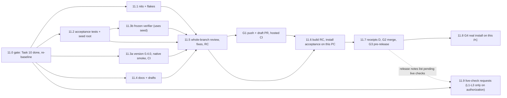

# Task 11 Full Acceptance, Windows 0.4.0 Install, Documentation and Release — Reviewable Sub-task Plan

> **For agentic workers:** REQUIRED SUB-SKILL: superpowers:subagent-driven-development (recommended) or
> superpowers:executing-plans. Each code sub-task below is one implementer and one independent review, test-first.
> Install and publish sub-tasks are run by root with the user's go-ahead where §2.1 says so. Steps use checkbox
> (`- [ ]`) syntax.

**Parent plan:** [General-purpose training workflows, Task 11](2026-10-17-general-training-workflows.md#task-11-전체-인수windows-설치문서와-공유)
("전체 인수·Windows 설치·문서와 공유"). **Spec:** [design §8 acceptance scenarios 1–10](../specs/2026-10-17-general-training-workflows-design.md#8-구현-경계와-인수-검증),
the [SSH server extension §검증](../specs/2026-10-19-ssh-gpu-servers-extension.md#검증) and the
[first-run tutorial design §검증/§문서](../specs/2026-10-19-first-run-tutorial-design.md#검증).
**Builds on:** the [Task 8 sub-plan](2026-10-20-task8-graph-controller.md) §5 (simulated dispatcher, mock diamond),
the [Task 9 sub-plan](2026-10-20-task9-secure-desktop-broker.md) §6 (broker, onefile child, Credential Manager), the
[Task 10 sub-plan](2026-10-21-task10-workflow-workbench-ui.md) §5 "What Task 11 needs from Task 10", and every
PROGRESS note addressed to Task 11.

**Goal:** Close the branch as Windows **0.4.0**: fix the recorded small leftovers, add cross-task acceptance tests,
version and build the installer, prove the frozen sidecar, the real broker and the installed app on this PC without
GPU, network data or paid resources, document the new workflows, pass one whole-branch independent review, merge the
branch into `master` with a merge commit, publish a GitHub **pre-release v0.4.0** with the accepted installer and its
SHA256, install 0.4.0 for real on this PC, and hand the user concrete requests for the live checks that need separate
authorization.

**Baseline:** HEAD `2b98a4c` on `codex/general-training-workflows` (Task 10.7). Latest receipts in PROGRESS:
`uv run pytest -q` → **1715 passed, 1 skipped** (PROGRESS 4523; the skip is the opt-in real-GPU test), Ruff clean,
`check_secrets.py` 0 findings; `npx playwright test` → **174 passed** and `npm run build` passes (PROGRESS 4520-4522);
`cargo test --manifest-path desktop/src-tauri/Cargo.toml --locked --offline --release` → **49 passed** (PROGRESS
4366-4367); CPU acceptance **29/29**, receipt `f035bcc9…83be`, source `0849b47e…d56c` (PROGRESS 4138-4140; no `src/`
change since). **Task 10 is not finished on this branch:** 10.5 is committed on `codex/task-10.5` (`a89ab22`, its
PROGRESS entry reports 1716 passed / 180 Playwright), the 10.3 review fix on `codex/task-10.3-fix` (`39edbdd`), and
10.6 and 10.8 have no commits yet. Every count is re-baselined in 11.0.

**Status:** planning only. This document authorizes **no** GPU, SSH, RunPod, MLflow write, Hugging Face download,
other network access, institution data, dataset transfer or paid resource. The publishing steps (push, pull request,
merge, tag and release) and the real install on this PC need the user's explicit go-ahead at the time they run, as
listed in §2.1, even though the user chose their targets on 2026-10-20. Each live check (§2.1 L1–L3) needs its own
separate authorization.

**User decisions honoured (2026-10-20):** finish Tasks 7–11 and release **0.4.0** in one go; distribute through a
**pull request merged into `master` plus a GitHub pre-release `v0.4.0`** carrying the installer and its SHA256;
**install the new version on this PC**.

---

## 0. Facts verified for this plan (evidence)

Checked on 2026-10-21 against HEAD `2b98a4c` by reading files, plus these read-only commands: `git log`, `git
rev-list`, `git merge-base`, `git worktree list`, `gh pr list/view`, `gh release list/view`, a read-only SQLite open
(`mode=ro&immutable=1`) of the local `jobs.db`, `cmdkey /list` (names only), registry reads of the uninstall keys, and
a byte search of the installed Tauri CLI for its NSIS template. Nothing was built, installed or downloaded.

| # | Fact | Evidence |
|---|---|---|
| F1 | **Git state.** `git log --oneline master..HEAD` counts **132**, but local `master` (`490faee`) is **13 commits behind** `origin/master` (`c097feb`, "Merge pull request #1"). Against `origin/master`: 120 commits ahead, 1 behind (the merge commit only); merge base `79fea89`; `c097feb^{tree}` equals `79fea89^{tree}`, so the branch merges into `master` without conflicts and the merge result's tree equals the branch tree. `origin/codex/general-training-workflows` equals HEAD (the branch is pushed). | `git rev-list --count`, `git merge-base HEAD origin/master`, `git rev-parse <c>^{tree}` |
| F2 | **Open pull requests.** #1 (`codex/windows-desktop` → `master`) merged. #2 (`codex/training-capabilities-s3` → `codex/windows-desktop`) and #3 (same head → `master`, empty body) are **open**. That head (`cc1ed39`) is an ancestor of HEAD. No pull request exists for this branch. | `gh pr list --state all`; `gh pr view 2/3`; `git merge-base --is-ancestor` |
| F3 | **Release precedent.** `v0.3.0` and `v0.2.3` are pre-releases with exactly two assets: `LLM.Tuning.Factory_<v>_x64-setup.exe` (GitHub turned the spaces into dots) and `<same>.sha256` (`<64 hex>␠␠LLM.Tuning.Factory_0.3.0_x64-setup.exe\n`, 106 bytes, LF). GitHub reports each asset's `digest` (`sha256:b7be…e49b` for the 0.3.0 installer, 47 043 962 bytes). Tags are lightweight. `v0.3.0` points at `cc1ed39`, the commit that **recorded** the acceptance, whose parent `36e479d` is the frozen source commit named in the receipt. The release body is Korean (새 기능, 설치와 시작, 범위, 검증) with doc links pinned to the tag. The 0.3.0 PR/release drafts were kept in the git-ignored `.factory/extension-pr.md` and `.factory/extension-release.md`. | `gh release view v0.3.0 --json …`; `od -c dist/LLM.Tuning.Factory_0.3.0_x64-setup.exe.sha256`; `git cat-file -p v0.3.0`; docs/acceptance/2026-10-15-desktop-030.json:3-8; `ls .factory` |
| F4 | **Where the version lives.** `0.3.0` at `desktop/package.json:3`, `desktop/package-lock.json:3` and `:9`, `desktop/src-tauri/Cargo.toml:3`, `desktop/src-tauri/Cargo.lock:2031` (the root package; **line 28 is the unrelated crate `alloc-stdlib 0.3.0`**), `desktop/src-tauri/tauri.conf.json:4`. The sidebar footer reads `package.json` (main.ts:2, 542); `workspace.spec.ts:4,94` reads it too; `native-smoke.mjs:13` hard-codes `0.3.0`. `pyproject.toml:7` is the engine package `0.1.0`, and `pyproject.toml`/`uv.lock` bytes are recorded in every manifest's `dependency_file_hashes` (manifest.py:56-64). README.md:10-12 and docs/WINDOWS_APP.md:1 name 0.3.0. | as cited |
| F5 | **Build script.** `build_desktop.py` copies `pyproject.toml`, `uv.lock`, both GPU locks, `configs/ai` and the tutorial sample into `build/desktop-assets` (:15-23), builds the engine wheel (:28), writes `commit.txt` from `git rev-parse HEAD` (:29-30), runs PyInstaller 6.20.0 `--onefile` on `scripts/desktop_entry.py` (:36-44) and copies the bridge to `desktop/src-tauri/binaries/` (:45-47). The frozen planner reads the GPU lock from `sys._MEIPASS/assets` (graph_planner.py:382-392, 9.2 D18). PyInstaller 6.20.0 is in the local uv cache. | as cited; `uv cache dir` listing |
| F6 | **Package verifier today.** `verify_desktop_package.py` runs only legacy one-request actions against the hard-coded `dist/factory-bridge.exe` (:16): catalog, dataset, plan with `source_sha256` and the GPU lock hash, six stage plans with the PPO lock, the local S3 refusal, the tutorial sample (persisted, refused with export, registered) and wheel bytes = `src/tuning_factory/*.py` (:13-84; the package is flat, 53 modules). It never sends a workflow request, never starts `--controller` and never checks argument refusal. | as cited; `find src/tuning_factory -type d` |
| F7 | **Native smoke today.** `native-smoke.mjs` attaches over CDP to `127.0.0.1:9223` (:5), checks the 0.3.0 footer (:13), runs legacy actions (:14-46) and **makes live Hugging Face calls**: `model_inspect` and `model_import` of `Qwen/Qwen3.5-0.8B` (:31-43). Its vault check writes synthetic legacy keys only when no `*_saved` flag is set (:58) and then calls `forget_credentials` (:71), which since Task 9.5 **also deletes every executor-profile key** in Credential Manager (PROGRESS 2476-2480). No workflow, profile or controller call. | as cited |
| F8 | **CI.** `ci.yml`: Ubuntu and Windows, uv 0.9.5, locked sync, Ruff, `check_secrets.py`, `pytest -m "not gpu"` (:1-21). `windows-desktop.yml`: on pull requests touching `desktop/**`, `src/**`, the build/entry/verifier scripts, the PyInstaller hooks, `containers/gpu*.lock`, `pyproject.toml`, `uv.lock` or itself (:4-15) — **not** `examples/**` or `configs/ai/**`, which the build bundles; it runs pytest, Ruff, the build, the verifier, `npm ci`, Playwright, `npm run build`, `cargo test --locked --release`, `tauri build --ci` and uploads the NSIS artifact (:37-58). The Task 9.6 tests never ran on Linux (PROGRESS 3601, 4089). | as cited |
| F9 | **Installer layout.** NSIS, `installMode: currentUser`, Korean/English, external binary `factory-bridge`, WebView2 bootstrapper downloaded only if missing (tauri.conf.json:18-26); identifier `kr.kbiofoundry.tuningfactory` (:5). The generated 0.3.0 script: default folder `$LOCALAPPDATA\LLM Tuning Factory` unless a previous location is in the registry (installer.nsi:498-511), one uninstall key per product name (`HKCU\…\Uninstall\LLM Tuning Factory`, :61, :662), switches `/S`, `/P`, `/NS`, `/UPDATE`, `/R` (:471-481), and an uninstaller checkbox that, when ticked, **deletes `%APPDATA%\kr.kbiofoundry.tuningfactory` and `%LOCALAPPDATA%\kr.kbiofoundry.tuningfactory`** (:831-844). | as cited; `desktop/src-tauri/target/release/nsis/x64/installer.nsi` |
| F10 | **Running-app check of the installer.** In Tauri CLI 2.12.2's embedded template, `NSIS_HOOK_PREINSTALL` runs, then `CheckIfAppIsRunning "$INSTDIR\llm-tuning-factory-desktop.exe"` registers **only the main binary** with the Restart Manager: if it runs, a silent install force-shuts it (`RmShutdown(…, RmForceShutdown)`), an interactive one asks OK/Cancel; the uninstaller does the same after `NSIS_HOOK_PREUNINSTALL`. `factory-bridge.exe` is not checked. | byte search of `desktop/node_modules/@tauri-apps/cli-win32-x64-msvc/cli.win32-x64-msvc.node` (`!macro CheckIfAppIsRunning`, `Section Install`, `Section Uninstall`) |
| F11 | **Controller processes.** The broker is the **main binary** run as `llm-tuning-factory-desktop.exe --controller`, detached with `CREATE_NO_WINDOW`, `CREATE_NEW_PROCESS_GROUP` and `CREATE_BREAKAWAY_FROM_JOB` (one retry without breakaway on OS error 5); it keeps the sidecar `factory-bridge.exe --controller` alive through a stdin pipe whose EOF drains the controller (PROGRESS 2231-2237, 3155-3170). Both binaries stay open while it runs, so NSIS update or uninstall needs the controller stopped first (PROGRESS 2512-2513). With F10: an installer run against a running controller kills the broker; the sidecar then drains on EOF and holds `factory-bridge.exe` open until the drain ends. | as cited |
| F12 | **State is keyed by the identifier, not the install folder.** App data is `app_data_dir()` (main.rs:50-51) = `%APPDATA%\kr.kbiofoundry.tuningfactory`; the WebView2 profile is `%LOCALAPPDATA%\kr.kbiofoundry.tuningfactory\EBWebView`; Credential Manager entries use service `kr.kbiofoundry.tuningfactory` (profiles.rs:8). A "dedicated install-check folder" isolates program files only. | as cited |
| F13 | **This PC today.** No LLM Tuning Factory install is registered (HKCU/HKLM uninstall keys). `%APPDATA%\kr.kbiofoundry.tuningfactory\state\jobs.db` exists (32 KiB, pre-Task-6 schema `jobs`/`gpu_locks`/`events`, 0 rows); there is no `settings.json`. `%LOCALAPPDATA%\kr.kbiofoundry.tuningfactory\EBWebView` exists. Credential Manager holds **0** entries for the service. The 0.3.0 acceptance used `dist/desktop-acceptance-030/` (both exes and `uninstall.exe` remain; no registry entry). The 0.3.0 installer is at `dist/LLM.Tuning.Factory_0.3.0_x64-setup.exe`. Toolchains: cargo/rustc 1.99.0, Node 26.7.0, npm 11.6.2, uv 0.11.23; `.factory/model-ops-cpu-venv` and `.venv` exist. **No NSIS toolchain cache** (`%LOCALAPPDATA%\tauri` absent; no `makensis.exe` under the profile or Program Files), so the first local `tauri build` will try to download it from GitHub. | registry reads; SQLite read-only open; `cmdkey /list`; `ls`; `Test-Path` |
| F14 | **Simulated merges stop.** Compilation is real-only for merges (`_merge_descriptors`, graph_planner.py:972-974, called at :827), so a dry-run merge of simulated outputs fails at the merge node; the 8.5 note says Task 11's mock diamond must not merge simulated outputs (PROGRESS 1967-1970); the 10.5 editor already explains it (`REASONS.mergeRealOnly`, `codex/task-10.5:desktop/src/graph-model.ts:95`). | as cited |
| F15 | **Offline planning needs an HF root.** A train or evaluate node needs an indexed root (`save_root`, `root_snapshots_dir`, workflow_planning.py:431-490) and, for `lora_target: all` or full recipes, module evidence (`save_root_targets`, :505-533). The only producers are the network actions `model_root_snapshot` (:928-979) and `model_root_targets` (hf_targets.py:308). Their offline building blocks are public: `model_artifacts.tokenizer_fingerprint` (:324), `model_artifacts.header_tensors` (:361), `hf_targets.target_evidence` (:261); tests seed roots the same way (`tests/test_simulated_dispatch.py:211-216`, `tests/test_model_inputs` `write_snapshot`). | as cited |
| F16 | **Acceptance coverage that already exists.** Simulated diamond straight/restart/cancel with the real simulated dispatcher but the test-only `world()` wiring (tests/test_graph_controller.py:1050-1111); production-process tests through `scripts/desktop_entry.py --controller` with a Python broker stand-in (tests/test_controller_entry.py:548-707); blank project → mapped data → recipe → dry plan through the channel (Task 9 plan §8, 9.2 test 18); the UI-level flow (Task 10 plan 10.8 test 3). None drives the **production wiring** (`controller_entry.build_controller`/`serve`) end to end from a channel-submitted plan. | as cited |
| F17 | **Controller wait reasons.** `DESTINATION_BUSY = "waiting for destination {key}"`, `AWAITING_RESULT`, `AT_CONCURRENCY`, `THREADS_BUSY`, `RETRY_WAIT` (graph_controller.py:67-78). | as cited |
| F18 | **Secret scan and line endings.** `check_secrets.py` scans staged files and all reachable history for PEM private-key headers and token shapes (:1-17); one push already failed on fake key headers in history (PROGRESS 187-192). `.gitattributes` forces LF (`* text=auto eol=lf`, :2). | as cited |
| F19 | **Acceptance receipt precedent.** `docs/acceptance/2026-10-15-desktop-030.json` records app version, installer file/bytes/SHA256, frozen source commit and `source_sha256`, `bridge_sha256`, frozen checks, test counts, the native smoke flags, and `paid_resources_started`/`real_s3_account_accessed`/`institution_data_transferred` = false plus an `outstanding` list. | as cited |
| F20 | **Pinned public model for a live HF check.** `Qwen/Qwen2.5-0.5B-Instruct` at `7ae557604adf67be50417f59c2c2f167def9a775` (configs/ai/integration_smoke.yaml:6-8), architecture `qwen2` (inside the 9.7 allowlist, PROGRESS 2814-2815), already inspected live on 2026-10-15 (desktop-030.json `public_model_metadata`). | as cited |
| F21 | **Task 11 hand-offs in PROGRESS** (each placed in §2.2): real Rust broker spawn, PyInstaller onefile child and EOF, job objects and breakaway, Credential Manager from the broker (2323-2326, 3305-3311); NSIS needs the controller stopped (2512-2513); redirected AppData (2503-2505); tick watchdog (3230-3231); fenced controller lingering until in-flight threads finish (3700-3702); ambient credential files, TLS behaviour change (3706-3708, 3744-3748); real WebView2 dialogs, focus, IME, timers, `visibilitychange`, `rfd` filter (3411, 3477, 3796, 4211, 4270-4271, 4381, 4442, 4530; 10.5 entry); tutorial in WebView2 (221-224); real HF ranges and redirects (2884-2891, 3087-3088); real RunPod, SSH, BOP, GPU, MLflow (194-196, 957-967, 2069-2087, 3312, 3597); PENDING-then-FAILED registration (2740-2742, 2993-2995); Linux CI and real console Ctrl+C (3601, 4086-4091). | as cited |
| F22 | **Recorded small leftovers.** `desktop_workflows._pointer` keeps unknown keys in pointers (PROGRESS 4034-4035; desktop_workflows.py:351-372; the CLI fix is cli.py:554-582); `controller_entry._observed_profile` does not use `pin_observation` (PROGRESS 4143-4146; controller_entry.py:346-363; workflow_planning.py:1290-1302); Windows `PermissionError` (WinError 5) in `test_graph_controller.py::test_ambiguous_launch_waits_for_the_operator[False-desktop]` while Playwright ran (PROGRESS 4359-4362); intermittent `test_operation_runner` cases tied to source edits during runs (PROGRESS 898-916). Root additionally named the `cli.py` Ctrl+C re-entrancy nit (`_CtrlC`, cli.py:835-859), a navigation sequence number, newline normalisation and a flake at `desktop/tests/connections.spec.ts:515` ("saving an unchanged GPU selection keeps the plan and says nothing changed", :515-525); their review texts are not in the repository. | as cited |

---

## 1. Rules that apply to every sub-task

- **Test-first where code changes.** Write the failing test, run it, see it fail for the intended reason, then fix.
  Acceptance tests that pass at once (11.2) are shown to be able to fail by mutations run through a pytest plugin under
  `%TEMP%`, with no `src/` edit, as Tasks 8–10 did. Scripts without a harness (`native-smoke.mjs`) get their RED
  against the previous build (0.3.0) in 11.6.
- **LF only.** Before staging, every changed text file must pass `git ls-files --eol -- <path>` → `w/lf`, or
  `uv run python -c "import pathlib,sys; bad=[p for p in sys.argv[1:] if b'\r' in pathlib.Path(p).read_bytes()]; sys.exit(bad)" <paths>`.
- **No literal secrets.** Never write a PEM private-key header or an API-key-shaped string into a committed file,
  even as a fake: the CI scan walks all history (F18). Build fakes at runtime, e.g. `"synthetic-" + "runpod-" +
  "k".repeat(12)` and `"-----BEGIN " + "OPENSSH PRIVATE KEY-----"`. Run `uv run python scripts/check_secrets.py`
  (0 findings) before every commit and before every push.
- **Stage and commit by path** (`git add <paths>`), never `git add -A`. Other implementers work in worktrees
  (`git worktree list`); never edit a file another worktree has uncommitted changes in. Root integrates
  `docs/PROGRESS.md`. Commit messages end with the attribution trailer the session's instructions give.
- **Legacy stays frozen.** The legacy one-request actions of `desktop.py`, `factory_action` and its allowlist, the v1
  CLI, the 0.3.0 settings contract and the legacy single-job pages keep their behaviour and texts. Task 11 changes no
  legacy action. Hardening a flaky legacy *test* (11.1 N6) is a listed deviation.
- **Default dry-run, no network.** No test, script or sub-task contacts Hugging Face, RunPod, SSH servers or MLflow,
  unless a live check of §2.1 was authorized for that run. Tests keep the existing socket guards. Offline planning
  uses the synthetic seeded root of D15.
- **Borrowed resources.** Existing Pods and SSH servers are never created, started, stopped or deleted, by code or by
  hand, in any sub-task or live check.
- **Credentials never in manifests, logs, receipts or commits.** Receipts hold IDs, hashes, counts and flags only.
  Synthetic credentials written during acceptance are deleted at the end and the Credential Manager count returns to
  its baseline (F13: 0).
- **Code freeze after the release candidate (D18).** After 11.5 marks the RC commit, any change under `src/`,
  `scripts/`, `desktop/` (except `desktop/tests/native-smoke.mjs` comments) or `containers/` invalidates the built
  installer: rebuild, re-run the frozen verifier and every installed check the change could affect, and re-review the
  fix (scoped). Docs-only commits need no rebuild.
- **Records.** Each sub-task reports actual commands, counts and receipts; root appends them to `docs/PROGRESS.md`,
  separating "verified on this PC" from "unverified" and "needs authorization".
- **File-list deviations from the parent plan, which root must approve.** The parent lists
  `scripts/verify_desktop_package.py`, `desktop/tests/native-smoke.mjs`, `scripts/build_desktop.py`,
  `.github/workflows/windows-desktop.yml`, `README.md`, `docs/CONFIGURATION.md`, `docs/WINDOWS_APP.md`,
  `docs/PROGRESS.md`, new `docs/TRAINING_WORKFLOWS.md`, acceptance receipts and the version files.
  - New: `scripts/seed_acceptance_root.py`, `tests/test_seed_acceptance_root.py`,
    `tests/test_acceptance_workflows.py`, `tests/test_release_version.py` (11.2, 11.3).
  - 11.1 touches `src/tuning_factory/cli.py`, `desktop_workflows.py`, `controller_entry.py` (one function each),
    `desktop/src/main.ts`/`view-types.ts` (only if N3 is confirmed), their tests, and the legacy spec
    `desktop/tests/connections.spec.ts` (flake only).
  - 11.4 adds a short pointer section to `docs/OPERATIONS.md`.
  - `scripts/build_desktop.py` is expected to stay **unchanged** (F5 covers every asset the frozen app needs).

---

## 2. Decisions taken here (conservative defaults; root or the user may overturn)

| # | Decision (conservative default) | Alternative |
|---|---|---|
| D1 | **Version scope.** `0.4.0` in the six desktop fields of F4: `npm version 0.4.0 --no-git-tag-version` in `desktop/` (package.json and both package-lock entries, no network), a manual edit of `tauri.conf.json:4` and `Cargo.toml:3`, then `cargo update --manifest-path desktop/src-tauri/Cargo.toml --offline --workspace` to rewrite only the root entry of `Cargo.lock`. The footer follows `package.json`; `native-smoke.mjs` reads `package.json` instead of a literal; README and WINDOWS_APP say 0.4.0. **`pyproject.toml` stays `0.1.0`**: its bytes and `uv.lock` are hashed into every manifest (F4) and a bump needs a relock. A test pins all of it (11.3). | Also bump `pyproject.toml` to 0.4.0 (relock; new manifest dependency hashes; wheel name change). |
| D2 | **Build and local verification.** Root builds the release candidate on this PC: `uv sync --locked`, `$env:UV_OFFLINE=1` for `build_desktop.py`, the extended `verify_desktop_package.py` (frozen workflow channel and controller, D15 seed), the CPU acceptance, every test suite, then `npm run tauri -- build --ci`. The released installer is exactly the one accepted in 11.6 (bytes and SHA256 recorded before upload). The CI artifact of `windows-desktop.yml` is a cross-check only. | Release the CI-built artifact (no local NSIS toolchain needed; the accepted installer would then be a download). |
| D3 | **Dedicated folder versus the real install.** Two phases. **Acceptance (11.6):** install the RC silently into `D:\llm-tuning-factory\dist\desktop-acceptance-040\app` with `/S /NS /D=…` (no shortcuts), after snapshotting `%APPDATA%\kr.kbiofoundry.tuningfactory` and `%LOCALAPPDATA%\kr.kbiofoundry.tuningfactory` and recording the Credential Manager count, because the folder does not isolate state (F12). At the end: archive the acceptance state, restore the snapshot, leave the acceptance install in place until 11.8. **Real install (11.8, G4):** uninstall the acceptance copy (app data kept), then install the **published** installer (same SHA256) into the NSIS default `%LOCALAPPDATA%\LLM Tuning Factory` with shortcuts, on the user's original (restored) state. One registered install at any time (F9: one uninstall key per product). | One phase: accept directly in the default folder, which then is the real install, keeping the acceptance projects, synthetic data and simulated runs in the user's state. |
| D4 | **Controller and the installer.** Procedure for update and uninstall: in the app press **정지** on the controller bar, wait for **정지** (`absent`), close the app, then run the installer or uninstaller. README, WINDOWS_APP and the release notes say so, with the reason (F10, F11) and the warning not to tick "delete app data" unless the user wants to lose projects, data versions and run history (F9). 11.6 verifies the stopped path and **observes** the running-idle path once. **No NSIS hook by default.** If 11.6 observes that an install over a running controller can leave a mixed install (new main binary, old `factory-bridge.exe`), root must take the alternative before release. | A `NSIS_HOOK_PREINSTALL`/`PREUNINSTALL` hook (`bundle.windows.nsis.installerHooks`) that registers `$INSTDIR\factory-bridge.exe` with the Restart Manager and aborts, without killing, with "백그라운드 컨트롤러가 실행 중입니다. 앱에서 컨트롤러를 정지한 뒤 다시 실행하세요." |
| D5 | **What Task 11 verifies offline on this PC and what stays unverified:** the table in §2.2. Nothing that needs a network destination, a borrowed resource or real credentials is claimed as verified. | — |
| D6 | **Live checks need separate authorization and do not block the pre-release.** Task 11 prepares the requests L1 (HF header-only range check), L2 (real BOP/GPU acceptance: L2a read-only inspection and a real plan, L2b execution) and L3 (MLflow) in 11.9 and runs none of them without the user's explicit authorization for that run. The 0.4.0 pre-release states that they are pending. | Hold the release until L1 (and L2) pass. |
| D7 | **Whole-branch independent review before the pull request.** Range `origin/master...<RC>` (F1). Four area reviewers in parallel plus one integration reviewer (11.5), each returning Critical/Important/Minor and "Ready to merge: Yes/No"; every Critical and Important is fixed test-first and re-reviewed (scoped); Minors are fixed or recorded with a reason. Review happens **before** the final build so that a fix cannot invalidate an accepted installer (parent order corrected, §5 P5). | One reviewer for the whole range (one context cannot hold ~130 commits). |
| D8 | **Pull request and merge method.** Base `master`, head `codex/general-training-workflows`, opened as a **draft** right after 11.5 (G1) so hosted CI (Ubuntu and Windows) runs before the local build; marked ready after the receipts. Merge with **"Create a merge commit"** (`gh pr merge --merge`): it keeps every SHA cited in PROGRESS and the sub-plans, matches PR #1, and makes `cc1ed39` reachable from `master`, so GitHub can mark #3 merged (if it does not, #3 is closed with a pointer); #2 (base `codex/windows-desktop`) is closed with a "superseded by #N" comment (G2). | Squash (orphans ~130 cited SHAs, leaves #2/#3 unmerged); rebase (rewrites every SHA). |
| D9 | **Tag and assets.** Lightweight tag `v0.4.0` on the **receipt commit D** — the commit that records the 11.6 acceptance, whose only differences from the frozen source commit B (the `commit.txt` inside the installer) are under `docs/` (`git diff --name-only B D`), exactly as `v0.3.0` (F3). After the merge, D is reachable from `master`. GitHub pre-release (not latest), title "Windows 0.4.0 — 범용 학습 프로젝트·학습 그래프", assets `LLM.Tuning.Factory_0.4.0_x64-setup.exe` and `LLM.Tuning.Factory_0.4.0_x64-setup.exe.sha256`. | Tag the merge commit M and rebuild from it (the accepted installer would not be the released one, so 11.6 would repeat). |
| D10 | **Checksum procedure.** Copy the NSIS output to `dist/LLM.Tuning.Factory_0.4.0_x64-setup.exe` (dotted name, as GitHub would rename it), write the `.sha256` file as `<lowercase hex>␠␠LLM.Tuning.Factory_0.4.0_x64-setup.exe\n` with LF (command in 11.6 step 9), cross-check with `Get-FileHash -Algorithm SHA256`, record bytes and SHA256 in the receipt and PROGRESS before upload, and after upload require `gh release view v0.4.0 --json assets` digests to equal both local SHA256 values. The 11.8 install uses a file with the same SHA256. | Rely on GitHub's `digest` only (no checksum asset). |
| D11 | **Release notes.** Korean, in the 0.3.0 structure, drafted in the git-ignored `.factory/release-0.4.0.md` (the PR body in `.factory/pr-0.4.0.md`) from the template in 11.7, reviewed by root (and shown to the user with G3): new features; install and update (stop the controller first, keep app data, 0.3.0 settings carry over, no downgrade after 0.4.0 opened the state, unsigned/SmartScreen); scope and limits (simulated merges stop, text metrics are not semantic quality, synthetic and simulated results are never promoted or registered, one controller per PC, no auto-start, borrowed resources never started or stopped, TLS behaviour change for graph controllers, redirected AppData); verification counts; what is unverified and which live checks are pending; links pinned to the tag; checksum instructions. | Commit the notes under `docs/releases/` (new folder; no precedent). |
| D12 | **Deferred nits.** 11.1 fixes the recorded leftovers of F22 test-first. Each root-reported item without a repository record starts from the review text root pastes into the brief; an item that does not reproduce is recorded as "not reproduced", never as "fixed". No legacy action, text or backend revision rule changes. | Defer all nits to after 0.4.0. |
| D13 | **Mock diamond without a merge.** The acceptance diamond is `train-a → (train-b continues a, train-c new adapter on the root) → (eval-b, eval-c) → select`, as a dry run, once with two estimate destinations and once with one, plus restart and cancel, through the **production** wiring (F16). The merge path is covered by planning refusals (11.2 A4), the pinned real-only stop of a simulated merge (A4 last case) and the CPU numerics. | Relax the real-only merge rule for simulation plans (backend change in the last task). |
| D14 | **Three acceptance layers.** Python in-process through the channel and `build_controller`/`serve` (11.2); the frozen sidecar through `verify_desktop_package.py` (11.3); the installed app through `native-smoke.mjs` plus a manual WebView2 checklist (11.6). | Installed app only (slow to iterate, no CI coverage). |
| D15 | **Synthetic seeded root for offline acceptance.** `scripts/seed_acceptance_root.py` writes a deterministic tiny Qwen2 root `factory-acceptance/tiny-qwen2` (revision = SHA-1 of `factory-acceptance/tiny-qwen2@1`, which no HF commit can collide with in practice) with config, WordLevel tokenizer and module evidence through the public functions of F15, into a given state directory. It is never bundled in the installer, is used by the verifier, the acceptance tests and the 11.6 installed flow, and the acceptance state that holds it is archived and removed (D3). | Run L1 first and plan the installed flow on a real public root (needs network authorization before acceptance). |
| D16 | **CI change.** `windows-desktop.yml` path filters add `examples/**`, `configs/ai/**` and `scripts/seed_acceptance_root.py`. No new job, no release job. | A tag-triggered build-and-release job (not now: the release must carry the locally accepted bytes). |
| D17 | **Documentation set.** README, docs/CONFIGURATION.md, docs/WINDOWS_APP.md, new docs/TRAINING_WORKFLOWS.md, a pointer in docs/OPERATIONS.md, PROGRESS. Every quoted UI label and CLI flag is checked against the code (11.4 step 5). ARCHITECTURE.md is untouched unless a reviewer asks. | Also rewrite ARCHITECTURE.md. |
| D18 | **RC freeze and rebuild rule** as in §1. The RC is the commit after 11.5's fixes; B is the commit the installer is built from (normally the RC); D is the receipt commit. | — |
| D19 | **App data for the real install:** restore the pre-acceptance snapshot (the user's own state: today an empty legacy `jobs.db`). The archive of the acceptance state stays in `dist/desktop-acceptance-040/appdata-after/` (git-ignored) as evidence. | Keep the acceptance state in the real install. |
| D20 | **Known limitations stay limitations in 0.4.0:** no tick watchdog, a fenced controller lingers until its in-flight threads return, a PENDING registration later marked `FAILED_REGISTRATION` still shows `registered`, ambient credential *files* stay readable by the controller, redirected AppData cannot start the controller, `local_file` does not detect links to shares. Each is written in WINDOWS_APP or TRAINING_WORKFLOWS and in the release notes. | Implement the watchdog and the registration re-check now (new controller and outbox code in the release task). |
| D21 | **Sidecar start time (Task 10 Q-L).** The native smoke measures the median round trip of five `controller_status` calls and records it. No interval change in 0.4.0 unless the median exceeds 3 s; above 1.5 s root records a follow-up to raise the D10 base intervals. | Change the poll intervals now without a measurement. |

### Root decisions (2026-10-21)

D1–D21 and the file-list and sequence changes in §1 and §3 are accepted as written.

**Go-ahead status.** On 2026-10-20 the user chose: finish Tasks 7–11 and then release 0.4.0 in one go; distribute by
"PR 병합 + GitHub 사전 릴리스"; install the new version on this PC.
- **G0, G1 and G4 are covered by that instruction.** G0 is the build-tool download needed to produce the installer the
  user asked for. G1 is the branch push and draft PR; branch pushes have been running all along. G4 is the install on
  this PC.
- **G2 (merge) and G3 (publish) are also what the user chose.** They are outward-facing and hard to reverse, so root
  shows the user the final PR summary, release notes and installer SHA256, and gets a short confirmation right before
  running them.
- **L1–L3 each still need the user's explicit authorization for that run.**

**Deferred nit details for 11.1.** These are the review texts the planner could not find in the repository:
1. **`cli.py` Ctrl+C handling (9.6 re-review).**
   - **N1, re-entrancy:** `_CtrlC.__call__` calls `stop_event.set()` before `presses += 1`. `Event._cond` is a
     non-reentrant lock, so a second SIGINT that runs the handler re-entrantly while the first handler holds that lock
     (a window of microseconds) would deadlock the main thread. Count first and exit on the second press, then set.
   - **N2, robustness and wording:**
     - If writing the `DRAINING` note to a broken stderr pipe raises, the wait ends early. Wrap that write in
       `contextlib.suppress(OSError)`.
     - `GRAPH_WORK_HELP` says "then always a final line", but exit 130 and Click usage errors print none.
2. **Navigation sequence number (10.2 re-review).** Visiting the same page several times while a task is held makes
   every visit's `enter` run after the task ends: projects → history → projects → recipes → projects gave 3
   `projects_list` calls. Add a navigation sequence number so only the latest visit's `enter` runs.
3. **Newline normalization (10.2 re-review).** A project `name` or `task_type` containing a line break, written by
   another program, shows a phantom "저장 안 된 변경", because `<input>` strips newlines from its value. Compare those
   inputs with `\r` and `\n` removed.
4. **IME full-render gap (10.2 re-review).** A full render, as opposed to a patch, during IME composition drops the
   composing text and focus. Patches are already deferred.
5. **`connections.spec.ts:515` (10.1 review).** One Playwright timeout ("page never rendered") in a full run. It passed
   5/5 alone and in the full rerun, and has not recurred since.
6. **`test_graph_controller.py::test_ambiguous_launch_waits_for_the_operator[False-desktop]` (10.3 run).** One Windows
   `PermissionError` (WinError 5) renaming a file in its temporary directory while Playwright ran alongside. That file
   alone gave 65 passed.
7. **`desktop_workflows._pointer` (9.6 review).** It still echoes unknown JSON keys in desktop issue paths. Point at the
   parent object instead.
8. **`controller_entry._observed_profile` (9.8 follow-up).** It doesn't share `workflow_planning.pin_observation`. The
   two agree today, but they are two functions.
9. **`desktop/src/views/data-import.ts:157` `isolatedText` (10.3 re-review).** It contains literal invisible
   U+2068/U+2069 characters, which trigger GitHub's bidirectional-text warning and Trojan-Source linters. Write them as
   `⁨`/`⁩` escapes.
10. **PROGRESS notes (10.3 re-review).** The 500-choice cap takes the first 500 source columns in alphabetical order,
    not file order. A flags-only change to an already-registered ID and version is blocked as "이미 등록했습니다".

Root adds any further Minors from the 10.5, 10.6, 10.7 and 10.8 reviews to this list before 11.1 starts.

### 2.1 Steps that need the user's explicit go-ahead

| ID | Step | Exact action | Why it needs a go-ahead |
|---|---|---|---|
| G0 | Build-tool download (only if needed, F13) | `npm run tauri -- build --ci` fetches NSIS and `nsis_tauri_utils` from `github.com/tauri-apps/binary-releases` into `%LOCALAPPDATA%\tauri`; or `UV_OFFLINE=1` makes `build_desktop.py` fail on a build dependency missing from the uv cache — stop, report the package, and fetch it only with the go-ahead | network download of build tools; no project data leaves the PC |
| G1 | Share the release candidate | `git fetch origin`; `git push origin codex/general-training-workflows`; `gh pr create --draft --base master --head codex/general-training-workflows --title "범용 학습 프로젝트와 학습 그래프 자동 실행 (Windows 0.4.0)" --body-file .factory/pr-0.4.0.md` | GitHub write; starts hosted CI minutes on the private repository |
| G2 | Merge | `gh pr ready <N>`; `gh pr merge <N> --merge`; `gh pr close 2 --comment "…#N에 포함되어 병합되었습니다."`; close #3 the same way only if GitHub did not mark it merged | changes `master` for every user |
| G3 | Publish | `git tag v0.4.0 <D>`; `git push origin v0.4.0`; `gh release create v0.4.0 --verify-tag --prerelease --title "Windows 0.4.0 — 범용 학습 프로젝트·학습 그래프" --notes-file .factory/release-0.4.0.md <installer> <installer>.sha256` | public (repository-wide) distribution |
| G4 | Real install on this PC | uninstall the acceptance copy, keep the restored app data, run the published installer with `/S` (default folder, shortcuts) | changes the user's installed software |
| L1 | Live HF header-only check | 11.9 L1 (one public model, config and tokenizer files plus two range requests per shard; optional sharded model L1b; optional native-smoke HF metadata) | network to huggingface.co and its CDN |
| L2 | Live BOP/GPU acceptance | 11.9 L2a (read-only inspection of named borrowed resources, a real plan without submit) and L2b (execution with dummy data, time limit, cost cap, destination list) | real credentials, borrowed resources, possible cost, data transfer |
| L3 | Live MLflow | 11.9 L3 (read-only connection check; writes only inside an authorized L2b) | real server and credentials |

Not a go-ahead step (local, reversible, inside Task 11's authorization): building the sidecar, installing the 0.3.0
and 0.4.0 installers into the acceptance folder, launching the installed app with the loopback debug port, writing
and deleting synthetic Credential Manager entries, observing the installer against an idle local controller, and
snapshotting/restoring the app-data folders (precondition: the user does not use the app during 11.6, and 11.6 step 1
stops if the state differs from F13).

### 2.2 Hand-offs: verified offline on this PC versus left unverified

| Item (PROGRESS) | Task 11 | Where |
|---|---|---|
| Real Rust broker spawning the frozen sidecar (2323-2326, 3305-3307) | **Verified** | 11.6 native smoke `controller_start`/`controller_status`/`controller_stop` |
| PyInstaller onefile child keeps the stdin lifeline; EOF stop through the bootloader (2324-2325, 3308-3309) | **Verified** | 11.3 verifier `controller` check (EOF and stop request); 11.6 broker kill → drained sidecar |
| Credential Manager read from the background broker (2323, 3311) | **Verified** with a synthetic RunPod profile key (no contact) | 11.6 native smoke: profile in `current.profiles`, not in `skipped_profiles` |
| Windows job objects and `CREATE_BREAKAWAY_FROM_JOB` (3310) | **Partly**: launcher `IsProcessInJob` recorded; survival after the window closes from an Explorer launch | 11.6 step 13 |
| Real WebView2 dialogs, focus return, Esc, `patch` focus, roving tabindex, `<select>` keyboard, IME, `visibilitychange`, timers, live region, `rfd` filters (F21) | **Verified** (CDP-assisted and manual checklist); screen-reader announcements **manual, best effort** | 11.6 steps 11-12 |
| Tutorial 16 steps in WebView2 (221-224) | **Verified** | 11.6 checklist M9 |
| Frozen package with workflow channel and controller | **Verified** | 11.3, 11.6 |
| NSIS update/uninstall with the controller stopped (2512-2513) | **Verified**; running-idle path **observed** | 11.6 step 14 |
| 0.3.0 → 0.4.0 in-place update keeps settings and vault; legacy `jobs.db` migrated; no downgrade (1278-1280) | **Verified** (no downgrade is documented, not exercised) | 11.6 step 8 |
| Profiles after 9.3, controller lifecycle UI, legacy isolation with graph runs (Task 10 §5 items 3, 4, 6) | **Verified** | 11.6 |
| Blank project → dry run, mock diamond two/one destinations in the installed app (Task 10 §5 items 1-2) | **Verified** on the seeded synthetic root (D15) | 11.6 step 11 |
| Approval dialog of a **real** plan (Task 10 §5 item 5) | **Unverified** offline (needs a real observation) | L2a |
| Linux CI of the 9.6 tests and every new test (3601, 4089) | **Verified** by hosted CI on the draft PR | 11.5 (G1) |
| Real console Ctrl+C of `factory graph-work` (4086-4091) | **Verified, manual, optional** (simulation run in a real console window) | 11.6 checklist M12 |
| Sidecar start time (Task 10 Q-L) | **Measured** | 11.6 (D21) |
| Redirected AppData (2503-2505) | **Unverified** (this PC is not redirected); documented | D20 |
| Tick watchdog (3230-3231); fenced controller lingering (3700-3702); PENDING→FAILED registration (2740-2742) | **Not implemented**; documented | D20 |
| Real HF ranges, redirects, CDN hops, sharded index, gated access (2884-2891, 3087) | **Unverified** | L1 (gated access stays unverified) |
| Real RunPod, SSH/BOP, GPU training, lost launch response, multi-Pod concurrency, cache publish, merge at size (194-196, 957-967, 2069-2087) | **Unverified** | L2 |
| Real MLflow server: version, tag search, pagination, artifact roots, upload times, registration (2069-2079) | **Unverified** | L3/L2 (registration stays unverified with synthetic data) |
| Clean second PC, code signing | **Unverified** | release notes |

---

## 3. Sub-tasks and sequence

| Sub-task | One line |
|---|---|
| **11.0** | Gate: Task 10 complete and reviewed; re-baseline every count; confirm no worktree holds Task 11 files. |
| **11.1** | Deferred-nits batch: Ctrl+C re-entrancy, channel pointers, navigation sequence, newline normalisation, one observation rule, flake hardening. |
| **11.2** | Cross-task acceptance tests through the production wiring, plus the synthetic seeded root (D15). |
| **11.3** | Release machinery: version 0.4.0 and its test, frozen verifier (workflow, controller, arguments, `--bridge`), native smoke, CI filters. |
| **11.4** | Documentation (README, CONFIGURATION, WINDOWS_APP, TRAINING_WORKFLOWS, OPERATIONS pointer) and the PR/release-note drafts. |
| **11.5** | Whole-branch independent review, fixes, RC freeze; G1 draft PR and hosted CI. |
| **11.6** | Build the RC installer and accept it on this PC: frozen checks, 0.3.0 → 0.4.0 update, native smoke, installed flows, WebView2 checklist, broker and installer behaviour, cleanup and receipt. |
| **11.7** | Receipts commit D, PR ready, merge (G2), tag and pre-release (G3), digest check. |
| **11.8** | Install 0.4.0 for real on this PC (G4) and a short post-install check. |
| **11.9** | Prepare the live-check requests L1–L3; run each only after its own authorization; record results. |



**Parallel worktrees.** After 11.0: **11.1 ∥ 11.2 ∥ 11.3a ∥ 11.4** (disjoint files below). 11.3b (the verifier) starts
when 11.2's seed script is committed. 11.5 needs all of them. 11.6–11.8 are root's, sequential. 11.9's requests can be
drafted any time after 11.0; the L-runs happen after 11.7 unless the user authorizes earlier.

**File ownership** (a file is edited only by its owner; root integrates PROGRESS).

| Sub-task | Creates | Modifies |
|---|---|---|
| 11.1 | — | `src/tuning_factory/cli.py` (`_CtrlC`, `_exit_now`), `src/tuning_factory/desktop_workflows.py` (`issues_from_validation`/`_pointer`), `src/tuning_factory/controller_entry.py` (`_observed_profile`), `desktop/src/main.ts` and `view-types.ts` (N3 only), the workbench text-compare helper (N4 only), `tests/test_cli_graph.py`, `tests/test_desktop_projects.py`, `tests/test_controller_entry.py`, `desktop/tests/navigation.spec.ts`, `desktop/tests/connections.spec.ts` (flake), the module that owns the N6b rename (if production) and its test |
| 11.2 | `scripts/seed_acceptance_root.py`, `tests/test_seed_acceptance_root.py`, `tests/test_acceptance_workflows.py` | `tests/test_graph_readiness.py` (a `synthetic=` keyword on `build`, only if missing) |
| 11.3 | `tests/test_release_version.py` | `desktop/package.json`, `desktop/package-lock.json`, `desktop/src-tauri/Cargo.toml`, `desktop/src-tauri/Cargo.lock`, `desktop/src-tauri/tauri.conf.json`, `desktop/tests/native-smoke.mjs`, `scripts/verify_desktop_package.py`, `.github/workflows/windows-desktop.yml` |
| 11.4 | `docs/TRAINING_WORKFLOWS.md`; `.factory/pr-0.4.0.md`, `.factory/release-0.4.0.md` (ignored, not committed) | `README.md`, `docs/CONFIGURATION.md`, `docs/WINDOWS_APP.md`, `docs/OPERATIONS.md` |
| 11.5 | — | whatever the findings require (each fix by its area owner, test-first) |
| 11.6 | `docs/acceptance/<date>-desktop-040.json` (date of the acceptance, e.g. `2026-10-22-desktop-040.json`) | — (local artifacts under `dist/`, `.factory/`) |
| 11.7 | — | `docs/PROGRESS.md` (root) |

---

## 4. Sub-tasks

### 11.0 Gate and re-baseline (root)

**Goal.** Start Task 11 on a branch where Task 10 is complete, reviewed and integrated.

**Steps**
- [ ] Confirm on `codex/general-training-workflows`: 10.3 review fix, 10.5, 10.6, 10.7 review fixes and 10.8 are
  committed with their independent reviews passed and PROGRESS entries integrated; `git worktree list` shows no
  worktree with uncommitted changes to any file in the §3 ownership table.
- [ ] Re-baseline from a clean tree and record the numbers in the 11.0 report:
  - `uv sync --python 3.12 --extra dev --extra tracking --locked`
  - `uv run pytest -q` (expect ≥ 1716 passed, 1 skipped) and `uv run ruff check src tests`
  - `uv run python scripts/check_secrets.py` → `0 findings`
  - from `desktop/`: `npx playwright test` (expect ≥ 180 passed plus 10.6/10.8 specs) and `npm run build`
  - `cargo test --manifest-path desktop/src-tauri/Cargo.toml --locked --offline --release` (expect ≥ 49 passed)
  - `.factory\model-ops-cpu-venv\Scripts\python.exe -I scripts\verify_model_ops_cpu.py --receipt .factory\model-ops-cpu-receipt.json` → exit 0, 29/29
  - `git ls-files --eol | awk '$2 ~ /w\/crlf/'` prints nothing
- [ ] Re-read Task 10 §5 against the landed 10.6/10.8 code: selectors, `data-tour` anchors (`project-start`,
  `executor-profiles`, `data-import`, `graph-editor`, `graph-runs`), `#controller-bar`, `#node-form`,
  `#benchmark-form`; record any rename for 11.3/11.6.

**No commit** (report only).

---

### 11.1 Deferred-nits batch and flake hardening

**Goal / scope.** Fix the small leftovers recorded in PROGRESS and named by root (F22), each reproduced first.

**Non-goals.** Legacy behaviour or texts; new features; backend revision rules; anything not in the inventory.

**Step 0 — inventory.** Root pastes into the brief the text of every deferred, unfixed finding from the reviews of
9.6, 9.8, 10.1–10.8 and their re-reviews. The implementer lists each as *reproduced → fixed*, *not reproduced*, or
*declined (reason)*. The items below are the minimum.

**N1 — `graph-work` Ctrl+C re-entrancy** (root-reported; cli.py:835-859, `_exit_now` :825-832).
- Evidence to confirm against the review text: `_CtrlC.__call__` does `self.stop_event.set()`, then
  `self.presses += 1` (a read-modify-write that a second SIGINT handler can interleave between bytecodes, losing one
  press), and `_exit_now` flushes streams from inside a signal handler.
- Fix (if that is the finding): take the press number from an atomic counter before anything else
  (`press = next(self._presses)` with `itertools.count(1)`), set the stop event, exit when `press >= 2`; keep `presses`
  as a read-only property for the main loop's note.
- RED test `test_a_ctrl_c_arriving_inside_the_handler_still_exits_on_the_second_press` (tests/test_cli_graph.py):
  stub `_exit_now` to record its code; make the stop event's `set` re-enter the handler once (a nested SIGINT);
  expect exactly one recorded `130` and no exception. A second case nests the press between the count read and the
  store through a seam the fix keeps (`_CtrlC._count()`).
- Keep the 9.6 real-interrupt tests green (`test_a_real_ctrl_c_drains_then_releases_the_owner`,
  `test_a_second_real_ctrl_c_exits_at_once_and_keeps_the_owner_until_its_ttl`).

**N2 — channel pointers echo unknown keys** (PROGRESS 4034-4035; desktop_workflows.py:351-372).
- Fix: in `issues_from_validation`, an `extra_forbidden` error points at the object that holds the unknown key (the
  key segment is dropped) and its message gains the CLI's hidden-key note (`UNKNOWN_KEY_HIDDEN`, cli.py); the CLI's
  `_file_issues` keeps its stricter truncation. Other codes are unchanged.
- RED test `test_unknown_keys_are_never_echoed_in_workflow_pointers` (tests/test_desktop_projects.py): a
  `project_create` with `{"name": "x", "purpose": "", "task_type": "", "request_id": "r1", "zz-secret-name": 1}` and a
  `graph_plan` request with an unknown key inside `estimates[0]` → `extra_field` issues whose `path` is `""` and
  `/estimates/0`; the strings `zz-secret-name` and the nested key appear nowhere in the serialized result.
- Check the UI routing: `npx playwright test tests/workflow-core.spec.ts tests/graph-plan.spec.ts` stays green (issues
  route by prefix, F19 of Task 10).

**N3 — navigation sequence number** (root-reported, from a 10.x review; `desktop/src/main.ts` routing, `stillOn`).
- Expected finding (confirm): a task started on page P, the user leaves P and comes back before it ends; "still on P"
  is true, so the stale result is applied as if fresh (an A→B→A race).
- Fix (if confirmed): the shell keeps a `navigationSeq` counter incremented on every navigation; `ViewContext`
  exposes `navigation()` → the current number; tasks and `enter` capture it and treat "same page" as "same number".
- RED test in `desktop/tests/navigation.spec.ts`: hold a task's answer, navigate away and back, release the answer:
  the result is shown as a notice only and does not replace the newer page state or move focus.

**N4 — newline normalisation** (root-reported; related 10.2 I2, PROGRESS 4235-4237).
- Expected finding (confirm): some workbench text fields added after 10.2 (10.3 import, 10.5 card labels and benchmark
  form, 10.6 plan panel) compare drafts with stored values without the 10.2 line-ending rule, so a CRLF value stored by
  another writer shows a phantom unsaved change.
- Fix (if confirmed): reuse the 10.2 helper for every workbench textarea; **no backend normalisation** (it would
  change stored revision hashes).
- RED test per affected view spec: a stored value with `\r\n` opens clean and saves nothing.

**N5 — one observation rule** (PROGRESS 4143-4146; controller_entry.py:346-363).
- Fix: `_observed_profile` keeps its reads (`load_observation`; `observation_invalid`/`observation_missing`), then
  calls `workflow_planning.check_key_paths` (refusal → `invalid_fields`) and `pin_observation` (None →
  `observation_revision_differs`), and keeps the integrity check `public != observation["profile"]` →
  `observation_invalid`. Planning, `controller_status.restart_required` and the controller start then decide with one
  function.
- RED test `test_the_controller_and_planning_skip_a_profile_for_the_same_reason` (tests/test_controller_entry.py): the
  9.8 home-directory probe (an SSH key path `~/keys/lab` observed with `HOME`/`USERPROFILE` = A, then started with B):
  `graph_plan` (real) reports `observation_revision_differs` at `/profiles/lab` and `provider_profiles` skips `lab`
  with `observation_revision_differs` (today `invalid_fields`).

**N6 — flake hardening.**
- (a) `connections.spec.ts:515`: reproduce with `npx playwright test tests/connections.spec.ts:515 --repeat-each=50`
  (worktree Vite on its own port, scratch config under `%TEMP%`, `reuseExistingServer: false`, as 10.3-10.7 did).
  Fix the test's synchronisation only (wait for the held plan, e.g. `plan-summary`, before leaving the training page,
  and for the GPU list before saving); if a real app race shows, fix it test-first in the owning module instead.
  Passing criterion: 100 of 100 repeats.
- (b) `test_ambiguous_launch_waits_for_the_operator[False-desktop]` `PermissionError`: loop the test 50 times while
  `npx playwright test` runs beside it, keep the traceback. If the failing rename is production code (an
  `os.replace`/`os.rename` of an atomic write), add a bounded retry for Windows sharing violations (WinError 5 and 32,
  at most 10 tries 50 ms apart, then re-raise) in that module's write helper, RED-tested by monkeypatching the rename to
  raise `PermissionError` twice; if it is test cleanup, harden the test. If it never reproduces, record the attempt.
- (c) `test_operation_runner` intermittents: no code change; the rule "never edit `src/` while a suite runs in the
  same tree" goes into the 11.5 reviewer brief.

**Verification**
- `uv run pytest tests/test_cli_graph.py tests/test_desktop_projects.py tests/test_controller_entry.py tests/test_workflow_planning.py tests/test_graph_controller.py -q`, then `uv run pytest -q`, `uv run ruff check src tests`.
- From `desktop/`: the touched specs, then `npx playwright test` and `npm run build`.
- `uv run python scripts/check_secrets.py`; LF check on changed files.
- No CPU acceptance unless `src/` changed; if it did, run it and record the receipt.

**Commits** (one per item that changes code), e.g. `fix: count graph-work Ctrl+C presses atomically`,
`fix: keep unknown request keys out of workflow issue pointers`, `fix: decide controller profile skips with the
planning observation rule`, `fix: ignore task results from an earlier visit of the same page`, `fix: compare every
workbench text draft without line-ending noise`, `test: synchronize the unchanged GPU selection test`.

---

### 11.2 Cross-task acceptance tests and the synthetic seeded root

**Goal / scope.** Parent step 1 as assertions, through the same entry points as the app: the workflow channel
(`desktop_workflows.dispatch_action`) and the production controller wiring (`controller_entry.build_controller` and
`serve`). Plus D15's seed script.

**Non-goals.** UI (Task 10 has it); network; real dispatchers.

**Files**
- Create `scripts/seed_acceptance_root.py`, `tests/test_seed_acceptance_root.py`, `tests/test_acceptance_workflows.py`.
- Modify `tests/test_graph_readiness.py` only to add a `synthetic=` keyword to `build` if A5 needs it.

**Seed script interface**

```python
"""Write the synthetic acceptance root ``factory-acceptance/tiny-qwen2`` into a state directory (offline).

Acceptance only: never bundled in the installer. The root plans and runs simulated graphs; a real run on it fails at
the worker, because no such Hugging Face repository exists.
Usage: uv run python scripts/seed_acceptance_root.py --state-dir <state>   (prints one JSON line)
"""
REPO_ID = "factory-acceptance/tiny-qwen2"
REVISION = hashlib.sha1(b"factory-acceptance/tiny-qwen2@1").hexdigest()
CONFIG = {"architectures": ["Qwen2ForCausalLM"], "model_type": "qwen2", "hidden_size": 16,
          "intermediate_size": 32, "num_hidden_layers": 2, "num_attention_heads": 2, "num_key_value_heads": 2,
          "vocab_size": 32, "max_position_embeddings": 64, "torch_dtype": "bfloat16", "tie_word_embeddings": False}

def seed(state_dir: Path) -> dict:
    """Idempotent: writes <root_snapshots_dir>/factory-acceptance/tiny-qwen2/<REVISION>/ (config.json and the
    WordLevel tokenizer files of tests/test_model_inputs.write_snapshot, canonical LF bytes), then
    save_root(state, ModelContext(root=HFRootRef(repo_id, REVISION, digest(config bytes),
    tokenizer_fingerprint(dir)), profile=...)) and save_root_targets(state, target_evidence(root,
    header_tensors(<synthetic model.safetensors header for every Qwen2 linear, embedding, norm and lm_head>,
    <payload size>, "model.safetensors"))). Returns {"root": root.model_dump(mode="json"), "modules": n}."""
```

`profile` is `None` unless planning refuses without a `ModelProfile`; then the script builds one with the same
function the legacy `model_inspect` path uses on a local config (the test decides). Nothing is downloaded.

**Failing tests**

`tests/test_seed_acceptance_root.py`
1. `test_the_seeded_root_is_indexed_with_targets_and_is_idempotent`: two `seed(state)` calls give identical bytes;
   `model_roots_list` (channel) reports it with `snapshot_ready` and `targets_ready`; the socket guard sees no connect.
2. `test_the_seeded_root_plans_and_runs_a_simulated_train`: a project with a registered synthetic dataset, an SFT LoRA
   recipe with `lora_target: all`, a train + evaluate graph and one estimate → `graph_plan` (simulation) is `ok` with
   no `simulated_execution_needs_targets` warning; the simulated dispatcher completes the train.

`tests/test_acceptance_workflows.py` (module-wide socket guard; `action()` as in tests/test_controller_entry.py:250;
FAST controller settings as in that module)
- A1 `test_a_blank_purpose_and_csv_reach_an_immutable_dry_plan_without_examples[utf8|cp949]`: `project_create`
  (name "질의응답 실험 01", purpose "문맥으로 답하기", task type "qa") → `dataset_import_source` (CSV
  `question,context,answer`, 12 rows, CP949 bytes in the second case) → `dataset_import_preview` (encoding as written,
  mapping to instruction/input/output; Korean cells round-trip in `samples`) → `dataset_import_register`
  (`synthetic: true`, `export_allowed: false`) → `dataset_split_preview` 80/10/10 seed 42 → `dataset_split_commit` →
  `project_save` with the three bindings → `recipe_save` (SFT LoRA) → `seed()` → `benchmark_save` (validation output,
  evaluator `text`) → `project_save` with train → evaluate → `graph_validate` `ok` → `graph_plan` (simulation, estimate
  `estimate-local`) `ok` → a second identical `graph_plan` returns the same `plan_sha256` → `graph_plan_get` equals it
  → `graph_runs_list` has no run. The project has no `legacy_origin`; no request names a catalog template.
- A2 `test_the_mock_diamond_completes_through_the_production_controller[two_destinations|one_destination]`: the D13
  diamond planned with estimates `estimate-a`/`estimate-b` (train-b on a, train-c on b) or one estimate for every GPU
  node; `graph_submit` (simulation, request ID) → `build_controller(ControllerStart(…, tracking=TrackingScope(),
  profiles=(), settings=FAST))`, `acquire_controller`, tick until the run is final (≤ 120 s wall time). Assert: run
  COMPLETED; `select` shows `selection == "no_winner"`; each GPU node has exactly one attempt; the claimed resource
  keys are two distinct `simulation:` keys in the first case and one shared key in the second; `graph_status` never
  showed a GPU node on another destination than its pinned one; zero MLflow client construction (blank URI).
- A3 `test_the_mock_diamond_survives_a_controller_restart_and_honours_cancel[restart|cancel]` through `serve` on a
  thread: *restart* — stop the first `serve` with its stop event after train-a COMPLETED and one branch claimed; a
  second `serve` with a new owner finishes the run; every node has one attempt and every launch directory one
  `<launch_id>.result.json`; *cancel* — `graph_cancel` (channel) after train-a COMPLETED: run CANCELED, unstarted
  nodes CANCELED, no attempt launched after the cancel time, then `controller_stop` (channel) and `serve` returns 0.
  (The killed-process restart is tests/test_controller_entry.py test 8; not duplicated.)
- A4 `test_invalid_merges_are_refused_before_any_run`: through `graph_validate`/`graph_plan`, each case names the issue
  code observed today and creates no run: five models (schema), weights `[0.5, 0.6]`, a duplicated model reference, a
  merge fed by a full-method training, a merge fed by an evaluation output (typed port), and two different roots.
  Last case `test_a_simulated_merge_stops_at_the_merge_node`: a simulation plan whose merge takes two simulated
  adapters plans, then the run ends FAILED with the merge node FAILED (real-only message), its children BLOCKED and no
  merged artifact frozen — the documented behaviour (F14), pinned so a change is deliberate.
- A5 `test_synthetic_and_simulated_results_are_never_promoted_or_registered`: (a) the A2 run's selection excludes
  every candidate with reason `simulation` and only local receipts exist under `state/tracking/<run_id>/`; (b) a
  **real** run with `ScriptedDispatcher` and a synthetic dataset (tests/test_graph_controller.py `world`): selection
  `no_winner` with reason `synthetic`, no `model_registration` tracking event, no `create_model_version` call on the
  fake MLflow client, and the node's `registration_status` is the not-applicable value.
- A6 `test_the_headless_lifecycle_through_the_channel`: `serve` on a thread; `controller_status` (channel) →
  `running` with this owner's `current.json`; a simulated `graph_submit` → `graph_run_get` until COMPLETED;
  `controller_stop` → `{requested: true}`; `serve` returns 0; `controller_status` → `absent`; `current.json` has
  `stopped_at` and `code: stopped`; a second `serve` started while the first runs returns 3 (`owner_held`).

**Mutations (each must fail at least one test):** `select_best` keeps simulation candidates (A2, A5); registration
enqueued for synthetic artifacts (A5); cancel no longer wins over the join (A3); `begin_launch` without the cancel gate
(A3); merge weight check removed (A4); `graph_plan` not content-addressed (A1); the seed writes a different tokenizer
fingerprint than its files (seed test 1).

**Verification**
- `uv run pytest tests/test_seed_acceptance_root.py tests/test_acceptance_workflows.py -q` three times in a row, then
  `uv run pytest -q`, `uv run ruff check src tests scripts/seed_acceptance_root.py`.
- `uv run python scripts/check_secrets.py`; LF check.

**Commits:** `test: seed a synthetic offline root for acceptance plans` and
`test: accept blank projects, the mock diamond and the headless lifecycle through the production wiring`.

---

### 11.3 Release machinery: version 0.4.0, frozen verifier, native smoke, CI

**Goal / scope.** D1, D14 (frozen and installed layers), D16.

**Non-goals.** Building the NSIS installer (11.6); running the native smoke (needs the installed app, 11.6).

**Files** as in the ownership table. `scripts/build_desktop.py` unchanged (record it in the report).

**11.3a Version**

```python
# tests/test_release_version.py
import json
import re
import tomllib
from pathlib import Path

ROOT = Path(__file__).resolve().parents[1]
RELEASE = "0.4.0"


def desktop_versions() -> dict[str, str]:
    read = lambda path: (ROOT / path).read_text(encoding="utf-8")   # noqa: E731
    package, lock = json.loads(read("desktop/package.json")), json.loads(read("desktop/package-lock.json"))
    cargo, cargo_lock = tomllib.loads(read("desktop/src-tauri/Cargo.toml")), tomllib.loads(read("desktop/src-tauri/Cargo.lock"))
    (own,) = [item for item in cargo_lock["package"] if item["name"] == cargo["package"]["name"]]
    return {"package.json": package["version"], "package-lock.json": lock["version"],
            "package-lock.json packages['']": lock["packages"][""]["version"],
            "Cargo.toml": cargo["package"]["version"], "Cargo.lock": own["version"],
            "tauri.conf.json": json.loads(read("desktop/src-tauri/tauri.conf.json"))["version"]}


def test_every_desktop_version_field_is_the_release():
    versions = desktop_versions()
    assert versions == dict.fromkeys(versions, RELEASE)


def test_the_native_smoke_reads_the_version_instead_of_a_literal():
    assert not re.search(r"내부 검토 \d+\.\d+\.\d+", (ROOT / "desktop/tests/native-smoke.mjs").read_text(encoding="utf-8"))


def test_the_engine_package_keeps_its_own_version():
    """pyproject.toml and uv.lock bytes are hashed into every manifest (manifest.py:56-64)."""
    assert tomllib.loads((ROOT / "pyproject.toml").read_text(encoding="utf-8"))["project"]["version"] == "0.1.0"
```

- [ ] Write the test; `uv run pytest tests/test_release_version.py -q` → the first two fail (`0.3.0`, literal).
- [ ] Bump: `cd desktop; npm version 0.4.0 --no-git-tag-version`; edit `src-tauri/tauri.conf.json:4` and
  `src-tauri/Cargo.toml:3`; `cargo update --manifest-path src-tauri/Cargo.toml --offline --workspace`;
  `git diff --stat desktop/src-tauri/Cargo.lock` shows one line changed (the root entry, never `alloc-stdlib`).
- [ ] `native-smoke.mjs`: read the version from `../package.json` (as workspace.spec.ts:4 does) for the footer check.
- [ ] Green: the version test; `cargo test --manifest-path desktop/src-tauri/Cargo.toml --locked --offline --release`;
  `npx playwright test tests/workspace.spec.ts` (footer reads 0.4.0).

**Commit:** `chore: version the Windows workbench as 0.4.0`

**11.3b Frozen verifier** (after 11.2's seed script)

Structure (the legacy checks move into `check_legacy` unchanged; the receipt keeps its old keys):

```text
usage: verify_desktop_package.py [--bridge PATH] [--check NAME]... [--receipt PATH]
  --bridge   default dist/factory-bridge.exe; also used on the installed app's factory-bridge.exe (11.6)
  --check    legacy | arguments | workflow | controller | wheel   (default: all, in this order)
  --receipt  also write the printed JSON receipt to PATH (e.g. .factory/frozen-040-receipt.json)
```

- `check_arguments`: `bridge --bogus` and `bridge --controller extra` → exit 2, stderr `unsupported sidecar
  arguments`, empty stdout, within 60 s, stdin never read (stdin is a pipe that stays open).
- `check_workflow` (fresh temp state; every request is `{"channel": "workflow", "root", "settings": {}, "profiles":
  [], "secrets": {}, "action", "data"}`): the A1 chain with the CP949 CSV, the split, the recipe, `seed()` of the
  synthetic root into the same state from this process (source `tuning_factory`), `benchmark_save`,
  `graph_validate`, `graph_plan` twice with the same `plan_sha256`, `graph_plan_get`, and the plan's pinned GPU-lock
  digest equal to `digest(containers/gpu-requirements.lock)` (the frozen `_MEIPASS` path, F5); then `graph_submit`
  (simulation, request ID).
- `check_controller`: start `bridge --controller` with one start line `{"schema": "factory-controller/1",
  "state_root", "owner_id": "verify.<pid>.<ns>", "tracking": {}, "profiles": [<one RunPod profile with a synthetic key
  built at runtime>], "settings": {<fast lease/heartbeat/tick>}}`, keep stdin open; read the ready line `{"ok": true,
  "owner_id", "pid"}`; poll `graph_run_get` until the run is COMPLETED (≤ 180 s); `controller_status` →
  `running`, `current.profiles` names the RunPod profile and `skipped_profiles` does not; `controller_stop` → the
  process exits 0 within 60 s, `current.json` has `stopped_at` and `code: stopped`; a second start, then close stdin
  (EOF through the onefile bootloader) → exit 0 and the ready line's `pid` is gone; a third start plus a fourth while
  it runs → the fourth prints `owner_held` and exits 3; stop the third. The synthetic key appears in no file under the
  state directory, no stdout and no stderr.
- `check_wheel`: unchanged wheel-byte comparison.
- Receipt adds: `workflow_channel`, `mapped_import_cp949`, `split_committed`, `immutable_plan`, `frozen_lock_path`,
  `controller_ready`, `controller_run_completed`, `controller_stop_drained`, `controller_eof_drained`,
  `owner_held_exit_3`, `unsupported_args_exit_2`, `onefile_child_exited`, `broker_secret_not_written`,
  `bridge_sha256`, and keeps `gpu_started: false`.

Steps
- [ ] RED: `uv run python scripts/verify_desktop_package.py --bridge dist\desktop-acceptance-030\factory-bridge.exe --check arguments --check workflow`
  fails (the 0.3.0 bridge ignores argv and answers the workflow envelope as an unsupported legacy action). If that
  folder is gone, use any pre-9.4 bridge and say so.
- [ ] Implement; `$env:UV_OFFLINE=1; uv run python scripts/build_desktop.py`; then
  `uv run python scripts/verify_desktop_package.py --receipt .factory\frozen-040-receipt.json` → all checks pass.
- [ ] `uv run ruff check src tests` (the script is checked by reading; add `scripts/verify_desktop_package.py` to the
  Ruff command for this sub-task).

**Commit:** `test: verify the frozen workflow channel and background controller in the package check`

**11.3c Native smoke** (run in 11.6)

Sections, in order (env flags are opt-in; defaults are offline and safe):
1. Footer `Windows · 내부 검토 ${version}` (from `package.json`).
2. Legacy (unchanged) — except the HF metadata block (:31-43) runs only with `FACTORY_SMOKE_LIVE_HF=1`; otherwise
   `modern_hf_model_registered: null`, `live_hf: false`.
3. Legacy vault check only when `settings_get` shows no `*_saved` flag **and** `executor_profiles_get` returns no
   profile; otherwise `native_vault_masked: "skipped_existing_credentials"` (never `forget_credentials` on a state
   with profiles or saved credentials).
4. Workflow: `workflow_action` `projects_list`, `project_create` (`스모크 <suffix>`), `recipes_list`,
   `controller_status` (`absent` before any start).
5. Profiles (only when no profile exists): save RunPod profile `smoke-<suffix>` with fields `public_profile` accepts
   offline (fake Pod ID, a well-formed SSH fingerprint, an absolute `ssh_key_file`) and a synthetic key;
   `executor_profiles_get` shows `RUNPOD_API_KEY_saved: true` and no key; a relative `ssh_key_file` on an SSH draft
   and a pasted-key value (`"-----BEGIN " + "OPENSSH PRIVATE KEY-----"`) are refused with their Korean texts.
6. Controller: `controller_start` → poll `controller_status` until `running` (≤ 60 s); `current.profiles` contains
   `smoke-<suffix>` and `skipped_profiles` does not (the broker read Credential Manager in the background); a second
   `controller_start` → `{started: false, reason: "already_running"}`; median of five `controller_status` round trips
   (D21); `controller_stop` → poll until `absent` (≤ 120 s); `executor_profile_delete`; no profile left.
7. Flow (`FACTORY_SMOKE_FLOW=1`; precondition: the seeded root in the app's state): the A1 chain plus a train →
   evaluate graph through `workflow_action`, `graph_plan` (simulation), `graph_submit`, `controller_start`, poll
   `graph_run_get` until COMPLETED, `controller_stop`.
8. UI: visit 프로젝트, 실행 프로필, 그래프 실행 and the overview; screenshot each to `test-results/`; open the controller
   stop dialog while running (section 6): focus is inside the dialog heading, Esc closes it, focus returns to the
   opener (`document.activeElement` checks).
9. Output one JSON line with every flag, `gpu_started: false`, `dataset_transferred: false`,
   `network_used: <live_hf>`.

- [ ] Implement; `node --check desktop/tests/native-smoke.mjs`; version test green; secret scan 0 findings.

**Commit:** `test: extend the installed-app smoke to workflows, profiles and the background controller`

**11.3d CI** — add to `windows-desktop.yml` `paths`: `'examples/**'`, `'configs/ai/**'`,
`'scripts/seed_acceptance_root.py'`. **Commit:** `ci: rebuild the desktop package when bundled examples or configs change`

**Verification (11.3 as a whole)**
- `uv run pytest tests/test_release_version.py -q`, `uv run pytest -q`, `uv run ruff check src tests`.
- `cargo test --manifest-path desktop/src-tauri/Cargo.toml --locked --offline --release`.
- From `desktop/`: `npx playwright test`, `npm run build`.
- The verifier receipt with every check passing; `git diff --exit-code containers/ pyproject.toml uv.lock`.

---

### 11.4 Documentation and release-note drafts

**Goal / scope.** D11, D17. User docs in Korean (as today), contract docs in English (as CONFIGURATION is today).

**Files and contents**
- `README.md`: 0.4.0 and the `v0.4.0` link; the general-purpose workflow in five lines (프로젝트 → 데이터 가져오기 → 레시피
  → 학습 그래프 → 계획·승인 → 그래프 실행); the SSH server and MLflow "인증 없음" paragraphs lose "개발 브랜치"; verification
  split (CPU, fakes and the installed app on one PC versus pending live checks); update notes (stop the controller
  first, no downgrade, D4); doc list gains TRAINING_WORKFLOWS.
- `docs/WINDOWS_APP.md`: title 0.4.0; the dev-branch banner removed; new sections 프로젝트와 데이터 가져오기 (CSV/JSON/
  JSONL, CP949 for CSV, preview, immutable versions, split), 레시피, 학습 그래프 (serial/parallel cards, starting
  shapes, reasons, 기반 모델 panel and its two approvals, simulated merges stop), 계획과 승인 (dry run by default, two
  approvals, maximum cost is not a provider cap), 실행 프로필과 백그라운드 컨트롤러 (start/stop, drain can take hours,
  closing the window keeps it running, restart after saving or rotating keys and MLflow credentials, redirected
  AppData), 그래프 실행 (wait reasons, 결과 대기, 운영자 확인 필요 and 실행 잠금 해제), 업데이트·제거 (D4 procedure, the
  "delete app data" warning, 0.3.0 settings carried over, no downgrade); the tutorial is 16 steps (about 7 minutes);
  "저장 위치와 한계" adds `state/workflows/…`, `state/controller/…` and the D20 limits; "개발·빌드" adds the verifier
  options and the native smoke flags (`FACTORY_SMOKE_LIVE_HF`, `FACTORY_SMOKE_FLOW`) and how to start the app with
  `WEBVIEW2_ADDITIONAL_BROWSER_ARGUMENTS=--remote-debugging-port=9223` on loopback.
- `docs/CONFIGURATION.md`: contracts for projects and recipes (fields, revisions, CAS), import mappings and split
  plans, the graph JSON (node kinds, ports, limits 64/256, merge rules), planning inputs, benchmarks and selection,
  the native `executor-profiles.json` and the CLI profiles file, `state/controller/{current,broker,stop-request}.json`,
  the destination hashes; links to the code that owns each.
- `docs/TRAINING_WORKFLOWS.md` (new): concepts (project, data version, recipe, graph, benchmark, selection, merge,
  materialize), what runs where (one controller per PC, borrowed resources, one job per Pod or server, aliases share a
  lock), simulation versus real, approvals and costs, recovery without retraining, operator release, MLflow hierarchy
  and the tracking outbox, CLI equivalents (`factory project-list`, `graph-validate`, `graph-plan`, `graph-submit`,
  `graph-status`, `graph-pause/resume/cancel`, `graph-rearm-tracking`, `graph-work`), limits (D20, F14), verification
  status table (§2.2 in user words).
- `docs/OPERATIONS.md`: a short section pointing to TRAINING_WORKFLOWS for graph CLI operation and to WINDOWS_APP for
  the controller.
- `.factory/pr-0.4.0.md` and `.factory/release-0.4.0.md` from the 11.7 templates (ignored; not committed).

**Steps**
- [ ] Write the docs; keep the 0.3.0-era statements that remain true; remove those that are now wrong (for example
  "설치 파일 0.3.0에는 포함되어 있지 않습니다" for features that 0.4.0 ships).
- [ ] Accuracy check (Git Bash; run and fix every miss):

```bash
uv run python - <<'EOF'
import pathlib, re, subprocess
docs = ["README.md", "docs/WINDOWS_APP.md", "docs/TRAINING_WORKFLOWS.md"]
labels = sorted({m for d in docs for m in re.findall(r"“([^”]{2,40})”", pathlib.Path(d).read_text(encoding="utf-8"))})
missing = [l for l in labels if subprocess.run(["git", "grep", "-q", "-F", l, "--", "desktop/src", "src/tuning_factory"]).returncode]
print("\n".join(missing) or "all quoted labels exist")
EOF
```

  and `uv run factory --help`, `uv run factory graph-work --help`, `uv run factory graph-plan --help`: every flag
  the docs name exists.
- [ ] Root reads the PR and release drafts.

**Verification:** the accuracy check prints "all quoted labels exist" (or each remaining quote is a deliberate
non-UI quote, listed in the report); links resolve (`git ls-files` for relative paths); LF check; secret scan.

**Commit:** `docs: guide general-purpose training workflows and the 0.4.0 install`

---

### 11.5 Whole-branch independent review, fixes and the release candidate

**Goal / scope.** D7, D8 (draft PR), D18.

**Steps**
- [ ] Root fixes the range: `R = HEAD` after 11.1–11.4; `git diff --stat origin/master...R`.
- [ ] Dispatch five reviewers in parallel (superpowers:requesting-code-review), each with the parent Review Focus 1–5,
  the Review Focus of its sub-plans, §6 below, PROGRESS's unverified lists and "never edit `src/` while a suite runs":
  - **R1 control plane** (`src/tuning_factory` graph, store, controller, outbox, runner, worker, model ops; Tasks
    5–8): fencing, no retraining, budget, tracking, simulation boundaries.
  - **R2 desktop backend, native and CLI** (`desktop_workflows`, `workflow_*`, `controller_entry`, `hf_targets`,
    `cli.py`, `desktop/src-tauri/src/*.rs`; Tasks 6B, 9): secret boundary, legacy freeze, strict requests, broker.
  - **R3 Windows UI** (`desktop/src/**`, tutorial; Task 10): no client scheduling, approval integrity, escaping,
    focus, polling.
  - **R4 release machinery and docs** (Task 11 files): verifier and smoke safety (no network by default, no
    credential deletion on a used state), version scope, doc accuracy, PROGRESS truthfulness against receipts.
  - **R5 integration**: design §8 scenarios 1–10 against tests; cross-module contracts (Python/Rust/TypeScript
    action lists and scopes); the merge into `master` (tree equality, F1); open PRs #2/#3 (F2).
- [ ] Each Critical/Important: fix test-first by the area owner, scoped re-review. Minors: fix or record with reason.
- [ ] Full verification on the result (all suites, CPU acceptance, verifier with a fresh `build_desktop.py`, secret
  scan, LF). The resulting commit is the **RC**.
- [ ] **G1** (with the user's go-ahead): `git fetch origin` (if `origin/master` moved, merge it into the branch —
  never rebase — and re-run the suites); `git push origin codex/general-training-workflows`;
  `gh pr create --draft --base master --head codex/general-training-workflows --title "범용 학습 프로젝트와 학습 그래프 자동 실행 (Windows 0.4.0)" --body-file .factory/pr-0.4.0.md`.
  Wait for `ci.yml` (Ubuntu and Windows) and `windows-desktop.yml`; every failure is fixed test-first on the branch
  (Linux-only failures included) and the RC moves forward.

**Gate.** Every reviewer "Ready to merge: Yes" (after fixes); hosted CI green on the RC (if G1 was given; otherwise
record that hosted CI waits for G1 and Linux stays unverified).

**Commits:** one `fix: …` per finding; no squashing of history.

---

### 11.6 Build the release candidate installer and accept it on this PC (root)

**Goal / scope.** D2, D3, D4, D21, §2.2. No GPU, no network data, no paid resource; G0 only if needed.

All paths below: `$acc = "D:\llm-tuning-factory\dist\desktop-acceptance-040"`; install folder `$acc\app`; snapshots
`$acc\appdata-before`, `$acc\appdata-after`; screenshots and logs `$acc\evidence`.

**Steps**
- [ ] **1. Preconditions.** Clean tree at the RC; the user is not using the app. Compare the state with F13
  (no install registered, only `state\jobs.db` with 0 rows in `%APPDATA%\kr.kbiofoundry.tuningfactory`, Credential
  Manager count 0); **stop and ask root/user** on any difference.
- [ ] **2. Snapshot.** `Copy-Item -Recurse "$env:APPDATA\kr.kbiofoundry.tuningfactory" "$acc\appdata-before\roaming"`;
  `Copy-Item -Recurse "$env:LOCALAPPDATA\kr.kbiofoundry.tuningfactory" "$acc\appdata-before\local"`; record SHA256 of
  every snapshot file and `(cmdkey /list | Select-String kbiofoundry).Count`.
- [ ] **3. Build the sidecar (B = RC).** `uv sync --python 3.12 --extra dev --extra tracking --locked`;
  `$env:UV_OFFLINE=1; uv run python scripts/build_desktop.py`; record `git rev-parse HEAD` (B) and
  `Get-FileHash dist\factory-bridge.exe`.
- [ ] **4. Frozen checks.** `uv run python scripts/verify_desktop_package.py --receipt .factory\frozen-040-receipt.json`
  → every check true.
- [ ] **5. CPU acceptance.** `.factory\model-ops-cpu-venv\Scripts\python.exe -I scripts\verify_model_ops_cpu.py --receipt .factory\model-ops-cpu-receipt.json`
  → exit 0, 29/29; record receipt SHA256, `source_sha256` (must equal `source_hash()` of B), `lock_sha256`.
- [ ] **6. Suites on B.** `uv run pytest -q`; `uv run ruff check src tests`; `uv run python scripts/check_secrets.py`;
  from `desktop/`: `npx playwright test`, `npm run build`; `cargo test --manifest-path desktop/src-tauri/Cargo.toml --locked --offline --release`.
- [ ] **7. NSIS** (G0 if the toolchain is missing): from `desktop/`: `npm run tauri -- build --ci`. Output
  `desktop\src-tauri\target\release\bundle\nsis\LLM Tuning Factory_0.4.0_x64-setup.exe`.
- [ ] **8. Upgrade path 0.3.0 → 0.4.0.**
  - `Get-FileHash dist\LLM.Tuning.Factory_0.3.0_x64-setup.exe` equals `b7be610e…e49b` (F3), else stop.
  - `Start-Process -Wait dist\LLM.Tuning.Factory_0.3.0_x64-setup.exe -ArgumentList '/S','/NS',"/D=$acc\app"`; the
    uninstall key shows `DisplayVersion 0.3.0`, `InstallLocation "$acc\app"`.
  - Start 0.3.0 with `$env:WEBVIEW2_ADDITIONAL_BROWSER_ARGUMENTS="--remote-debugging-port=9223"`; with a one-off
    `node` snippet that attaches as native-smoke.mjs:5-10 does, call `invoke("settings_save", {values: …})` with public
    settings without `provider` (`FACTORY_OPERATOR=acceptance`, `MLFLOW_TRACKING_URI=http://127.0.0.1:5999`) and a
    synthetic legacy RunPod key built at runtime; close the app.
  - RED for 11.3c: `node desktop\tests\native-smoke.mjs` against 0.3.0 fails at the footer or the first
    `workflow_action`.
  - `Start-Process -Wait "<0.4.0 setup>" -ArgumentList '/S','/NS',"/D=$acc\app"` → `DisplayVersion 0.4.0`; installed
    `factory-bridge.exe` SHA256 equals `dist\factory-bridge.exe`; the installed main binary differs from
    `target\release\llm-tuning-factory-desktop.exe` only by the bundle marker (record the differing byte count; 0.2.3
    saw three bytes).
  - Start 0.4.0 (debug port): footer 0.4.0; `settings_get` keeps the two public values and `RUNPOD_API_KEY_saved:
    true`; the connection screen shows RunPod (no `provider` = RunPod). Then `forget_credentials` (no profile exists)
    and save the original empty public settings; Credential Manager count back to 0.
- [ ] **9. Checksum (D10).** `Copy-Item "<nsis output>" dist\LLM.Tuning.Factory_0.4.0_x64-setup.exe`, then

```powershell
uv run python -c "import hashlib,pathlib,sys; p=pathlib.Path(sys.argv[1]); h=hashlib.sha256(p.read_bytes()).hexdigest(); pathlib.Path(str(p)+'.sha256').write_bytes(f'{h}  {p.name}\n'.encode('ascii')); print(h, p.stat().st_size)" dist\LLM.Tuning.Factory_0.4.0_x64-setup.exe
(Get-FileHash -Algorithm SHA256 dist\LLM.Tuning.Factory_0.4.0_x64-setup.exe).Hash.ToLower()
```

  Both hashes equal; the `.sha256` file is one LF-terminated line.
- [ ] **10. Native smoke (offline).** With the app running on the debug port: `node desktop\tests\native-smoke.mjs`
  → every section passes; keep the JSON line in `$acc\evidence\native-smoke.json`. Then
  `uv run python scripts/verify_desktop_package.py --bridge "$acc\app\factory-bridge.exe" --check arguments --check workflow --check controller`
  → passes on the installed sidecar.
- [ ] **11. Installed flows** (Task 10 §5 items 1–4, 6, 9): `uv run python scripts/seed_acceptance_root.py --state-dir "$env:APPDATA\kr.kbiofoundry.tuningfactory\state"`;
  `FACTORY_SMOKE_FLOW=1 node desktop\tests\native-smoke.mjs`; then by hand in the UI (checklist M1–M8 below) with
  screenshots.
- [ ] **12. WebView2 checklist** (M9–M12 below).
- [ ] **13. Broker, job objects and EOF.**
  - Record whether this shell is in a job: `Add-Type -Namespace W -Name K -MemberDefinition '[DllImport("kernel32.dll")] public static extern bool IsProcessInJob(System.IntPtr p, System.IntPtr j, out bool r);'; $r=$false; [W.K]::IsProcessInJob((Get-Process -Id $PID).Handle, [IntPtr]::Zero, [ref]$r); $r`.
  - Start the app from Explorer (`explorer.exe "$acc\app\llm-tuning-factory-desktop.exe"`), press 컨트롤러 시작,
    close the window; after 60 s the controller is alive: `controller_status` through the verifier's one-request
    helper (or the owner heartbeat in `jobs.db` read with `mode=ro`) is `running` with a fresh heartbeat.
  - Find the broker: `Get-CimInstance Win32_Process -Filter "Name='llm-tuning-factory-desktop.exe'" | Where-Object CommandLine -like '*--controller*'`;
    `Stop-Process -Id <broker pid>`; within 60 s the sidecar drains on EOF: `current.json` has `stopped_at`,
    `code: stopped`, the owner is released, no `factory-bridge.exe --controller` process is left.
- [ ] **14. Installer and controller (D4).**
  - Stopped path: start the controller, press 정지, wait for 정지, close the app; re-run the 0.4.0 installer with
    `/S /NS /D=…` → exit 0, sidecar hash unchanged.
  - Running-idle path (observe once): start the controller with no run active, close the window, run the installer
    **interactively** (no `/S`); record the prompt text, what OK does, whether copying `factory-bridge.exe` fails or
    asks to retry, and the final installed hashes. If the result can be a mixed install, stop and escalate D4.
  - Uninstall (last, after M-checks): `Start-Process -Wait "$acc\app\uninstall.exe" -ArgumentList '/S'` → files and
    uninstall key gone, app data kept, Credential Manager unchanged; reinstall `/S /NS /D=…` for 11.8's later removal.
- [ ] **15. Cleanup.** Controller `absent`; synthetic profiles deleted; Credential Manager count equals the step-2
  baseline; close the app; `Copy-Item -Recurse` both app-data folders to `$acc\appdata-after\…`; replace them with
  `$acc\appdata-before\…` and check every restored file's SHA256 against step 2.
- [ ] **16. Receipt.** Write `docs/acceptance/<date>-desktop-040.json` with the F19 fields: `app_version`,
  `installer_file`, `installer_bytes`, `installer_sha256`, `frozen_source_commit` (B), `source_sha256`,
  `bridge_sha256`, `frozen_acceptance` (11.3b keys), `cpu_acceptance` (receipt, source, lock SHA256, 29/29), test
  counts, `native_smoke` (11.3c keys, `status_roundtrip_ms_median`), `upgrade_from_030`, `installer_controller`
  (stopped path, observed running path), `job_object` facts, `webview2_checklist` (M1–M12 pass/fail), the safety flags
  (`gpu_started`, `paid_resources_started`, `network_used`, `institution_data_transferred`, `real_credentials_used`:
  false) and `outstanding` (the unverified rows of §2.2 and L1–L3).

**Manual checklist (record pass/fail and a screenshot each)**
- M1 Blank project with a free Korean name and purpose; no example used.
- M2 데이터 가져오기 from the project: CSV re-selected as CP949, row issues shown as "N행", register, split 80/10/10,
  "프로젝트에 연결", save. The native picker for import shows CSV/JSON/JSONL; the legacy data picker JSON/JSONL only.
- M3 레시피 SFT LoRA; 학습 그래프 "단일 학습" with the seeded root; save validates; plan as 모의 실행 with an estimate;
  "모의 실행 등록"; 컨트롤러 시작; 그래프 실행 follows the run to 완료.
- M4 Mock diamond with two estimates, then with one: the one-destination run shows the second branch 대기
  ("waiting for destination …" localized), completes, and the selection says no winner for simulated results.
- M5 실행 프로필: save and delete work; a relative key path, a pasted key and a profile in use are refused with their
  Korean texts; `affected_runs` shows after an edit of a profile a run pins (simulation runs never pin, so this needs a
  real plan: record as "not applicable offline").
- M6 Controller bar: start; close the window; reopen: 동작 중; restart banner after a profile edit; second start says
  already running; stop dialog explains the drain; 정지 after the drain.
- M7 Legacy isolation: with graph runs present, 작업 공간 and 실행 관리 load, list only single jobs and show the
  "그래프 실행 단계 N개…" note; a single-job dry-run plan still works. (HF search, S3 and history are network and are
  not clicked.)
- M8 Escaping: a project and node label `` renders as text everywhere.
- M9 Tutorial: all 16 steps in WebView2, every anchor found, popovers placed, Esc ends it, no mutating call.
- M10 Dialogs and focus: every dialog takes focus on its heading, Esc closes, focus returns to the opener; the graph
  card list is one tab stop with ArrowUp/ArrowDown/Home/End; a `<select>` changes by keyboard.
- M11 IME and polling: with the controller running, type a Korean profile name with the Microsoft IME on 실행 프로필
  (the controller bar polls every 5 s on that page) and a Korean node label on 학습 그래프; the composition is never
  broken and no typed text is lost. (The release dialog's label field needs a `needs_operator` node, which only a real
  run produces: L2.) On 그래프 실행 with a running run, minimize the window for 30 s: no
  `factory-bridge.exe` one-request process starts meanwhile (`Get-CimInstance Win32_Process -Filter "Name='factory-bridge.exe'"`
  sampled every 2 s, ignoring the controller); restoring the window reads at once. Narrator announcement of the
  controller live region: best effort, recorded.
- M12 (optional, developer CLI) In a real console window: `uv run factory --state-dir <temp state> graph-work
  --tick-seconds 0.5` on a simulated submitted plan, one Ctrl+C → drained exit 0 with the final line.

**Commit:** none here (the receipt is committed in 11.7).

---

### 11.7 Receipts, merge and the v0.4.0 pre-release (root; G2, G3)

**Steps**
- [ ] PROGRESS: a "Task 11 — Windows 0.4.0" entry with every command and count of 11.0–11.6, the receipts (frozen,
  CPU, installer bytes/SHA256, bridge SHA256, B), §2.2 as verified/unverified, the outstanding GPU work and the L1–L3
  requests (11.9); update the file's top status line; commit with the acceptance JSON. This commit is **D**:
  `docs: record the Windows 0.4.0 acceptance receipts`. Check `git diff --name-only <B> <D>` lists only `docs/`.
- [ ] Secret scan, LF check; push D (within G1's scope); CI green on D.
- [ ] Update the PR body from `.factory/pr-0.4.0.md` (`gh pr edit <N> --body-file .factory/pr-0.4.0.md`).
- [ ] **G2:** `gh pr ready <N>`; `gh pr merge <N> --merge`; `git fetch origin`; check
  `git merge-base --is-ancestor <D> origin/master` and `git rev-parse origin/master^{tree}` = `git rev-parse <D>^{tree}`;
  `gh pr view 3 --json state` — if not `MERGED`, `gh pr close 3 --comment "<N>번 PR에 포함되어 master에 병합되었습니다."`;
  `gh pr close 2 --comment "<N>번 PR에 포함되어 master에 병합되었습니다."`.
- [ ] **G3:** `git tag v0.4.0 <D>`; `git push origin v0.4.0`;
  `gh release create v0.4.0 --verify-tag --prerelease --title "Windows 0.4.0 — 범용 학습 프로젝트·학습 그래프" --notes-file .factory/release-0.4.0.md dist\LLM.Tuning.Factory_0.4.0_x64-setup.exe dist\LLM.Tuning.Factory_0.4.0_x64-setup.exe.sha256`;
  `gh release view v0.4.0 --json tagName,isPrerelease,targetCommitish,assets` → `isPrerelease: true`, both asset
  digests equal the local SHA256 values, the installer size equals the receipt.
- [ ] The publish facts (release URL, verified digests, merge commit M) go into root's final report and into PROGRESS
  on the next development branch (no direct commit to `master`).

**PR body template (`.factory/pr-0.4.0.md`)** — Korean summary of Tasks 1–11 (one line each); what users get;
verification (counts, frozen receipt, CPU receipt, installed acceptance on one PC); explicitly unverified items and
pending live checks L1–L3; upgrade notes (D4, no downgrade, TLS change); "PR #2/#3의 변경을 포함합니다"; links to
PROGRESS and the sub-plans; the attribution line the session's instructions require.

**Release notes template (`.factory/release-0.4.0.md`)**

```markdown
Windows x64 **0.4.0 내부 검토 버전**입니다. 목적·데이터를 자유롭게 정한 프로젝트에서 여러 학습을 직렬·병렬로 묶어 자동
실행합니다. 실제 GPU·BOP·MLflow 서버 시험은 아직 하지 않았습니다(아래 “아직 확인하지 않은 것”).

## 새 기능
- 빈 프로젝트(이름·목적 자유), CSV·JSON·JSONL 열 연결 가져오기(CSV는 CP949 선택), 미리보기·행 오류, 바뀌지 않는 데이터 버전, 학습·검증·시험 분할
- 재사용 레시피, 카드형 학습 그래프(직렬·병렬, 시작 모양 4가지), 평가 기준과 자동 선택, LoRA 병합·전체 모델 확정
- 전체 계획(기본 모의 실행)과 실행 승인·데이터 전송 승인 분리, 최대 예상 비용 표시
- 실행 프로필(여러 RunPod Pod·SSH GPU 서버)과 창을 닫아도 계속 도는 백그라운드 컨트롤러, 그래프 실행 화면(대기 이유·결과 대기·운영자 잠금 해제)
- MLflow 인증 없음(신뢰할 수 있는 망), 16단계 튜토리얼

## 설치와 업데이트
- 업데이트·제거 전에 컨트롤러 막대에서 **정지**를 누르고 ‘정지’가 된 뒤 앱을 닫으세요. 설치 프로그램은 실행 중인 앱을 닫지만 백그라운드 엔진이 끝날 때까지 파일을 바꿀 수 없습니다.
- 제거할 때 “앱 데이터 삭제”를 선택하면 프로젝트·데이터 버전·실행 기록이 지워집니다.
- 0.3.0 설정과 저장된 인증값은 그대로 씁니다. 0.4.0으로 연 작업 DB는 0.3.0에서 다시 쓸 수 없습니다.
- 코드 서명하지 않은 설치 파일입니다(Windows가 경고하면 “추가 정보 → 실행”). SHA256: `<installer sha256>`

## 범위와 제한
<D20 limits, F14 simulated merge, text metrics, synthetic/simulated never promoted or registered, one controller per
PC, no auto-start, borrowed resources never started or stopped, TLS change for graph controllers, redirected AppData>

## 검증
<counts and receipts from PROGRESS: Python, Playwright, Rust, frozen package, CPU numerics 29/29, installed acceptance
on the development PC; frozen source commit B>

## 아직 확인하지 않은 것
<§2.2 unverified rows in user words; L1–L3 pending>

[Windows 사용 안내](…/blob/v0.4.0/docs/WINDOWS_APP.md) · [학습 그래프 안내](…/blob/v0.4.0/docs/TRAINING_WORKFLOWS.md) ·
[진행·검증 기록](…/blob/v0.4.0/docs/PROGRESS.md)
```

Every angle-bracket line is replaced by the actual text before G3; G3 is not run while any remains.

---

### 11.8 Install 0.4.0 for real on this PC (root; G4)

**Steps**
- [ ] Controller `absent`; app closed.
- [ ] `Start-Process -Wait "$acc\app\uninstall.exe" -ArgumentList '/S'` → the uninstall key is gone; app data and
  Credential Manager unchanged (they hold the restored original state, D19).
- [ ] `(Get-FileHash -Algorithm SHA256 dist\LLM.Tuning.Factory_0.4.0_x64-setup.exe).Hash.ToLower()` equals the release
  digest (`gh release view v0.4.0 --json assets`).
- [ ] `Start-Process -Wait dist\LLM.Tuning.Factory_0.4.0_x64-setup.exe -ArgumentList '/S'` → `DisplayVersion 0.4.0`,
  `InstallLocation "%LOCALAPPDATA%\LLM Tuning Factory"`, Start-menu and desktop shortcuts present; installed
  `factory-bridge.exe` SHA256 equals the accepted bridge.
- [ ] The user (or root, with the user watching) opens the app from the Start menu: footer 0.4.0; optional controller
  start/stop once. No project, data or profile is created by Task 11.
- [ ] Root reports the install facts; they go into PROGRESS on the next development branch.

---

### 11.9 Live-check requests (prepared by root; each run needs its own authorization)

**Goal.** Give the user requests concrete enough to authorize, per parent step 5, without starting anything.

**L1 — Hugging Face header-only check** (closes PROGRESS 2884-2891 except gated access)
- Model: `Qwen/Qwen2.5-0.5B-Instruct` at `7ae557604adf67be50417f59c2c2f167def9a775` (F20); public, no HF token sent
  (no `HF_TOKEN` saved in the acceptance state).
- Actions: `model_root_snapshot` (config and tokenizer files only; cap 128 MiB, expected about 10 MiB) and
  `model_root_targets` (index request, then exactly two range requests per shard; cap 64 MiB, expected under 1 MiB).
  Optional L1b: one sharded public model of an allowed architecture (index plus two ranges per shard). Optional L1c:
  `FACTORY_SMOKE_LIVE_HF=1` native-smoke HF metadata section.
- Destinations: `huggingface.co` and the CDN hosts it redirects to (recorded, not assumed). Time: at most 15 minutes.
- Where: the installed 0.4.0 app (기반 모델 panel buttons and their notice dialogs) on an acceptance state, or
  `dispatch_action` from the source tree on a temp state.
- Records: HTTP status per hop, redirect count, exact `Content-Range`/length per range, module count of the evidence,
  bytes received, a simulation plan on the real root.

**L2 — real BOP/GPU acceptance** (closes the parent step 5 items; borrowed resources only)
- L2a (read-only, separate authorization): `executor_profile_inspect` of the profiles the user names (a RunPod status
  GET or the fixed SSH probe), then a **real** `graph_plan` without submit, showing the approval dialog (Task 10 §5
  item 5): destinations, GPU type and count, live hourly prices and cost source, datasets, MLflow destination, maximum
  duration and maximum estimated cost.
- L2b graph (dummy data only): `train-a` (SFT LoRA r 8, ≤ 20 steps) → `train-b` (continue a) ∥ `train-c` (new LoRA on
  the root, other learning rate) → `eval-b`, `eval-c` → `select` → `merge(b, c)` 50/50 → `eval-m` → final selection
  with merge tolerance 0 (keep the best original on regression). Model as L1. Data: a generated synthetic 64-row SFT
  CSV plus a 16-row held-out benchmark, `synthetic: true`, `export_allowed: true` (needed for transfer; synthetic keeps
  every result out of promotion and registration).
- Destinations: the two borrowed resources the user names (for example one RunPod Pod and one BOP server), their remote
  roots (`/workspace/factory-desktop` or the server's `remote_root`), Hugging Face for the base weights on each host,
  and the MLflow server if L3 is included. The app never starts, stops or deletes either resource; the user keeps them
  running for the window and stops them afterwards as usual.
- Limits to fill at authorization: per-node time limits (train 30 min, eval 15 min, merge 20 min by default), whole
  session cap (for example 120 minutes), cost cap = the plan's maximum estimated cost from L2a (illustration: about
  2.5 GPU-hours at the 2026-10-15 observed H200 rate of $5.29/h is about $13; the real figure comes from L2a's live
  price). Stop conditions: any `needs_operator`, the cap reached, or the user's word; pause or cancel from 그래프 실행.
- Records: actual serial handoff, parallel run on two resources, merge and re-evaluation, collection, MLflow
  hierarchy (if L3), elapsed time and the provider-side cost the user reads; PROGRESS gets a dated entry.

**L3 — MLflow** (optional): a read-only connection check (`scripts/verify_desktop_readonly.py` or the app's 연결 검사)
against the user's server; writes only inside an authorized L2b. Registration stays unverified while data is synthetic.

**Steps**
- [ ] Root writes L1–L3 into PROGRESS ("Outstanding live checks — need authorization") and into the PR body and
  release notes.
- [ ] Each authorized run gets its own short session plan (watchdog, deadline, records) as on 2026-10-15, then a
  PROGRESS entry on the development branch.

---

## 5. Risks and open questions

**Found while planning (and corrections to the parent plan)**
- **P1 (F12, F9).** The parent's "전용 검사 폴더" does not isolate state: app data, the WebView2 profile and
  Credential Manager follow the identifier, and NSIS registers one install per product, so a second folder orphans the
  first. D3 snapshots and restores state and sequences the installs.
- **P2 (F15).** Parent step 3's installed "새 project/data/plan" needs an HF root, which only network actions produce.
  D15's synthetic seeded root makes it offline; a real root needs L1.
- **P3 (F7).** The current native smoke makes live HF calls and calls `forget_credentials`, which now deletes every
  profile key. 11.3c gates the first and guards the second.
- **P4 (F14).** Task 10 §5 item 2 allows "(+ optional merge)" in the mock diamond, but simulated merges fail by
  design. D13 removes the merge from the diamond and pins the stop.
- **P5.** Parent step 4 reviews after the install acceptance; a code fix would then invalidate the accepted installer.
  D7/D18 move the review before the final build.
- **P6 (F3).** The parent asks to link the exe/checksum to "the exact commit" but does not say which, once a merge
  commit exists and receipts are committed after the build. D9 follows the v0.3.0 precedent (tag the receipt commit;
  the receipt names the frozen source commit).
- **P7 (F1, F2).** The parent does not mention that local `master` is stale or that PRs #2/#3 (contained in this
  branch) are open. Use `origin/master`; D8 handles #2/#3.
- **P8 (F4).** "package/lock/Cargo/Tauri" is underspecified: `Cargo.lock` holds an unrelated `0.3.0` (line 28) and
  `pyproject.toml` must not move (manifest hashes). D1 and the version test.
- **P9 (F13).** The local NSIS build likely downloads its toolchain (G0); the parent assumes offline.
- **P10.** Task 10 §5 item 5 (real plan approval dialog) cannot be done offline without fabricating an observation;
  it moves to L2a.
- **P11 (F10, F11).** The installer force-closes the broker but not the sidecar; the parent says only "stop first".
  D4 documents, verifies and has an escalation path.
- **P12.** Task 10 is not finished (10.6, 10.8 missing); 11.0 gates on it.

**Need a decision (the conservative default is in place):** D1 (pyproject stays 0.1.0), D3 (two phases, restore
state), D4 (no NSIS hook unless 11.6 shows a mixed install), D6 (release before live checks), D8 (merge commit), D9
(tag the receipt commit), D13 (no simulated merge), D15 (synthetic root), D19 (restore original state), D20 (known
limitations documented, not fixed), D21 (measure, change intervals only above 3 s), and whether root has the review
texts for N1, N3 and N4.

**Operational risks**
- **Linux CI.** The 9.6 tests and every new test meet Ubuntu for the first time on the draft PR; Windows-only tests
  must skip there. Budget a fix loop in 11.5.
- **Running the app from an agent shell.** If the shell is in a job object without breakaway, the broker may die with
  the shell; 11.6 step 13 uses an Explorer launch for the survival check and records the job facts.
- **Installer over a running controller** may leave a mixed install if someone chooses Ignore on a file error (F10,
  F11); D4's escalation and the docs.
- **App-data restore** deletes acceptance-created files from the user's live folder; mitigated by the precondition
  check, the archive and SHA256-verified restore.
- **Hosted CI minutes** on a private repository count against the account (G1).
- **Unsigned installer** triggers SmartScreen for colleagues who download it; the release notes say what to do.
- **Wait-reason localization by English prefix** (Task 10) silently falls back to the original text if a backend
  string changes in 11.1/11.5 fixes; R3 checks `wait-reasons.ts` against `graph_controller.py:67-78`.

---

## 6. Review Focus — Task 11

1. **Released bytes equal accepted bytes.** The installer uploaded is the one 11.6 accepted: same SHA256 locally, in
   the `.sha256` asset and in GitHub's digest; the frozen `source_sha256` equals the tree of B; `git diff --name-only
   B D` is docs only; the merge result's tree equals D's tree.
2. **No side effects without authorization.** No network in tests, the verifier or the default native smoke; live
   sections are opt-in flags; nothing contacts RunPod, SSH, MLflow or HF without an L-authorization; borrowed resources
   are never started or stopped.
3. **User state is safe.** Acceptance never deletes real credentials (`forget_credentials` only on a state with no
   profiles and no saved credentials), snapshots and restores app data with hashes, and leaves Credential Manager at
   its baseline; the docs warn about "delete app data".
4. **Truthful records.** PROGRESS, the receipt, the PR body and the release notes claim only what ran, with the
   exact counts and hashes; every unverified item and pending live check is named.
5. **Acceptance tests can fail.** 11.2's tests are shown to fail under the listed mutations and go through the
   production wiring, not test-only shortcuts.
6. **Nits are minimal and test-first.** 11.1 changes one function per item, keeps legacy behaviour and texts, and
   records unreproduced items honestly.
7. **Version scope.** Six desktop fields at 0.4.0, the engine package untouched, no unrelated lock line changed.
8. **Controller and installer.** The update/uninstall procedure is documented and verified; the observed
   running-controller behaviour is recorded; D4 escalation is honoured.
9. **Secrets.** No literal key headers or token shapes in any committed file (scan over history); synthetic keys
   built at runtime; none written to receipts, logs or the state directory.
10. **Merge hygiene.** Merge commit (not squash or rebase); PRs #2/#3 closed or marked merged with a pointer.

---

## 7. Self-review

**Parent Task 11 → sub-tasks.**
- Files: verifier, native smoke, build script (unchanged, recorded), windows-desktop.yml, README, CONFIGURATION,
  WINDOWS_APP, PROGRESS, new TRAINING_WORKFLOWS, acceptance receipt, version files: 11.3, 11.4, 11.6, 11.7.
- Interfaces: frozen verification of worker bytes and both GPU locks (`check_legacy`, `check_wheel`), data mapping and
  immutable plan (`check_workflow`), controller entrypoint (`check_controller`); CPU numerics in the separate
  hash-locked venv with a receipt (11.0, 11.6 step 5); numerical fixtures never promoted (A5, receipt flags).
- Step 1 acceptance tests (new purpose/CSV plan without examples, mock diamond restart/cancel, invalid merge refusal,
  synthetic results without promotion or registration, headless lifecycle): 11.2 A1–A6.
- Step 2 full checks: 11.0, 11.5, 11.6 steps 3–6.
- Step 3 install acceptance (sidecar hash, project/data/plan, vault masking, controller start/stop/reconnect,
  tutorial practice, the verifier's practice copy check): 11.6 steps 8–15, M1–M12; second PC and signing stay
  unverified (§2.2).
- Step 4 review, records, credential scan, push, PR, exe/checksum/commit link, upload digest: 11.5, 11.7.
- Step 5 live GPU preparation with dummy data, several Pods, time/cost/destinations, no lifecycle: 11.9 L2.

**Design §8 scenarios → coverage.** 1 → A1, M1–M3; 2 → Task 9/10 tests, M3; 3 → Task 7 tests (real run in L2); 4 →
A2, M4 (real concurrency in L2); 5 → A3, A6, Task 8 tests, 11.6 step 13; 6 → Task 3/7 tests, A4; 7 → CPU acceptance
29/29, A5; 8 → Task 4 tests; 9 → Task 8 outbox tests (real server in L3); 10 → 11.0, 11.5, 11.6.

**PROGRESS hand-offs → §2.2.** Every item of F21 has a row: verified (where), partly verified, documented limitation,
or live check.

**User decisions.** 0.4.0 in one go (D1, 11.3); PR merge plus pre-release with installer and SHA256 (D8–D10, 11.7);
install on this PC (D3, 11.8).

**Placeholder scan.** The only bracketed items are the release-note fill-ins of 11.7, which G3 forbids publishing
while any remains, and values that exist only at run time (dates, PR number N, commit SHAs B/D/M, live prices), each
with the command that produces it.

**Names.** Functions used here exist at HEAD `2b98a4c` (`dispatch_action`, `save_root`, `save_root_targets`,
`root_snapshots_dir`, `tokenizer_fingerprint`, `header_tensors`, `target_evidence`, `pin_observation`,
`check_key_paths`, `build_controller`, `serve`, `graph_status`, `DESTINATION_BUSY`) or are defined in this plan
(`seed`, `check_arguments`, `check_workflow`, `check_controller`, `check_legacy`, `check_wheel`, the native-smoke
sections and flags). Test names in 11.2 and 11.3 are new.
