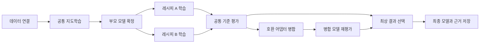

# 범용 학습 프로젝트와 자동 학습 그래프 — 설계 검토안

작성일: 2026-10-17 · 상태: 사용자 설계·구현 계획 승인 완료, 구현 진행

2026-10-19 사용자 범위 추가: RunPod 외에 BOP 같은 일반 GPU 서버를 사용한다.
사용자는 **SSH 접속 후 Linux 서버에서 직접 실행**하는 방식을 선택했다.
[일반 SSH 서버 확장 명세](2026-10-19-ssh-gpu-servers-extension.md)가 이 문서의 RunPod 전용 제약에 우선한다.

설계 승인: 2026-10-17 사용자 “진행해”. [구현 계획](../plans/2026-10-17-general-training-workflows.md)을 작성했다.

## 1. 사용자 목적과 결정

기존 논문 추출·실험노트·업무 분류 예제에 종속되지 않고, 목적과 입력 데이터를 바꿔 여러 텍스트 LLM 학습에 사용한다.
재사용 가능한 학습 레시피를 추가하고, 여러 학습을 직렬·병렬 연결하여 실행·평가·통합까지 자동으로 진행한다.
사용자는 통합 방식으로 **공통 평가 후 최상 모델 선택 + 호환 어댑터 병합**을 선택했다.
각자 Windows PC에서 관리하고 배정된 RunPod에서 학습하며 공용 MLflow에 기록하는 운영 방식을 유지한다.

완료 기준은 화면에서 새 목적의 프로젝트를 만들고 데이터 열을 연결한 뒤, 다단계 학습 계획을 저장·검사·실행하여
어떤 입력과 학습에서 최종 모델이 만들어졌는지 추적하고 같은 평가 기준으로 결과를 확인할 수 있는 것이다.
본 문서는 이 기능이 이미 구현되거나 GPU에서 검증되었다는 의미가 아니다.

## 2. 선택한 구조

기존 실행기 위에 프로젝트·불변 모델 산출물·학습 그래프와 지속 실행 컨트롤러를 추가한다.
기존 단일 학습 API와 Windows 0.3.0 설정은 계속 읽는다. 학습 엔진과 인프라 어댑터를 분리한다.

검토한 대안은 다음과 같다.

| 대안 | 판단 |
|---|---|
| 화면에서 여러 단일 학습 버튼만 순서대로 호출 | 작지만 모델 전달·재시작·중복 방지를 제공하지 못한다. |
| 기존 실행기 + PC 내부의 영속 그래프 컨트롤러 | 권장. 기존 검증과 운영 방식을 재사용하고 여러 배정 Pod를 지원한다. |
| 별도 중앙 워크플로 서버 도입 | 서버 운영과 사용자 접근 관리가 추가된다. 이번 변경에는 필요하지 않다. |

## 3. 범용 프로젝트·데이터·레시피

첫 화면의 기본 시작점은 **빈 프로젝트 만들기**이며 이름·목적·작업 유형을 자유롭게 입력한다.
예제 세 개는 선택 가능한 시작점으로 남긴다. 예제를 선택하지 않아도 모든 기본 흐름이 동작해야 한다.
화면은 프로젝트·실험·학습 단계로 표현하고, 기존 `ai_id`/`workflow_id` 값과 과거 MLflow 태그는 보존한다.
새 프로젝트의 실험을 기존 AIConfig로 내릴 때 `workflow_id`에는 프로젝트 ID를 연결한다.

데이터 마법사는 로컬 파일 또는 기존 S3 가져오기를 사용한다. CSV·JSON 배열·JSONL의 샘플과 열을 보여주고
instruction/input/output, text, chosen/rejected, kto_tag 또는 기존 대화 형식으로 연결한다.
기본 인코딩은 UTF-8이며 Windows CSV는 UTF-8 BOM/CP949를 명시적으로 선택할 수 있다.
원본 바이트는 PC에 보존하고 원본 해시·S3 버전·열 매핑·변환 버전을 기록한다.
미리보기와 전체 형식 검사 후 표준 데이터의 새 불변 버전을 등록한다. 원본 보존만으로 외부 전송을 허용하지 않는다.
모호한 불리언 값이나 빈 필수 열을 임의로 보정하지 않는다. 이미지·오디오·영상은 이번 범위에 포함하지 않는다.
첫 버전은 파일당 32 MiB를 유지하며 큰 파일은 이유와 한도를 표시한다.

선택적으로 train/validation/test를 비율과 seed로 분리한다. 같은 입력 또는 지정된 그룹 열은 같은 분할에 배치하며,
분할 seed·그룹 규칙·정확한 행 목록과 해시를 저장한다. 검증/시험 데이터는 학습 단계에 넘기지 않는다.
별도 파일의 평가 데이터도 지원하고 알려진 입력 중복은 실행 계획에서 차단한다.

**레시피 추가**는 PT/SFT/RM/PPO/DPO/KTO와 Full/Freeze/LoRA/QLoRA/OFT, 관련 옵션의 조합을
이름·설명·입력 종류·버전과 함께 저장·복제하는 기능이다. 기존의 검증된 설정 범위는 그대로 적용한다.
레시피는 데이터 버전·프로젝트 ID·Pod·인증값·전송 승인을 복사하지 않으며 적용 시 해당 프로젝트에서 연결한다.
새 알고리즘은 버전이 있는 엔진 기능 정의와 어댑터·잠금 의존성·검증을 추가해 확장한다.
화면에 임의 실행 명령이나 검증하지 않은 알고리즘 이름을 추가하는 방식은 제공하지 않는다.
새로운 특정 학습 알고리즘의 추가는 대상 알고리즘을 명시한 별도 기능 확장이다.

## 4. 학습 그래프와 실행

화면에서 단계 카드를 추가하고 각 단계의 데이터·입력 모델·앞 단계·레시피·실행 자원을 선택한다.
카드 연결을 그래프로 미리 보여주며 JSON이나 코드를 직접 작성할 필요가 없다.
기본 시작점은 단일 학습, 직렬 추가 학습, 병렬 비교, 병렬 비교 후 병합이다.

그래프는 `train`, `evaluate`, `select`, `merge`, `materialize` 노드와 모델·데이터·후보 집합의 형식화된 입출력을 가진다.
최대 64개 노드·256개 간선을 첫 제품 한도로 제안한다. 순환·중복 ID·없는 입력·잘못된 데이터 종류·지원하지 않는
모델/단계/방법·평가가 없는 자동 선택·병합 불가능 조합은 실행 전에 거절한다.
병합은 명시적으로 추가/선택하는 선택 단계이며, 항상 수행해야 하는 최종 단계로 강제하지 않는다.

정의와 실행을 구분한다. 그래프 정의는 부모 출력의 논리적 참조를 포함한 불변 버전이다.
각 자식은 부모가 완료되고 산출물 해시를 검증한 뒤 실제 입력을 고정한 별도 불변 실행 명세를 만든다.
실행 중인 명세를 새 부모 결과로 덮어쓰지 않는다. 완료 상태만으로 후속 실행을 허용하지 않고,
필요한 산출물 가용성·평가 조건·추적 저장 조건을 함께 확인한다.

## 5. 모델 전달과 병합

모델 산출물은 불변 inventory 해시, 생성 작업·시도·명세, 원본 HF 모델/commit, 실효 기반 모델 해시,
설정·토크나이저·어휘·특수 토큰·템플릿, 어댑터 방식, 실제 tensor 이름/shape/dtype을 가진다.
`latest`나 변경 가능한 output 경로를 입력으로 사용하지 않는다. 작업별 경로는 실행 시 해시로 검증한 캐시에 연결한다.
큰 가중치는 스트리밍 해시/전송하며 같은 Pod의 검증된 캐시는 재사용한다. 다른 Pod 전송은 승인된 목적지에 한한다.

직렬 학습은 새 데이터/방법으로 시작하는 새 학습이며, 같은 작업의 optimizer를 복구하는 체크포인트 재개와 구분한다.
부모 loader가 유지하는 모든 실효 설정(rank/target/variant/alpha·scaling/dropout/양자화 등)이 같은 LoRA만
이어서 학습한다. 기본값까지 해석한 자식 설정을 비교하고, 다르면 부모 설정을 조용히 덮어쓰지 않고 변환/새 방법을 요구한다.
호환되는 부모 어댑터는 trainable로 로드하고 새 optimizer를 시작한다.
방법 전환과 SFT→DPO/KTO 연결에서는 부모를 비양자화 기반 모델로 확정하고 요청한 자식 방법으로 학습을 시작한다.
자식 방법이 어댑터 방식이면 새 어댑터를 만들고, Full/Freeze이면 그 확정 가중치를 직접 갱신한다.
참조 정책도 그 확정 부모여야 한다. 단순히 SFT 어댑터를 DPO에 넣어 참조가 원본 모델로 돌아가는 연결은 허용하지 않는다.
Full/Freeze 부모는 완전한 가중치와 토크나이저 snapshot을 사용한다. OFT 등 전달/변환 미지원 경로는 사전에 차단한다.
PPO 보상 모델도 검증된 산출물 참조로 연결하되 기존 전용 runtime과 기반/토크나이저 일치 검사를 유지한다.

첫 다중 어댑터 병합은 PEFT의 결정적 `cat` 방식으로 한정한다. 입력은 서로 다른 실제 완료 산출물 2~4개이며,
양의 유한 가중치는 합 1로 정규화하고
합산 rank는 최대 256으로 제한한다. 숫자 한도는 upstream 제한이 아닌 제안하는 제품 한도다.
동일한 실효 기반 모델·토크나이저·확장된 target module과 기반 tensor 차원을 가진 보통 LoRA/QLoRA만 허용한다.
서로 다른 기반 가중치, OFT, value head가 있는 RM/PPO, DoRA/rsLoRA/PiSSA, bias/modules_to_save,
어휘 변경·rank/alpha pattern·parameter target·layer replication은 초기 자동 병합에서 제외한다.
다른 rank/alpha는 실제 scale과 shape 검사 후 허용한다. 병합 어댑터를 독립 산출물로 남긴다.

전체 모델 확정은 해당 어댑터의 정확히 고정된 **실효 비양자화 기반 가중치**에 병합한다.
실효 기반이 SFT 부모 snapshot이면 그 부모를 사용하며, 루트 HF 모델인 경우에만 원본 HF 가중치를 사용한다.
루트 가중치로 되돌아가 이전 단계의 업데이트를 잃지 않도록 검사하고 4/8-bit packed 가중치에 직접 덮어쓰지 않는다.
변환·병합·재평가의 추가 메모리·시간·전송도 계획에 포함한다. 저장 후 재로딩, 가중 델타 검산, 유한 tensor 검사와
고정 입력 logits 검사를 수행한다. 이는 수치 무결성 검사이며 품질 검증을 대신하지 않는다.

이 구분은 고정한 [LF 어댑터 로더](https://github.com/hiyouga/LLaMA-Factory/blob/v0.9.5/src/llamafactory/model/adapter.py),
[참조 정책 생성](https://github.com/hiyouga/LLaMA-Factory/blob/v0.9.5/src/llamafactory/train/trainer_utils.py),
[PEFT 병합 구현](https://github.com/huggingface/peft/blob/v0.18.1/src/peft/tuners/lora/model.py)을 확인해 정했다.
실제 새 직렬 연결·병합 동작은 이후 CPU 연산 시험과 잠금 GPU 환경에서 검증해야 한다.

## 6. 평가와 최상 결과 선택

사용자가 주 평가 지표와 최대화/최소화 방향, 최소 품질 기준을 선택한다.
비교에 사용하는 fingerprint는 평가 데이터/순서/샘플 수, 평가기 버전·코드, 생성 seed/길이/방식,
템플릿·토크나이저, 정밀도·양자화와 모델의 의미적 종류(생성 모델/보상 모델)를 포함한다.
어댑터/전체 모델이라는 저장 형태가 다른 것은 그 자체로 비교를 금지하지 않는다.
비교할 후보는 같은 추론 정밀도/양자화 조건으로 별도 평가한다.
공통 평가 조건을 실행 자원이 감당할 수 없으면 다른 조건의 점수를 대신 비교하지 않고 계획 오류를 표시한다.
학습 방식별 train_loss, 단순 실행 완료, JSON 형식 준수만을 자동으로 업무 품질이라고 취급하지 않는다.
기존 분류·추출·JSON·보상 평가와 일반 텍스트 정답 비교를 제공하되, 정답/평가 기준 없는 생성 품질은 미평가로 남긴다.
기존 기록은 새 비교 조건을 충족할 때만 재사용하고, 부족하면 같은 기준으로 재평가한다.

품질 기준을 통과한 유한 지표만 후보에 넣고 주 지표를 비교한다. 동점은 산출물 ID 사전순으로 결정한다.
기본 join은 요청한 모든 후보가 평가될 때까지 기다린다. 부분 성공 허용은 사용자가 명시하고 최소 성공 수 2를 충족해야 한다.
모든 후보가 탈락하면 최상 모델을 만들지 않고 이유를 표시한다. 합성/모의 실행은 실제 품질·배포 후보로 승격하지 않는다.
선택에 사용하지 않은 별도 test 데이터가 있으면 최종 결과를 추가 평가하고 선택용 결과와 구분한다.

병합 후보도 같은 기준으로 다시 평가한다. 기본 허용 퇴보는 0이며, 개별 최상 모델보다 나빠지면
병합 결과를 남기되 최종 선택은 기존 최상 모델로 유지한다. 자동 선택은 추천 결과 확정이며 서비스 배포를 수행하지 않는다.

## 7. 병렬 자원·복구·기록

기존에 배정된 여러 Pod를 실행 자원 프로필로 등록한다. 공용 API 인증과 프로필별 SSH 경로/서버 지문은
Windows 보안 설정에서 해석하고 그래프에는 프로필 ID만 보관한다. 실제 동시 실행은 서로 다른 Pod에서만 한다.
Pod 한 개이면 준비된 가지를 순서대로 처리한다. 동일 Pod의 여러 GPU를 작업별로 나누는 동시 실행은 이번 범위 밖이다.
기본 동시 실행 수는 1이며 계획에서 자원 수에 맞게 올린다. Pod를 생성·시작·정지·삭제하지 않는다.

SQLite에 그래프·노드·시도·입력/출력 참조·컨트롤러 heartbeat를 저장한다. 준비된 노드만 원자적으로 claim하고
자원에 맞지 않는 대기 노드가 다른 실행 가능한 노드를 막지 않게 한다. 요청 ID로 중복 제출을 막는다.
컨트롤러와 모든 작업 변경은 시도 ID/lease token으로 구분하며 오래된 프로세스의 완료·해제 요청을 거절한다.
제출과 노드 연결 사이 PC 종료도 같은 요청 ID로 복구한다. 일반 작업 실행기가 미해결 그래프 작업을 임의로 가져가지 않는다.

별도 백그라운드 컨트롤러가 화면과 독립적으로 후속 작업을 진행한다. 화면에서 동작 중/정지/연결 끊김을 표시한다.
일시정지는 새 단계 시작을 막고, 취소는 실행 중인 단계에 취소 요청을 전달한다. 원격 종료 확인 전 자원을 해제하지 않는다.
PC 종료·절전 중에는 새 단계가 시작되지 않으며 다시 앱을 열어 상태 확인과 컨트롤러 복구 후 이어간다.
재접속이 불확실한 원격 작업은 중복 실행하지 않는다. 완료된 부모 snapshot은 재개/재시도로 변경하지 않는다.

그래프 전체의 학습·평가·변환·병합·허용 재시도를 합한 최대 추정 비용, 동시 GPU 수와 실행 시간을 확인한다.
시작 승인은 그 고정 계획의 데이터·목적지·비용 범위에만 적용하고 변경 시 다시 계획한다. Pod 단위 총 시간당 요금을
명시하여 GPU 수를 중복 곱하지 않는다. 이는 provider 청구 강제 상한이 아니며 저장/idle 비용은 별도 표시한다.
현재 설계 작업은 유료 자원 사용이나 데이터 전송을 승인하지 않는다.

MLflow는 그래프 parent → 노드 → 시도로 연결하고 전체 정의·실행 명세·모델 계보·평가/선택 근거를 artifact로 남긴다.
학습 성공과 추적 저장 대기를 구분한다. MLflow 장애는 저장 outbox를 재시도하고 학습을 다시 하지 않는다.
등록은 산출물 해시/생성 시도로 중복 방지한다. 새 자식 dispatch는 필요한 증거의 저장 확인 후 진행한다.

## 8. 구현 경계와 인수 검증

새 모듈 책임은 프로젝트/레시피, 입력 매핑, 그래프 명세/저장소/컨트롤러, 모델 산출물, 병합 연산으로 나눈다.
`runner.py`, `jobs.py`, `manifest.py`, `training.py`, `worker.py`, `execution.py`의 기존 분리 구조를 확장한다.
`desktop.py`는 해당 서비스 호출만 하고 Windows UI에는 프로젝트·데이터 연결·그래프 편집·전체 실행 관리 화면을 추가한다.
구현 계획은 본 설계 확인 이후 파일·인터페이스·테스트 단위로 작성한다.

인수 시나리오는 아래와 같다.

1. 빈 프로젝트에서 CSV 질문/답 열을 연결해 등록하고 기존 예제 없이 단일 학습 계획을 만든다.
2. 학습 레시피 두 개를 저장·복제하고 데이터 종류/모델 호환성 오류를 실행 전에 설명한다.
3. SFT→DPO 직렬 연결의 실제 입력 모델·참조 모델이 같은 확정 부모를 가리키는지 검사한다.
4. 두 자원에서 diamond 그래프를 병렬 실행하고, 자원 하나에서는 자동 순차 실행한다.
5. 컨트롤러 중복·PC 재시작·오래된 완료 통지·취소와 join 경합에서도 작업/모델/청구 실행이 중복되지 않는다.
6. hash 변조·다른 기반 모델·토크나이저 변경·누락 shard·NaN·미지원 어댑터 병합을 차단한다.
7. 작은 합성 CPU 모델의 실제 LoRA delta 합과 병합/저장/재로딩 결과를 검산한다. 모의 학습 점수를 실제 품질로 내보내지 않는다.
8. 동일 benchmark의 max/min 선택, 결측 지표, 모든 후보 탈락, 동점, 병합 후 퇴보·최상 원본 유지가 맞게 동작한다.
9. MLflow 저장 실패를 복구하면서 학습을 반복하거나 모델 버전을 중복 등록하지 않는다.
10. Python 3.12 잠금 sync, 전체 pytest/Ruff, Windows UI/Rust, frozen package·실제 설치를 확인한다.

새 직렬 학습·복수 Pod 동시 학습·실제 가중치 병합/재평가는 별도의 유료 GPU 승인 후 확인할 인수 항목이다.
실제 검증과 미검증 항목은 `docs/PROGRESS.md`에 기록한다. 현재는 저장소/고정 upstream 소스 조사만 수행했다.

이번 범위는 텍스트 LLM, 단일 PC 컨트롤러, 기존 배정 Pod, 선택과 호환 LoRA 통합이다.
다중 PC 중앙 스케줄링, 범용 임의 코드 플러그인, 이종 모델 가중치 평균, 앙상블/증류, 멀티모달 학습,
무제한 스트리밍, 자동 서비스 배포는 별도 확장으로 남긴다.
